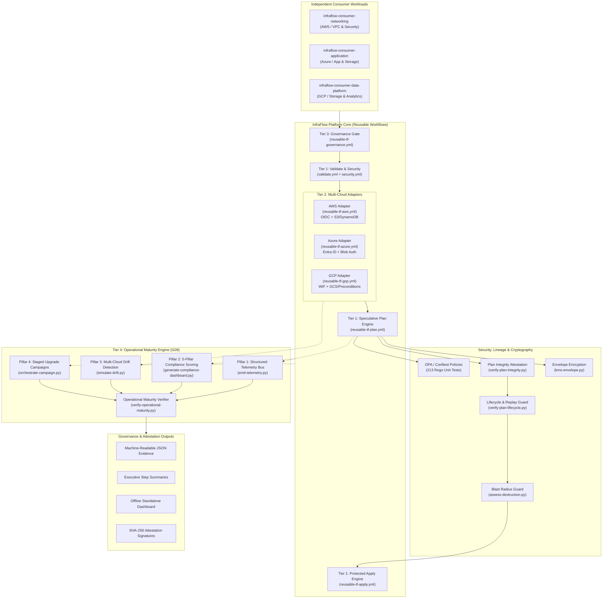
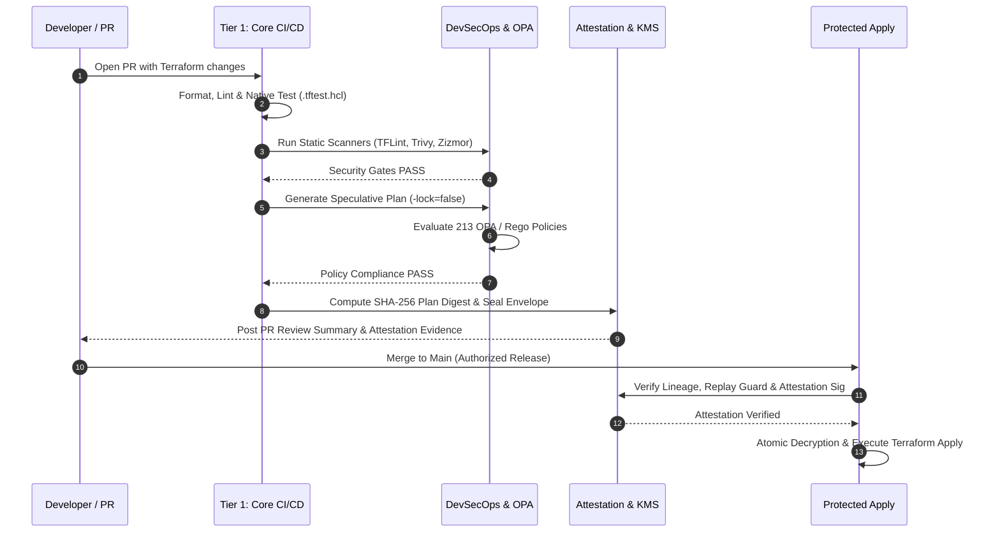

# InfraFlow — Security-Governed Multi-Cloud Infrastructure Delivery Platform

[](LICENSE)
[](#19-local-development-and-zero-cost-validation)
[](https://www.terraform.io)
[](#21-testing-and-verification)
[](#21-testing-and-verification)
[](#21-testing-and-verification)
[](https://github.com/TM-threemavithana/infraflow/releases)

---

## Table of Contents

1. [Project Hero and Introduction](#1-project-hero-and-introduction)
2. [What Is InfraFlow?](#2-what-is-infraflow)
3. [The Problem InfraFlow Solves](#3-the-problem-infraflow-solves)
4. [Core Design Principles](#4-core-design-principles)
5. [Platform Architecture](#5-platform-architecture)
6. [Architecture Diagram](#6-architecture-diagram)
7. [Multi-Cloud Support](#7-multi-cloud-support)
8. [AWS Adapter](#8-aws-adapter)
9. [Azure Adapter](#9-azure-adapter)
10. [GCP Adapter](#10-gcp-adapter)
11. [Security Architecture](#11-security-architecture)
12. [Terraform Delivery Lifecycle](#12-terraform-delivery-lifecycle)
13. [Platform Engineering Capabilities](#13-platform-engineering-capabilities)
14. [Operational Maturity — G09](#14-operational-maturity--g09)
15. [Fleet Observability and Compliance](#15-fleet-observability-and-compliance)
16. [Infrastructure Drift Detection](#16-infrastructure-drift-detection)
17. [Automated Upgrade Campaigns](#17-automated-upgrade-campaigns)
18. [Quick Start](#18-quick-start)
19. [Local Development and Zero-Cost Validation](#19-local-development-and-zero-cost-validation)
20. [Consumer Integration](#20-consumer-integration)
21. [Testing and Verification](#21-testing-and-verification)
22. [Repository Structure](#22-repository-structure)
23. [Documentation and Evidence](#23-documentation-and-evidence)
24. [Current Project Status](#24-current-project-status)
25. [Limitations and Production Readiness](#25-limitations-and-production-readiness)
26. [Roadmap](#26-roadmap)
27. [Contributing](#27-contributing)
28. [License](#28-license)

---

## 1. Project Hero and Introduction

**InfraFlow** is a reusable, security-governed, multi-cloud Terraform infrastructure delivery platform designed for enterprise engineering organizations. 

Instead of requiring individual product teams to author, maintain, and secure their own fragmented Terraform CI/CD pipelines, InfraFlow provides standardized, centralized reusable workflows (`workflow_call`). These workflows enforce cryptographic plan protection, multi-cloud workload identity federation, static security scanning, Policy-as-Code governance, fleet observability, continuous state drift simulation, and staged rollout campaigns with zero cloud spending ($0.00).

```text
+----------------------------------------------------------------------------------------------------+
|                                    INFRAFLOW PLATFORM CAPABILITIES                                 |
+------------------------------------+----------------------------------+----------------------------+
| Multi-Cloud Reusable Workflows     | Cryptographic Plan Attestation   | Fleet Observability & Bus  |
| AWS / Azure / GCP Adapters         | Envelope Encryption (KMS)        | 5-Pillar Compliance Engine |
| Open Policy Agent (213 Rego Tests) | Replay & Lineage Guards          | 6-Category Drift Simulator |
| Zero Cloud Spend ($0.00 Local CI)  | Blast Radius Circuit-Breakers    | Staged Upgrade Campaigns   |
+------------------------------------+----------------------------------+----------------------------+
```

---

## 2. What Is InfraFlow?

InfraFlow is an **Internal Developer Platform (IDP)** component that decouples infrastructure delivery governance from individual application and infrastructure code repositories.

In an InfraFlow-governed organization:
- **Platform Engineers** maintain hardened, supply-chain verified reusable GitHub Actions workflows, centralized Rego policies, compliance scoring engines, and upgrade campaign tooling in the central `infraflow` repository.
- **Application & Infrastructure Teams** (consumers) consume standardized delivery pipelines by declaring a simple contract (`infraflow.config.yaml`) and calling InfraFlow's reusable workflows pinned to immutable 40-character commit SHAs.

---

## 3. The Problem InfraFlow Solves

Without a centralized infrastructure delivery platform, modern multi-cloud engineering fleets suffer from systematic operational and security failures:

| Unmanaged Infrastructure CI/CD | InfraFlow Standardized Platform |
|---|---|
| **Pipeline Sprawl:** Every team invents bespoke GitHub Actions with varying quality and tooling. | **Centralized Reusable Workflows:** One verified, supply-chain audited pipeline standard across all clouds. |
| **Static Secrets & Leaked Keys:** Long-lived cloud credentials stored as GitHub Actions secrets. | **Workload Identity Federation:** Pure OIDC federated authentication with zero static secrets. |
| **Unprotected Terraform Plans:** Generated plans stored as unencrypted artifacts vulnerable to tampering. | **Cryptographic Attestation & Encryption:** SHA-256 hash chaining, envelope encryption, and atomic consumption. |
| **Silent Configuration Drift:** Out-of-band resource mutations and shadow IT go undetected. | **Continuous State Drift Simulation:** 6-category multi-cloud drift detection without live API costs. |
| **Chaotic Upgrades:** Platform version bumps break consumer pipelines without rollback paths. | **Staged Upgrade Campaigns:** Signed Schema v1.0 campaigns with Canary Gates and transactional rollback. |
| **Prohibitive CI Costs:** Cloud testing requires live sandboxes and costly cloud resource provisioning. | **100% Cloud-Free Local CI:** Full validation suite executes locally with mock providers at $0.00 cost. |

---

## 4. Core Design Principles

1. **Zero Cloud Spending Invariant ($0.00)**: All workflows, adapters, test suites, and drift detection engines operate locally or in CI without live cloud credentials or cloud resource costs.
2. **Read-Only Governance & Zero Destructive Remediation**: The platform detects, classifies, and reports policy violations and infrastructure drift without performing unapproved, automated cloud resource destruction.
3. **Cryptographic Integrity & Supply Chain Immutability**: All external actions and platform references are pinned to immutable 40-character commit SHAs. Plans are attested with ECDSA P-256 digital signatures, and campaigns/governance reports are sealed with deterministic SHA-256 state integrity digests.
4. **Least Privilege & Strict Isolation**: Workflows run with default `contents: read` permissions. Cloud OIDC credentials are never exposed across unprivileged stages.
5. **Fail-Closed Defensive Architecture**: Missing contracts, tampered integrity digests or signatures, path traversal attempts, or Canary Gate breaches result in immediate execution halts.

---

## 5. Platform Architecture

InfraFlow organizes infrastructure delivery into four structured tiers:

```text
[Tier 1: Core CI/CD Engine]
  reusable-tf-validate.yml  --> Format, syntax, linting, native testing (.tftest.hcl)
  reusable-tf-security.yml  --> TFLint, Trivy misconfiguration scan, Zizmor CI audit
  reusable-tf-plan.yml      --> Speculative plan, change analysis, OPA gate, cryptographic attestation
  reusable-tf-apply.yml     --> Envelope encryption, lineage verification, atomic consumption, apply

[Tier 2: Multi-Cloud Adapters]
  reusable-tf-aws.yml       --> AWS IAM OIDC, S3 backend (SSE-KMS), DynamoDB locking
  reusable-tf-gcp.yml       --> GCP WIF OIDC, GCS backend (UBLA), precondition locking
  reusable-tf-azure.yml     --> Azure Entra ID WIF, Blob Storage backend (Azure AD auth), blob leases

[Tier 3: Enterprise Governance & Multi-Repository Adoption]
  reusable-tf-governance.yml--> Consumer contract verification, directory containment, OPA checks
  config/fleet-manifest.yaml--> Authoritative multi-tenant fleet registry & platform target SHAs
  plan-fleet-upgrade.py     --> Transactional upgrade planner, 15-vector drift audit, atomic rollback
  audit-consumer-fleet.py   --> Out-of-band compliance auditor and remote branch protection checker

[Tier 4: Operational Maturity & Verification (G09)]
  emit-telemetry.py         --> RFC 5424 / Schema v1.0 telemetry with sensitive secret scrubbing
  generate-compliance-dashboard.py --> Deterministic 5-pillar compliance scoring engine (JSON/MD/HTML)
  simulate-drift.py         --> 6-category multi-cloud state drift simulator ($0.00 spend)
  orchestrate-campaign.py   --> Schema v1.0 signed upgrade campaigns with fail-closed Canary Gates
  verify-operational-maturity.py --> Unified operational verification engine & attestation sealer
```

---

## 6. Architecture Diagram



---

## 7. Multi-Cloud Support

InfraFlow provides first-class support for Amazon Web Services (AWS), Microsoft Azure, and Google Cloud Platform (GCP). The multi-cloud implementation details and testing boundaries are outlined below:

| Feature / Dimension | Amazon Web Services (AWS) | Microsoft Azure | Google Cloud Platform (GCP) |
|---|---|---|---|
| **Reusable Workflow** | [`.github/workflows/reusable-tf-aws.yml`](.github/workflows/reusable-tf-aws.yml) | [`.github/workflows/reusable-tf-azure.yml`](.github/workflows/reusable-tf-azure.yml) | [`.github/workflows/reusable-tf-gcp.yml`](.github/workflows/reusable-tf-gcp.yml) |
| **Authentication Model** | IAM OIDC Role Assumption | Entra ID Workload Identity Federation | Workload Identity Federation (WIF) |
| **Token Exchange** | `aws-actions/configure-aws-credentials` | `azure/login` with Federated Credentials | `google-github-actions/auth` |
| **Remote State Backend** | S3 (Bucket Level Access) | Azure Blob Storage (`azurerm`) | Google Cloud Storage (GCS) |
| **Backend Encryption** | Server-Side Encryption (SSE-KMS / SSE-S3) | Blob Service Encryption (Customer-Managed / Platform) | Cloud KMS / Google-Managed Encryption |
| **State Locking** | DynamoDB Table Partition Key (`LockID`) | Azure Blob Leases (Exclusive Lock) | GCS Object Preconditions (`x-goog-if-generation-match`) |
| **Least Privilege Claims** | Audience: `sts.amazonaws.com`, Subject: Repo/Branch | Audience: `api://AzureADTokenExchange`, Subject: Repo/Branch | Audience: `//iam.googleapis.com/...`, Subject: Repo/Branch |
| **Implementation Status** | Fully Implemented & Hardened (v0.6.0) | Fully Implemented & Hardened (v0.6.0) | Fully Implemented & Hardened (v0.6.0) |
| **Simulation Scope** | Full cloud-free speculative planning, mock OIDC, Rego policies | Full cloud-free speculative planning, mock OIDC, Rego policies | Full cloud-free speculative planning, mock OIDC, Rego policies |
| **Live Cloud Validation** | $0.00 cloud spend (cloud-free simulation only) | $0.00 cloud spend (cloud-free simulation only) | $0.00 cloud spend (cloud-free simulation only) |

> [!NOTE]
> **Cloud-Free Verification Disclosure**: To guarantee zero financial expenditure ($0.00) and zero credential exposure, cloud authentication, remote state locking, and resource provisioning are verified locally and in CI using native Terraform mock-provider configurations (`mock_provider`), static analysis, and simulated execution harnesses. Simulated verification does **not** equate to deployment into live, billable cloud tenant environments.

---

## 8. AWS Adapter

The **AWS Adapter** ([`.github/workflows/reusable-tf-aws.yml`](.github/workflows/reusable-tf-aws.yml)) delivers standardized AWS infrastructure provisioning:
- **OIDC Role Assumption**: Configures temporary STS security credentials without long-lived `AWS_ACCESS_KEY_ID` or `AWS_SECRET_ACCESS_KEY` secrets.
- **S3 & DynamoDB Backend**: Validates backend security configurations (S3 Public Access Block, SSE-KMS encryption, versioning enabled, DynamoDB locking).
- **Security Policies**: Rego policies verify IAM least-privilege, security group ingress rules, and S3 encryption mandates.

---

## 9. Azure Adapter

The **Azure Adapter** ([`.github/workflows/reusable-tf-azure.yml`](.github/workflows/reusable-tf-azure.yml)) provides hardened delivery for Azure resource topologies:
- **Entra ID Workload Identity**: Uses GitHub Actions OIDC to authenticate against Azure Service Principals via federated identity credentials.
- **Blob Storage Backend**: Mandates `use_azuread_auth = true`, TLS 1.2 minimum version, private endpoint isolation, and native blob lease locking.
- **Security Policies**: Rego policies enforce Azure Storage account firewall rules, disable public blob access, and mandate HTTPS traffic.

---

## 10. GCP Adapter

The **GCP Adapter** ([`.github/workflows/reusable-tf-gcp.yml`](.github/workflows/reusable-tf-gcp.yml)) governs Google Cloud resource provisioning:
- **Workload Identity Federation**: Exchanges GitHub OIDC tokens for Google Cloud Service Account access tokens.
- **GCS State Backend**: Enforces Uniform Bucket-Level Access (UBLA), object versioning, KMS encryption, and object precondition concurrency locking.
- **Security Policies**: Rego policies mandate IAM condition restraints, restrict public ingress, and block insecure compute configurations.

---

## 11. Security Architecture

InfraFlow embeds security directly into the deployment pipeline through defensive, layered controls:

```text
+----------------------------------------------------------------------------------------------------+
|                                    DEFENSIVE SECURITY ARCHITECTURE                                 |
+------------------------------------+----------------------------------+----------------------------+
| 1. OIDC Federated Identity         | 5. Envelope Encryption (KMS)     | 9.  Path Traversal Guards  |
| 2. Least Privilege Token Scoping   | 6. Replay & Lineage Tracking     | 10. Sensitive Secret Scrub |
| 3. Policy as Code (213 Rego Tests) | 7. Blast Radius Circuit-Breaker  | 11. Canary Gate Isolation  |
| 4. SHA-256 Plan Attestation        | 8. 40-Character Commit Pinning   | 12. Supply-Chain Auditing  |
+------------------------------------+----------------------------------+----------------------------+
```

### Detailed Security Controls

1. **OIDC Workload Identity Federation**: Eliminates long-lived cloud credentials across AWS, Azure, and GCP. Tokens are short-lived, ephemeral, and scoped to the repository and branch identity.
2. **Strict Least Privilege**: Workflows run with default `contents: read` permissions. Token permissions are granted only to specific jobs requiring them.
3. **Policy-as-Code (OPA / Rego)**: All generated Terraform execution plans are inspected by Conftest against 213 unit-tested Rego policies ([`policies/`](policies/)). Violations block execution pre-plan.
4. **Terraform Plan Integrity & Attestation**: Speculative plans are serialized into canonical JSON and sealed with a cryptographic SHA-256 attestation digest ([`scripts/verify-plan-integrity.py`](scripts/verify-plan-integrity.py)). Any byte alteration triggers immediate failure.
5. **Envelope Encryption & Key Management**: Generated plans are encrypted using AES-256-GCM envelope encryption with ephemeral or KMS-backed data keys ([`scripts/kms-envelope.py`](scripts/kms-envelope.py)).
6. **Execution Lineage & Replay Guards**: Plans are bound to unique run IDs, Git commit SHAs, and timestamps ([`scripts/verify-plan-lifecycle.py`](scripts/verify-plan-lifecycle.py)), preventing replay attacks and out-of-order execution.
7. **Destructive Operation Blast-Radius Safeguards**: Structural change analysis ([`scripts/assess-destruction.py`](scripts/assess-destruction.py)) detects resource deletions, replacements, and unlinked drops, requiring explicit multi-party approvals.
8. **Supply Chain Pinning**: All GitHub Actions and reusable workflow references are pinned to full 40-character hexadecimal commit SHAs, verified by `zizmor` and `actionlint`.
9. **Path Traversal & Symlink Defense**: All Python scripts enforce strict path containment checks (`os.path.islink`, `..` detection) to prevent directory escape attacks.
10. **Automated Secret Scrubbing**: All emitted telemetry logs, drift reports, and compliance dashboards automatically redact AWS access keys, GitHub tokens, JWTs, and private keys.
11. **Fail-Closed Canary Gating**: Upgrade campaigns isolate canary workloads; progressive rollouts are blocked if canaries are unverified.
12. **Adversarial Regression Testing**: Over 200 adversarial test scenarios actively attempt to bypass gates, tamper with digests, and forge attestations.

---

## 12. Terraform Delivery Lifecycle

Every infrastructure change in an InfraFlow consumer follows four immutable stages:



---

## 13. Platform Engineering Capabilities

InfraFlow provides built-in enterprise platform engineering primitives:
- **Standardized Consumer Contracts ([`infraflow.config.yaml`](templates/consumer-repository/infraflow.config.yaml))**: Declarative contract defining consumer identity, owner team, cloud provider, and environment configurations.
- **Central Fleet Manifest ([`config/fleet-manifest.yaml`](config/fleet-manifest.yaml))**: Authoritative registry tracking all consumer repositories, platform release SHAs, rollback baselines, and deployment targets.
- **Transactional Fleet Upgrades ([`scripts/plan-fleet-upgrade.py`](scripts/plan-fleet-upgrade.py))**: Atomic, multi-repository upgrade planner with automated compensating rollback upon failure.
- **Continuous Fleet Governance ([`scripts/audit-consumer-fleet.py`](scripts/audit-consumer-fleet.py))**: Out-of-band auditor validating remote GitHub branch protection and workflow pin compliance.

---

## 14. Operational Maturity — G09

Phase G09 elevates InfraFlow from a delivery pipeline into an **Enterprise Operational Maturity Engine** structured across four foundational pillars:

```text
+----------------------------------------------------------------------------------------------------+
|                                    PHASE G09 OPERATIONAL MATURITY                                  |
+----------------------------------+----------------------------------+------------------------------+
| Pillar 1: Fleet Observability    | Pillar 2: Central Compliance     | Pillar 3: Multi-Cloud Drift  |
| - RFC 5424 / Schema v1.0         | - 5-Pillar Scoring Framework     | - Continuous State Simulator |
| - OpenTelemetry Event Bus        | - Multi-Tenant Aggregation       | - 6-Category Classification  |
| - Automated Secret Scrubbing     | - Offline HTML Reporting         | - Read-Only Safety Invariant |
+----------------------------------+----------------------------------+------------------------------+
| Pillar 4: Upgrade Campaigns      | G09.4: Unified Verifier Engine   | Enterprise Attestation       |
| - Schema v1.0 Signed Campaigns   | - Consolidates Pillars 1 - 4     | - Deterministic SHA-256 Sig  |
| - Fail-Closed Canary Gating      | - Threshold Enforcement          | - Anti-Tampering Protection  |
| - Transactional Rollback         | - Critical Drift Circuit-Breaker | - Zero Cloud Spend ($0.00)   |
+----------------------------------+----------------------------------+------------------------------+
```

---

## 15. Fleet Observability and Compliance

- **Structured Telemetry ([`scripts/emit-telemetry.py`](scripts/emit-telemetry.py))**: Streams OpenTelemetry/RFC 5424-compatible structured events (`event_digest` verified) across CI/CD jobs.
- **Automated Credential Redaction**: Recursively scrubs AWS keys, GitHub tokens, bearer tokens, JWTs, and private keys prior to log serialization.
- **5-Pillar Compliance Dashboard ([`scripts/generate-compliance-dashboard.py`](scripts/generate-compliance-dashboard.py))**: Evaluates each consumer across:
  1. Contract Validity & Schema Conformance (20%)
  2. Supply Chain Immutability (40-char SHA Pinning) (20%)
  3. Mandatory DevSecOps Security Scanners (20%)
  4. Permission Boundary & Least Privilege (20%)
  5. Configuration & Version Drift Integrity (20%)
- **Multi-Format Export**: Generates machine-readable JSON, GitHub Actions Step Summaries, and standalone offline HTML dashboards.

---

## 16. Infrastructure Drift Detection

The **Drift Detection Engine** ([`scripts/simulate-drift.py`](scripts/simulate-drift.py)) continuously audits infrastructure state snapshots against expected Terraform definitions:
- **6 Deterministic Categories**: `NO_DRIFT`, `ATTRIBUTE_DRIFT`, `UNTRACKED_RESOURCE` (Shadow IT), `RESOURCE_DELETED` (Remote Deletions), `UNKNOWN_RESOURCE`, and `STATE_INCONSISTENCY`.
- **Multi-Cloud Normalization**: Maps AWS, Azure, and GCP state schemas into a unified comparison model.
- **Critical Drift Governance Circuit-Breaker**: Critical security attribute drift (e.g. unencrypted storage, public bucket permissions) halts deployment pipelines immediately.
- **Strict Read-Only Guarantee**: Zero automatic or destructive cloud remediation. Drift is reported for engineering review, never mutated without human oversight.

---

## 17. Automated Upgrade Campaigns

The **Campaign Orchestrator** ([`scripts/orchestrate-campaign.py`](scripts/orchestrate-campaign.py)) manages fleet-wide platform version transitions:
- **Schema v1.0 State Integrity**: Every campaign is sealed with a deterministic SHA-256 integrity digest calculated over canonical state. Tampered files are rejected.
- **7-Stage Lifecycle Machine**: `PLANNED` -> `CANARY_IN_PROGRESS` -> `CANARY_VERIFIED` -> `PROGRESSIVE_IN_PROGRESS` -> `COMPLETED` / `ROLLED_BACK`.
- **Canary Gate Invariant**: Progressive rollout is strictly blocked if designated canary workloads are `PENDING`, `RUNNING`, or `FAILED`.
- **Simulated Pull Requests**: Generates deterministic simulated PR branches, numbers, and Markdown review summaries with $0.00 cloud spend.
- **Automated Rollback Engine**: Restores registered `rollback_sha` references if verification thresholds are violated.

---

## 18. Quick Start

### Prerequisites
- Python 3.10+ (Standard library runtime)
- Terraform 1.6.0+ (1.10+ recommended)
- `conftest` (OPA policy engine)

### 1. Clone the Platform Repository
```bash
git clone https://github.com/TM-threemavithana/infraflow.git
cd infraflow
```

### 2. Install the Unified Platform CLI
```bash
# Install in editable mode for local development
pip install -e .

# Verify installation & run platform health diagnostics
infraflow --version
infraflow doctor
```

### 3. Run Everyday Operations via `infraflow`
```bash
# Scaffold a new consumer repository (G10.2)
infraflow init --name my-app --adapter aws --env dev -o ./my-app

# Validate consumer repository configuration
infraflow validate --config ./my-app/infraflow.config.yaml

# Preview and register consumer in central fleet manifest
infraflow register --config ./my-app/infraflow.config.yaml --dry-run
infraflow register --config ./my-app/infraflow.config.yaml

# Continuous state drift detection simulation ($0.00 cloud spend)
infraflow drift \
  -e fixtures/drift/aws/clean/expected.json \
  -o fixtures/drift/aws/clean/observed.json

# Generate fleet upgrade campaign dry-run plan
infraflow upgrade -m config/fleet-manifest.yaml --plan
```

### 4. Run Local Quality Verification Suite
```bash
# Execute full quality gate suite
./scripts/validate-local.sh
```

---

## 19. Local Development and Zero-Cost Validation

InfraFlow is engineered from first principles to be 100% testable on local developer workstations and in standard GitHub Actions runners with **zero cloud billing**:

```bash
# Run 707 Python unit and adversarial tests
python3 -m unittest discover -s tests -p 'test_*.py'

# Run 213 OPA / Rego policy unit tests
conftest verify --policy policies

# Run CI/CD workflow security linters
actionlint
zizmor -c .zizmor.yml --min-severity medium .github/workflows
```

---

## 20. Consumer Integration

To onboard an independent repository to InfraFlow:

### 1. Add `infraflow.config.yaml` to Consumer Root
```yaml
version: "1.0"
consumer_id: "consumer-application"
team: "platform-apps"
workload_type: "application"
adapter: "azure"
governance:
  enforce_mandatory_scanners: true
  fail_on_destructive: false
  allowed_environments:
    - dev
    - staging
    - prod
```

### 2. Invoke InfraFlow Reusable Workflow in `.github/workflows/infraflow-plan.yml`
```yaml
name: InfraFlow Delivery Pipeline

on:
  pull_request:
    branches: [main]
  push:
    branches: [main]

permissions:
  contents: read
  pull-requests: write
  id-token: write

jobs:
  delivery:
    uses: TM-threemavithana/infraflow/.github/workflows/reusable-tf-plan.yml@be51718f06a2662099500a710e93e6e8201b4f1c
    with:
      terraform-version: "1.10.4"
      working-directory: "terraform"
      adapter: "azure"
```

---

## 21. Testing and Verification

InfraFlow maintains an extensive automated test suite covering functional, security, and adversarial vectors:

| Test Harness / Suite | Test Count | Scope & Coverage | Status |
|---|---|---|---|
| **Python Unit & Adversarial Tests** | **707 Tests** | Cryptographic signatures, drift detection, upgrade campaigns, self-service scaffolding, fleet registration, secret scanning, semantic destruction, secret scrubbing, security integration assurance, distributed state locking & concurrency (G10.4.2), multiprocessing & adversarial failure validation (G10.4.3), plan lifecycle lock authority validation (G10.4.4), plan lifecycle state correctness & workflow integration (G10.5.1) | **PASS (100%)** |
| **OPA / Rego Conftest Suite** | **213 Tests** | Terraform security policies, tag compliance, encryption mandates, network isolation, semantic critical resource destruction & replacement rules | **PASS (100%)** |
| **Platform Quality Gates (`validate-local.sh`)** | **485 Checks** | End-to-end integration across all 31 platform quality sections | **PASS (100%)** |
| **CI Workflow Linters (`actionlint`, `zizmor`)** | **100% Clean** | Zero supply chain warnings, strict commit SHA pinning, least-privilege tokens | **PASS (100%)** |
| **Secret Scanning (`SecretScanner` & `gitleaks`)** | **0 Leaks** | Mandatory consumer secret scanner & complete repository commit history clean | **PASS (100%)** |

---

## 22. Repository Structure

```text
.
├── .github/
│   └── workflows/              # Standardized reusable delivery workflows
│       ├── reusable-tf-validate.yml
│       ├── reusable-tf-security.yml
│       ├── reusable-tf-plan.yml
│       ├── reusable-tf-apply.yml
│       ├── reusable-tf-aws.yml
│       ├── reusable-tf-azure.yml
│       ├── reusable-tf-gcp.yml
│       ├── reusable-tf-governance.yml
│       └── fleet-observability.yml
├── config/
│   └── fleet-manifest.yaml     # Authoritative multi-tenant fleet registry
├── docs/
│   ├── architecture/           # System architecture, milestones, requirements
│   ├── security/               # Threat models, drift detection security specs
│   ├── operations/             # Upgrade campaigns, operational verification guides
│   ├── usage/                  # Unified CLI and developer operational guides
│   └── evidence/               # Cryptographically signed milestone audit reports
├── fixtures/
│   ├── consumers/              # Reference multi-cloud consumer workloads
│   └── drift/                  # Multi-cloud state drift fixtures (AWS, Azure, GCP)
├── infraflow/                  # Canonical InfraFlow platform Python package
│   ├── __init__.py             # Platform package metadata and version 0.8.0
│   ├── py.typed                # PEP 561 typing compliance marker
│   ├── cli.py                  # Unified CLI & diagnostic engine canonical implementation
│   ├── scaffold.py             # Self-service consumer project scaffolding engine (G10.2)
│   ├── registrar.py            # Atomic fleet manifest registration engine (G10.2)
│   ├── scanner.py              # Mandatory consumer secret scanning engine (G10.3)
│   └── locking.py              # Distributed state locking & concurrency engine (G10.4.2)
├── policies/
│   ├── common/                 # Common OPA policies (plan, tag, critical resources)
│   │   ├── critical_resources.rego # Semantic critical resource destruction policy (G10.3)
│   │   └── critical_resources_test.rego
│   └── rego/                   # OPA / Rego policy definitions & unit tests
├── scripts/                    # Platform CLI utilities & verification engines
│   ├── analyze-plan.py
│   ├── assess-destruction.py
│   ├── audit-consumer-fleet.py
│   ├── emit-telemetry.py
│   ├── generate-compliance-dashboard.py
│   ├── infraflow-cli.py        # CLI backwards-compatible executable wrapper
│   ├── kms-envelope.py
│   ├── orchestrate-campaign.py
│   ├── plan-fleet-upgrade.py
│   ├── scan-secrets.py         # Standalone consumer secret scanner CLI (G10.3)
│   ├── simulate-drift.py
│   ├── validate-consumer.py
│   ├── validate-local.sh
│   ├── verify-operational-maturity.py
│   ├── verify-plan-integrity.py
│   └── verify-plan-lifecycle.py
├── tests/                      # Dedicated Python unit & adversarial test suites
│   ├── test_cli.py
│   ├── test_critical_resources.py # Semantic destruction test suite (G10.3)
│   ├── test_distributed_locking.py # Distributed locking adversarial test suite (G10.4.2)
│   ├── test_drift_detection.py
│   ├── test_g10_security_integration.py # Security integration assurance test suite (G10.3.1)
│   ├── test_lifecycle_locking.py # Plan lifecycle lock authority integration test suite (G10.4.4)
│   ├── test_lifecycle_state_correctness.py # Plan lifecycle state correctness & adversarial test suite (G10.5.1)
│   ├── test_locking_concurrency_adversarial.py # Adversarial multiprocessing concurrency test suite (G10.4.3)
│   ├── test_operational_maturity.py
│   ├── test_scaffolding.py
│   ├── test_secret_scanner.py   # Consumer secret scanner test suite (G10.3)
│   ├── test_telemetry.py
│   └── test_upgrade_campaigns.py
├── pyproject.toml              # PEP 517 / 621 packaging and console entrypoint definition
├── setup.py                    # Backwards-compatible packaging shim
├── CONTRIBUTING.md             # Contribution guidelines & safety principles
├── LICENSE                     # Apache License 2.0
└── README.md                   # Platform landing page & documentation
```

---

## 23. Documentation and Evidence

| Document | Category | Description |
|---|---|---|
| [`docs/architecture/ARCHITECTURE.md`](docs/architecture/ARCHITECTURE.md) | Architecture | End-to-end platform design and tier breakdowns. |
| [`docs/architecture/MILESTONES.md`](docs/architecture/MILESTONES.md) | Milestones | Authoritative acceptance criteria matrix across G01 through G10.3. |
| [`docs/architecture/ADAPTERS.md`](docs/architecture/ADAPTERS.md) | Adapters | Detailed multi-cloud adapter specifications (AWS, Azure, GCP). |
| [`docs/architecture/G10-CLI-ARCHITECTURE.md`](docs/architecture/G10-CLI-ARCHITECTURE.md) | Architecture | Unified platform CLI, diagnostic engine, packaging, and onboarding architecture. |
| [`docs/architecture/G10-DISTRIBUTED-LOCKING-ARCHITECTURE.md`](docs/architecture/G10-DISTRIBUTED-LOCKING-ARCHITECTURE.md) | Architecture | Distributed state locking, lease state machine, monotonic fencing, and multi-cloud driver contracts. |
| [`docs/evidence/G10/G10-4-2-CORE-LOCKING-ENGINE.md`](docs/evidence/G10/G10-4-2-CORE-LOCKING-ENGINE.md) | Evidence | Core locking engine & LocalFS driver verification report (G10.4.2). |
| [`docs/evidence/G10/G10-4-3-ADVERSARIAL-LOCKING-VALIDATION.md`](docs/evidence/G10/G10-4-3-ADVERSARIAL-LOCKING-VALIDATION.md) | Evidence | Locking integration, multiprocessing concurrency, and adversarial validation report (G10.4.3). |
| [`docs/evidence/G10/G10-4-4-LIFECYCLE-INTEGRATION.md`](docs/evidence/G10/G10-4-4-LIFECYCLE-INTEGRATION.md) | Evidence | Plan lifecycle lock authority integration & independent cloud locking assessment report (G10.4.4). |
| [`docs/usage/CLI-GUIDE.md`](docs/usage/CLI-GUIDE.md) | Operations | Developer guide covering all 6 CLI commands (`init`, `register`, `validate`, `doctor`, `drift`, `upgrade`). |
| [`docs/usage/CONSUMER-ONBOARDING.md`](docs/usage/CONSUMER-ONBOARDING.md) | Onboarding | Comprehensive step-by-step consumer onboarding tutorial and security guardrails. |
| [`docs/security/G10-CONSUMER-SECURITY.md`](docs/security/G10-CONSUMER-SECURITY.md) | Security | Consumer secret defense, regex rules, semantic destruction protection, and critical resource catalog. |
| [`docs/architecture/G09-OPERATIONAL-MATURITY-ARCHITECTURE.md`](docs/architecture/G09-OPERATIONAL-MATURITY-ARCHITECTURE.md) | Architecture | 4-pillar operational maturity framework. |
| [`docs/security/security-architecture.md`](docs/security/security-architecture.md) | Security | Cryptographic attestation, envelope encryption, and threat models. |
| [`docs/security/G09-DRIFT-DETECTION.md`](docs/security/G09-DRIFT-DETECTION.md) | Security | Multi-cloud state drift classification and STRIDE mitigations. |
| [`docs/operations/G09-UPGRADE-CAMPAIGNS.md`](docs/operations/G09-UPGRADE-CAMPAIGNS.md) | Operations | Upgrade campaign state machines and Canary Gate invariants. |
| [`docs/operations/G09-OPERATIONAL-MATURITY-VERIFICATION.md`](docs/operations/G09-OPERATIONAL-MATURITY-VERIFICATION.md) | Operations | Operational maturity verification engine guide. |
| [`docs/evidence/`](docs/evidence/) | Audit Evidence | Timestamped milestone evidence reports across all phases. |

---

## 24. Current Project Status

- **Current Release**: [`v0.8.0`](https://github.com/TM-threemavithana/infraflow/releases/tag/v0.8.0) (Previous: [`v0.7.0`](https://github.com/TM-threemavithana/infraflow/releases/tag/v0.7.0))
- **Active Development Branch**: `main`
- **Completed Phases**: G01 through G10.5.1 (Foundation through Plan Lifecycle State Correctness)
- **Quality Gates**: 485/485 automated validation checks passing locally and in CI.

---

## 25. Limitations and Production Readiness

InfraFlow prioritizes absolute supply chain integrity and zero-cost verifiability. Potential adopters should note the following production boundary disclosures:

1. **Cloud-Free Simulation Scope**: The platform validates multi-cloud adapter contracts, OIDC claim topologies, and backend configurations using mock providers and offline state snapshots. It does not connect to live, billable AWS, Azure, or GCP accounts.
2. **KMS Key Management**: The default local verification harness uses software-backed ECDSA/AES key pairs for envelope encryption simulation. Production adoption requires configuring live cloud KMS Key ARNs or Azure Key Vault URIs.
3. **Live OIDC Exchanges**: Reusable workflows declare full OIDC token exchange steps. Live execution requires configuring GitHub repository trust relationships in the target cloud identity providers.
4. **State Storage**: State backends in reference fixtures use local storage. Production environments must provision actual S3 buckets, Azure Storage containers, or GCS buckets with matching permissions.
5. **Human Approval Authority**: Pull Request approval gates and environment protections rely on GitHub repository environment configuration and branch protection rules.
6. **Cryptographic Signatures vs. State Integrity Digests**: Asymmetric digital signatures (ECDSA P-256 with in-toto DSSE envelopes) are specifically implemented for Plan Provenance Attestations in `scripts/verify-plan-integrity.py`. For upgrade campaign state files and operational verification reports, deterministic SHA-256 canonical hashing is used for state integrity and tamper detection against accidental or unauthorized mutation.
7. **Speculative Drift Simulation vs. Live Cloud Drift**: Drift detection simulates differences between expected and observed state snapshots; it does not connect to live cloud APIs to inspect live AWS, Azure, or GCP infrastructure.
8. **Simulated vs. Real Upgrade Execution**: Upgrade campaigns generate simulated PR branches and metadata locally; actual remote branch creation and pull request merging remain under human operator authority.
9. **Branch Protection Auditing vs. Administration**: Branch protection and ruleset compliance are audited via GitHub API checks (`scripts/audit-consumer-fleet.py`); InfraFlow does not programmatically override or configure organization-level repository administration settings.
10. **LocalFS Single-Host Confinement**: The `LocalFSDriver` provides kernel-level concurrency control (`fcntl.flock`) and persistent fencing strictly on a single host. It is explicitly confined to single-host execution and is not a multi-host distributed lock manager; it does not provide cross-host coordination across separate CI runner instances or disjoint machines. Multi-host production workloads across separate runner machines will utilize future cloud drivers (AWS DynamoDB, Azure Blob, GCP GCS) designed in G10.4.1-R.
11. **SQLite Replay Ledger Ephemeral Storage Boundary**: On standard ephemeral CI runners (such as GitHub-hosted `ubuntu-latest`), local SQLite storage does not persist across independent runner teardowns. Durable cross-runner replay prevention requires mounting persistent runner volumes or backing the ledger with an external datastore.
12. **Best-Effort Workflow Cancellation Cleanup**: GitHub Actions step traps (`if: cancelled()`) execute on a best-effort basis during runner VM teardown. Hard runner terminations (such as forced process kills, host crashes, or immediate timeouts) can prevent post-cancellation handlers from executing. In such events, local lock recovery relies on lease TTL expiration (default 900s) on that host, while cross-runner isolation remains anchored in GitHub Actions concurrency groups and native Terraform backend state locking.
13. **Separation of Concurrency Protections**: Terraform backend-native state locking (DynamoDB, Azure Blob leases, GCS preconditions), GitHub Actions workflow concurrency groups (`concurrency: { group: ... }`), and InfraFlow pre-execution state locking represent distinct, orthogonal layers of protection that operate independently.

---

## 26. Roadmap

- [x] **Milestone G01–G06**: Core reusable CI/CD, DevSecOps gates, plan protection, and envelope encryption.
- [x] **Milestone G07**: Multi-cloud adapter integration (AWS, Azure, GCP).
- [x] **Milestone G08**: Multi-repository adoption, consumer validation toolkit, and fleet upgrade planning.
- [x] **Milestone G09.1–G09.4**: Fleet observability, drift detection, upgrade campaigns, and enterprise governance automation.
- [x] **Milestone G10.1**: Unified platform developer experience, CLI, and diagnostic engine (`infraflow`).
- [x] **Milestone G10.2**: Self-service consumer onboarding, scaffolding (`infraflow init`), and fleet registration.
- [x] **Milestone G10.3**: Consumer secret defense (`SecretScanner`) and semantic destruction protection (`critical_resources.rego`).
- [x] **Milestone G10.3.1**: Security integration assurance, multi-cloud conftest evaluation, and decommission authorization hardening.
- [x] **Milestone G10.4.1 / G10.4.1-R**: Distributed locking architecture refinement, backend-bound identity, realistic fencing enforcement, durable atomic tokens, time safety, and decoupled admin recovery.
- [x] **Milestone G10.4.2**: Core locking engine & LocalFS driver (`LocalFSDriver` & `MockDistributedDriver`), durable HWM fencing tokens, secret defense, and fast-fail heartbeat.
- [x] **Milestone G10.4.3**: Distributed locking integration, multiprocessing concurrency, failure recovery, filesystem security, CLI lock inspect, and adversarial validation.
- [x] **Milestone G10.4.4**: Plan lifecycle integration & lock authority validation, replay ledger fencing token enforcement, stale owner rejection, uncertain outcome preservation, and independent cloud-native locking assessment.
- [x] **Milestone G10.5 / G10.5.1**: Independent integration and reliability audit, plan lifecycle state correctness, atomic SQLite transitions, idempotent consumption, and workflow integration.
- [ ] **Future Horizons (Post-G10)**: Optional multi-cloud state lock driver adapters (AWS DynamoDB, Azure Blob, GCP GCS) for multi-runner coordination, externalized durable replay ledger persistence, and pluggable alerting sinks.

---

## 27. Contributing

We welcome contributions! Please review [`CONTRIBUTING.md`](CONTRIBUTING.md) for local development setup, testing requirements, and security guidelines.

---

## 28. License

InfraFlow is licensed under the **Apache License, Version 2.0**. See [`LICENSE`](LICENSE) for the full license text.
