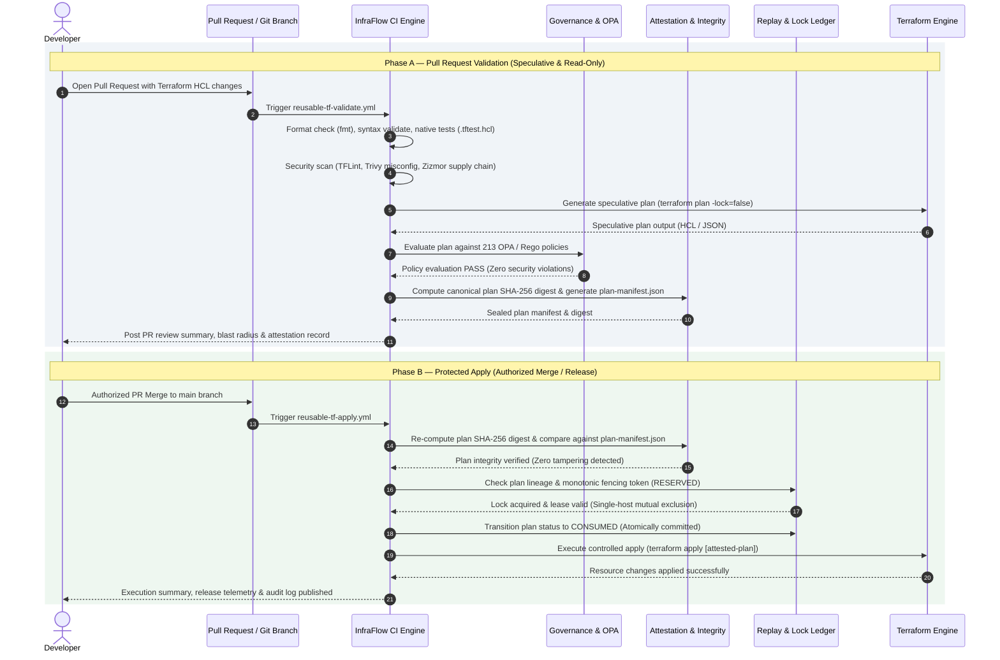

# InfraFlow — Security-Governed Multi-Cloud Infrastructure Delivery Platform

[](LICENSE)
[](#16-local-development-and-zero-cost-validation)
[](https://www.terraform.io)
[](#17-testing-verification--quality-gates)
[](#17-testing-verification--quality-gates)
[](#17-testing-verification--quality-gates)
[](https://github.com/TM-threemavithana/infraflow/releases)

---

## Table of Contents

1. [Project Overview](#1-project-overview)
2. [What Is InfraFlow?](#2-what-is-infraflow)
3. [The Problem InfraFlow Solves](#3-the-problem-infraflow-solves)
4. [Core Design Principles](#4-core-design-principles)
5. [High-Level Platform Architecture](#5-high-level-platform-architecture)
6. [Multi-Cloud Support & Cloud Adapters](#6-multi-cloud-support--cloud-adapters)
7. [Security & Governance Architecture](#7-security--governance-architecture)
8. [Terraform Delivery Lifecycle](#8-terraform-delivery-lifecycle)
9. [Platform Engineering & Developer Experience](#9-platform-engineering--developer-experience)
10. [Distributed State Locking & Fencing Engine](#10-distributed-state-locking--fencing-engine)
11. [Fleet Observability & Compliance](#11-fleet-observability--compliance)
12. [Continuous State Drift Detection](#12-continuous-state-drift-detection)
13. [Automated Upgrade Campaigns](#13-automated-upgrade-campaigns)
14. [Quick Start Guide](#14-quick-start-guide)
15. [Consumer Repository Integration Guide](#15-consumer-repository-integration-guide)
16. [Local Development and Zero-Cost Validation](#16-local-development-and-zero-cost-validation)
17. [Testing, Verification & Quality Gates](#17-testing-verification--quality-gates)
18. [Repository Structure](#18-repository-structure)
19. [Documentation and Evidence Reference](#19-documentation-and-evidence-reference)
20. [Project Status & Release Information](#20-project-status--release-information)
21. [Architectural Scope & Boundary Disclosures](#21-architectural-scope--boundary-disclosures)
22. [Roadmap](#22-roadmap)
23. [Contributing](#23-contributing)
24. [License](#24-license)

---

## 1. Project Overview

**InfraFlow** is a security-governed infrastructure delivery platform and Internal Developer Platform (IDP) component built on centralized, supply-chain-hardened GitHub Actions reusable workflows (`workflow_call`).

Instead of requiring individual application and platform engineering teams to maintain fragmented, unvetted Terraform pipelines, InfraFlow centralizes delivery governance:
- **Zero Live Cloud Spend ($0.00):** Comprehensive end-to-end testing, policy enforcement, and drift simulation execute without billable cloud infrastructure or live credentials.
- **Multi-Cloud Workload Identity:** Short-lived federated OpenID Connect (OIDC) authentication models for AWS, Azure, and Google Cloud with zero static API keys.
- **Cryptographic Plan Integrity:** Canonical plan serialization, SHA-256 tamper-evident integrity digests, and in-toto DSSE attestation support.
- **Policy as Code Enforcement:** 213 unit-tested Open Policy Agent (OPA) / Rego rules inspecting infrastructure plans prior to execution.
- **State Locking & Fencing Tokens:** Single-host POSIX kernel locking (`fcntl.flock`), 64-bit strictly monotonic high-water mark fencing tokens, and ACID SQLite plan replay protection.
- **Fleet Governance & Observability:** Centralized multi-repository fleet manifest, continuous state drift simulation, RFC 5424 / OpenTelemetry structured logging, and automated staged upgrade campaigns with Canary Gates.

```text
+----------------------------------------------------------------------------------------------------+
|                                    INFRAFLOW PLATFORM CAPABILITIES                                 |
+------------------------------------+----------------------------------+----------------------------+
| Multi-Cloud Reusable Workflows     | Canonical Plan Attestation       | Fleet Observability & Bus  |
| AWS / Azure / GCP Adapters         | Envelope Encryption Utility (KMS)| 5-Pillar Compliance Engine |
| Open Policy Agent (213 Rego Tests) | Replay & Lineage Guards (SQLite) | 6-Category Drift Simulator |
| Zero Cloud Spend ($0.00 Local CI)  | Monotonic Fencing Tokens (64-bit)| Staged Upgrade Campaigns   |
+------------------------------------+----------------------------------+----------------------------+
```

---

## 2. What Is InfraFlow?

InfraFlow decouples delivery governance from application infrastructure code across multi-cloud engineering fleets:

- **Platform Engineers** maintain hardened reusable workflows, central OPA/Rego policies, compliance scoring engines, and upgrade orchestration tools in the authoritative `infraflow` repository.
- **Consumer Teams** consume standardized delivery pipelines by declaring a declarative configuration file (`infraflow.config.yaml`) and calling InfraFlow reusable workflows pinned to immutable 40-character commit SHAs.

This model establishes an auditable organizational boundary between infrastructure definition (consumer repos) and delivery governance (platform repo).

---

## 3. The Problem InfraFlow Solves

Unmanaged Terraform deployments across engineering organizations routinely experience security vulnerabilities, compliance drift, and operational failures:

| Problem Domain | Unmanaged Infrastructure CI/CD | InfraFlow Standardized Platform |
|:---|:---|:---|
| **Pipeline Governance** | Bespoke pipelines authored per repository with varying security standards. | Centralized, supply-chain-audited reusable workflows with strict SHA pinning. |
| **Credential Management** | Long-lived cloud secrets stored in CI runners, vulnerable to leakage. | Ephemeral OIDC federated tokens; zero static cloud credentials. |
| **Plan Tampering** | Raw execution plans stored unverified in CI runner artifacts. | Canonical SHA-256 integrity digests, attestation manifests, and atomic replay ledger. |
| **Concurrent Mutation** | Uncoordinated runs race against remote backends without pre-execution gating. | LocalFS state locking with strictly monotonic 64-bit high-water mark fencing tokens. |
| **Configuration Drift** | Out-of-band resource mutations go undetected until deployment failure. | Continuous 6-category multi-cloud drift detection simulation ($0.00 spend). |
| **Fleet Upgrades** | Breaking platform changes rolled out manually across dozens of repositories. | Staged upgrade campaigns with fail-closed Canary Gates and transactional rollback. |
| **Testing Overhead** | Expensive cloud test sandboxes incurring ongoing infrastructure costs. | 100% cloud-free local validation suite with mock providers ($0.00 cloud spend). |

---

## 4. Core Design Principles

1. **Zero Cloud Spending Invariant ($0.00):** Workflows, adapters, test suites, and drift detection engines operate locally or in CI without live cloud credentials or cloud resource costs.
2. **Read-Only Governance & Zero Destructive Remediation:** The platform detects, classifies, and reports policy violations and infrastructure drift without performing unapproved, automated cloud resource destruction.
3. **Cryptographic Integrity & Supply-Chain Immutability:** External actions and platform references are pinned to immutable 40-character commit SHAs. Plans are sealed with canonical SHA-256 digests and validated against an ACID replay ledger.
4. **Least Privilege & Strict Isolation:** Workflows enforce default `contents: read` permissions. Ephemeral cloud OIDC tokens are scoped strictly to individual jobs.
5. **Fail-Closed Defensive Architecture:** Missing contracts, tampered digests, path traversal attempts, or Canary Gate breaches result in immediate execution termination.

---

## 5. High-Level Platform Architecture

The InfraFlow platform organizes infrastructure delivery into an end-to-end governed pipeline:

```mermaid
flowchart TD
    subgraph Consumers["1. Consumer Repositories"]
        CR1["Networking Repository<br/><code>infraflow.config.yaml</code>"]
        CR2["Application Repository<br/><code>infraflow.config.yaml</code>"]
        CR3["Data Platform Repository<br/><code>infraflow.config.yaml</code>"]
    end

    subgraph Platform["2. Reusable Workflow Platform"]
        WF["Central Workflow Orchestrator<br/><code>workflow_call</code> (Pinned SHA)"]
    end

    subgraph Governance["3. Governance & Validation Gates"]
        LINT["Static Analysis<br/>TFLint • Trivy • Zizmor"]
        OPA["Policy as Code<br/>Conftest / OPA (213 Rego Tests)"]
        SEC["Consumer Secret Defense<br/>SecretScanner (Entropy & Regex)"]
    end

    subgraph Adapters["4. Multi-Cloud Adapters (Zero Cloud Spend)"]
        AWS["AWS Adapter<br/>IAM OIDC • S3 / DynamoDB"]
        AZURE["Azure Adapter<br/>Entra ID WIF • Blob Leases"]
        GCP["GCP Adapter<br/>Workload Identity • GCS Preconditions"]
    end

    subgraph Lifecycle["5. Execution & Protection Lifecycle"]
        PLAN["Speculative Plan<br/>Read-Only (-lock=false)"]
        ATTEST["Plan Attestation & Integrity<br/>Canonical SHA-256 Digest • Plan Manifest"]
        APPLY["Protected Apply<br/>Replay Ledger • Fencing Tokens • Execution"]
    end

    subgraph Outputs["6. Observability & Governance Evidence"]
        EVID["Execution Evidence<br/>Step Summaries • JSON Artifacts"]
        DASH["Compliance Dashboard<br/>5-Pillar Fleet Scoring"]
        TELEM["Structured Telemetry<br/>RFC 5424 • OpenTelemetry Events"]
    end

    Consumers --> WF
    WF --> Governance
    Governance --> Adapters
    Adapters --> PLAN
    PLAN --> ATTEST
    ATTEST --> APPLY
    APPLY --> Outputs

    classDef default fill:#F8F9FA,stroke:#BDC1C6,stroke-width:1px,color:#202124;
    classDef primary fill:#E8F0FE,stroke:#1A73E8,stroke-width:1.5px,color:#174EA6;
    classDef gate fill:#FEF7E0,stroke:#F9AB00,stroke-width:1.5px,color:#B06000;
    classDef cloud fill:#E6F4EA,stroke:#137333,stroke-width:1.5px,color:#0D652D;
    classDef protect fill:#FCE8E6,stroke:#D93025,stroke-width:1.5px,color:#A50E0E;
    classDef output fill:#F3E8FD,stroke:#9334E6,stroke-width:1.5px,color:#681DA8;

    class WF primary;
    class LINT,OPA,SEC gate;
    class AWS,AZURE,GCP cloud;
    class PLAN,ATTEST,APPLY protect;
    class EVID,DASH,TELEM output;
```



### Architectural Journey

1. **Consumer Repositories:** Consumer teams declare infrastructure definitions and configure repository governance via [`infraflow.config.yaml`](templates/consumer-repository/infraflow.config.yaml).
2. **Reusable Workflow Platform:** GitHub Actions triggers centralized workflows ([`.github/workflows/`](.github/workflows/)) pinned to immutable commit SHAs.
3. **Governance & Validation Gates:** Code formatting (`terraform fmt`), syntax verification, static analysis (TFLint), vulnerability scanning (Trivy), supply-chain audits (Zizmor), credential detection (`SecretScanner`), and OPA Rego policies execute pre-plan.
4. **Multi-Cloud Adapters:** Cloud-specific workflows synthesize authentication parameters and remote backend specifications for AWS, Azure, or GCP in simulation mode.
5. **Execution & Protection Lifecycle:** The speculative plan is generated, verified for semantic destruction limits, sealed with a canonical SHA-256 integrity digest, registered in the ACID SQLite replay ledger, and applied under monotonic fencing token protection.
6. **Observability & Governance Evidence:** Structured telemetry events (RFC 5424), 5-pillar compliance scores, and machine-readable execution records are emitted for fleet auditing.

---

## 6. Multi-Cloud Support & Cloud Adapters

InfraFlow provides standardized reusable workflows for Amazon Web Services (AWS), Microsoft Azure, and Google Cloud Platform (GCP):

| Dimension | Amazon Web Services (AWS) | Microsoft Azure | Google Cloud Platform (GCP) |
|:---|:---|:---|:---|
| **Reusable Workflow** | [`.github/workflows/reusable-tf-aws.yml`](.github/workflows/reusable-tf-aws.yml) | [`.github/workflows/reusable-tf-azure.yml`](.github/workflows/reusable-tf-azure.yml) | [`.github/workflows/reusable-tf-gcp.yml`](.github/workflows/reusable-tf-gcp.yml) |
| **Authentication Model** | IAM OIDC Role Assumption | Entra ID Workload Identity Federation | Workload Identity Federation (WIF) |
| **Token Exchange Action** | `aws-actions/configure-aws-credentials` | `azure/login` with Federated Credentials | `google-github-actions/auth` |
| **Remote State Backend** | S3 (Bucket Level Access) | Azure Blob Storage (`azurerm`) | Google Cloud Storage (GCS) |
| **Backend Encryption** | Server-Side Encryption (SSE-KMS / SSE-S3) | Blob Service Encryption (Customer-Managed / Platform) | Cloud KMS / Google-Managed Encryption |
| **State Locking** | DynamoDB Table Partition Key (`LockID`) | Azure Blob Leases (Exclusive Lease) | GCS Object Preconditions (`x-goog-if-generation-match`) |
| **Least-Privilege Audience** | `sts.amazonaws.com` | `api://AzureADTokenExchange` | `//iam.googleapis.com/...` |
| **Implementation Status** | Hardened & CI-Verified (v0.8.0) | Hardened & CI-Verified (v0.8.0) | Hardened & CI-Verified (v0.8.0) |
| **Simulation Scope** | Cloud-free speculative planning, mock OIDC, Rego policies | Cloud-free speculative planning, mock OIDC, Rego policies | Cloud-free speculative planning, mock OIDC, Rego policies |
| **Live Cloud Expenditure** | Strictly **$0.00** (offline mock providers) | Strictly **$0.00** (offline mock providers) | Strictly **$0.00** (offline mock providers) |

> [!NOTE]
> **Cloud-Free Verification Disclosure**: To guarantee zero financial expenditure ($0.00) and zero credential exposure, cloud authentication, remote state locking, and resource provisioning are verified locally and in CI using native Terraform mock-provider configurations (`mock_provider`), static analysis, and simulated execution harnesses. Simulated verification validates workflow contracts and policy gates; it does not deploy into live, billable cloud tenant environments.

### AWS Adapter
The [AWS Adapter](.github/workflows/reusable-tf-aws.yml) configures temporary STS credentials via GitHub OIDC without long-lived access keys. It validates S3 bucket security configurations (Public Access Block, SSE-KMS encryption, versioning) and enforces IAM least-privilege policies.

### Azure Adapter
The [Azure Adapter](.github/workflows/reusable-tf-azure.yml) authenticates against Azure Entra ID Service Principals using federated credentials. It mandates `use_azuread_auth = true`, TLS 1.2 minimum version, storage account firewalls, and blob lease locking.

### GCP Adapter
The [GCP Adapter](.github/workflows/reusable-tf-gcp.yml) exchanges OIDC tokens for Google Cloud Service Account access tokens. It enforces Uniform Bucket-Level Access (UBLA), GCS object versioning, Cloud KMS encryption, and object precondition concurrency locking.

---

## 7. Security & Governance Architecture

InfraFlow embeds layered defensive controls directly into the delivery lifecycle, separating security enforcement gates from operational observability:

```mermaid
flowchart TD
    subgraph SecControls["Security & Integrity Controls"]
        subgraph IdentityAuth["Identity & Supply Chain Security"]
            OIDC["OIDC Workload Identity<br/>Short-Lived Ephemeral Tokens (No Static Secrets)"]
            LEAST["Least-Privilege Scoping<br/>Default contents:read • Job-Scoped Permissions"]
            SUPPLY["Supply-Chain Pinning<br/>Immutable 40-Char Commit SHAs • zizmor Audited"]
        end

        subgraph Gates["Pipeline & Policy Gates"]
            SCAN["Secret Defense<br/>Pre-Execution Credential & Entropy Scanning"]
            OPA["OPA / Conftest Policies<br/>213 Rego Unit Tests Enforcing Tags & Encryption"]
            DESTRUCT["Semantic Destruction Safeguards<br/>Schema-Validated Decommission Authorization Token"]
        end

        subgraph PlanProtection["Plan Integrity & Concurrency Controls"]
            ATTEST["Plan Integrity Attestation<br/>Deterministic SHA-256 Digest of Canonical Plan JSON"]
            REPLAY["Lifecycle & Replay Ledger<br/>ACID SQLite State Tracking (RESERVED → CONSUMED)"]
            LOCK["State Locking & Fencing<br/>Monotonic High-Water Mark Fencing Tokens (Single-Host POSIX)"]
        end
    end

    subgraph OpsGov["Operational Governance & Observability"]
        REDACT["Telemetry Redaction<br/>Recursive Secret Scrubbing (AWS, GitHub, JWT, Private Keys)"]
        FLEET["Fleet Manifest Governance<br/>Authoritative Central Registry & Drift Inspection"]
        DASH["Compliance Engine<br/>Deterministic 5-Pillar Scoring & Offline HTML Reports"]
        EVID["Evidence Records<br/>Machine-Readable JSON & PR Markdown Summaries"]
    end

    IdentityAuth --> Gates
    Gates --> PlanProtection
    PlanProtection -.-> OpsGov

    classDef default fill:#F8F9FA,stroke:#BDC1C6,stroke-width:1px,color:#202124;
    classDef auth fill:#E8F0FE,stroke:#1A73E8,stroke-width:1.5px,color:#174EA6;
    classDef gate fill:#FEF7E0,stroke:#F9AB00,stroke-width:1.5px,color:#B06000;
    classDef crypto fill:#FCE8E6,stroke:#D93025,stroke-width:1.5px,color:#A50E0E;
    classDef ops fill:#E6F4EA,stroke:#137333,stroke-width:1.5px,color:#0D652D;

    class OIDC,LEAST,SUPPLY auth;
    class SCAN,OPA,DESTRUCT gate;
    class ATTEST,REPLAY,LOCK crypto;
    class REDACT,FLEET,DASH,EVID ops;
```



### Key Security Controls

1. **OIDC Workload Identity Federation:** Eliminates long-lived cloud credentials across AWS, Azure, and GCP. Tokens are short-lived, ephemeral, and bound to repository, branch, and environment claims.
2. **Least Privilege & Strict Scoping:** Workflows execute with default `contents: read` permissions. Token write permissions are granted exclusively to jobs executing authentication exchanges.
3. **Consumer Secret Defense Engine (`SecretScanner`):** Multi-rule regex and Shannon entropy credential scanning ([`infraflow/scanner.py`](infraflow/scanner.py)) blocks exposed AWS keys, GitHub PATs, GCP API keys, private key blocks, and bearer tokens before pipeline execution.
4. **Policy as Code (OPA / Conftest):** Execution plans are validated against 213 unit-tested Rego policies ([`policies/`](policies/)). Violations block execution pre-plan with actionable remediation guidance.
5. **Semantic Critical Resource Destruction Safeguards:** Fine-grained OPA policies ([`policies/common/critical_resources.rego`](policies/common/critical_resources.rego)) prevent unintended deletion of critical stateful resources (S3 buckets, RDS databases, Azure storage accounts, GCS buckets). Destruction requires explicit, schema-validated decommission tokens (`infraflow-destruction-confirmation-v1`), eliminating naming-based bypasses.
6. **Plan Integrity Attestation:** Speculative plans are serialized into canonical JSON and sealed with a deterministic SHA-256 integrity digest in `plan-manifest.json` ([`scripts/verify-plan-integrity.py`](scripts/verify-plan-integrity.py)). Any byte alteration between plan and apply halts execution.
7. **Envelope Encryption Reference Engine:** AES-256-GCM envelope encryption is implemented in [`scripts/kms-envelope.py`](scripts/kms-envelope.py) for offline or pipeline plan encryption simulation with KMS-compatible keys.
8. **Plan Lifecycle & Replay Ledger:** Plans are tracked in an ACID SQLite replay ledger ([`scripts/verify-plan-lifecycle.py`](scripts/verify-plan-lifecycle.py)). Transitions follow a strict state machine (`RESERVED` -> `CONSUMED` / `FAILED` / `OUTCOME_UNCERTAIN` / `INTERRUPTED`), preventing duplicate consumption and out-of-order execution.
9. **Monotonic Fencing Tokens:** The locking engine emits strictly increasing 64-bit integer fencing tokens per target resource, ensuring stale or delayed processes cannot overwrite valid state.
10. **Supply Chain Pinning & Security Audit:** External actions and reusable workflow calls are pinned to immutable 40-character commit SHAs, audited continuously by `zizmor` and `actionlint`.
11. **Path Traversal & Symlink Defense:** All platform utilities enforce strict path containment checks (`os.path.islink`, `resolve()`, directory boundary enforcement) to prevent directory escape attacks.
12. **Automated Credential Redaction:** Telemetry logs, drift reports, and compliance dashboards automatically redact sensitive tokens, private keys, and passwords before serialization.

---

## 8. Terraform Delivery Lifecycle

Every infrastructure change in an InfraFlow-governed consumer repository follows two decoupled, tamper-resistant phases:



### Phase A: Pull Request Validation (Speculative & Read-Only)
1. **Developer Pull Request:** A developer submits a pull request proposing changes to Terraform HCL configurations.
2. **Static Validation & Linting:** The workflow executes `terraform fmt -check`, `terraform validate`, native tests (`.tftest.hcl`), TFLint static analysis, Trivy IaC misconfiguration scanning, and Zizmor supply-chain auditing.
3. **Speculative Planning:** Terraform generates a speculative execution plan in read-only mode (`-lock=false`).
4. **Policy-as-Code Evaluation:** Conftest evaluates the generated plan against 213 OPA Rego rules, inspecting resource tags, encryption mandates, network isolation, and critical resource deletion gates.
5. **Plan Sealing & Attestation:** The plan is normalized to canonical JSON, hashed to produce a deterministic SHA-256 attestation digest, and written to `plan-manifest.json`.
6. **PR Review Evidence:** A structured summary detailing proposed additions, changes, destructions, and the cryptographic plan digest is posted directly to the pull request.

### Phase B: Protected Apply (Authorized Merge / Release)
1. **Authorized Release Trigger:** Merging to the protected `main` branch or publishing a release tag triggers the apply workflow.
2. **Integrity Re-Verification:** The workflow re-computes the candidate plan SHA-256 digest and validates it against `plan-manifest.json`. Any divergence aborts execution immediately.
3. **Replay Ledger & Lock Acquisition:** The workflow queries the ACID SQLite ledger to confirm the plan is in `RESERVED` status and acquires a state lock with a monotonic fencing token.
4. **Atomic State Transition:** The plan status is committed to `CONSUMED` in the replay ledger, preventing replay attacks.
5. **Controlled Apply:** Terraform executes the exact attested plan (`terraform apply [plan-file]`).
6. **Telemetry & Audit Emission:** Structured telemetry and execution evidence are recorded.

---

## 9. Platform Engineering & Developer Experience

InfraFlow provides a standardized developer experience and CLI toolchain ([`infraflow`](infraflow/)):

### Unified Platform CLI (`infraflow`)
The `infraflow` CLI consolidates platform automation into a single executable entrypoint:
- **`doctor`**: Runs 12-dimension environment and dependency diagnostics (Python, Terraform, Git, TFLint, Trivy, Conftest, Actionlint, Zizmor, directory hierarchy, core policies, dependencies, workspace status).
- **`validate`**: Validates consumer configuration contracts, fleet manifests, or OPA policies with human-readable error messages.
- **`drift`**: Executes 6-category continuous state drift detection simulation ($0.00 cloud spend).
- **`upgrade`**: Plans and orchestrates staged multi-repository upgrade campaigns and rollbacks.
- **`init`**: Scaffolds self-service consumer infrastructure repositories from multi-cloud templates.
- **`register`**: Validates and registers consumer repositories in the central fleet manifest.
- **`lock`**: Inspects and queries active distributed infrastructure state locks.

### Self-Service Consumer Onboarding (`infraflow init`)
Consumer repositories are scaffolded transactionally from verified multi-cloud templates (`networking`, `application`, `data-platform`):
```bash
infraflow init --name payment-service --adapter aws --env dev -o ./payment-service
```
This generates a standardized directory layout, compliant Terraform baseline, GitHub Actions caller workflow, and `infraflow.config.yaml`.

### Automated Fleet Registration (`infraflow register`)
Platform engineers register onboarded repositories into the central fleet registry using atomic file staging:
```bash
infraflow register --config ./payment-service/infraflow.config.yaml --dry-run
infraflow register --config ./payment-service/infraflow.config.yaml
```

---

## 10. Distributed State Locking & Fencing Engine

To prevent concurrent modifications and out-of-order execution, InfraFlow implements an extensible state locking and fencing token engine ([`infraflow/locking.py`](infraflow/locking.py)):

### Locking Architecture & Fencing Tokens
- **`DistributedLockDriver` Interface:** Abstract driver specification supporting pluggable concurrency backends (`LocalFSDriver`, `MockDistributedDriver`).
- **64-bit Monotonic High-Water Mark Fencing Tokens:** Every successful lock acquisition emits a strictly increasing fencing token ($token_{n+1} > token_n$). Consumption requests presenting stale tokens are rejected with `STALE_FENCING_TOKEN`.
- **Target Mutual Exclusion:** Concurrent execution against identical state targets is prevented (`LOCK_HELD`).
- **Heartbeat & Lease Expiration:** Locks carry configurable time-to-live leases (default 900s) and background heartbeats. Expired leases are safely reclaimed by active workers after deadline verification.
- **Single-Host POSIX Confinement (`LocalFSDriver`):** Uses kernel-level file advisory locking (`fcntl.flock`) for mutual exclusion within a single operating system host.

### CLI Lock Inspection
Inspect active state locks and fencing tokens directly from the command line:
```bash
# Human-readable lock status
infraflow lock inspect "aws/networking/dev" -d /tmp/infraflow-locks

# Structured JSON output for automated tooling
infraflow lock inspect "aws/networking/dev" -d /tmp/infraflow-locks --json
```

---

## 11. Fleet Observability & Compliance

InfraFlow provides comprehensive visibility across multi-tenant infrastructure fleets:

- **Structured Telemetry Bus ([`scripts/emit-telemetry.py`](scripts/emit-telemetry.py)):** Streams RFC 5424 / OpenTelemetry-compatible structured events (`event_digest` verified) across CI/CD jobs.
- **Automatic Secret Redaction:** Recursively sanitizes emitted logs, redacting AWS access keys, GitHub tokens, JWTs, and private keys.
- **Deterministic 5-Pillar Compliance Scoring ([`scripts/generate-compliance-dashboard.py`](scripts/generate-compliance-dashboard.py)):** Evaluates consumer repositories across five weighted dimensions:
  1. *Contract Validity & Schema Conformance* (20%)
  2. *Supply-Chain Immutability (40-char SHA Pinning)* (20%)
  3. *Mandatory DevSecOps Security Scanners* (20%)
  4. *Permission Boundary & Least Privilege* (20%)
  5. *Configuration & Version Drift Integrity* (20%)
- **Multi-Format Export:** Generates machine-readable JSON, GitHub Actions Step Summaries, and standalone offline HTML reports.

---

## 12. Continuous State Drift Detection

The **Drift Detection Engine** ([`scripts/simulate-drift.py`](scripts/simulate-drift.py)) continuously audits observed infrastructure states against expected definitions without live API costs:

- **6 Deterministic Drift Categories:**
  1. `NO_DRIFT`: State matches expected definitions perfectly.
  2. `ATTRIBUTE_DRIFT`: In-place modifications to managed attributes.
  3. `UNTRACKED_RESOURCE`: Unmanaged resources (Shadow IT).
  4. `RESOURCE_DELETED`: Managed resources deleted out-of-band.
  5. `UNKNOWN_RESOURCE`: Resources missing catalog metadata.
  6. `STATE_INCONSISTENCY`: Structural schema or corrupt state discrepancies.
- **Critical Drift Circuit-Breaker:** Critical security drift (unencrypted storage, public bucket permissions) immediately halts deployment pipelines.
- **Strict Read-Only Guarantee:** Drift is detected, classified, and reported for engineering review; no unapproved destructive mutations are executed.

---

## 13. Automated Upgrade Campaigns

The **Campaign Orchestrator** ([`scripts/orchestrate-campaign.py`](scripts/orchestrate-campaign.py)) coordinates progressive platform version rollouts across the fleet:

- **Schema v1.0 State Integrity:** Upgrade campaigns are sealed with a deterministic SHA-256 state integrity digest. Tampered campaign files are unconditionally rejected.
- **7-Stage Lifecycle Machine:** `PLANNED` -> `CANARY_IN_PROGRESS` -> `CANARY_VERIFIED` -> `PROGRESSIVE_IN_PROGRESS` -> `COMPLETED` / `ROLLED_BACK`.
- **Fail-Closed Canary Gate Invariant:** Progressive fleet rollout is strictly blocked until designated canary workloads pass all verification checks.
- **Automated Rollback Engine:** Restores registered baseline commit SHAs if verification thresholds or canary gates fail.
- **Zero Cloud Spend:** Simulates branch creation, PR generation, and review summaries offline.

---

## 14. Quick Start Guide

### Prerequisites
- Python 3.10+ (Standard library runtime)
- Terraform 1.6.0+ (1.10+ recommended)
- `conftest` (OPA policy engine)

### 1. Clone the Platform Repository
```bash
git clone https://github.com/TM-threemavithana/infraflow.git
cd infraflow
```

### 2. Install the Unified Platform CLI
```bash
# Install in editable mode for local development
pip install -e .

# Verify installation & run platform health diagnostics
infraflow --version
infraflow doctor
```

### 3. Run Everyday Platform Operations
```bash
# 1. Scaffold a new consumer repository
infraflow init --name payment-service --adapter aws --env dev -o ./payment-service

# 2. Validate consumer repository configuration contract
infraflow validate --config ./payment-service/infraflow.config.yaml

# 3. Preview and register consumer in central fleet manifest
infraflow register --config ./payment-service/infraflow.config.yaml --dry-run
infraflow register --config ./payment-service/infraflow.config.yaml

# 4. Run multi-cloud state drift detection simulation ($0.00 spend)
infraflow drift \
  -e fixtures/drift/aws/clean/expected.json \
  -o fixtures/drift/aws/clean/observed.json

# 5. Inspect an active state lock
infraflow lock inspect "aws/networking/dev" -d /tmp/infraflow-locks

# 6. Generate fleet upgrade campaign dry-run plan
infraflow upgrade -m config/fleet-manifest.yaml --plan
```

### 4. Run the Full Quality Suite
```bash
./scripts/validate-local.sh
```

---

## 15. Consumer Repository Integration Guide

To onboard an independent infrastructure repository to InfraFlow:

### Step 1: Add `infraflow.config.yaml` to Consumer Root
```yaml
version: "1.0"
consumer_id: "consumer-application"
team: "platform-apps"
workload_type: "application"
adapter: "azure"
governance:
  enforce_mandatory_scanners: true
  fail_on_destructive: false
  allowed_environments:
    - dev
    - staging
    - prod
```

### Step 2: Invoke Reusable Workflows in Consumer CI
Create `.github/workflows/infraflow-delivery.yml` in the consumer repository:
```yaml
name: "InfraFlow Delivery Pipeline"

on:
  pull_request:
    branches: [main]
  push:
    branches: [main]

permissions:
  contents: read
  pull-requests: write
  id-token: write

jobs:
  governance:
    name: "Governance Gate"
    uses: TM-threemavithana/infraflow/.github/workflows/reusable-tf-governance.yml@16ed6f6b0880333190c1e861452060b7414a240d
    with:
      config-file: "infraflow.config.yaml"
      working-directory: "."
      platform-sha: "16ed6f6b0880333190c1e861452060b7414a240d"
      expected-adapter: "azure"

  plan:
    name: "Speculative Plan & Policy Gate"
    needs: [governance]
    if: github.event_name == 'pull_request'
    uses: TM-threemavithana/infraflow/.github/workflows/reusable-tf-plan.yml@16ed6f6b0880333190c1e861452060b7414a240d
    with:
      terraform-version: "1.10.4"
      working-directory: "terraform"
      environment: "dev"

  apply:
    name: "Protected Apply"
    needs: [governance]
    if: github.event_name == 'push' && github.ref == 'refs/heads/main'
    uses: TM-threemavithana/infraflow/.github/workflows/reusable-tf-apply.yml@16ed6f6b0880333190c1e861452060b7414a240d
    with:
      terraform-version: "1.10.4"
      working-directory: "terraform"
      environment: "dev"
      enable-lock: true
```

---

## 16. Local Development and Zero-Cost Validation

InfraFlow is designed from first principles to be 100% testable on local developer workstations and in CI runners with **$0.00 cloud spend**:

```bash
# Run 707 Python unit and adversarial tests
python3 -m unittest discover -s tests -p 'test_*.py'

# Run 213 OPA / Rego policy unit tests
conftest verify --policy policies

# Run CI workflow syntax and security linters
actionlint
zizmor -c .zizmor.yml --min-severity medium .github/workflows

# Run complete end-to-end quality gate suite (485 checks)
./scripts/validate-local.sh
```

---

## 17. Testing, Verification & Quality Gates

InfraFlow maintains an extensive automated test suite covering functional, security, and adversarial vectors:

| Test Harness / Suite | Checks / Tests | Scope & Coverage | Status |
|:---|:---|:---|:---|
| **Python Unit & Adversarial Tests** | **707 Tests** | Cryptographic attestation, drift detection, upgrade campaigns, self-service scaffolding, fleet registration, secret scanning, semantic destruction, secret scrubbing, security integration, state locking, multiprocessing concurrency, plan lifecycle lock authority, and replay ledger correctness. | **PASS (100%)** |
| **OPA / Rego Conftest Suite** | **213 Tests** | Terraform security policies, tag compliance, encryption mandates, network isolation, and semantic critical resource destruction & replacement rules across AWS, Azure, and GCP. | **PASS (100%)** |
| **Platform Quality Gates (`validate-local.sh`)** | **485 Checks** | Comprehensive integration across all 31 platform quality sections (tooling, syntax, negative checks, DevSecOps layers 1–4, and G01–G10 gates). | **PASS (100%)** |
| **Workflow Linters (`actionlint`, `zizmor`)** | **100% Clean** | Zero supply-chain warnings, strict commit SHA pinning, and least-privilege token permissions across all 7 workflows. | **PASS (100%)** |
| **Secret Scanning (`SecretScanner` & `gitleaks`)** | **0 Leaks** | Mandatory consumer secret defense engine and full git commit history scan clean of credential leakage. | **PASS (100%)** |
| **Package Validation (`twine check --strict`)** | **0 Errors** | Distribution wheel and source archive verified strictly compliant with Python packaging standards. | **PASS (100%)** |

---

## 18. Repository Structure

```text
.
├── .github/
│   └── workflows/              # Hardened reusable delivery workflows
│       ├── reusable-tf-validate.yml
│       ├── reusable-tf-security.yml
│       ├── reusable-tf-plan.yml
│       ├── reusable-tf-apply.yml
│       ├── reusable-tf-aws.yml
│       ├── reusable-tf-azure.yml
│       ├── reusable-tf-gcp.yml
│       ├── reusable-tf-governance.yml
│       └── fleet-observability.yml
├── config/
│   └── fleet-manifest.yaml     # Authoritative multi-tenant fleet registry
├── docs/
│   ├── architecture/           # System architecture, milestones, requirements
│   ├── security/               # Threat models, consumer security specifications
│   ├── operations/             # Upgrade campaigns, operational verification guides
│   ├── usage/                  # Unified CLI and developer onboarding guides
│   └── evidence/               # Milestone audit reports and evidence records
├── fixtures/
│   ├── consumers/              # Reference multi-cloud consumer workloads
│   └── drift/                  # Multi-cloud state drift fixtures (AWS, Azure, GCP)
├── infraflow/                  # Canonical InfraFlow platform Python package
│   ├── __init__.py             # Platform package metadata and version (0.8.0)
│   ├── py.typed                # PEP 561 typing compliance marker
│   ├── cli.py                  # Unified CLI & diagnostic engine implementation
│   ├── scaffold.py             # Self-service consumer project scaffolding engine
│   ├── registrar.py            # Atomic fleet manifest registration engine
│   ├── scanner.py              # Mandatory consumer secret scanning engine
│   └── locking.py              # State locking & concurrency engine
├── policies/
│   ├── common/                 # Common OPA policies (plan, tag, critical resources)
│   │   ├── critical_resources.rego # Semantic critical resource destruction policy
│   │   └── critical_resources_test.rego
│   └── rego/                   # Cloud-specific OPA / Rego policy definitions
├── scripts/                    # Platform CLI utilities & verification engines
│   ├── analyze-plan.py
│   ├── assess-destruction.py
│   ├── audit-consumer-fleet.py
│   ├── emit-telemetry.py
│   ├── generate-compliance-dashboard.py
│   ├── infraflow-cli.py        # CLI backwards-compatible executable wrapper
│   ├── kms-envelope.py         # Envelope encryption reference utility
│   ├── orchestrate-campaign.py
│   ├── plan-fleet-upgrade.py
│   ├── scan-secrets.py         # Standalone consumer secret scanner CLI
│   ├── simulate-drift.py
│   ├── validate-consumer.py
│   ├── validate-local.sh
│   ├── verify-operational-maturity.py
│   ├── verify-plan-integrity.py
│   └── verify-plan-lifecycle.py
├── tests/                      # Dedicated Python unit & adversarial test suites
│   ├── test_cli.py
│   ├── test_critical_resources.py
│   ├── test_distributed_locking.py
│   ├── test_drift_detection.py
│   ├── test_g10_security_integration.py
│   ├── test_lifecycle_locking.py
│   ├── test_lifecycle_state_correctness.py
│   ├── test_locking_concurrency_adversarial.py
│   ├── test_operational_maturity.py
│   ├── test_scaffolding.py
│   ├── test_secret_scanner.py
│   ├── test_telemetry.py
│   └── test_upgrade_campaigns.py
├── pyproject.toml              # PEP 517 / 621 packaging & entrypoint specification
├── setup.py                    # Backwards-compatible packaging shim
├── CONTRIBUTING.md             # Contribution guidelines & security principles
├── LICENSE                     # Apache License 2.0
└── README.md                   # Platform documentation & landing page
```

---

## 19. Documentation and Evidence Reference

| Document | Category | Description |
|:---|:---|:---|
| [`docs/architecture/ARCHITECTURE.md`](docs/architecture/ARCHITECTURE.md) | Architecture | End-to-end platform design and tier breakdowns. |
| [`docs/architecture/MILESTONES.md`](docs/architecture/MILESTONES.md) | Milestones | Authoritative acceptance criteria matrix across G01 through G10.5.1. |
| [`docs/architecture/ADAPTERS.md`](docs/architecture/ADAPTERS.md) | Adapters | Detailed multi-cloud adapter specifications (AWS, Azure, GCP). |
| [`docs/architecture/G10-CLI-ARCHITECTURE.md`](docs/architecture/G10-CLI-ARCHITECTURE.md) | Architecture | Unified platform CLI, diagnostic engine, packaging, and onboarding architecture. |
| [`docs/architecture/G10-DISTRIBUTED-LOCKING-ARCHITECTURE.md`](docs/architecture/G10-DISTRIBUTED-LOCKING-ARCHITECTURE.md) | Architecture | Distributed state locking, lease state machine, monotonic fencing, and multi-cloud driver contracts. |
| [`docs/evidence/G10/G10-4-2-CORE-LOCKING-ENGINE.md`](docs/evidence/G10/G10-4-2-CORE-LOCKING-ENGINE.md) | Evidence | Core locking engine & LocalFS driver verification report. |
| [`docs/evidence/G10/G10-4-3-ADVERSARIAL-LOCKING-VALIDATION.md`](docs/evidence/G10/G10-4-3-ADVERSARIAL-LOCKING-VALIDATION.md) | Evidence | Locking integration, multiprocessing concurrency, and adversarial validation report. |
| [`docs/evidence/G10/G10-4-4-LIFECYCLE-INTEGRATION.md`](docs/evidence/G10/G10-4-4-LIFECYCLE-INTEGRATION.md) | Evidence | Plan lifecycle lock authority integration & independent cloud locking assessment report. |
| [`docs/usage/CLI-GUIDE.md`](docs/usage/CLI-GUIDE.md) | Operations | Developer guide covering all CLI commands (`doctor`, `validate`, `drift`, `upgrade`, `init`, `register`, `lock`). |
| [`docs/usage/CONSUMER-ONBOARDING.md`](docs/usage/CONSUMER-ONBOARDING.md) | Onboarding | Step-by-step consumer onboarding tutorial and security guardrails. |
| [`docs/security/G10-CONSUMER-SECURITY.md`](docs/security/G10-CONSUMER-SECURITY.md) | Security | Consumer secret defense, regex rules, semantic destruction protection, and critical resource catalog. |
| [`docs/architecture/G09-OPERATIONAL-MATURITY-ARCHITECTURE.md`](docs/architecture/G09-OPERATIONAL-MATURITY-ARCHITECTURE.md) | Architecture | 4-pillar operational maturity framework. |
| [`docs/security/security-architecture.md`](docs/security/security-architecture.md) | Security | Cryptographic attestation, envelope encryption, and threat models. |
| [`docs/security/G09-DRIFT-DETECTION.md`](docs/security/G09-DRIFT-DETECTION.md) | Security | Multi-cloud state drift classification and STRIDE mitigations. |
| [`docs/operations/G09-UPGRADE-CAMPAIGNS.md`](docs/operations/G09-UPGRADE-CAMPAIGNS.md) | Operations | Upgrade campaign state machines and Canary Gate invariants. |
| [`docs/operations/G09-OPERATIONAL-MATURITY-VERIFICATION.md`](docs/operations/G09-OPERATIONAL-MATURITY-VERIFICATION.md) | Operations | Operational maturity verification engine guide. |
| [`docs/release-notes-v0.8.0.md`](docs/release-notes-v0.8.0.md) | Release Notes | Authoritative release notes for InfraFlow v0.8.0. |
| [`docs/evidence/`](docs/evidence/) | Audit Evidence | Timestamped milestone evidence reports across all phases. |

---

## 20. Project Status & Release Information

- **Current Published Release**: [`v0.8.0`](https://github.com/TM-threemavithana/infraflow/releases/tag/v0.8.0) (Previous: [`v0.7.0`](https://github.com/TM-threemavithana/infraflow/releases/tag/v0.7.0))
- **Active Branch**: `main`
- **Completed Milestones**: G01 through G10.5.1 (Foundation through Plan Lifecycle State Correctness)
- **Quality Gates**: 485/485 automated validation checks passing locally and in CI.
- **Python Test Suite**: 707/707 passing tests.
- **OPA Policy Suite**: 213/213 passing Rego tests.

---

## 21. Architectural Scope & Boundary Disclosures

InfraFlow prioritizes absolute supply-chain integrity and zero-cost verifiability. Adopters and reviewers should note the following architectural boundaries and scope disclosures:

1. **Cloud-Free Simulation Scope:** The platform validates multi-cloud adapter contracts, OIDC claim topologies, and backend configurations using mock providers and offline state snapshots. It does not connect to live, billable AWS, Azure, or GCP accounts ($0.00 cloud spend).
2. **KMS Key Management Simulation:** The local verification harness uses software-backed ECDSA/AES key pairs for envelope encryption simulation. Production adoption requires configuring live cloud KMS Key ARNs or Azure Key Vault URIs.
3. **Live OIDC Exchanges:** Reusable workflows declare full OIDC token exchange steps. Live execution requires configuring GitHub repository trust relationships in the target cloud identity providers.
4. **State Storage:** Remote state backends in reference fixtures use local storage. Production environments must provision actual S3 buckets, Azure Storage containers, or GCS buckets with matching permissions.
5. **Cryptographic Digests vs. Digital Signatures:** Asymmetric digital signatures (ECDSA P-256 with in-toto DSSE envelopes) are implemented for Plan Provenance Attestations in `scripts/verify-plan-integrity.py`. For baseline GitHub Actions workflow executions, upgrade campaign state files, and operational verification reports, deterministic SHA-256 canonical hashing is used for state integrity and tamper detection against unauthorized mutation.
6. **Speculative Drift Simulation vs. Live Cloud Drift:** Drift detection simulates differences between expected and observed state snapshots; it does not connect to live cloud APIs to inspect live AWS, Azure, or GCP infrastructure.
7. **Simulated vs. Real Upgrade Execution:** Upgrade campaigns generate simulated PR branches and metadata locally; actual remote branch creation and pull request merging remain under human operator authority.
8. **Branch Protection Auditing vs. Administration:** Branch protection and ruleset compliance are audited via GitHub API checks (`scripts/audit-consumer-fleet.py`); InfraFlow does not programmatically override organization-level repository administration settings.
9. **LocalFS Single-Host POSIX Confinement:** The `LocalFSDriver` provides kernel-level concurrency control (`fcntl.flock`) and persistent fencing strictly on a **single operating system host**. It is explicitly confined to single-host execution and is not a multi-host distributed lock manager; it does not provide cross-host coordination across separate CI runner instances or disjoint machines. Multi-host production workloads across separate runner machines will utilize future cloud drivers (AWS DynamoDB, Azure Blob, GCP GCS) designed in G10.4.1-R.
10. **SQLite Replay Ledger Ephemeral Storage Boundary:** On standard ephemeral CI runners (such as GitHub-hosted `ubuntu-latest`), local SQLite storage does not persist across independent runner VM teardowns. Durable cross-runner replay prevention requires mounting persistent runner volumes or backing the ledger with an external datastore.
11. **Best-Effort Workflow Cancellation Cleanup:** GitHub Actions step traps (`if: cancelled()`) execute on a best-effort basis during runner VM teardown. Hard runner terminations (such as forced process kills, host crashes, or immediate timeouts) can prevent post-cancellation handlers from executing. In such events, local lock recovery relies on lease TTL expiration (default 900s) on that host, while cross-runner isolation remains anchored in GitHub Actions concurrency groups and native Terraform backend state locking.
12. **Separation of Concurrency Protections:** Terraform backend-native state locking (DynamoDB, Azure Blob leases, GCS preconditions), GitHub Actions workflow concurrency groups (`concurrency: { group: ... }`), and InfraFlow pre-execution state locking represent distinct, orthogonal layers of protection that operate independently.
13. **Distribution Packaging & PyPI:** Python distribution packages (`infraflow-0.8.0-py3-none-any.whl` and `infraflow-0.8.0.tar.gz`) are built and verified strictly via `twine check --strict` and attached directly to GitHub Releases. The package is not published to public PyPI.

---

## 22. Roadmap

- [x] **Milestone G01–G06**: Core reusable CI/CD, DevSecOps gates, plan protection, and envelope encryption.
- [x] **Milestone G07**: Multi-cloud adapter integration (AWS, Azure, GCP).
- [x] **Milestone G08**: Multi-repository adoption, consumer validation toolkit, and fleet upgrade planning.
- [x] **Milestone G09.1–G09.4**: Fleet observability, drift detection, upgrade campaigns, and enterprise governance automation.
- [x] **Milestone G10.1**: Unified platform developer experience, CLI, and diagnostic engine (`infraflow`).
- [x] **Milestone G10.2**: Self-service consumer onboarding, scaffolding (`infraflow init`), and fleet registration.
- [x] **Milestone G10.3**: Consumer secret defense (`SecretScanner`) and semantic destruction protection (`critical_resources.rego`).
- [x] **Milestone G10.3.1**: Security integration assurance, multi-cloud conftest evaluation, and decommission authorization hardening.
- [x] **Milestone G10.4.1 / G10.4.1-R**: Distributed locking architecture refinement, backend-bound identity, realistic fencing enforcement, durable atomic tokens, time safety, and decoupled admin recovery.
- [x] **Milestone G10.4.2**: Core locking engine & LocalFS driver (`LocalFSDriver` & `MockDistributedDriver`), durable HWM fencing tokens, secret defense, and fast-fail heartbeat.
- [x] **Milestone G10.4.3**: Distributed locking integration, multiprocessing concurrency, failure recovery, filesystem security, CLI lock inspect, and adversarial validation.
- [x] **Milestone G10.4.4**: Plan lifecycle integration & lock authority validation, replay ledger fencing token enforcement, stale owner rejection, uncertain outcome preservation, and independent cloud-native locking assessment.
- [x] **Milestone G10.5 / G10.5.1**: Independent integration and reliability audit, plan lifecycle state correctness, atomic SQLite transitions, idempotent consumption, and workflow integration.
- [ ] **Future Horizons (Post-G10)**: Optional multi-cloud state lock driver adapters (AWS DynamoDB, Azure Blob, GCP GCS) for multi-runner coordination, externalized durable replay ledger persistence, and pluggable alerting sinks.

---

## 23. Contributing

Contributions to InfraFlow are welcome! Please review [`CONTRIBUTING.md`](CONTRIBUTING.md) for guidelines on local development setup, coding standards, test execution, and safety principles.

---

## 24. License

InfraFlow is licensed under the **Apache License, Version 2.0**. See [`LICENSE`](LICENSE) for the full license text.
