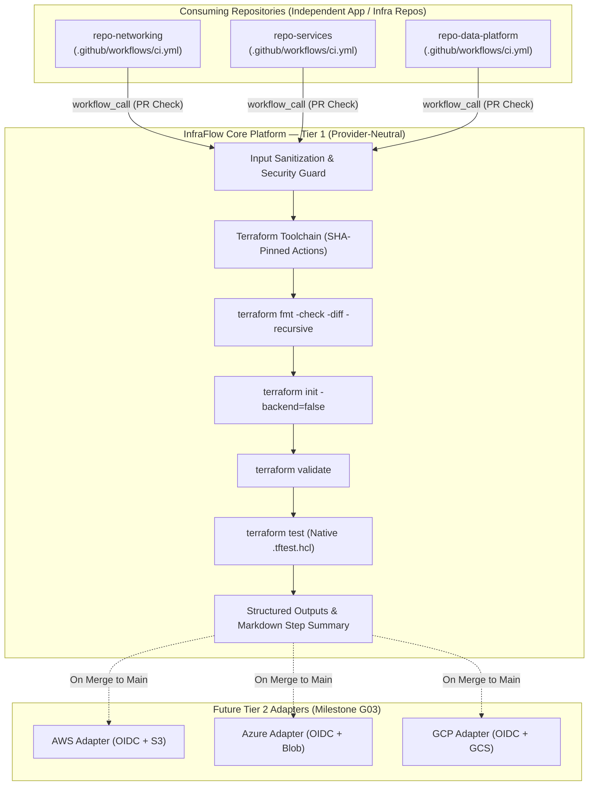

# InfraFlow — Reusable Multi-Cloud Infrastructure Delivery Platform

[](LICENSE)
[](#local-validation)
[](https://www.terraform.io)
[](docs/security/security-architecture.md)

**InfraFlow** is an enterprise-oriented, secure, and maintainable Terraform delivery platform engineered to be reused across independent GitHub repositories.

InfraFlow separates infrastructure delivery into distinct layers:
1. **Tier 1 — Reusable Provider-Neutral CI/CD Core (`reusable-tf-validate.yml`)**: A standardized GitHub Actions workflow (`workflow_call`) executing linting, static validation, and native testing (`.tftest.hcl`) with **zero cloud credentials** and least-privilege tokens.
2. **Tier 1 — DevSecOps Security Quality Gates (`reusable-tf-security.yml`)**: Automated security scanning incorporating TFLint static analysis, Trivy IaC misconfiguration scanning, Zizmor CI/CD supply chain auditing, and Conftest/OPA Policy-as-Code governance.
3. **Tier 1 — Secure Planning & Approval Engine (`reusable-tf-plan.yml`)**: Automated speculative planning (`-lock=false`), structural change classification (`analyze-plan.py`), OPA live plan evaluation, cryptographic attestation binding (`verify-plan-integrity.py`), and protected environment approval gating.
4. **Tier 2 — Modular Cloud Adapters (AWS, Azure, GCP)**: Isolated adapters handling OIDC authentication, remote state backends, and speculative planning/applies on protected branches.

---

## Architecture Overview



---

## Reusable Workflow Specification

The core reusable workflow is located at [`.github/workflows/reusable-tf-validate.yml`](.github/workflows/reusable-tf-validate.yml).

### Inputs Contract

| Input Name | Type | Required | Default | Description |
|---|---|---|---|---|
| `terraform-version` | `string` | No | `'1.10.4'` | Terraform CLI version to install. Enforced `>= 1.6.0` and validated against SemVer format. |
| `working-directory` | `string` | No | `'.'` | Relative directory containing Terraform configuration. Traversal (`..`), absolute paths, and workspace escapes are blocked. |
| `enable-fmt-check` | `boolean` | No | `true` | Enforces canonical styling via `terraform fmt -check`. |
| `enable-validate` | `boolean` | No | `true` | Validates configuration integrity via `terraform validate`. |
| `enable-test` | `boolean` | No | `true` | Runs native unit tests via `terraform test`. |
| `test-var-file` | `string` | No | `''` | Optional relative path to a `.tfvars` file for test variables. |

### Outputs Contract

| Output Name | Type | Description |
|---|---|---|
| `fmt-status` | `string` | Formatting check outcome (`success`, `failure`, `skipped`). |
| `validate-status` | `string` | Validation check outcome (`success`, `failure`, `skipped`). |
| `test-status` | `string` | Native test suite outcome (`success`, `failure`, `skipped`). |
| `summary` | `string` | Aggregated execution summary string. |

---

## Consuming Repository Quick Start

> **NOTE**: The example below uses placeholders (`YOUR_OWNER/YOUR_REPOSITORY`). Prior to publishing release tag `v1`, callers must reference an immutable commit SHA (`@<40-char-sha>`) or active branch. See [Consumer Workflow Guide](examples/consumer-workflow/README.md) for full instructions.

Create `.github/workflows/infraflow-validate.yml` in your consumer repository:

```yaml
name: "Terraform CI"

on:
  pull_request:
    branches: [main]
    paths:
      - "terraform/**"
      - ".github/workflows/infraflow-validate.yml"

permissions:
  contents: read

jobs:
  validate:
    name: "Validate Terraform"
    # Replace YOUR_OWNER/YOUR_REPOSITORY with your GitHub org/repo
    # Replace YOUR_INFRAFLOW_COMMIT_SHA with your commit SHA (e.g., 8a3f9c...) or @v1 once published
    uses: YOUR_OWNER/YOUR_REPOSITORY/.github/workflows/reusable-tf-validate.yml@YOUR_INFRAFLOW_COMMIT_SHA
    with:
      terraform-version: "1.10.4"
      working-directory: "terraform"
      enable-fmt-check: true
      enable-validate: true
      enable-test: true
```

For full multi-module matrix execution examples, see the [Consumer Workflow Guide](examples/consumer-workflow/README.md).

---

## Security Architecture & Defenses

1. **Least-Privilege Token Permissions**: Workflows run with `permissions: contents: read`. No write permissions are granted to pull request jobs.
2. **Zero Cloud Credentials in PR**: Pull request validation requires zero AWS, Azure, or GCP credentials.
3. **No `pull_request_target`**: Prevents untrusted fork code from executing with base repository privileges.
4. **Script Injection Mitigation**: All workflow inputs are mapped to POSIX environment variables before shell script execution. No raw `${{ inputs.* }}` expressions are evaluated directly inside `run:` strings.
5. **Directory Traversal & Containment**: Inputs are strictly validated against regex allowlists; absolute paths (`/`), tildes (`~`), and path traversal (`..`) are rejected before checkout. Post-checkout checks enforce that the canonical working directory is contained within `$GITHUB_WORKSPACE`.
6. **Immutable Action Pinning**: External actions are pinned to full 40-character commit SHAs:
   - `actions/checkout@11bd71901bbe5b1630ceea73d27597364c9af683` (# v4.2.2)
   - `hashicorp/setup-terraform@b9cd54a3c349d3f38e8881555d616ced269862dd` (# v3.1.2)
7. **Supply Chain Hardened CI**: Platform CI downloads and executes `actionlint` v1.7.7 verified against an immutable SHA256 checksum.

---

## Release Readiness & Verification Status

### Locally Verified Capabilities (22/22 Automated Checks)
- **Workflow Schema & Syntax**: Validated with `actionlint` across all workflows.
- **Terraform Formatting**: Validated via `terraform fmt -check` on cloud-free modules.
- **Backend-Free Init**: Validated via `terraform init -backend=false`.
- **Static Validation**: Validated via `terraform validate`.
- **Native Unit Testing**: Validated via `terraform test` (6 passed unit assertions).
- **Negative Fixture Rejection**: Verified failure detection on invalid syntax, unformatted code, and failing assertions.
- **Input Guard & Workspace Containment**: 12 automated security tests exercising path traversal, injection payloads, invalid SemVer, version `< 1.6.0`, absolute paths, and missing directories.

### Remotely Unverified Capabilities (Pending Remote Release)
- **Live GitHub-Hosted Runner Execution**: Cannot be executed offline; requires pushing to a remote repository with active GitHub Actions runners.
- **Live Cross-Repository Invocations**: Requires a published remote repository with cross-repository access enabled.

---

## How to Create the First Immutable Release

When ready to publish the first public release to GitHub:

```bash
# 1. Review status and create the initial commit on main
git add .
git commit -m "feat(core): initial release of InfraFlow reusable terraform delivery platform"

# 2. Add remote origin (replace with your repository URL)
git remote add origin https://github.com/YOUR_OWNER/YOUR_REPOSITORY.git

# 3. Push main branch
git push -u origin main

# 4. Tag the immutable semantic release
git tag -a v1.0.0 -m "Release v1.0.0: Initial release of InfraFlow CI/CD Core"

# 5. Create the floating major tag
git tag -fa v1 -m "Release v1"

# 6. Push tags to GitHub
git push origin v1.0.0 v1

# 7. Configure Cross-Repository Access (if repository is private)
# Navigate to: Settings -> Actions -> General -> Access
# Select: "Accessible from repositories in the '{organization}' organization"
```

---

## Repository Structure

```
infraflow/
├── .github/
│   └── workflows/
│       ├── reusable-tf-validate.yml   # Core validation reusable workflow (G02)
│       ├── reusable-tf-security.yml   # DevSecOps quality gates reusable workflow (G03)
│       ├── reusable-tf-plan.yml       # Speculative planning & approval gate (G04)
│       └── ci.yml                     # Platform self-testing workflow
├── docs/
│   ├── architecture/                  # Architectural foundations (G01)
│   │   ├── ARCHITECTURE.md            # System design & two-tier model
│   │   ├── REQUIREMENTS.md            # Functional & security requirements
│   │   ├── THREAT_MODEL.md            # STRIDE threat model & trust boundaries
│   │   ├── ADAPTERS.md                # Multi-cloud adapter specifications
│   │   └── MILESTONES.md              # Delivery milestones & quality gates
│   ├── security/                      # DevSecOps security specifications (G03)
│   │   ├── security-architecture.md   # Defense-in-depth security architecture
│   │   ├── threat-model.md            # STRIDE security & supply chain threat model
│   │   ├── policy-reference.md        # Rego policy reference & input contracts
│   │   ├── scanner-configuration.md   # TFLint, Trivy, Zizmor, Conftest standards
│   │   └── verification-report.md     # Milestone G03 engineering verification report
│   └── planning/                      # Planning & approval specifications (G04)
│       ├── planning-architecture.md   # Speculative planning architecture & data flow
│       ├── approval-model.md          # Automated verified policy gate & governance model
│       ├── plan-security.md           # Secret masking, ephemeral storage & attestation
│       └── verification-report.md     # Milestone G04 verification & test evidence
├── examples/
│   ├── cloud-free-module/             # Cloud-neutral reference module (terraform_data)
│   │   ├── main.tf
│   │   ├── variables.tf
│   │   ├── outputs.tf
│   │   ├── versions.tf
│   │   └── tests/
│   │       └── unit.tftest.hcl
│   └── consumer-workflow/             # Sample consumer repository workflow & guide
├── fixtures/                          # Verification and regression test fixtures
│   ├── invalid-syntax/
│   ├── unformatted/
│   ├── failing-test/
│   ├── security/                      # DevSecOps security fixtures (G03)
│   │   ├── tflint/                    # Valid & invalid HCL lint fixtures
│   │   ├── trivy/                     # Secure & insecure storage/network fixtures
│   │   ├── zizmor/                    # Insecure permissions, unpinned action fixtures
│   │   └── policies/                  # Positive & negative policy & plan JSON fixtures
│   └── planning/                      # Planning engine fixtures (G04)
│       ├── valid-plan/                # Valid plan JSON fixture
│       ├── sensitive-plan/            # Sensitive attributes masking test fixture
│       ├── destructive-plan/          # Destructive change (delete/replace) fixture
│       └── malformed-plan/            # Corrupted plan JSON syntax fixture
├── policies/                          # Declarative Rego Policy-as-Code suites
│   ├── common/                        # Mandatory tags, naming, plan policies
│   ├── aws/                           # AWS S3 encryption, public access, SG ingress
│   ├── azure/                         # Azure storage TLS 1.2+, public blob disabled
│   └── gcp/                           # GCP GCS uniform bucket-level access
├── .github/
│   ├── CODEOWNERS                     # Platform code ownership & review routing
│   ├── rulesets/
│   │   └── main-ruleset.json          # Repository-level GitHub governance ruleset
│   └── workflows/
│       ├── ci.yml                     # Platform CI pipeline
│       ├── reusable-tf-validate.yml   # Core validation reusable workflow
│       ├── reusable-tf-security.yml   # DevSecOps scanning reusable workflow
│       └── reusable-tf-plan.yml       # Speculative plan & Sigstore attestation workflow
├── docs/
│   ├── architecture/                  # Architecture specs, requirements, threat models
│   ├── planning/                      # Planning engine, approval model, provenance specs
│   └── security/                      # DevSecOps, supply chain, and policy specifications
├── examples/
│   ├── cloud-free-module/             # Cloud-free reference module (tests, validations)
│   └── consumer-workflow/             # Calling workflow integration patterns
├── fixtures/                          # Positive & negative test fixtures
│   ├── invalid-syntax/                # Malformed HCL syntax fixture
│   ├── unformatted/                   # Canonical styling negative fixture
│   ├── failing-test/                  # Native test failure fixture
│   ├── security/                      # DevSecOps scanner fixtures
│   │   ├── tflint/                    # Deprecated syntax & naming fixtures
│   │   ├── trivy/                     # Secure & insecure storage/network fixtures
│   │   ├── zizmor/                    # Insecure permissions, unpinned action fixtures
│   │   └── policies/                  # Positive & negative policy & plan JSON fixtures
│   └── planning/                      # Planning engine fixtures (G04)
│       ├── valid-plan/                # Valid plan JSON fixture
│       ├── sensitive-plan/            # Sensitive attributes masking test fixture
│       ├── destructive-plan/          # Destructive change (delete/replace) fixture
│       └── malformed-plan/            # Corrupted plan JSON syntax fixture
├── policies/                          # Declarative Rego Policy-as-Code suites
│   ├── common/                        # Mandatory tags, naming, plan policies
│   ├── aws/                           # AWS S3 encryption, public access, SG ingress
│   ├── azure/                         # Azure storage TLS 1.2+, public blob disabled
│   ├── gcp/                           # GCP GCS uniform bucket-level access
│   └── trust/                         # Trust anchors, public keys & revocation list
├── scripts/
│   ├── analyze-plan.py                # Plan analysis engine & change classifier
│   ├── verify-plan-integrity.py       # Plan provenance, Sigstore & attestation engine
│   └── validate-local.sh              # Local automated verification harness (132 checks)
├── .gitignore
├── .tflint.hcl                        # Standardized TFLint configuration
├── .zizmor.yml                        # Zizmor workflow audit configuration
├── LICENSE
└── README.md
```

---

## Local Validation

InfraFlow includes an automated, offline local test harness executing all 132 quality gates across G01, G02, G03, G04, G04.1, G04.1.1, G04.1.2, G04.1.3, and G04.1.4:

```bash
chmod +x scripts/validate-local.sh
./scripts/validate-local.sh
```

---

## Documentation Links

### Architecture & Delivery
- [System Architecture](docs/architecture/ARCHITECTURE.md)
- [Requirements Specification](docs/architecture/REQUIREMENTS.md)
- [Foundational Threat Model](docs/architecture/THREAT_MODEL.md)
- [Cloud Adapters Specification](docs/architecture/ADAPTERS.md)
- [Milestones & Acceptance Criteria](docs/architecture/MILESTONES.md)
- [Consumer Integration Guide](examples/consumer-workflow/README.md)

### DevSecOps Security (G03)
- [Security Architecture](docs/security/security-architecture.md)
- [Supply Chain Threat Model](docs/security/threat-model.md)
- [Policy as Code Reference](docs/security/policy-reference.md)
- [Scanner Configuration Standards](docs/security/scanner-configuration.md)
- [G03 Security Verification Report](docs/security/verification-report.md)

### Planning & Approval Engine (G04)
- [Planning Architecture](docs/planning/planning-architecture.md)
- [Automated Verified Policy Gate Model](docs/planning/approval-model.md)
- [Plan Security & Attestation](docs/planning/plan-security.md)
- [G04 Verification Report](docs/planning/verification-report.md)
