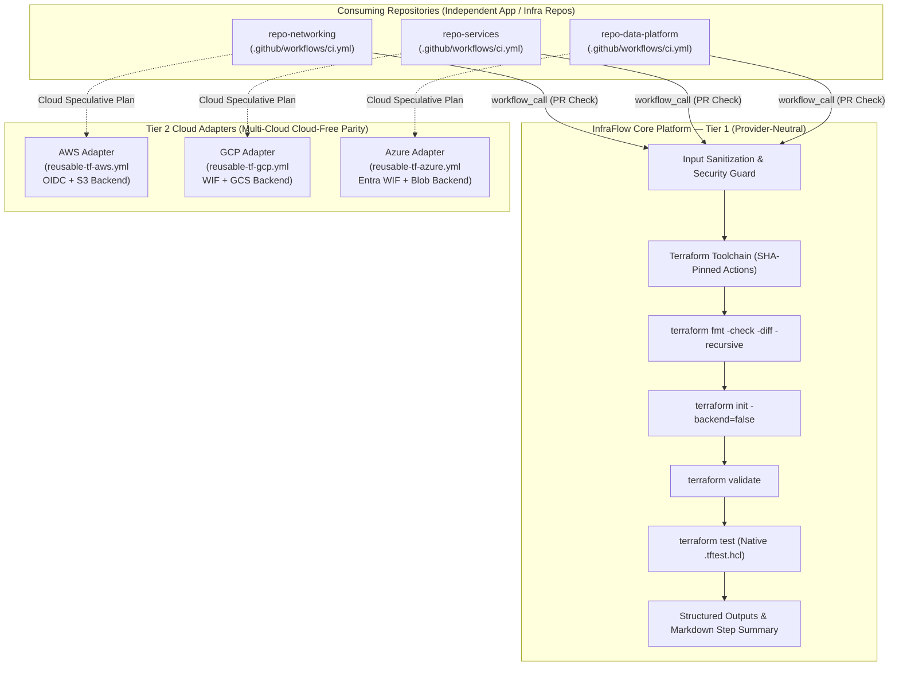

# InfraFlow — Reusable Multi-Cloud Infrastructure Delivery Platform

[](LICENSE)
[](#local-validation)
[](https://www.terraform.io)
[](docs/security/security-architecture.md)
[](https://github.com/TM-threemavithana/infraflow/releases)

**InfraFlow** is an enterprise-oriented, secure, and maintainable multi-cloud Terraform delivery platform engineered to be reused across independent GitHub repositories.

InfraFlow separates infrastructure delivery into distinct layers:
1. **Tier 1 — Reusable Provider-Neutral CI/CD Core (`reusable-tf-validate.yml`)**: A standardized GitHub Actions workflow (`workflow_call`) executing linting, static validation, and native testing (`.tftest.hcl`) with **zero cloud credentials** and least-privilege tokens.
2. **Tier 1 — DevSecOps Security Quality Gates (`reusable-tf-security.yml`)**: Automated security scanning incorporating TFLint static analysis, Trivy IaC misconfiguration scanning, Zizmor CI/CD supply chain auditing, and Conftest/OPA Policy-as-Code governance.
3. **Tier 1 — Secure Planning & Governance Engine (`reusable-tf-plan.yml`)**: Automated speculative planning (`-lock=false`), structural change classification (`analyze-plan.py`), dual static security scanners (Trivy + OPA/Conftest), cryptographic attestation binding (`verify-plan-integrity.py`), and automated verified policy gate governance.
4. **Tier 1 — Protected Apply & Destroy Simulation Engine (`reusable-tf-apply.yml`)**: Cryptographically verified execution simulation with envelope encryption (`kms-envelope.py`), state lineage verification (`verify-plan-lifecycle.py`), atomic plan consumption, and platform blast-radius safeguards.
5. **Tier 2 — Modular Multi-Cloud Adapters (AWS, GCP, Azure)**:
   - **AWS Adapter (`reusable-tf-aws.yml`)**: IAM OIDC role assumption, S3 state backend with SSE-KMS and DynamoDB locking.
   - **GCP Adapter (`reusable-tf-gcp.yml`)**: Workload Identity Federation (WIF) OIDC token exchange, GCS state backend with UBLA, versioning, and precondition locking.
   - **Azure Adapter (`reusable-tf-azure.yml`)**: Microsoft Entra ID Workload Identity Federation, Azure Blob Storage state backend with `use_azuread_auth`, private containers, TLS 1.2+, and blob lease locking.

> [!IMPORTANT]
> **Cloud-Free Release Scope**: InfraFlow v0.5.0 provides multi-cloud cloud-free speculative planning, static security validation, Workload Identity Federation policy enforcement, and simulated execution. It does **NOT** perform real cloud infrastructure deployment, live OIDC token exchanges, or authenticated remote Terraform state operations. Cloud expenditure is strictly **$0.00** with **zero live credentials**.

---

## Architecture Overview



---

## Reusable Workflows Contract

InfraFlow provides standardized reusable workflows callable via GitHub Actions `workflow_call`:

| Reusable Workflow | Purpose | Key Inputs | Key Security Controls |
|---|---|---|---|
| [`.github/workflows/reusable-tf-validate.yml`](.github/workflows/reusable-tf-validate.yml) | Core validation & formatting | `terraform-version`, `working-directory` | Input regex sanitization, path containment |
| [`.github/workflows/reusable-tf-security.yml`](.github/workflows/reusable-tf-security.yml) | DevSecOps security scanning | `scan-severity`, `policy-directory` | TFLint, Trivy, Zizmor, Conftest/OPA |
| [`.github/workflows/reusable-tf-plan.yml`](.github/workflows/reusable-tf-plan.yml) | Speculative plan & governance | `environment`, `var-file` | Dual scanners, Sigstore attestation, redaction |
| [`.github/workflows/reusable-tf-apply.yml`](.github/workflows/reusable-tf-apply.yml) | Protected apply simulation | `plan-file`, `plan-integrity-digest` | KMS envelope encryption, state lineage, atomic consumption |
| [`.github/workflows/reusable-tf-aws.yml`](.github/workflows/reusable-tf-aws.yml) | AWS cloud adapter | `aws-region`, `role-to-assume`, `backend-bucket` | IAM OIDC validation, S3 encryption & locking |
| [`.github/workflows/reusable-tf-gcp.yml`](.github/workflows/reusable-tf-gcp.yml) | GCP cloud adapter | `gcp-project-id`, `service-account`, `backend-bucket` | WIF OIDC validation, GCS UBLA & versioning |
| [`.github/workflows/reusable-tf-azure.yml`](.github/workflows/reusable-tf-azure.yml) | Azure cloud adapter | `azure-subscription-id`, `azure-client-id`, `azure-storage-account-name` | Entra ID OIDC validation, Azure AD auth, TLS 1.2+ |

---

## Multi-Cloud Adapter Parity (AWS vs GCP vs Azure)

InfraFlow delivers architectural parity across all three major cloud providers in a completely cloud-free, zero-spend model:

| Capability | AWS Adapter (G05) | GCP Adapter (G07.2–G07.4) | Azure Adapter (G07.5–G07.7) |
|---|---|---|---|
| **OIDC Trust Mechanism** | AWS IAM Identity Provider (OIDC) | GCP Workload Identity Pool (WIF) | Microsoft Entra ID Federated Credentials |
| **Token Exchange Audience** | `sts.amazonaws.com` | Canonical Provider URI | `api://AzureADTokenExchange` |
| **State Storage Service** | Amazon S3 | Google Cloud Storage (GCS) | Azure Blob Storage |
| **State Locking Mechanism**| Amazon DynamoDB (`LockID`) | GCS Object Versioning / Preconditions | Azure Blob Native Lease |
| **Data Plane Authentication**| IAM Role Assumption | Service Account Impersonation | Microsoft Entra ID (`use_azuread_auth = true`) |
| **Static Key Prohibition** | Reject Access Key / Secret Key | Reject Service Account JSON Keys | Reject Storage Access Key / SAS Token |
| **Offline Speculative Plan** | `terraform init -backend=false` | `terraform init -backend=false` | `terraform init -backend=false` |
| **Mandatory Scanning** | Trivy (HIGH,CRITICAL) | Trivy (HIGH,CRITICAL) | Trivy (HIGH,CRITICAL) |
| **Policy Engine** | Conftest / OPA (AWS policies) | Conftest / OPA (GCP policies) | Conftest / OPA (Azure policies) |
| **Mock Provider Testing** | Native mock provider (`aws`) | Native mock provider (`google`) | Native mock provider (`azurerm`) |
| **Cloud-Free Spend** | **$0.00** | **$0.00** | **$0.00** |
| **SEC-02 PR Gate** | Fail-Closed | Fail-Closed | Fail-Closed |

---

## Consuming Repository Quick Start

To call InfraFlow reusable workflows from an external repository, reference an immutable 40-character commit SHA (recommended for production: `@2ce0ddd5de01530b6bf7aba749f0081620fb9b27`) or official release tag (`@v0.5.0`):

> [!TIP]
> **Immutability Best Practice**: While git release tags (`@v0.5.0`) provide convenient human-readable references, git tags are technically mutable references in git. For true cryptographically immutable dependency pinning and supply-chain security compliance (SLSA / CIS), consumers should pin the full 40-character commit SHA in caller workflows.

```yaml
name: "Terraform Multi-Cloud CI"

on:
  pull_request:
    branches: [main]
    paths:
      - "terraform/**"

permissions:
  contents: read

jobs:
  validate:
    name: "Validate Terraform"
    uses: TM-threemavithana/infraflow/.github/workflows/reusable-tf-validate.yml@2ce0ddd5de01530b6bf7aba749f0081620fb9b27 # v0.5.0
    with:
      terraform-version: "1.10.4"
      working-directory: "terraform"
      enable-fmt-check: true
      enable-validate: true
      enable-test: true

  azure-plan:
    name: "Azure Speculative Plan (Cloud-Free)"
    needs: [validate]
    uses: TM-threemavithana/infraflow/.github/workflows/reusable-tf-azure.yml@2ce0ddd5de01530b6bf7aba749f0081620fb9b27 # v0.5.0
    with:
      working-directory: "terraform/azure"
      environment: "dev"
      storage-account-name: "stinfraflowdev"
      container-name: "tfstate"
      state-key: "env/dev/terraform.tfstate"
      enable-azure-auth: false
```

---

## Security Architecture & Defense-in-Depth

1. **Least-Privilege Token Permissions**: Workflows run with default `permissions: contents: read`. No elevated write privileges or `id-token: write` permissions are granted to pull request or cloud-free simulation jobs.
2. **SEC-02 Fail-Closed Invariant**: Untrusted pull requests requesting live cloud credentials (`enable-*-auth: true`) fail closed immediately before toolchain execution.
3. **No `pull_request_target`**: Prevents untrusted fork code from executing with base repository privileges.
4. **Script Injection Mitigation**: All workflow inputs are mapped to POSIX environment variables before shell script execution. No raw `${{ inputs.* }}` expressions are evaluated directly inside `run:` strings.
5. **Defensive Workspace Containment**: All path inputs are validated against regex allowlists; absolute paths (`/`), tildes (`~`), and path traversal (`..`) are rejected before checkout. Post-checkout checks enforce that the canonical working directory is strictly contained within `$GITHUB_WORKSPACE`.
6. **Immutable Action Pinning**: External GitHub Actions are pinned to full 40-character commit SHAs:
   - `actions/checkout@11bd71901bbe5b1630ceea73d27597364c9af683` (# v4.2.2)
   - `hashicorp/setup-terraform@b9cd54a3c349d3f38e8881555d616ced269862dd` (# v3.1.2)
7. **Supply Chain Hardened CI**: Platform CI executes `actionlint` and `zizmor` across all workflows, with zero medium/high findings.

---

## Quality Metrics & Verification

InfraFlow enforces rigorous quality and security standards across offline test harnesses and authoritative CI runners:

- **Local Automated Quality Harness (`scripts/validate-local.sh`)**: **303/303** passing checks (100% pass rate) across 18 distinct test sections covering G01 through G07.
- **Python Unit & Adversarial Test Suites**: **299/299** passing tests (`tests/`), including dedicated 30-vector GCP and 45-vector Azure adversarial integration suites.
- **OPA / Conftest Rego Policy Suites**: **171/171** passing unit tests (`policies/`) covering naming, tags, S3, GCS, Azure Blob, AWS OIDC, GCP WIF, and Azure Entra ID federation policies.
- **Reference Module Testing**: 4 complete reference modules (`cloud-free-module`, `aws-reference-module`, `gcp-reference-module`, `azure-reference-module`) verified with Terraform `>= 1.7.0` provider mocking, formatting, validation, and zero cloud spend ($0.00).
- **External Consumer Integration**: Independently verified on GitHub Actions runners in `TM-threemavithana/infraflow-consumer-test` across PR #3 (G06), PR #4 (G07 GCP), and PR #5 (G07 Azure) with 100% green workflows.

To execute the offline local validation harness:

```bash
chmod +x scripts/validate-local.sh
./scripts/validate-local.sh
```

---

## Repository Structure

```
infraflow/
├── .github/
│   ├── CODEOWNERS                     # Code ownership & review routing
│   ├── rulesets/
│   │   └── main-ruleset.json          # Repository branch protection ruleset
│   └── workflows/
│       ├── ci.yml                     # Platform self-testing pipeline
│       ├── reusable-tf-validate.yml   # Provider-neutral CI core (G02)
│       ├── reusable-tf-security.yml   # DevSecOps security scanning (G03)
│       ├── reusable-tf-plan.yml       # Speculative planning & attestation (G04)
│       ├── reusable-tf-apply.yml      # Protected apply simulation (G06)
│       ├── reusable-tf-aws.yml        # AWS cloud adapter (G05)
│       ├── reusable-tf-gcp.yml        # GCP cloud adapter (G07.2–G07.4)
│       └── reusable-tf-azure.yml      # Azure cloud adapter (G07.5–G07.7)
├── docs/
│   ├── adapters/                      # Cloud adapter architecture & guides
│   │   ├── aws-adapter-guide.md       # AWS OIDC & S3 architecture guide
│   │   ├── gcp-adapter-guide.md       # GCP WIF & GCS architecture guide
│   │   └── azure-adapter-guide.md     # Azure Entra ID & Blob architecture guide
│   ├── architecture/                  # Architectural foundations & specifications
│   │   ├── ARCHITECTURE.md            # System design & two-tier model
│   │   ├── REQUIREMENTS.md            # Functional & security requirements
│   │   ├── THREAT_MODEL.md            # STRIDE threat model & trust boundaries
│   │   ├── ADAPTERS.md                # Multi-cloud adapter specifications
│   │   └── MILESTONES.md              # Delivery milestones & quality gates
│   ├── evidence/                      # Milestone verification & integration evidence
│   │   ├── G05/                       # AWS integration evidence
│   │   ├── G06/                       # Protected apply simulation evidence
│   │   └── G07/                       # Multi-cloud assessment, GCP, Azure & release evidence
│   ├── planning/                      # Planning & approval specifications (G04)
│   └── security/                      # DevSecOps security specifications (G03)
├── examples/
│   ├── cloud-free-module/             # Cloud-neutral reference module (terraform_data)
│   ├── aws-reference-module/          # AWS mock-provider reference module
│   ├── gcp-reference-module/          # GCP mock-provider reference module
│   ├── azure-reference-module/        # Azure mock-provider reference module
│   └── consumer-workflow/             # Calling workflow integration patterns
├── fixtures/                          # Verification, security & planning test fixtures
├── policies/                          # Declarative Rego Policy-as-Code suites
│   ├── common/                        # Mandatory tags, naming, plan policies
│   ├── aws/                           # AWS S3, security groups & OIDC policies
│   ├── gcp/                           # GCP GCS backend & WIF OIDC policies
│   ├── azure/                         # Azure Blob backend & Entra OIDC policies
│   └── trust/                         # Trust anchors & public key allowlists
├── scripts/
│   ├── analyze-plan.py                # Plan analysis & structural change classifier
│   ├── verify-plan-integrity.py       # Plan provenance, Sigstore & attestation engine
│   ├── kms-envelope.py                # Symmetric envelope encryption tooling
│   ├── verify-plan-lifecycle.py       # State lineage & replay verification tooling
│   └── validate-local.sh              # Local automated verification harness (303 checks)
├── tests/                             # Python unit & adversarial test suites (299 tests)
├── .tflint.hcl                        # Standardized TFLint configuration
├── .zizmor.yml                        # Zizmor workflow audit configuration
├── LICENSE                            # Apache License 2.0
└── README.md
```

---

## Documentation Links

### Architecture & Program Roadmap
- [System Architecture](docs/architecture/ARCHITECTURE.md)
- [Requirements Specification](docs/architecture/REQUIREMENTS.md)
- [Foundational Threat Model](docs/architecture/THREAT_MODEL.md)
- [Multi-Cloud Adapters Specification](docs/architecture/ADAPTERS.md)
- [Milestones & Acceptance Criteria](docs/architecture/MILESTONES.md)

### Cloud Adapter Guides
- [AWS Adapter Guide](docs/adapters/aws-adapter-guide.md)
- [GCP Adapter Guide](docs/adapters/gcp-adapter-guide.md)
- [Azure Adapter Guide](docs/adapters/azure-adapter-guide.md)

### Verification & Release Evidence Reports
- [G05 AWS Integration Report](docs/evidence/G05/G05-FINAL-RELEASE-REPORT.md)
- [G06 Protected Execution Simulation Report](docs/evidence/G06/G06-FINAL-RELEASE-REPORT.md)
- [G07 Multi-Cloud Readiness Assessment](docs/architecture/G07-MULTICLOUD-READINESS-ASSESSMENT.md)
- [G07 GCP Integration Report](docs/evidence/G07/G07-FINAL-GCP-INTEGRATION-REPORT.md)
- [G07 Azure Integration Report](docs/evidence/G07/G07-AZURE-EXTERNAL-INTEGRATION-REPORT.md)
- [G07 Final Multi-Cloud Release Report](docs/evidence/G07/G07-FINAL-MULTICLOUD-RELEASE-REPORT.md)
