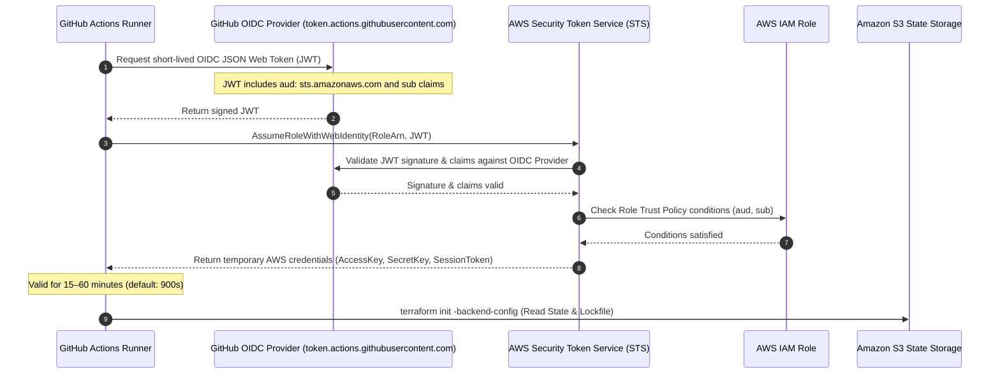

# InfraFlow — AWS Cloud Adapter Architecture & Security Guide

**Document ID:** `INFRAFLOW-GUIDE-AWS-001`  
**Milestone:** G05 — AWS Integration (Tier 2 Cloud Adapter)  
**Target Audience:** Platform Engineers, Cloud Security Architects, DevSecOps Teams  
**Classification:** Official Technical Architecture & Implementation Standard  

---

## 1. Executive Summary & Adapter Topology

InfraFlow adheres to a strict two-tier architecture that decouples cloud-neutral CI/CD orchestration from cloud-specific authentication and state persistence.

```
+-----------------------------------------------------------------------------------+
|                        TIER 1: REUSABLE PLATFORM ENGINE                           |
|  - reusable-tf-validate.yml (Syntax, format, native tests; ZERO cloud credentials)|
|  - reusable-tf-security.yml (TFLint, Trivy, Conftest/OPA dual scanners)           |
|  - reusable-tf-plan.yml (Speculative planning, change analysis, attestation gate) |
+-----------------------------------------------------------------------------------+
                                         |
                       [ Branch & Authentication Gate ]
                       [ PRs -> Cloud-Free Validation ]
                       [ Protected Branches/Envs -> Tier 2 Adapters ]
                                         v
+-----------------------------------------------------------------------------------+
|                           TIER 2: AWS CLOUD ADAPTER                               |
|                         (reusable-tf-aws.yml - G05)                               |
|  - Passwordless GitHub Actions OIDC Authentication (Zero Long-Lived Keys)         |
|  - Ephemeral AWS STS Credentials (AssumeRoleWithWebIdentity)                      |
|  - Least-Privilege Planning IAM Roles & Permission Boundaries                     |
|  - Amazon S3 Remote State Backend (SSE-KMS, Versioning, Public Access Blocked)    |
|  - Native S3 State Locking (use_lockfile = true via S3 Conditional Writes)        |
|  - Optional Legacy DynamoDB State Locking (Backward Compatibility)                |
|  - Dynamic Backend Configuration Injection (-backend-config)                      |
+-----------------------------------------------------------------------------------+
```

### 1.1 Separation of Execution Modes & Job-Level Permission Scoping

InfraFlow strictly isolates pull request verification from cloud-authenticated operations:

1. **Cloud-Free Validation Mode (`reusable-tf-validate.yml` / `cloud-free-plan`)**:
   - Executes on **all pull requests** from internal branches and forks.
   - Operates with minimal GitHub token (`permissions: contents: read`).
   - Uses `terraform init -backend=false`.
   - Never requests, loads, or exposes AWS credentials (`SEC-02`).
   - Fast, deterministic, and incurs $0.00 cloud spend.

2. **AWS-Authenticated Planning Mode (`reusable-tf-aws.yml`)**:
   - Executes **only** on protected branches (`main`, `release/*`) or designated GitHub Environments (`production`).
   - In GitHub Actions, elevated OIDC token permissions (`permissions: id-token: write`) **must be granted at the job level**, not the step level.
   - Workflow architecture segregates execution into distinct, least-privilege jobs:
     - `validate-inputs`: Evaluates input guards and platform trust boundaries with `permissions: contents: read`.
     - `cloud-free-plan`: Offline speculative planning fallback with `permissions: contents: read` (default when `enable-aws-auth: false`).
     - `aws-plan`: Cloud-authenticated planning with `permissions: contents: read, id-token: write`, strictly guarded by `if: inputs.enable-aws-auth == true && github.event_name != 'pull_request'`.
   - Untrusted pull requests are blocked by policy from triggering `aws-plan` or requesting OIDC tokens.
   - Authenticates via GitHub OIDC federation to assume a temporary, read-only IAM planning role.
   - Connects to the remote Amazon S3 state backend with native state locking (`use_lockfile = true`).
   - Generates speculative execution plans against real cloud state without applying changes.

---

## 2. GitHub Actions to AWS OIDC Identity Federation

Static AWS credentials (IAM Access Key ID and Secret Access Key) introduce severe security vulnerabilities, including secret sprawl, credential exfiltration, and rotation overhead. InfraFlow mandates **passwordless OpenID Connect (OIDC)** federation.

### 2.1 OIDC Federation Architecture



### 2.2 AWS IAM OIDC Provider Setup

To establish the trust relationship, the GitHub Actions OIDC identity provider must be registered once per AWS account:

- **Provider URL**: `https://token.actions.githubusercontent.com`
- **Audience (Client ID)**: `sts.amazonaws.com`

#### Bootstrap via Terraform:
```hcl
resource "aws_iam_openid_connect_provider" "github_actions" {
  url             = "https://token.actions.githubusercontent.com"
  client_id_list  = ["sts.amazonaws.com"]
  thumbprint_list = ["6938fd4d98bab03faadb97b34396831e3780aea1", "1c58a3a8518e8759bf075b76b750d4f8d264fcd9"]
}
```
*(Note: AWS IAM natively validates GitHub's root certificate authorities, but thumbprints remain required by the AWS IAM API).*

---

## 3. IAM Role Trust Policy Security Standard

The IAM role trust policy defines *who* can assume the role. InfraFlow enforces strict Policy-as-Code guardrails via [`policies/aws/iam_oidc.rego`](file:///home/tharuka/projects/infraflow/policies/aws/iam_oidc.rego) to eliminate overly permissive configurations.

### 3.1 Standard Production Trust Policy Blueprint

```json
{
  "Version": "2012-10-17",
  "Statement": [
    {
      "Sid": "GitHubActionsOIDCAuthenticate",
      "Effect": "Allow",
      "Principal": {
        "Federated": "arn:aws:iam::123456789012:oidc-provider/token.actions.githubusercontent.com"
      },
      "Action": "sts:AssumeRoleWithWebIdentity",
      "Condition": {
        "StringEquals": {
          "token.actions.githubusercontent.com:aud": "sts.amazonaws.com"
        },
        "StringLike": {
          "token.actions.githubusercontent.com:sub": "repo:TM-threemavithana/infraflow:ref:refs/heads/main"
        }
      }
    }
  ]
}
```

### 3.2 OIDC Token Claims & Subject Scoping (Immutable vs. Legacy Formats)

GitHub Actions mints a JWT containing claims verified by AWS STS. The subject claim (`sub`) establishes caller identity.

#### Post-July 15, 2026 Immutable Subject Format
For GitHub repositories created after July 15, 2026 (or organizations enforcing immutable claims), GitHub includes immutable numeric IDs for both the account/owner and repository:
`repo:OWNER@OWNER-ID/REPO@REPO-ID:(ref:refs/heads/<branch>|ref:refs/tags/<tag>|environment:<env>)`

*Example:* `repo:TM-threemavithana@157876462/infraflow@1463731985:ref:refs/heads/main`

**Security Benefit:** Immutable numeric IDs protect against repository and organization renaming/squatting attacks. If a repository or organization is deleted, renamed, or transferred, an attacker cannot claim the old name to assume the cloud IAM role.

#### Pre-July 15, 2026 Legacy Subject Format
Older repositories continue to support the legacy name-only subject format:
`repo:OWNER/REPO:(ref:refs/heads/<branch>|ref:refs/tags/<tag>|environment:<env>)`

InfraFlow's OPA policy [`policies/aws/iam_oidc.rego`](file:///home/tharuka/projects/infraflow/policies/aws/iam_oidc.rego) supports **both** immutable and legacy formats while strictly verifying numeric ID integrity and rejecting wildcards.

| Scoping Model | `sub` Claim Format (Immutable / Legacy) | Permitted In InfraFlow | Security Evaluation |
|---|---|:---:|---|
| **Protected Branch** | `repo:OWNER[@ID]/REPO[@ID]:ref:refs/heads/<branch>` | **YES** | Recommended for trunk-based delivery (`refs/heads/main`). |
| **Protected Environment** | `repo:OWNER[@ID]/REPO[@ID]:environment:<env>` | **YES** | Recommended for multi-stage pipelines (e.g., `environment:production`). |
| **Release Tag** | `repo:OWNER[@ID]/REPO[@ID]:ref:refs/tags/<tag>` | **YES** | Permitted for immutable release tags (e.g., `refs/tags/v*`). |
| **Pull Request** | `repo:OWNER[@ID]/REPO[@ID]:pull_request` | **NO** | **FORBIDDEN.** Untrusted PR code must never assume authenticated cloud roles. |
| **Wildcard Repo** | `repo:*`, `repo:OWNER/*:*`, `repo:OWNER@ID/*:*` | **NO** | **FORBIDDEN.** Violates isolation; permits any repo to assume role. |
| **Bare Repo** | `repo:OWNER/REPO` or `repo:OWNER@ID/REPO@ID` | **NO** | **FORBIDDEN.** Missing branch/environment scope; permits any PR/branch. |
| **Malformed ID** | `repo:OWNER@abc/REPO@xyz:...` | **NO** | **FORBIDDEN.** Non-numeric IDs fail regex validation. |

### 3.3 Multiple Target Branches & Environments

When a workflow requires role assumption from multiple specific branches (e.g., `main` and `release/*`), use array conditions under `StringLike`:

```json
"Condition": {
  "StringEquals": {
    "token.actions.githubusercontent.com:aud": "sts.amazonaws.com"
  },
  "StringLike": {
    "token.actions.githubusercontent.com:sub": [
      "repo:TM-threemavithana/infraflow:ref:refs/heads/main",
      "repo:TM-threemavithana/infraflow:ref:refs/heads/release/*"
    ]
  }
}
```

---

## 4. IAM Permission Scoping & Least Privilege

The assumed IAM role must adhere strictly to the principle of least privilege, segregated by lifecycle phase.

### 4.1 Planning Role Permissions (G05 Scope)

In Milestone G05, the adapter executes **read-only speculative planning**. The IAM planning role requires least-privilege scoping that clearly separates infrastructure read-only discovery from state storage locking:

1. **Remote State Access & Native S3 Locking Permissions**:
   - **State File (Read-Only)**: `s3:GetObject` on the state key prefix (`arn:aws:s3:::<bucket>/<prefix>/*`). The planning role is strictly forbidden from writing or modifying `terraform.tfstate`!
   - **Native Lockfile (`*.tflock`) (Write & Delete)**: When using native S3 state locking (`use_lockfile = true`), Terraform acquires and releases distributed locks by creating and deleting `<key>.tflock` using Amazon S3 Conditional Writes. The planning role is granted `s3:PutObject` and `s3:DeleteObject` **strictly on `arn:aws:s3:::<bucket>/<prefix>/*.tflock`**.
   - **Bucket Listing**: `s3:ListBucket` on `arn:aws:s3:::<bucket>` with a condition restricting `s3:prefix` to `<prefix>/*`.
2. **KMS State Decryption**:
   - `kms:Decrypt` and `kms:GenerateDataKey` on the remote state KMS customer managed key (CMK).
3. **Infrastructure Read-Only Discovery**:
   - Read-only metadata permissions for resources managed by Terraform (e.g., `ec2:Describe*`, `s3:GetBucket*`, `iam:Get*`).
4. **Prohibition of Mutation**:
   - Planning roles must **not** possess `Create`, `Delete`, `Put`, or `Modify` permissions on cloud infrastructure resources.
   - Modifying state files (`s3:PutObject` on `terraform.tfstate`) and applying approved changes is deferred to **Milestone G06 (Protected Apply & Destroy)**.

#### Example Least-Privilege Planning IAM Policy:
```json
{
  "Version": "2012-10-17",
  "Statement": [
    {
      "Sid": "AllowStateFileRead",
      "Effect": "Allow",
      "Action": ["s3:GetObject"],
      "Resource": "arn:aws:s3:::infraflow-state-prod/env/production/*"
    },
    {
      "Sid": "AllowNativeLockfileManagement",
      "Effect": "Allow",
      "Action": ["s3:PutObject", "s3:DeleteObject"],
      "Resource": "arn:aws:s3:::infraflow-state-prod/env/production/*.tflock"
    },
    {
      "Sid": "AllowStateBucketList",
      "Effect": "Allow",
      "Action": ["s3:ListBucket"],
      "Resource": "arn:aws:s3:::infraflow-state-prod",
      "Condition": {
        "StringLike": {"s3:prefix": "env/production/*"}
      }
    },
    {
      "Sid": "AllowKMSDecrypt",
      "Effect": "Allow",
      "Action": ["kms:Decrypt", "kms:GenerateDataKey"],
      "Resource": "arn:aws:kms:us-east-1:123456789012:key/state-key-uuid"
    }
  ]
}
```

### 4.2 IAM Permission Boundaries

To prevent privilege escalation, the IAM role should be governed by a **Permission Boundary** (`permissions_boundary`):
```json
{
  "Version": "2012-10-17",
  "Statement": [
    {
      "Sid": "DenyIAMModification",
      "Effect": "Deny",
      "Action": [
        "iam:Create*",
        "iam:Delete*",
        "iam:PutRolePolicy",
        "iam:AttachRolePolicy"
      ],
      "Resource": "*"
    }
  ]
}
```

---

## 5. Amazon S3 Remote State Storage Architecture

Terraform state files contain sensitive data (resource IDs, IP addresses, secrets in state). State backends must enforce rigorous data protection controls.

### 5.1 S3 State Bucket Security Controls

1. **Server-Side Encryption (SSE-KMS)**:
   - State files must be encrypted at rest using an AWS KMS Customer Managed Key (CMK) with automated key rotation:
     ```hcl
     server_side_encryption_configuration {
       rule {
         apply_server_side_encryption_by_default {
           kms_master_key_id = aws_kms_key.terraform_state.arn
           sse_algorithm     = "aws:kms"
         }
       }
     }
     ```
2. **Bucket Versioning**:
   - Versioning must be `Enabled` to allow state rollback in the event of accidental corruption or invalid writes.
3. **S3 Public Access Block**:
   - All four public access block settings must be set to `true`:
     - `block_public_acls = true`
     - `block_public_policy = true`
     - `ignore_public_acls = true`
     - `restrict_public_buckets = true`
   - Enforced by InfraFlow Rego policy [`policies/aws/s3.rego`](file:///home/tharuka/projects/infraflow/policies/aws/s3.rego).
4. **Enforce TLS 1.2+ In Transit**:
   - Bucket policy must explicitly deny non-HTTPS traffic (`aws:SecureTransport: false`).

---

## 6. Native S3 State Locking (`use_lockfile = true`)

Historically, the Terraform `s3` backend required an Amazon DynamoDB table for distributed locking. 

### 6.1 The Modern Native S3 Locking Standard

Starting in **Terraform 1.10.0**, the S3 backend natively supports distributed state locking via **Amazon S3 Conditional Writes** (`use_lockfile = true`):

```
+-----------------------------------------------------------------------------------+
|               TRADITIONAL S3 BACKEND             MODERN S3 BACKEND (G05)          |
|                 (Terraform < 1.10)                 (Terraform >= 1.10.4)          |
+-----------------------------------------------------------------------------------+
|  State Storage:  Amazon S3 Bucket             State Storage:  Amazon S3 Bucket    |
|  State Locking:  Amazon DynamoDB Table        State Locking:  Native S3 Lockfile  |
|                                                               (.tflock via S3     |
|                                                                Conditional Writes)|
|  Infrastructure: 2 Resources (S3 + DDB)       Infrastructure: 1 Resource (S3)     |
|  IAM Perms:      s3:* + dynamodb:*            IAM Perms:      s3:* only           |
|  Operational:    DDB Capacity / Provisioning  Operational:    Zero DDB Maintenance|
|  Cost:           S3 + DynamoDB Requests       Cost:           S3 Requests Only    |
+-----------------------------------------------------------------------------------+
```

### 6.2 Architectural Rationale for Native S3 Locking

1. **Reduced Attack Surface**: Eliminates the need to grant `dynamodb:GetItem`, `dynamodb:PutItem`, and `dynamodb:DeleteItem` permissions in the IAM planning role.
2. **Simplified Infrastructure**: Eliminates DynamoDB table provisioning, billing, and capacity management.
3. **Atomic Consistency**: Leverages Amazon S3's strong read-after-write consistency and conditional `PutObject` operations (`If-None-Match: *`). When Terraform acquires a lock, it writes `<key>.tflock`. If another process holds the lock, S3 returns HTTP 412 (Precondition Failed), preventing concurrent state modification.
4. **Legacy DynamoDB Compatibility & Deprecation**: DynamoDB table inputs (`backend-dynamodb-table`) remain supported for existing legacy projects, but DynamoDB locking is deprecated in modern Terraform (>= 1.10) in favor of native S3 locking.
5. **Cloud-Free Simulation Invariant**: In InfraFlow's cloud-free model ($0.00 spend), speculative plans execute offline with `terraform init -backend=false`. No live S3 or DynamoDB state locks are acquired or exercised. Live state migration or changes to the baseline AWS backend design will not occur without an additional approved milestone.

---

## 7. Secure Dynamic Backend Configuration Injection

To eliminate hardcoded environment parameters and avoid checking sensitive backend settings into version control, InfraFlow injects backend configuration dynamically at runtime.

### 7.1 Backend Declaration in Code

The consuming repository declares an empty or minimal S3 backend block:

```hcl
terraform {
  required_version = ">= 1.6.0"
  backend "s3" {}
}
```

### 7.2 CLI Parameter Injection

The reusable AWS adapter workflow dynamically constructs `-backend-config` arguments during initialization:

```bash
terraform init -backend=true -input=false \
  -backend-config="bucket=${INPUT_BACKEND_BUCKET}" \
  -backend-config="key=${INPUT_BACKEND_KEY}" \
  -backend-config="region=${INPUT_AWS_REGION}" \
  -backend-config="encrypt=true" \
  -backend-config="use_lockfile=true"
```

If legacy DynamoDB locking is specified:
```bash
  -backend-config="dynamodb_table=${INPUT_DYNAMODB_TABLE}"
```

---

## 8. State Infrastructure Bootstrapping

Remote state infrastructure cannot be managed by the same state file it hosts (chicken-and-egg problem). State infrastructure must be bootstrapped out-of-band.

### 8.1 Bootstrap Architecture

1. **Dedicated Bootstrap Module**: A standalone Terraform configuration (`bootstrap/aws-state`) run once with local state by a cloud administrator.
2. **Bootstrap Deliverables**:
   - KMS CMK for state encryption.
   - S3 state bucket with encryption, versioning, and public access blocks.
   - GitHub Actions IAM OIDC Identity Provider (`token.actions.githubusercontent.com`).
   - IAM Roles for Planning (and future Apply) with explicit repository trust policies.
3. **Handoff to InfraFlow**: Output the Bucket Name, KMS Key ARN, and Role ARN into the consumer workflow configuration.

---

## 9. Zero-Cost Local Testing & Mocking Limitations

InfraFlow enforces a strict **$0.00 cloud budget constraint** during CI and local development.

### 9.1 Offline Verification Model

| Layer | Verification Tool | Verification Strategy |
|---|---|---|
| **Workflow Syntax & Context** | `actionlint` (v1.7.7) | Validates workflow AST, context properties, expressions, and action versions. |
| **Supply Chain Security** | `zizmor` (v1.32.0) | Audits runner permissions, action commit SHAs, and injection vectors. |
| **Input Guards & Path Traversal** | Shell / Bash Regex Harness | Tests role ARN formats, region allowlists, bucket name rules, and traversal rejection. |
| **OIDC Trust Policy Security** | `conftest verify` / OPA | Evaluates IAM trust policy JSON structures against [`policies/aws/iam_oidc.rego`](file:///home/tharuka/projects/infraflow/policies/aws/iam_oidc.rego). |
| **Terraform Code Integrity** | `terraform validate` & `test` | Validates HCL consistency and runs unit tests using mock provider configurations. |

### 9.2 Explicit Limitations of Mocked Testing

To maintain engineering truthfulness, the following testing boundaries are recognized:
1. **Mocked STS Token Exchange**: Offline testing verifies the *structure* of IAM trust policies and the *validity* of workflow syntax. It does not communicate with the live AWS STS API endpoint (`sts.amazonaws.com`).
2. **S3 Network Connectivity**: Offline tests do not verify whether an S3 bucket actually exists or whether the IAM role has permissions to access the bucket.
3. **Live Token Lifetime**: OIDC token expiration, session refresh, and clock skew cannot be evaluated without live runner-to-AWS communication.
4. **Conclusion**: Offline tests prove **syntactic correctness, security guardrail compliance, and policy-as-code enforcement**, but live deployment authorization requires live AWS infrastructure in a real cloud environment.

---
*End of Guide — InfraFlow AWS Cloud Adapter Architecture Specification.*
