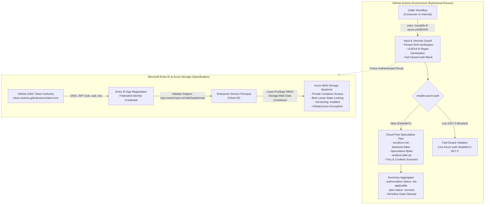

# InfraFlow — Microsoft Azure Adapter & Workload Identity Guide
**Milestone:** G07.5 — Microsoft Azure Adapter & Workload Identity Foundation  
**Classification:** Enterprise Security Architecture & Implementation Guide  
**Status:** Hardened, Adversarially Tested & Verified (Cloud-Free Simulation Foundation)

---

## 1. Executive Summary & Architecture

The InfraFlow Microsoft Azure Adapter extends InfraFlow's multi-cloud DevSecOps pipeline to support Microsoft Azure infrastructure provisioning and Terraform state management.

Conforming to InfraFlow's strict Zero Cloud Spend ($0.00) architectural mandate, Milestone G07.5 establishes the foundational security contracts, Microsoft Entra ID Workload Identity Federation (WIF) policy rules, reusable workflow specifications, and offline reference modules without requiring an Azure subscription, Entra ID tenant, or active cloud credentials.



---

## 2. Microsoft Entra ID Workload Identity Federation Trust Model

### 2.1 Cryptographic OIDC Token Exchange
InfraFlow eliminates long-lived client secrets, management certificates, and service principal passwords. Instead, authentication relies on short-lived OIDC tokens minted by GitHub Actions and validated by Microsoft Entra ID.

1. **Issuer URI**: Strictly `https://token.actions.githubusercontent.com`. Any other issuer is rejected.
2. **Audience**: Strictly `api://AzureADTokenExchange`. Wildcards (`*`) or arbitrary audiences are strictly rejected.
3. **Federated Identity Credential Subject Formats**:
   - **Standard Branch Format**:
     `repo:<ORG>/<REPO>:ref:refs/heads/<BRANCH>` (e.g. `repo:TM-threemavithana/infraflow:ref:refs/heads/main`)
   - **Standard Environment Format**:
     `repo:<ORG>/<REPO>:environment:<ENV>` (e.g. `repo:TM-threemavithana/infraflow:environment:production`)
   - **Immutable Format (GitHub OIDC Enhancement / Post-July 15, 2026)**:
     `repo-id:<REPO_ID>:ref:refs/heads/<BRANCH>` or `repo-id:<REPO_ID>:environment:<ENV>` (where `<REPO_ID>` is numeric)
4. **Trust Confinement & Policy Guards**:
   - **Zero Wildcards**: Wildcard subjects (`*`) are strictly prohibited in federated identity credentials.
   - **Repository Confinement**: Subject must match the authorized repository identity.
   - **SEC-02 Enforcement**: Pull request subjects (`pull_request`) are strictly prohibited from receiving cloud credential federation.
   - **Parent Identity Binding**: Federated credentials must bind to an explicit Entra Application Registration or Managed Identity parent resource.

### 2.2 Least-Privilege Role-Based Access Control (RBAC)
Service principals assigned to Terraform state management must adhere to least privilege:
- **Mandatory Role**: `Storage Blob Data Contributor` (or fine-grained custom data-plane role scoped to the state container).
- **Strictly Prohibited**:
  - `Owner` or `Contributor` at subscription or management group scope.
  - Subscription-wide `User Access Administrator`.
  - Classic co-administrator roles.

---

## 3. Azure Blob Storage Remote Backend Contract

Terraform remote state storage on Azure Blob Storage (`backend "azurerm"`) is guarded by enterprise Open Policy Agent (OPA) policies:

| Security Requirement | Implementation | Standard / Baseline |
| :--- | :--- | :--- |
| **Data Plane Authentication** | `use_azuread_auth = true` or `use_oidc = true` | Zero Trust Architecture |
| **Shared Key Disabled** | `shared_access_key_enabled = false` | CIS Azure Benchmark v3.0 §5.1 |
| **Container Access Type** | `container_access_type = "private"` | CIS Azure Benchmark v3.0 §5.2 |
| **Public Network Access** | `public_network_access_enabled = false` / `network_rules default_action = "Deny"` | CIS Azure Benchmark v3.0 §5.3 |
| **Minimum TLS Version** | `min_tls_version = "TLS1_2"` or `"TLS1_3"` | NIST SP 800-52 Rev 2 |
| **Blob Versioning** | `blob_properties.versioning_enabled = true` | ISO/IEC 27001 A.8.12 |
| **State Locking** | Native Azure Blob Leases (exclusive blob lock) | Terraform AzureRM Provider Contract |
| **Environment Isolation** | State key includes environment namespace (`env/prod/...`) | SRE Defense in Depth |

### 3.1 State Locking: Azure Blob Leases vs AWS DynamoDB
Unlike AWS S3 which requires a secondary service (Amazon DynamoDB) for distributed state locking, Azure Blob Storage provides **native blob lease locking** through the Azure Storage service. When Terraform initializes an `azurerm` backend, it acquires a 60-second renewable exclusive lease on the state blob. If another execution attempts to acquire a lock, the Azure Storage REST API returns HTTP 412 (Precondition Failed) / `LeaseAlreadyPresent`, safely preventing concurrent state corruption without secondary infrastructure.

---

## 4. Reusable Workflow (`reusable-tf-azure.yml`)

The reusable Azure workflow contract provides:
1. **Strict Input Sanitization**:
   - Subscription ID, Tenant ID, and Client ID validated as RFC 4122 UUIDv4 strings.
   - Resource Group names validated (1–90 alphanumeric, underscore, hyphen, parentheses, periods, no trailing dot).
   - Storage Account names validated (3–24 lowercase alphanumeric).
   - Storage Container names validated (3–63 lowercase alphanumeric and hyphens, no consecutive hyphens).
   - State blob key validated against path traversal (`..`) and leading slashes (`/`).
2. **Platform Trust Boundary**: Verifies caller workflow repository against trusted platform repository and mandates immutable 40-character commit SHA pinning.
3. **Simulation-Only Invariant**: In Milestone G07.5, setting `enable-azure-auth: true` triggers an immediate fail-closed security error.
4. **Offline Speculative Planning**: Initializes Terraform backend-free (`-backend=false`), generates an execution plan, and runs dual security scanners (Trivy + Conftest).
5. **Standardized Outputs**: Emits canonical plan status, authorization status (`not-applicable` in cloud-free mode), change metrics (`has-changes`, `has-destructive-changes`, `total-changes`), and job execution statuses.

---

## 5. Multi-Cloud Comparison: AWS vs GCP vs Azure

| Dimension | AWS Adapter (G05) | GCP Adapter (G07.2-G07.4) | Azure Adapter (G07.5) |
| :--- | :--- | :--- | :--- |
| **Trust Model** | IAM OIDC Provider + Role AssumeRoleWithWebIdentity | Workload Identity Pool + Provider + Service Account | Entra ID App Registration + Federated Identity Credential |
| **Token Issuer** | `https://token.actions.githubusercontent.com` | `https://token.actions.githubusercontent.com` | `https://token.actions.githubusercontent.com` |
| **Target Audience** | `sts.amazonaws.com` | GCP Provider Resource URI | `api://AzureADTokenExchange` |
| **Subject Claim Matching** | IAM Condition `StringEquals` / `StringLike` on `token.actions.githubusercontent.com:sub` | CEL `attribute_condition` on `assertion.repository` and `assertion.ref` | Entra Federated Credential `subject` exact match |
| **Remote State Backend** | `backend "s3"` | `backend "gcs"` | `backend "azurerm"` |
| **State Locking Mechanism** | AWS DynamoDB Table (`LockID` attribute) | GCS native object generation / preconditions | Azure Blob Storage native lease lock |
| **Access Keys Disabled** | IAM User Access Keys prohibited (Role-only) | Service Account JSON Keys prohibited | Storage Account Access Keys (`shared_access_key_enabled = false`) |
| **Mock Provider Testing** | `mock_provider "aws" {}` | `mock_provider "google" {}` | `mock_provider "azurerm" {}` |
| **Cloud Spend Requirement** | $0.00 (Cloud-Free Simulation) | $0.00 (Cloud-Free Simulation) | $0.00 (Cloud-Free Simulation) |

---

## 6. Offline Reference Module & Mock Provider Testing

The reference module located at `examples/azure-reference-module/` demonstrates how Azure infrastructure is validated offline without credentials or cloud spend:

- **Terraform Version Requirement**: `>= 1.7.0` (required for native `mock_provider` testing).
- **Mock Testing (`tests/azure_test.tftest.hcl`)**:
  ```hcl
  mock_provider "azurerm" {}

  variables {
    subscription_id      = "00000000-0000-0000-0000-000000000000"
    tenant_id            = "00000000-0000-0000-0000-000000000000"
    client_id            = "00000000-0000-0000-0000-000000000000"
    resource_group_name  = "rg-infraflow-prod"
    location             = "eastus"
    storage_account_name = "stinfraflowprod01"
    container_name       = "tfstate"
    environment          = "prod"
  }

  run "verify_azure_storage_configuration" {
    command = plan

    assert {
      condition     = azurerm_storage_account.storage.min_tls_version == "TLS1_2"
      error_message = "min_tls_version must explicitly be TLS1_2"
    }

    assert {
      condition     = azurerm_storage_account.storage.allow_nested_items_to_be_public == false
      error_message = "allow_nested_items_to_be_public must be false"
    }

    assert {
      condition     = azurerm_storage_container.tfstate.container_access_type == "private"
      error_message = "container_access_type must explicitly be private"
    }
  }
  ```

---

## 7. Verification and Local Testing

Execute the complete Azure validation and regression testing suite locally:

```bash
# 1. Actionlint workflow syntax validation
actionlint .github/workflows/reusable-tf-azure.yml

# 2. Zizmor supply chain security audit
zizmor -c .zizmor.yml --min-severity medium .github/workflows/reusable-tf-azure.yml

# 3. OPA / Conftest Rego unit tests (164 tests)
conftest verify --policy policies policies

# 4. Reference module testing (mock provider azurerm)
cd examples/azure-reference-module
terraform fmt -check
terraform init -backend=false
terraform validate
terraform test
cd ../..

# 5. Dedicated Azure Python test suite (39 unit and adversarial tests)
python3 -m unittest tests/test_azure_adapter.py

# 6. Complete Python unit test discovery (254 tests)
python3 -m unittest discover tests

# 7. Full local validation harness (Section 18)
./scripts/validate-local.sh
```

---

## 8. Future Live Authentication Architecture Notice

> [!IMPORTANT]
> **Cloud-Free Simulation Notice**:
> In accordance with Milestone G07.5 constraints, real Azure authentication (`enable-azure-auth: true`), live Microsoft Entra ID token exchange, Azure CLI integration (`azure/login`), and Azure ARM/Storage REST interactions remain **unverified against live Azure subscriptions**.
> Any workflow invocation enabling `enable-azure-auth: true` is intercepted by the workflow guard and fails closed with an informative error. Live cloud authentication and external consumer validation are slated for subsequent milestones (G07.6 / G07.7) following identical security verification protocols established in G05 (AWS) and G07.4 (GCP).
