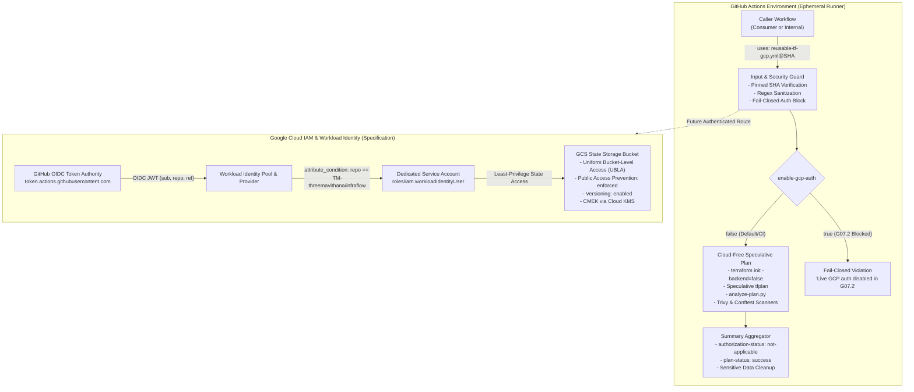

# InfraFlow — Google Cloud Adapter & Workload Identity Guide
**Milestone:** G07.2 — Google Cloud Adapter & Workload Identity Foundation  
**Classification:** Enterprise Security Architecture & Implementation Guide  
**Status:** Implemented & Verified (Cloud-Free Simulation Foundation)

---

## 1. Executive Summary & Architecture

The InfraFlow Google Cloud Platform (GCP) Adapter extends InfraFlow's multi-cloud DevSecOps pipeline to support Google Cloud infrastructure provisioning and Terraform state management.

Conforming to InfraFlow's strict Zero Cloud Spend ($0.00) architectural mandate, Milestone G07.2 establishes the foundational security contracts, Workload Identity Federation (WIF) policy rules, reusable workflow specifications, and offline reference modules without requiring a GCP billing account, service project, or active cloud credentials.



---

## 2. Workload Identity Federation (WIF) Trust Model

### 2.1 Cryptographic OIDC Token Exchange
InfraFlow eliminates long-lived service account keys (`*.json` key files) entirely. Instead, authentication relies on short-lived OIDC tokens minted by GitHub Actions and validated by GCP's Security Token Service (STS).

1. **Issuer URI**: Strictly `https://token.actions.githubusercontent.com`.
2. **Allowed Audiences**: Must explicitly match the full GCP provider resource URI:
   `https://iam.googleapis.com/projects/<PROJECT_NUMBER>/locations/global/workloadIdentityPools/<POOL_NAME>/providers/<PROVIDER_NAME>`
   Wildcard audiences (`*`) are strictly prohibited and blocked by OPA policy.
3. **Attribute Mappings**:
   - `google.subject` = `assertion.sub`
   - `attribute.repository` = `assertion.repository`
   - `attribute.ref` = `assertion.ref`
   - `attribute.actor` = `assertion.actor`
4. **Attribute Condition**: Enforces strict repository and branch confinement:
   ```cel
   assertion.repository == 'TM-threemavithana/infraflow' && assertion.ref == 'refs/heads/main'
   ```

### 2.2 Service Account IAM Binding Contract
Service accounts mapped to GitHub Actions workloads must bind exclusively using full `principalSet` expressions:
```text
principalSet://iam.googleapis.com/projects/<PROJECT_NUMBER>/locations/global/workloadIdentityPools/<POOL>/attribute.repository/<OWNER>/<REPO>
```
**Strictly Prohibited**:
- Wildcard principal bindings (`allUsers`, `allAuthenticatedUsers`, `*`).
- Org-wide bindings (`attribute.repository_owner/<OWNER>`) without repository restriction.
- Direct user impersonation across untrusted branches.

---

## 3. Secure GCS Backend Contract

Terraform remote state storage on Google Cloud Storage (GCS) is guarded by enterprise Open Policy Agent (OPA) policies:

| Security Requirement | Implementation | Standard / Baseline |
| :--- | :--- | :--- |
| **Uniform Bucket-Level Access** | `uniform_bucket_level_access = true` | CIS GCP Benchmark v3.0 §5.2 |
| **Public Access Prevention** | `public_access_prevention = "enforced"` | CIS GCP Benchmark v3.0 §5.1 |
| **Object Versioning** | `versioning.enabled = true` | ISO/IEC 27001 A.8.12 |
| **Accidental Destruction Prevention** | `force_destroy = false` | SRE Best Practice |
| **Customer-Managed Encryption Keys** | `encryption.default_kms_key_name = "projects/.../cryptoKeys/..."` | NIST SP 800-218 SSDF |
| **Public Access Rejection** | Complete rejection of `allUsers` and `allAuthenticatedUsers` in ACLs/IAM | Zero Trust Architecture |

---

## 4. Reusable Workflow (`reusable-tf-gcp.yml`)

The reusable GCP workflow contract provides:
1. **Strict Input Sanitization**: Comprehensive regex validation on project IDs, regions, service accounts, WIF providers, and GCS buckets.
2. **Platform Trust Boundary**: Verifies caller workflow repository and mandates immutable 40-character commit SHA pinning.
3. **Simulation-Only Invariant**: In Milestone G07.2, setting `enable-gcp-auth: true` triggers an immediate fail-closed security error.
4. **Offline Speculative Planning**: Initializes Terraform backend-free (`-backend=false`), generates an execution plan, and runs dual security scanners (Trivy + Conftest).
5. **Standardized Outputs**: Emits canonical plan status, authorization status (`not-applicable` in cloud-free mode), and change telemetry.

---

## 5. Offline Reference Module & Mock Provider Testing

The reference module located at `examples/gcp-reference-module/` demonstrates how GCP infrastructure is validated offline without credentials or cloud spend:

- **Terraform Version Requirement**: `>= 1.7.0` (required for native `mock_provider` testing).
- **Mock Testing (`tests/gcs_test.tftest.hcl`)**:
  ```hcl
  mock_provider "google" {}

  variables {
    project_id  = "infraflow-mock-project"
    region      = "us-central1"
    bucket_name = "infraflow-test-bucket"
    environment = "prod"
  }

  run "verify_gcs_bucket_configuration" {
    command = plan
    assert {
      condition     = google_storage_bucket.storage.uniform_bucket_level_access == true
      error_message = "Uniform bucket-level access must be enabled"
    }
  }
  ```

---

## 6. Verification and Local Testing

Execute the complete GCP validation suite locally:

```bash
# 1. Actionlint workflow syntax validation
actionlint -shellcheck shellcheck .github/workflows/reusable-tf-gcp.yml

# 2. Zizmor supply chain security audit
zizmor -c .zizmor.yml --min-severity medium .github/workflows/reusable-tf-gcp.yml

# 3. OPA / Conftest Rego unit tests
conftest verify --policy policies policies

# 4. Reference module testing
cd examples/gcp-reference-module
terraform fmt -check
terraform init -backend=false
terraform validate
terraform test
cd ../..

# 5. Dedicated GCP Python test suite
python3 -m unittest tests/test_gcp_adapter.py

# 6. Full local validation harness
./scripts/validate-local.sh
```
