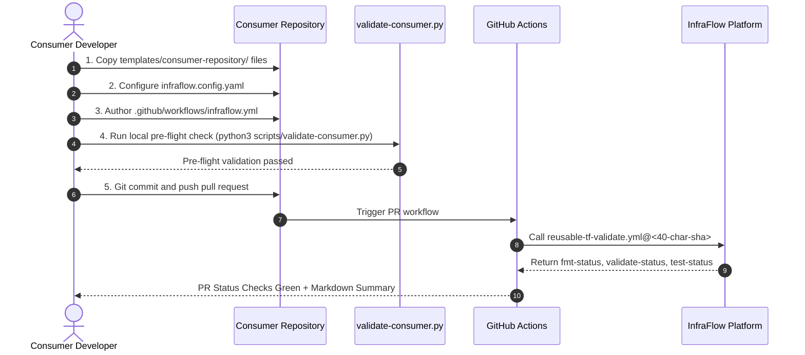

# InfraFlow — Consumer Repository Onboarding Guide

> **Audience:** Application, Infrastructure, and Data Platform Engineering Teams  
> **Platform Version:** v0.5.0 (`2ce0ddd5de01530b6bf7aba749f0081620fb9b27`)  
> **Standard:** Cloud-Free Terraform CI/CD & DevSecOps Delivery  
> **Estimated Setup Time:** 15 minutes

---

## 1. Introduction

Welcome to **InfraFlow**! InfraFlow provides standardized, reusable GitHub Actions workflows for linting, static analysis, DevSecOps scanning, speculative planning, and cloud adapter simulation across AWS, GCP, and Azure.

By adopting InfraFlow, your team achieves:
- **Zero Cloud Credentials Required**: Pull request checks run completely cloud-free ($0.00 spend).
- **Automated Security Gates**: TFLint, Trivy IaC scanning, and Conftest/OPA enterprise policies run out of the box.
- **Speculative Planning**: Structured change analysis and plan metrics on every pull request.
- **Provider Mocking Support**: Native unit tests execute offline using Terraform provider mocks.
- **Supply Chain Hardened**: All external actions and dependencies are SHA-pinned and validated with Actionlint and Zizmor.

---

## 2. Onboarding Workflow



---

## 3. Step-by-Step Setup Instructions

### Step 1: Copy Template Files
Copy the onboarding template from the InfraFlow platform repository into your repository root:

```bash
# In your consumer repository root:
cp -r /path/to/infraflow/templates/consumer-repository/.github/ .github/
cp /path/to/infraflow/templates/consumer-repository/infraflow.config.yaml .
```

If starting a new Terraform module from scratch, you can also copy the sample Terraform directory:
```bash
cp -r /path/to/infraflow/templates/consumer-repository/terraform/ terraform/
```

### Step 2: Configure `infraflow.config.yaml`
Edit `infraflow.config.yaml` to match your repository settings:

```yaml
version: "1.0"

# Unique identifier for your consuming repository (lowercase alphanumeric with hyphens)
consumer_id: "repo-my-service"

# Owning engineering team
team: "platform-networking"

# Primary workload category: networking | application | data-platform | general
workload_type: "networking"

# Relative path to your Terraform configuration (traversal '..' and absolute paths blocked)
terraform_dir: "terraform"

# Deployment target environment: dev | staging | prod
environment: "dev"

# Target cloud adapter: provider-neutral | aws | gcp | azure | apply-simulation
adapter: "provider-neutral"

# Platform dependency pinning (must be full 40-character commit SHA for immutability)
platform_ref: "TM-threemavithana/infraflow"
platform_sha: "2ce0ddd5de01530b6bf7aba749f0081620fb9b27"

# Minimum required Terraform CLI version (enforced >= 1.6.0)
terraform_version: "1.10.4"

# Mandatory security controls (cannot be disabled)
security_controls:
  enforce_mandatory_scanners: true
  fail_on_destructive: false
  max_allowed_deletions: 25
```

### Step 3: Configure GitHub Actions Workflow
In `.github/workflows/infraflow.yml`, reference InfraFlow's reusable workflow using the immutable 40-character commit SHA:

```yaml
name: "InfraFlow CI"

on:
  pull_request:
    branches: [main]
    paths:
      - "terraform/**"
      - "infraflow.config.yaml"
      - ".github/workflows/infraflow.yml"

permissions:
  contents: read

jobs:
  validate:
    name: "Validate Terraform"
    uses: TM-threemavithana/infraflow/.github/workflows/reusable-tf-validate.yml@2ce0ddd5de01530b6bf7aba749f0081620fb9b27
    with:
      terraform-version: "1.10.4"
      working-directory: "terraform"
      enable-fmt-check: true
      enable-validate: true
      enable-test: true
```

### Step 4: Run Local Pre-Flight Validation
Before pushing your changes, run the InfraFlow consumer validator:

```bash
python3 /path/to/infraflow/scripts/validate-consumer.py --config infraflow.config.yaml --repo-dir .
```

Expected output:
```
[PASS] Schema version: 1.0
[PASS] Consumer identity: repo-my-service
[PASS] Workload type: networking
[PASS] Terraform directory: terraform (exists, contained)
[PASS] Platform SHA: 2ce0ddd5de01530b6bf7aba749f0081620fb9b27 (valid 40-char hex)
[PASS] Adapter: provider-neutral
[PASS] Workflow permissions: contents: read (least privilege)
[PASS] Security controls: mandatory scanners enforced
=== ALL CONSUMER CONTRACT CHECKS PASSED ===
```

---

## 4. Reusable Workflow Options

InfraFlow provides separate reusable workflows tailored to your workload's requirements:

### Option A: Provider-Neutral Core (`reusable-tf-validate.yml`)
Best for modules that only require syntax checking, formatting, and unit tests without cloud provider specifics:
```yaml
uses: TM-threemavithana/infraflow/.github/workflows/reusable-tf-validate.yml@2ce0ddd5de01530b6bf7aba749f0081620fb9b27
with:
  terraform-version: "1.10.4"
  working-directory: "terraform"
```

### Option B: DevSecOps Quality Gates (`reusable-tf-security.yml`)
Adds static security analysis, TFLint, and Trivy scanning:
```yaml
uses: TM-threemavithana/infraflow/.github/workflows/reusable-tf-security.yml@2ce0ddd5de01530b6bf7aba749f0081620fb9b27
with:
  terraform-version: "1.10.4"
  working-directory: "terraform"
  scan-severity: "HIGH,CRITICAL"
```

### Option C: AWS Cloud-Free Adapter (`reusable-tf-aws.yml`)
Executes AWS speculative planning and S3 backend policy validation:
```yaml
uses: TM-threemavithana/infraflow/.github/workflows/reusable-tf-aws.yml@2ce0ddd5de01530b6bf7aba749f0081620fb9b27
with:
  terraform-version: "1.10.4"
  working-directory: "terraform/aws"
  environment: "dev"
  s3-bucket: "my-infra-tfstate"
  s3-key: "env/dev/terraform.tfstate"
  enable-aws-auth: false
```

### Option D: GCP Cloud-Free Adapter (`reusable-tf-gcp.yml`)
Executes GCP speculative planning and GCS backend policy validation:
```yaml
uses: TM-threemavithana/infraflow/.github/workflows/reusable-tf-gcp.yml@2ce0ddd5de01530b6bf7aba749f0081620fb9b27
with:
  terraform-version: "1.10.4"
  working-directory: "terraform/gcp"
  environment: "dev"
  gcs-bucket: "my-infra-tfstate"
  gcs-prefix: "env/dev"
  enable-gcp-auth: false
```

### Option E: Azure Cloud-Free Adapter (`reusable-tf-azure.yml`)
Executes Azure speculative planning and Azure Blob backend policy validation:
```yaml
uses: TM-threemavithana/infraflow/.github/workflows/reusable-tf-azure.yml@2ce0ddd5de01530b6bf7aba749f0081620fb9b27
with:
  terraform-version: "1.10.4"
  working-directory: "terraform/azure"
  environment: "dev"
  storage-account-name: "mystorageacct"
  container-name: "tfstate"
  state-key: "env/dev/terraform.tfstate"
  enable-azure-auth: false
```

---

## 5. Security & Permission Invariants

Every consuming repository must adhere to the following mandatory security rules:
1. **Least-Privilege CI Token**: Your caller workflow must explicitly define `permissions: contents: read`. Never specify `write-all` or elevated write permissions on PR checks.
2. **Zero Live Credentials in PRs**: Pull requests must never configure `enable-*-auth: true` or pass live cloud secrets. Untrusted PRs requesting cloud authentication will fail closed immediately (SEC-02).
3. **No `pull_request_target`**: Workflows must trigger only on `pull_request` (or `workflow_dispatch` on protected branches). Never use `pull_request_target` to invoke InfraFlow.
4. **Mandatory Scanners Enforced**: You cannot set `enforce_mandatory_scanners: false` or disable Conftest/Trivy quality gates.
5. **Immutable SHA Pinning**: All reusable workflow calls must pin an immutable 40-character commit SHA.
