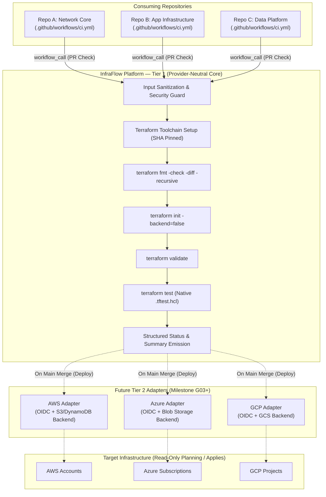
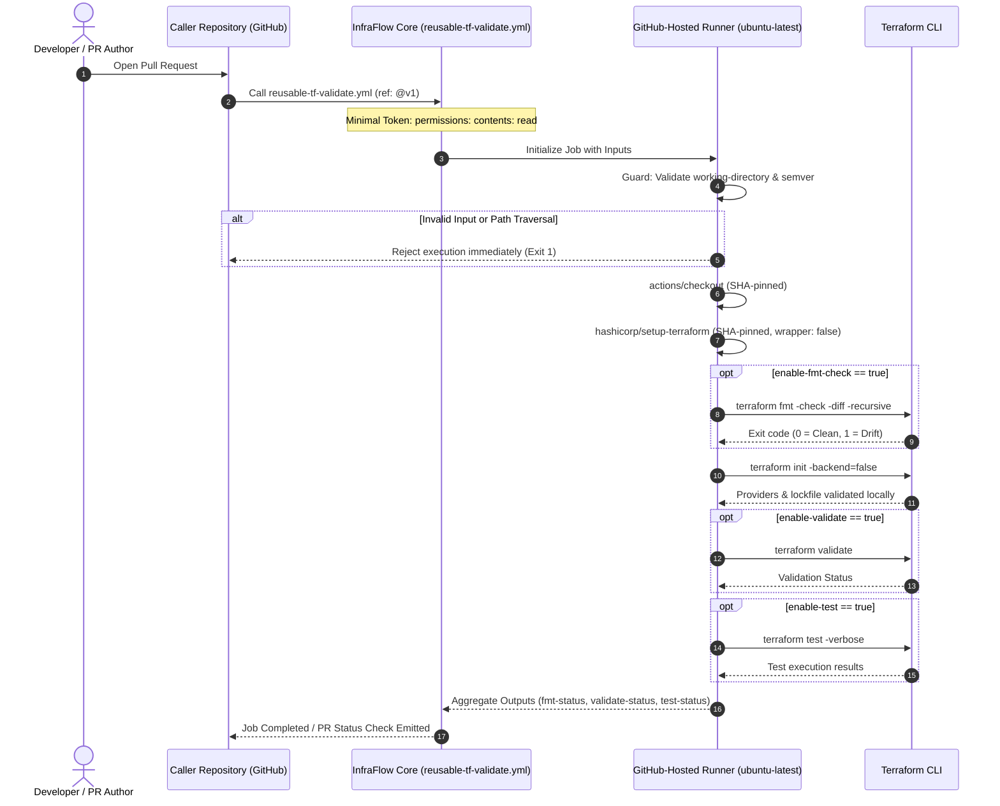

# InfraFlow — System Architecture & Workflow Design

## 1. System Vision & Architecture

**InfraFlow** is an enterprise-grade, reusable infrastructure delivery platform designed to provide a unified, secure CI/CD core across distributed engineering teams and multi-cloud environments.

Rather than duplicating GitHub Actions YAML pipelines across dozens of repositories, InfraFlow separates concerns into a **Two-Tier Architecture**:

1. **Tier 1 — Reusable Provider-Neutral CI/CD Core (`reusable-tf-validate.yml`)**:
   - Manages source checkout, toolchain installation, syntax linting, static validation, unit testing, and status reporting.
   - Operates with zero cloud credentials, zero cloud dependencies, and minimum permissions (`contents: read`).
   - Fast, deterministic, and identical across local developer workstations and remote CI runners.

2. **Tier 2 — Modular Cloud Adapters (Future AWS, Azure, GCP Extensions)**:
   - Encapsulates cloud-specific OIDC authentication (AWS AssumeRoleWithWebIdentity, Azure Federated Credentials, GCP Workload Identity Federation).
   - Manages remote state backends (S3/DynamoDB, Azure Blob, GCS) and state locking.
   - Orchestrates speculative planning (`terraform plan`) and controlled approvals/applies.
   - Plugs into the Tier 1 core without modifying provider-neutral logic.

---

## 2. Architecture Diagrams

### 2.1 Multi-Tier Platform Topology



---

### 2.2 Reusable Core Execution Pipeline



---

## 3. Workflow Specification: `reusable-tf-validate.yml`

### 3.1 Inputs Schema

| Input Name | Type | Required | Default | Description & Validation Constraint |
|---|---|---|---|---|
| `terraform-version` | `string` | No | `'1.10.4'` | SemVer string of Terraform binary (e.g., `1.10.4`, `1.11.0`). Validated against `^[0-9]+\.[0-9]+\.[0-9]+$` and enforced `>= 1.6.0`. |
| `working-directory` | `string` | No | `'.'` | Relative path to directory containing Terraform configuration. Traversal (`..`), absolute paths, and workspace escape are blocked. |
| `enable-fmt-check` | `boolean` | No | `true` | When true, enforces canonical styling via `terraform fmt -check`. |
| `enable-validate` | `boolean` | No | `true` | When true, executes `terraform validate` after backend-free initialization. |
| `enable-test` | `boolean` | No | `true` | When true, executes native tests using `terraform test`. |
| `test-var-file` | `string` | No | `''` | Optional path to a `.tfvars` file for `terraform test -var-file`. Validated against path traversal. |

### 3.2 Outputs Schema

| Output Name | Type | Description |
|---|---|---|
| `fmt-status` | `string` | Status of formatting check: `success`, `failure`, or `skipped`. |
| `validate-status` | `string` | Status of validation step: `success`, `failure`, or `skipped`. |
| `test-status` | `string` | Status of native test suite: `success`, `failure`, or `skipped`. |
| `summary` | `string` | Human-readable execution summary with step outcomes. |

### 3.3 Permissions Contract

The workflow operates under explicit least-privilege permissions:
```yaml
permissions:
  contents: read
  pull-requests: none
  id-token: none
  issues: none
  packages: none
```
This guarantees that caller PRs from forks or internal branches cannot modify repository contents, create releases, or request OIDC identity tokens during Tier 1 validation.

---

## 4. Input Sanitization & Security Guard

To prevent shell injection and path traversal, every invocation evaluates inputs inside an isolated POSIX bash guard before Terraform runs:

```bash
# Security Rule 1: No direct interpolation in bash scripts
# Inputs are mapped to environment variables:
# INPUT_WORKING_DIR="$1"
# INPUT_TF_VERSION="$2"

# Security Rule 2: Path Traversal Check
if [[ "${INPUT_WORKING_DIR}" =~ \.\. ]]; then
  echo "::error::Security Violation: Working directory path cannot contain '..' traversal sequences."
  exit 1
fi

# Security Rule 3: Character Allowlist
if [[ ! "${INPUT_WORKING_DIR}" =~ ^[a-zA-Z0-9_./-]+$ ]]; then
  echo "::error::Security Violation: Working directory contains forbidden characters."
  exit 1
fi

# Security Rule 4: SemVer Format Verification
if [[ ! "${INPUT_TF_VERSION}" =~ ^[0-9]+\.[0-9]+\.[0-9]+(-[a-zA-Z0-9.]+)?$ ]]; then
  echo "::error::Security Violation: Terraform version must be valid semantic version (e.g., 1.10.4)."
  exit 1
fi
```

---

## 5. Versioning & Consumer Release Strategy

Reusable workflows in GitHub Actions follow an immutable release strategy:

1. **Semantic Version Tags (`vX.Y.Z`)**:
   Every production release is tagged with a full semantic tag (e.g. `v1.0.0`, `v1.1.0`).
2. **Major Version Rolling Tag (`v1`)**:
   A floating major version tag (`v1`) is updated upon backward-compatible releases, allowing consumers to receive security fixes automatically.
3. **Commit SHA Referencing (`@<40-char-sha>`)**:
   High-security consumer repositories with strict compliance requirements can pin to the exact commit SHA for zero-drift immutability:
   ```yaml
   uses: my-org/infraflow/.github/workflows/reusable-tf-validate.yml@11bd71901bbe5b1630ceea73d27597364c9af683
   ```
4. **Breaking Changes**:
   Any backward-incompatible input or output changes increment the major version (`v2.0.0`), leaving `v1` pipelines completely unaffected.
