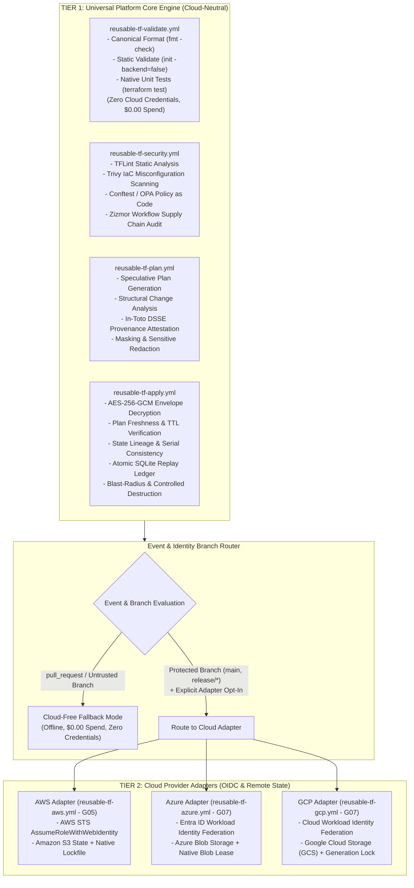
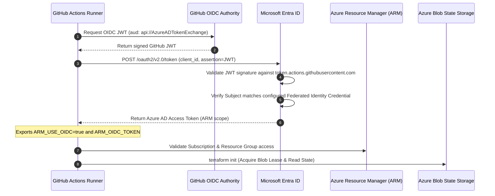
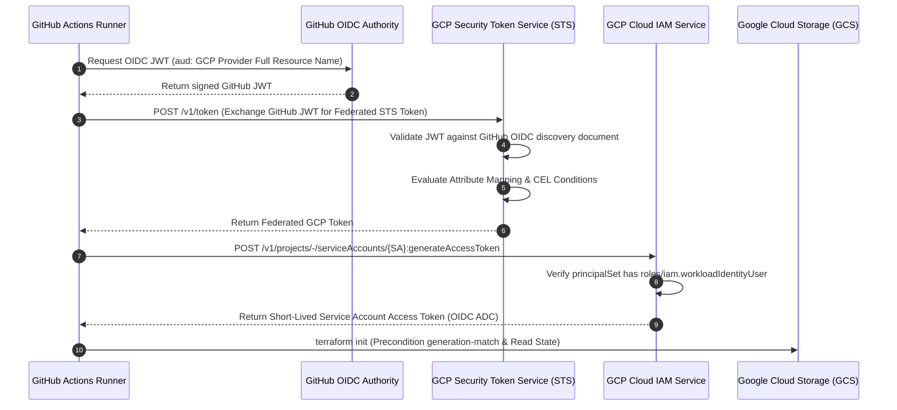
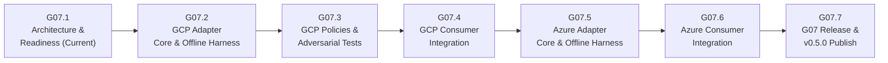

# InfraFlow G07.1 — Azure & Google Cloud Multi-Cloud Adapter Architecture & Readiness Assessment

> **Document ID:** `INFRAFLOW-ARCH-G07-001`  
> **Milestone:** G07.1 — Azure & GCP Multi-Cloud Adapter Architecture  
> **Standard:** ISO/IEC 27001:2022, NIST SP 800-218 (SSDF), CIS Software Supply Chain Security v1.0  
> **Baseline:** `main` @ `cb33ba9ec5ed7e8b2ce5907aa42d6930e7f95bd2` (Release `v0.4.0` @ `8985e2a8e9d8b4ca0337a7867a18ef077ef9c0e1`)  
> **Evaluation Mode:** Design and Architectural Discovery Only ($0.00 Cloud Spend, Zero Credentials)  
> **Classification:** Official Platform Architecture & Multi-Cloud Specification  

---

## 1. Executive Summary & Baseline Verification

### 1.1 Objective & Scope
Milestone **G07** expands InfraFlow's Tier 2 cloud adapter ecosystem to support **Microsoft Azure** (`azurerm`) and **Google Cloud Platform** (`google` / `gcs`), extending the passwordless OpenID Connect (OIDC) foundation established in **G05 (AWS)** and the cryptographic simulation safeguards established in **G06**.

This document represents the formal architectural design, threat model, adapter interface specification, and phased implementation blueprint for G07. In strict accordance with platform governance:
- **Zero Cloud Spend:** Incurs exactly $0.00 in cloud expenditure.
- **Zero Static Credentials:** Requires no Azure client secrets or GCP service account JSON keys.
- **Strict Decoupling:** Reuses 100% of the universal Tier 1 platform engine (DevSecOps scanning, speculative planning, cryptographic in-toto provenance, AES-256-GCM envelope encryption, state consistency, and blast-radius destruction protection) without duplicating shared security logic.
- **Clean Baseline:** Verified on `main` following the release of `v0.4.0`.

### 1.2 Baseline Verification Audit

```
Platform Repository : ~/projects/infraflow (TM-threemavithana/infraflow)
Current Branch      : main (up to date with origin/main)
Working Tree Status : Clean (0 uncommitted changes, 0 untracked files)
Release v0.4.0 Tag  : 8985e2a8e9d8b4ca0337a7867a18ef077ef9c0e1 (VERIFIED)
Documentation Head  : cb33ba9ec5ed7e8b2ce5907aa42d6930e7f95bd2 (VERIFIED)
Consumer Repository : ~/projects/infraflow-consumer-test (TM-threemavithana/infraflow-consumer-test)
Consumer Branch     : main (up to date with origin/main, commit 301c0da86aac791829d89fc3db8ef605dc9ea7fb)
Existing Releases   : v0.1.0, v0.2.0, v0.3.0, v0.4.0 (ALL INTACT & IMMUTABLE)
```

---

## 2. Multi-Cloud Topology & Separation of Concerns

InfraFlow enforces a strict two-tier architecture that decouples cloud-neutral CI/CD orchestration from provider-specific authentication and remote state persistence.



---

## 3. Workload Identity Federation Comparison (AWS vs. Azure vs. GCP)

All three cloud providers integrate with GitHub Actions via OpenID Connect (OIDC) through the universal issuer `https://token.actions.githubusercontent.com`. However, their exchange protocols, trust policy schemas, audience requirements, and credential scoping mechanisms differ significantly.

### 3.1 OIDC Federation Technical Comparison Matrix

| Evaluation Dimension | AWS OIDC Federation (G05 Baseline) | Azure Entra ID Workload Identity (G07) | GCP Workload Identity Federation (G07) |
| :--- | :--- | :--- | :--- |
| **Trust Anchor / Identity Authority** | AWS IAM OIDC Identity Provider | Microsoft Entra ID Federated Identity Credential (FIC) | GCP Workload Identity Pool & Provider |
| **Identity Target** | AWS IAM Role (`arn:aws:iam::...:role/...`) | Entra ID App Registration or User-Assigned Managed Identity | GCP Service Account (`...iam.gserviceaccount.com`) |
| **OIDC Audience (`aud`)** | `sts.amazonaws.com` | `api://AzureADTokenExchange` | `//iam.googleapis.com/projects/<NUM>/locations/global/workloadIdentityPools/<POOL>/providers/<PROV>` |
| **GitHub Actions Helper** | `aws-actions/configure-aws-credentials` | `azure/login` | `google-github-actions/auth` |
| **Job Permission Scoping** | `permissions: id-token: write, contents: read` | `permissions: id-token: write, contents: read` | `permissions: id-token: write, contents: read` |
| **Subject Claim Syntax** | `repo:ORG/REPO:ref:refs/heads/BRANCH` | `repo:ORG/REPO:ref:refs/heads/BRANCH` or `repo:ORG/REPO:environment:ENV` | `assertion.sub` mapped to `google.subject` or attribute mappings |
| **Immutable ID Support (Post-July 2026)** | Supported via `repo:ORG@OID/REPO@RID:...` | Supported via exact FIC subject string | Supported via custom attribute mapping |
| **Wildcard Matching Capability** | Supported via `StringLike` in IAM condition | **Strictly Prohibited** by Entra ID (Exact string matching only; max 20 FICs per identity) | Supported via Common Expression Language (CEL) conditions |
| **Token Exchange Output** | Ephemeral STS credentials (AccessKey, SecretKey, SessionToken) | Azure AD ARM Access Token (`ARM_OIDC_TOKEN`) | Ephemeral Google Access Token / Credential Configuration File |
| **Terraform Provider OIDC Binding** | Native AWS provider OIDC assume role | `ARM_USE_OIDC=true`, `ARM_CLIENT_ID`, `ARM_TENANT_ID`, `ARM_SUBSCRIPTION_ID` | `GOOGLE_APPLICATION_CREDENTIALS` (ADC file) or `access_token` |
| **Credential Lifetime** | 15–60 minutes (default 900s) | 60 minutes (Entra ID default) | 15–60 minutes (default 3600s, configurable) |

---

### 3.2 Azure Entra ID Workload Identity Federation Architecture

In Azure, passwordless federation is established by associating a **Federated Identity Credential (FIC)** with either an Entra ID App Registration (Service Principal) or a User-Assigned Managed Identity.



#### Entra ID Trust Policy Invariants
1. **Audience Exact Match:** Must strictly be `api://AzureADTokenExchange`.
2. **Subject Scoping:** Entra ID enforces **strict exact string matching**. Wildcards (`*`) are rejected by the Azure API.
   - For branch protection: `repo:TM-threemavithana/infraflow:ref:refs/heads/main`
   - For environment protection: `repo:TM-threemavithana/infraflow:environment:production`
3. **FIC Quota Containment:** Entra ID enforces a hard platform limit of **20 federated identity credentials** per application or managed identity. This necessitates consolidating branch bindings or utilizing GitHub Environments.

---

### 3.3 Google Cloud Workload Identity Federation Architecture

In Google Cloud, federation is managed via a **Workload Identity Pool** and **Workload Identity Provider**, decoupling GitHub claims from Google Service Accounts through attribute mapping and Common Expression Language (CEL) policy assertions.



#### GCP WIF Trust Policy Invariants
1. **Attribute Mapping:**
   ```
   google.subject        = assertion.sub
   attribute.repository  = assertion.repository
   attribute.ref         = assertion.ref
   attribute.actor       = assertion.actor
   attribute.environment = assertion.environment
   ```
2. **CEL Attribute Condition:**
   ```cel
   assertion.repository == 'TM-threemavithana/infraflow' &&
   (assertion.ref == 'refs/heads/main' || assertion.environment == 'production')
   ```
3. **Service Account IAM Binding:**
   ```
   member: principalSet://iam.googleapis.com/projects/<PROJECT_NUM>/locations/global/workloadIdentityPools/<POOL_ID>/attribute.repository/TM-threemavithana/infraflow
   role: roles/iam.workloadIdentityUser
   ```

---

## 4. Remote State Backend Contracts (`s3` vs. `azurerm` vs. `gcs`)

Terraform remote state backends store sensitive configuration snapshots and lock state against concurrent modification. InfraFlow standardizes all backend initialization through dynamic CLI injection (`-backend-config`), forbidding hardcoded backend credentials in repository files.

### 4.1 Remote Backend Technical Comparison Matrix

| Backend Parameter | Amazon S3 (`s3`) | Azure Blob Storage (`azurerm`) | Google Cloud Storage (`gcs`) |
| :--- | :--- | :--- | :--- |
| **Backend Provider Type** | `s3` | `azurerm` | `gcs` |
| **Target Storage Container** | S3 Bucket (`bucket`) | Storage Account Blob Container (`container_name`) | GCS Bucket (`bucket`) |
| **State Object Key** | S3 Key (`key`) | Blob Key (`key`) | Object Prefix (`prefix`) |
| **Resource Group / Project** | N/A (Global Namespace) | `resource_group_name` + `storage_account_name` | GCP Project ID |
| **Native State Locking** | S3 Conditional Writes (`use_lockfile = true`) | Azure Blob Leases (Native) | GCS Generation Preconditions (Native) |
| **Auxiliary Lock Service** | DynamoDB Table (Optional legacy) | None (Built into Blob Storage) | None (Built into GCS Storage) |
| **Server-Side Encryption** | SSE-S3 or SSE-KMS | Storage Service Encryption (SSE) / Customer-Managed Key (CMK) | Google-Managed AES-256 / Cloud KMS CMEK |
| **Versioning & Resilience** | S3 Object Versioning + MFA Delete | Blob Versioning + Soft Delete + Container Immutability | GCS Object Versioning + Retention Policy |
| **Public Access Defenses** | S3 Block Public Access (All 4 settings) | `allow_nested_items_to_be_public = false` | Uniform Bucket-Level Access (UBLA) + Public Access Prevention |
| **TLS Minimum Standard** | TLS 1.2 Enforced via Bucket Policy | `min_tls_version = "TLS1_2"` | TLS 1.2 / Google API Enforced |

---

### 4.2 Azure `azurerm` Remote Backend Contract

```hcl
# Contract Specification for Azure State Storage
terraform {
  backend "azurerm" {
    # Dynamically injected at runtime via -backend-config:
    # resource_group_name  = "rg-infraflow-tfstate"
    # storage_account_name = "stinfraflowstate"
    # container_name       = "tfstate"
    # key                  = "production/terraform.tfstate"
    # use_oidc             = true
    # use_azuread_auth     = true
  }
}
```

#### State Locking Mechanics (Azure Blob Lease)
- `azurerm` uses Azure Storage's native **Blob Leases** for state concurrency control.
- When `terraform plan` or `apply` runs, Terraform acquires a 60-second renewable or infinite lease on the `.tfstate.env.lock` or state blob.
- While the lease is active, any concurrent worker receives HTTP 412 (Precondition Failed) with `LeaseAlreadyPresent`.
- Upon command completion, Terraform releases the lease. If a worker process crashes, Azure automatically breaks expired leases if configured with renewable finite durations.

#### Least-Privilege IAM Role Separation
1. **Planning Role (`sp-infraflow-planner`)**:
   - `Storage Blob Data Reader` on the `tfstate` container.
   - `Storage Blob Data Contributor` **restricted to the `.lock` blob path** (to acquire/release lease locks).
   - `Reader` on target subscription/resource groups (to read existing infrastructure for refresh).
2. **Apply Role (`sp-infraflow-executor`)**:
   - `Storage Blob Data Contributor` on the `tfstate` container.
   - `Contributor` on target deployment resource groups.

---

### 4.3 Google Cloud `gcs` Remote Backend Contract

```hcl
# Contract Specification for Google Cloud Storage Backend
terraform {
  backend "gcs" {
    # Dynamically injected at runtime via -backend-config:
    # bucket = "bkt-infraflow-tfstate"
    # prefix = "env/production"
  }
}
```

#### State Locking Mechanics (GCS Generation Precondition)
- The `gcs` backend provides **fully native state locking without auxiliary services** using Google Cloud Storage object generation preconditions.
- When writing state or locking, Terraform issues requests with the HTTP header:
  `x-goog-if-generation-match: <GENERATION_NUMBER>`
- If another process modified the state file in the interim, the generation number mismatches and GCS rejects the transaction with HTTP 412 (Precondition Failed), preventing split-brain corruption.
- Temporary lock files (`default.tflock`) are managed with generation checks to ensure atomic acquisition.

#### Least-Privilege IAM Role Separation
1. **Planning Service Account (`sa-infraflow-planner@...`)**:
   - `roles/storage.objectViewer` on `gs://bkt-infraflow-tfstate`.
   - `roles/storage.objectUser` scoped to `gs://bkt-infraflow-tfstate/env/production/*.tflock` (for lock generation).
   - `roles/viewer` on target GCP project (for refresh).
2. **Apply Service Account (`sa-infraflow-executor@...`)**:
   - `roles/storage.objectAdmin` on `gs://bkt-infraflow-tfstate/env/production/*`.
   - Targeted service-specific Admin roles (e.g. `roles/compute.instanceAdmin`, `roles/container.admin`) on target project.

---

## 5. Architectural Cleanliness: Universal Engine vs. Cloud Adapters

A core architectural invariant of InfraFlow is **zero duplication of security and governance logic**. Cloud adapters must remain strictly scoped to authentication, input validation, and state backend connectivity.

```
+---------------------------------------------------------------------------------------+
|                       SHARED TIER 1 PLATFORM ENGINE (100% REUSED)                     |
|                                                                                       |
|  1. reusable-tf-validate.yml:                                                         |
|     - terraform fmt -check (Canonical formatting check)                               |
|     - terraform init -backend=false (Cloud-free static validation)                    |
|     - terraform test -verbose (Native unit tests with mock providers)                 |
|                                                                                       |
|  2. reusable-tf-security.yml:                                                         |
|     - TFLint static analysis with ruleset validation                                  |
|     - Trivy IaC misconfiguration scanner (HIGH,CRITICAL thresholds)                   |
|     - Conftest / OPA Rego policy-as-code evaluation                                   |
|     - Zizmor GitHub Actions workflow supply chain audit                               |
|                                                                                       |
|  3. reusable-tf-plan.yml:                                                             |
|     - terraform plan -out=tfplan (Speculative planning)                               |
|     - scripts/analyze-plan.py (Resource change calculation & delta metrics)           |
|     - scripts/verify-plan-integrity.py (In-toto DSSE signature attestation)           |
|     - Schema-aware redaction (after_sensitive masking of secrets)                     |
|                                                                                       |
|  4. reusable-tf-apply.yml:                                                            |
|     - scripts/kms-envelope.py (AES-256-GCM AEAD client envelope encryption)           |
|     - scripts/verify-plan-lifecycle.py (TTL expiration, state serial consistency,     |
|       atomic SQLite WAL replay ledger)                                                |
|     - scripts/assess-destruction.py (Blast-radius thresholds, destruction confirmation |
|       contracts, execution recovery state machine)                                    |
+---------------------------------------------------------------------------------------+
                                           |
                   +-----------------------+-----------------------+
                   |                                               |
                   v                                               v
+--------------------------------------+       +--------------------------------------+
|     TIER 2: AZURE CLOUD ADAPTER      |       |      TIER 2: GCP CLOUD ADAPTER       |
|      (reusable-tf-azure.yml)         |       |        (reusable-tf-gcp.yml)         |
|                                      |       |                                      |
| - Azure input guard validation       |       | - GCP input guard validation         |
| - Passwordless Entra ID OIDC login   |       | - Passwordless GCP WIF authentication|
| - azurerm backend injection          |       | - gcs backend injection              |
| - Native Azure Blob Lease locking    |       | - Native GCS generation locking      |
| - Environment variable containment   |       | - Environment variable containment   |
|   (ARM_CLIENT_ID, ARM_OIDC_TOKEN)    |       |   (GOOGLE_APPLICATION_CREDENTIALS)   |
+--------------------------------------+       +--------------------------------------+
```

### Prohibited Duplications in Cloud Adapters
- **No In-Workflow Security Scanners:** Cloud adapters must not re-implement custom Trivy or TFLint steps; they must call or compose with `reusable-tf-security.yml`.
- **No Provider-Specific Provenance Formats:** Attestation remains standardized on in-toto DSSE statements; cloud adapters do not create proprietary metadata envelopes.
- **No Custom State Locking Ledgers:** Cloud adapters rely on native backend locking (`azurerm` blob leases, `gcs` generation matches) combined with InfraFlow's universal SQLite pre-execution replay ledger.
- **No Bypass of SEC-02:** Pull requests are strictly forbidden from enabling live cloud authentication across all adapters.

---

## 6. Adapter Reusable Workflow Contracts

### 6.1 Azure Cloud Adapter Specification (`reusable-tf-azure.yml`)

#### Inputs Contract
```yaml
inputs:
  azure-client-id:
    description: "Microsoft Entra ID Application (Client) ID for OIDC federation"
    required: false
    default: ""
    type: string
  azure-tenant-id:
    description: "Microsoft Entra ID Directory (Tenant) ID (UUIDv4)"
    required: false
    default: ""
    type: string
  azure-subscription-id:
    description: "Target Azure Subscription ID (UUIDv4)"
    required: false
    default: ""
    type: string
  backend-resource-group:
    description: "Azure Resource Group containing state storage account"
    required: false
    default: ""
    type: string
  backend-storage-account:
    description: "Azure Storage Account name for state storage (3-24 lowercase alphanumeric)"
    required: false
    default: ""
    type: string
  backend-container:
    description: "Azure Blob Storage container name for state storage"
    required: false
    default: "tfstate"
    type: string
  backend-key:
    description: "Blob path for state file (e.g. production/terraform.tfstate)"
    required: false
    default: ""
    type: string
  terraform-version:
    description: "Terraform version (>= 1.6.0)"
    required: false
    default: "1.10.4"
    type: string
  working-directory:
    description: "Relative path to Terraform root configuration"
    required: false
    default: "."
    type: string
  environment:
    description: "Target deployment environment context"
    required: false
    default: "production"
    type: string
  enable-azure-auth:
    description: "Opt-in to authenticate against Azure via OIDC (default false for offline CI)"
    required: false
    default: false
    type: boolean
  enable-policy-evaluation:
    description: "Whether to execute Conftest / OPA policy checks"
    required: false
    default: true
    type: boolean
  enable-trivy:
    description: "Whether to execute Trivy IaC misconfiguration scanning"
    required: false
    default: true
    type: boolean
  severity-threshold:
    description: "Severity levels that trigger failure. Must be 'HIGH,CRITICAL'."
    required: false
    default: "HIGH,CRITICAL"
    type: string
  fail-on-destructive:
    description: "Whether to fail plan generation if deletions or replacements occur"
    required: false
    default: true
    type: boolean
```

#### Outputs Contract
```yaml
outputs:
  plan-status:
    description: "Outcome of speculative plan generation (success, failure, skipped)"
    value: ${{ jobs.summary.outputs.plan-status }}
  azure-auth-status:
    description: "Outcome of Azure authentication (success, skipped, disabled)"
    value: ${{ jobs.summary.outputs.azure-auth-status }}
  security-status:
    description: "Outcome of security scanning and policy evaluation"
    value: ${{ jobs.summary.outputs.security-status }}
  authorization-status:
    description: "Outcome of verified adapter gate (authorized, not-applicable, rejected)"
    value: ${{ jobs.summary.outputs.authorization-status }}
  has-changes:
    description: "Whether the plan contains modifying resource changes"
    value: ${{ jobs.summary.outputs.has-changes }}
  has-destructive-changes:
    description: "Whether the plan contains deletions or replacements"
    value: ${{ jobs.summary.outputs.has-destructive-changes }}
  total-changes:
    description: "Total count of modifying resource changes"
    value: ${{ jobs.summary.outputs.total-changes }}
```

---

### 6.2 GCP Cloud Adapter Specification (`reusable-tf-gcp.yml`)

#### Inputs Contract
```yaml
inputs:
  workload-identity-provider:
    description: "Full identifier of GCP Workload Identity Provider (projects/<NUM>/locations/global/workloadIdentityPools/<POOL>/providers/<PROV>)"
    required: false
    default: ""
    type: string
  service-account:
    description: "Google Service Account email to impersonate via Workload Identity"
    required: false
    default: ""
    type: string
  gcp-project-id:
    description: "Target Google Cloud Project ID"
    required: false
    default: ""
    type: string
  backend-bucket:
    description: "Google Cloud Storage bucket name for state storage"
    required: false
    default: ""
    type: string
  backend-prefix:
    description: "GCS object prefix for state storage (e.g. env/production)"
    required: false
    default: "terraform/state"
    type: string
  terraform-version:
    description: "Terraform version (>= 1.6.0)"
    required: false
    default: "1.10.4"
    type: string
  working-directory:
    description: "Relative path to Terraform root configuration"
    required: false
    default: "."
    type: string
  environment:
    description: "Target deployment environment context"
    required: false
    default: "production"
    type: string
  enable-gcp-auth:
    description: "Opt-in to authenticate against GCP via OIDC (default false for offline CI)"
    required: false
    default: false
    type: boolean
  enable-policy-evaluation:
    description: "Whether to execute Conftest / OPA policy checks"
    required: false
    default: true
    type: boolean
  enable-trivy:
    description: "Whether to execute Trivy IaC misconfiguration scanning"
    required: false
    default: true
    type: boolean
  severity-threshold:
    description: "Severity levels that trigger failure. Must be 'HIGH,CRITICAL'."
    required: false
    default: "HIGH,CRITICAL"
    type: string
  fail-on-destructive:
    description: "Whether to fail plan generation if deletions or replacements occur"
    required: false
    default: true
    type: boolean
```

#### Outputs Contract
```yaml
outputs:
  plan-status:
    description: "Outcome of speculative plan generation (success, failure, skipped)"
    value: ${{ jobs.summary.outputs.plan-status }}
  gcp-auth-status:
    description: "Outcome of GCP authentication (success, skipped, disabled)"
    value: ${{ jobs.summary.outputs.gcp-auth-status }}
  security-status:
    description: "Outcome of security scanning and policy evaluation"
    value: ${{ jobs.summary.outputs.security-status }}
  authorization-status:
    description: "Outcome of verified adapter gate (authorized, not-applicable, rejected)"
    value: ${{ jobs.summary.outputs.authorization-status }}
  has-changes:
    description: "Whether the plan contains modifying resource changes"
    value: ${{ jobs.summary.outputs.has-changes }}
  has-destructive-changes:
    description: "Whether the plan contains deletions or replacements"
    value: ${{ jobs.summary.outputs.has-destructive-changes }}
  total-changes:
    description: "Total count of modifying resource changes"
    value: ${{ jobs.summary.outputs.total-changes }}
```

---

## 7. Cloud-Free Offline Validation Strategy

To maintain InfraFlow's strict **zero cloud spend ($0.00)** invariant, multi-cloud testing must execute 100% offline using deterministic local fixtures, mock providers, and Policy-as-Code.

### 7.1 Native Terraform Mock Providers (`terraform test`)
Introduced in Terraform 1.7.0, native `mock_provider` blocks simulate provider responses during `terraform test` without downloading provider binaries from external registries or communicating with cloud APIs:

#### Azure Reference Module Test (`azure_test.tftest.hcl`)
```hcl
mock_provider "azurerm" {}

variables {
  resource_group_name  = "rg-infraflow-prod"
  storage_account_name = "stinfraflowprod"
  location             = "eastus"
}

run "verify_azure_storage_baseline" {
  command = plan

  assert {
    condition     = azurerm_storage_account.state.allow_nested_items_to_be_public == false
    error_message = "Storage account must not permit public blob access"
  }

  assert {
    condition     = azurerm_storage_account.state.min_tls_version == "TLS1_2"
    error_message = "Storage account must enforce TLS 1.2"
  }
}
```

#### GCP Reference Module Test (`gcp_test.tftest.hcl`)
```hcl
mock_provider "google" {}

variables {
  project_id  = "infraflow-production"
  bucket_name = "bkt-infraflow-tfstate"
  location    = "US"
}

run "verify_gcs_bucket_baseline" {
  command = plan

  assert {
    condition     = google_storage_bucket.state.uniform_bucket_level_access == true
    error_message = "GCS bucket must enforce uniform bucket-level access"
  }

  assert {
    condition     = google_storage_bucket.state.versioning[0].enabled == true
    error_message = "GCS bucket must enable object versioning"
  }
}
```

---

### 7.2 OPA Rego Multi-Cloud Policy Architecture
InfraFlow will expand its policy suite with provider-specific trust and configuration rules:

1. **`policies/azure/entra_oidc.rego`**:
   - Rejects wildcard subjects (`*` or partial `repo:*`).
   - Rejects untrusted `pull_request` subjects.
   - Enforces audience strictly equals `api://AzureADTokenExchange`.
   - Validates Entra ID Application ID and Tenant ID GUID formatting.
2. **`policies/gcp/wif_oidc.rego`**:
   - Rejects Workload Identity Pool mappings lacking `attribute.repository`.
   - Rejects broad CEL conditions (e.g. matching only `assertion.repository_owner`).
   - Enforces service account impersonation restricted to specific repositories.
3. **`policies/azure/storage_backend.rego`**:
   - Validates storage accounts enforce TLS 1.2, private endpoints, and disabled public blob access.
4. **`policies/gcp/storage_backend.rego`**:
   - Validates GCS buckets enforce Uniform Bucket-Level Access (UBLA), public access prevention, and object versioning.

---

### 7.3 Local Validation Script Expansion (`scripts/validate-local.sh`)
The local test runner will be expanded with Sections 17 and 18, following the established Section 15 (AWS) pattern:
- **Section 17: Azure Cloud Adapter & Entra ID OIDC Architecture (G07.2)** (25 checks).
- **Section 18: GCP Cloud Adapter & WIF Architecture (G07.5)** (25 checks).

---

## 8. Threat Model & Failure Modes

### 8.1 Threat Matrix

| Threat ID | Threat Scenario | Attack Vector | Impact | InfraFlow Mitigation |
| :--- | :--- | :--- | :--- | :--- |
| **THREAT-G07-01** | Untrusted PR Token Exfiltration | Attacker submits PR modifying workflow to request Azure/GCP OIDC token. | Unauthorized access to cloud subscription or project. | **SEC-02 Enforcement:** Workflow guard strictly rejects `pull_request` and `pull_request_target` events from enabling live authentication. |
| **THREAT-G07-02** | Wildcard Subject Assumption | Overly permissive FIC or WIF mapping allows any repo in an organization to authenticate. | Cross-repository lateral movement in cloud tenant. | **Policy-as-Code:** OPA Rego rules reject wildcards in Entra ID FIC subjects and GCP WIF CEL conditions. |
| **THREAT-G07-03** | Storage Key Fallback Bypass | Workflows fall back to long-lived Azure Storage Shared Access Signatures or GCP Service Account keys. | Static credential exposure and secret sprawl. | **Strict OIDC Mandate:** Backends configure `use_azuread_auth = true` and Google ADC. Static key inputs are prohibited. |
| **THREAT-G07-04** | State Locking Hijacking / Stale Lease | Concurrent workers attempt conflicting applies or fail to release Azure blob leases. | State file corruption or indefinitely blocked CI pipelines. | **Native Locking + Replay Ledger:** Native blob leases and GCS generation preconditions reject concurrent execution. Crash recovery clears transient runner locks. |
| **THREAT-G07-05** | Cloud Provider API Downtime | Entra ID or GCP STS experiences transient availability degradation. | Unhandled pipeline failures or unpredictable half-configured runs. | **Fail-Closed Semantics:** Any token exchange failure immediately halts the workflow before state initialization. |
| **THREAT-G07-06** | Cross-Environment State Collision | Non-production workflow writes state into production storage container or bucket. | Destruction or corruption of production infrastructure state. | **Context Binding:** Storage containers/buckets, prefixes, and KMS envelopes are cryptographically bound to the environment name in AAD. |

---

## 9. Comparative Analysis & Implementation Sequencing Recommendation

A critical technical decision in G07 is determining whether **Microsoft Azure** or **Google Cloud Platform** should be implemented first.

### 9.1 Multi-Dimensional Comparative Trade-Off Matrix

| Evaluation Dimension | Microsoft Azure (`azurerm`) | Google Cloud Platform (`gcs`) | Advantage |
| :--- | :--- | :--- | :---: |
| **Authentication Complexity** | Requires 4 distinct inputs (`client-id`, `tenant-id`, `subscription-id`, and federated credential). Strict exact-match subject strings. Max 20 FICs per identity. | Requires Workload Identity Provider resource string + Service Account email. Flexible attribute mapping via CEL. | **GCP** (Cleaner API ergonomics, fewer distinct identifiers) |
| **State Locking Reliability** | Relies on Azure Blob Leases. If a CI worker crashes without executing cleanup, leases can remain locked for their lease duration (or indefinitely if infinite). | Uses native GCS object generation preconditions (`x-goog-if-generation-match`). Fully atomic, zero lease state to clean up after worker crashes. | **GCP** (Mathematically race-free, stateless locking) |
| **Offline Tooling & Mockability** | `mock_provider "azurerm"` requires mocking complex subscription and tenant structures in HCL. | `mock_provider "google"` has lightweight project/bucket structures that evaluate exceptionally fast. | **GCP** (Faster, lighter offline execution) |
| **Enterprise Market Share** | Significant enterprise adoption for hybrid-cloud and Windows/Linux multi-cloud infrastructure. | Rapidly growing adoption in AI/ML, data platforms, and cloud-native engineering. | **Azure** (Broader traditional enterprise penetration) |
| **GitHub Actions Ecosystem Maturity** | `azure/login@v2` is mature but historical versions had environment-variable scoping quirks. | `google-github-actions/auth@v2` is widely regarded as the gold standard for OIDC credential configuration. | **GCP** (Best-in-class GitHub Actions integration) |

### 9.2 Definitive Sequencing Recommendation

> [!TIP]
> **RECOMMENDATION: IMPLEMENT GOOGLE CLOUD (GCP) FIRST (G07.2), FOLLOWED BY MICROSOFT AZURE (G07.5).**

#### Technical Justification:
1. **Stateless State Locking**: GCP's GCS backend utilizes object generation match preconditions (`x-goog-if-generation-match`). This eliminates the stateful lease expiration and orphan-lease cleanup challenges inherent in Azure Blob Storage, making it significantly more reliable during offline test harness development.
2. **Architectural Parity with AWS**: The GCP Workload Identity Pool model (mapping issuer claims to pool attributes and validating conditions via CEL) closely mirrors the AWS IAM OIDC model (`Condition: StringEquals / StringLike`). This allows rapid, clean adaptation of existing G05 Rego policies and test harnesses.
3. **Ergonomic GitHub Actions Action**: `google-github-actions/auth` outputs standard Application Default Credentials (ADC) files, allowing Terraform's Google provider to authenticate without managing multiple ambient environment variables.
4. **Iterative Complexity Ramp**: Implementing GCP first establishes the multi-cloud abstraction layer with minimal friction. Azure can then be implemented in G07.5 to tackle Entra ID's 20-FIC quota constraints and blob lease state machine handling on a mature multi-cloud foundation.

---

## 10. Phased Implementation Roadmap (G07.2 — G07.7)



### Milestone Breakdown

#### Milestone G07.2 — GCP Cloud Adapter Core & Offline Harness
- Implement `reusable-tf-gcp.yml` with input sanitization guard.
- Create `examples/gcp-reference-module` with `versions.tf`, `variables.tf`, `main.tf`, `outputs.tf`.
- Implement offline mock provider tests (`gcp_test.tftest.hcl`).
- Add Section 17 to `scripts/validate-local.sh` (Actionlint, Zizmor, input guard tests).

#### Milestone G07.3 — GCP Policy-as-Code & Adversarial Validation
- Implement `policies/gcp/wif_oidc.rego` (validating Workload Identity Pool attribute mappings, principalSet bounds, and CEL rules).
- Implement `policies/gcp/storage_backend.rego` (UBLA, public access prevention, versioning).
- Author comprehensive Rego unit test suite (`wif_oidc_test.rego`, `storage_backend_test.rego`).
- Expand adversarial negative tests covering GCP credential injection, project spoofing, and PR bypass.

#### Milestone G07.4 — GCP External Consumer Integration
- Update external consumer repository (`TM-threemavithana/infraflow-consumer-test`) with `infraflow-gcp-plan.yml`.
- Execute live GitHub Actions CI across push, pull request, and negative security scenarios.
- Verify zero regressions across G04, G05, and G06 consumer workflows.
- Author external integration evidence report.

#### Milestone G07.5 — Azure Cloud Adapter Core & Entra ID Policy Suite
- Implement `reusable-tf-azure.yml` with input sanitization guard.
- Create `examples/azure-reference-module` with `versions.tf`, `variables.tf`, `main.tf`, `outputs.tf`.
- Implement offline mock provider tests (`azure_test.tftest.hcl`).
- Implement `policies/azure/entra_oidc.rego` (validating Entra ID FIC subject formatting, exact string matching, and audience).
- Implement `policies/azure/storage_backend.rego` (TLS 1.2, private endpoints, blob access).
- Add Section 18 to `scripts/validate-local.sh`.

#### Milestone G07.6 — Azure External Consumer Integration & Multi-Cloud Matrix
- Add `infraflow-azure-plan.yml` to consumer repository.
- Execute live GitHub Actions CI matrix verifying concurrent AWS, GCP, and Azure workflow execution.
- Validate mutual credential isolation (ensuring AWS, Azure, and GCP credentials never cross-pollinate).
- Author multi-cloud consumer integration evidence report.

#### Milestone G07.7 — G07 Final Stabilization & v0.5.0 Release
- Execute full regression suite (300+ local quality checks).
- Publish release evidence report `docs/evidence/G07/G07-FINAL-RELEASE-REPORT.md`.
- Merge platform and consumer PRs.
- Publish official release tag **`v0.5.0`** with multi-cloud support.

---

## 11. Acceptance Criteria Framework (G07)

| Criterion ID | Objective | Description | Verification Method | Status |
| :--- | :--- | :--- | :--- | :---: |
| **AC-G07-01** | Multi-Cloud Architectural Blueprint | Formalize multi-cloud adapter specifications, remote backend contracts, OIDC trust models, and sequencing recommendations. | Architectural review of `G07-MULTICLOUD-READINESS-ASSESSMENT.md` | **PASS (G07.1)** |
| **AC-G07-02** | GCP Reusable Adapter Contract | Implement `.github/workflows/reusable-tf-gcp.yml` with least-privilege inputs, immutable SHA pinning, and SEC-02 execution guards. | `actionlint`, `zizmor`, input guard unit tests | Planned (G07.2) |
| **AC-G07-03** | GCP Reference Module & Offline Tests | Implement `examples/gcp-reference-module` verified offline via native `mock_provider "google"` without downloading provider binaries. | `terraform fmt`, `init -backend=false`, `test -verbose` | Planned (G07.2) |
| **AC-G07-04** | GCP WIF Policy as Code | Enforce GCP Workload Identity Federation guardrails via OPA Rego policies (`policies/gcp/wif_oidc.rego`). | `conftest verify` test suite | Planned (G07.3) |
| **AC-G07-05** | GCP Storage Backend Security Policy | Validate GCS bucket configuration security (UBLA, versioning, public access prevention). | `conftest test` against synthetic plan JSON | Planned (G07.3) |
| **AC-G07-06** | GCP Consumer Integration | Execute positive cloud-free planning and negative security tests on external consumer repository. | External GitHub Actions CI execution | Planned (G07.4) |
| **AC-G07-07** | Azure Reusable Adapter Contract | Implement `.github/workflows/reusable-tf-azure.yml` with Entra ID OIDC parameters, immutable SHA pinning, and SEC-02 execution guards. | `actionlint`, `zizmor`, input guard unit tests | Planned (G07.5) |
| **AC-G07-08** | Azure Reference Module & Offline Tests | Implement `examples/azure-reference-module` verified offline via native `mock_provider "azurerm"`. | `terraform fmt`, `init -backend=false`, `test -verbose` | Planned (G07.5) |
| **AC-G07-09** | Azure Entra ID Policy as Code | Enforce Entra ID Federated Identity Credential guardrails via OPA Rego policies (`policies/azure/entra_oidc.rego`). | `conftest verify` test suite | Planned (G07.5) |
| **AC-G07-10** | Azure Storage Backend Security Policy | Validate Azure storage account security (TLS 1.2, private endpoint, nested public blob access disabled). | `conftest test` against synthetic plan JSON | Planned (G07.5) |
| **AC-G07-11** | Azure Consumer Integration | Execute positive cloud-free planning and negative security tests on external consumer repository. | External GitHub Actions CI execution | Planned (G07.6) |
| **AC-G07-12** | Multi-Cloud Tri-Adapter CI Matrix | Concurrently execute AWS, GCP, and Azure adapters in consumer CI with zero cross-adapter credential leakage. | Matrix CI execution & log audit | Planned (G07.6) |
| **AC-G07-13** | SEC-02 Universal Enforcement | Untrusted pull requests unconditionally blocked from live cloud authentication across all three adapters. | Negative PR simulation tests | Planned (G07.6) |
| **AC-G07-14** | Universal Engine Integrity | G04 planning, G04.1 provenance, G05 AWS adapter, and G06 protected apply simulation operate with zero regressions. | 300+ check local test harness | Planned (G07.7) |
| **AC-G07-15** | $0.00 Cloud Expenditure Invariant | All development, testing, and CI validation across AWS, GCP, and Azure incur exactly $0.00 in cloud spending. | Billing audit & mock verification | Planned (G07.7) |
| **AC-G07-16** | v0.5.0 Release Certification | Publish official platform release `v0.5.0` with full multi-cloud documentation and evidence reports. | GitHub Release publication | Planned (G07.7) |

---

## 12. Conclusion & Next Steps

Milestone **G07.1** establishes the complete architectural foundation for InfraFlow's multi-cloud future. By decoupling provider-specific OIDC handshakes and remote state contracts from the universal Tier 1 platform engine, InfraFlow achieves clean, maintainable, multi-cloud scalability while preserving strict zero-cloud-spend offline validation.

**Next Immediate Action:** Await operator review of this architectural readiness assessment before proceeding to **Milestone G07.2: Google Cloud (GCP) Adapter Core & Offline Harness**.
