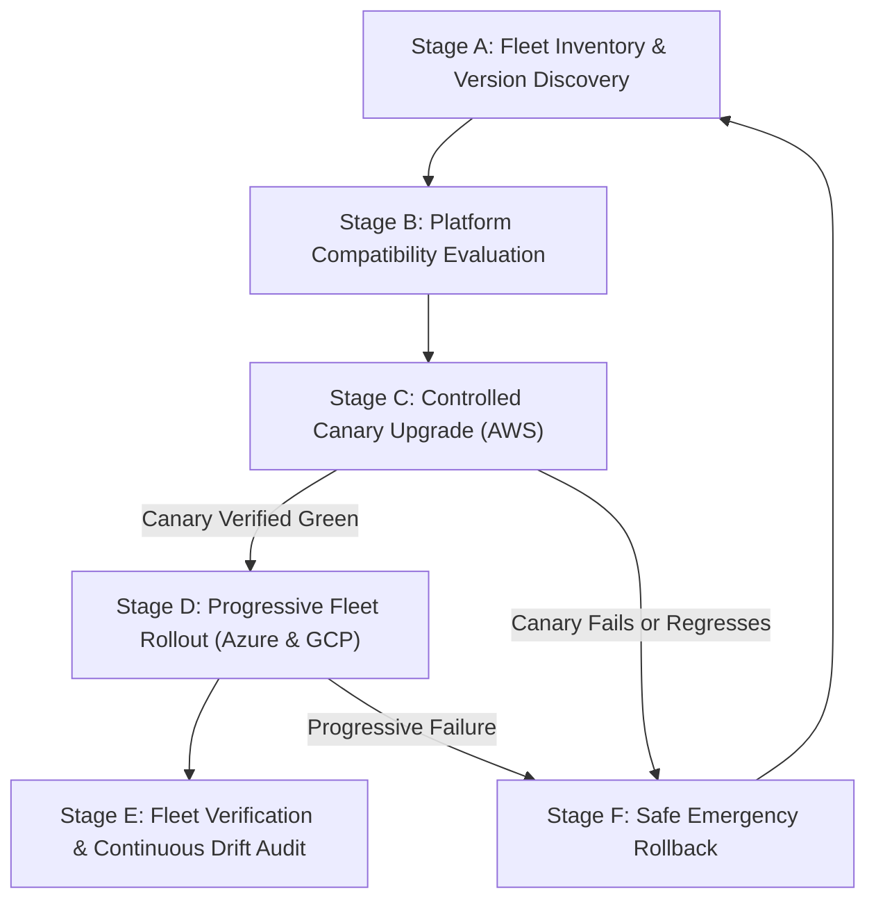

# InfraFlow Architecture Decision: Fleet-Wide Upgrade Orchestration, Configuration Drift & Rollback (G08.4)

## Status

**Approved & Implemented (Milestone G08.4)**

---

## 1. Context & Motivation

As InfraFlow scales from single-repository adoption to a multi-repository fleet across independent teams and multi-cloud environments (AWS, Azure, GCP), managing platform upgrades safely, reliably, and deterministically becomes critical.

Without centralized orchestration and strict validation:
1. **Uncoordinated Upgrades:** Independent teams may adopt untested platform commits or mutable branches (`@main`, `@latest`), introducing supply chain vulnerabilities and breaking changes.
2. **Configuration Drift:** Consumers may diverge from platform governance baselines (e.g., lowering deletion thresholds, disabling scanners, modifying workflow contracts).
3. **Rollback Ambiguity:** When an upgrade causes issues, teams lack an automated, atomic mechanism to restore the previously validated baseline commit.
4. **Blast Radius Exposure:** Upgrading the entire fleet simultaneously risks wide-scale disruption if subtle regressions escape upstream testing.

InfraFlow Milestone G08.4 solves these challenges by establishing an auditable, six-stage upgrade lifecycle, a centralized fleet manifest, automated drift detection across 15 vectors, canary isolation, progressive rollout coordination, and atomic rollback guarantees.

---

## 2. Strict Scope & Invariants

1. **Cloud-Free Scope Boundary:**
   - **Configuration / Version / Governance Drift:** Governed completely offline and in CI via repository metadata, config schemas, workflow contracts, and immutable commit SHAs ($0.00 cloud cost, zero credentials).
   - **Cloud Infrastructure Drift:** Actual live cloud infrastructure drift detection requires authenticated cloud provider APIs (`aws tf plan`, `azurerm`, `google`), live credentials, and remote state locks, which are strictly out of scope for the cloud-free foundation.
2. **Immutable Commit Pinning:**
   - All references to platform reusable workflows (`uses: TM-threemavithana/infraflow/.github/workflows/...@<SHA>`) and configuration contracts (`platform_sha: "<SHA>"`) MUST be exact 40-character hexadecimal commit SHAs. Mutable tags (`v0.5.0`) and branches (`main`) are strictly rejected fail-closed.
3. **No PR Merges or Release Publishing:**
   - Upstream Platform PR #6 and consumer PRs remain open in pull request testing state. Release `v0.6.0` is NOT published during G08.4.

---

## 3. Six-Stage Fleet Upgrade Lifecycle

InfraFlow models fleet upgrades as a deterministic six-stage state machine:

### Stage A: Fleet Inventory & Version Discovery
- The central fleet manifest (`config/fleet-manifest.yaml`) registers all active consumer repositories, team ownership, workload types, expected cloud adapters, current pinned SHAs, and caller workflows.
- `plan-fleet-upgrade.py --inventory` scans all consumer repositories and reports their active platform pins, governance invocation status, and workflow integrity.

### Stage B: Platform Compatibility Matrix Evaluation
- Before any consumer is touched, the candidate platform commit (`candidate_sha`) is verified against the mandatory workflow contracts of every registered cloud adapter:
  - AWS: `reusable-tf-aws.yml` (requires outputs `plan-status`, `aws-auth-status`, `security-status`, `authorization-status`, `has-changes`, `has-destructive-changes`, `total-changes`)
  - Azure: `reusable-tf-azure.yml` (requires outputs `plan-status`, `azure-auth-status`, `security-status`, `authorization-status`, `has-changes`, `has-destructive-changes`, `total-changes`)
  - GCP: `reusable-tf-gcp.yml` (requires outputs `plan-status`, `gcp-auth-status`, `security-status`, `authorization-status`, `has-changes`, `has-destructive-changes`, `total-changes`)
  - Generic: `reusable-tf-validate.yml` (requires outputs `fmt-status`, `validate-status`, `test-status`)
- Any missing mandatory output or contract breaking change blocks rollout execution immediately (fail-closed).

### Stage C: Controlled Canary Upgrade (AWS Networking)
- The designated canary consumer (`consumer-networking`, AWS adapter) is upgraded first.
- The platform tool updates `infraflow.config.yaml` and `.github/workflows/infraflow-ci.yml` in the canary repository to the candidate SHA.
- Isolation Invariant: During canary execution, all other consumers (`consumer-application`, `consumer-data-platform`) remain strictly pinned to their known-good baseline (`known_good_rollback_sha`).
- The canary CI run must pass 100% of its jobs (governance gate, security scanners, speculative plan) before progressive rollout is unlocked.

### Stage D: Multi-Repository Progressive Rollout
- Once the canary run succeeds, progressive rollout applies updates to the remaining fleet members in sequence or controlled batches (`consumer-application` on Azure, followed by `consumer-data-platform` on GCP).
- Each repository independently executes local validation (`validate-consumer.py`, `terraform test`) and upstream GitHub Actions CI.

### Stage E: Fleet Verification & Drift Audit
- Continuous auditing via `scripts/audit-consumer-fleet.py` and `plan-fleet-upgrade.py --check-drift` evaluates fleet alignment.
- Audits classify drift severity into `CRITICAL`, `HIGH`, `LOW`, and `NONE`.

### Stage F: Safe Emergency Rollback
- If any stage encounters regression, failure, or security policy rejection, `plan-fleet-upgrade.py --rollback` atomically restores `infraflow.config.yaml` and caller workflows back to `known_good_rollback_sha` (`f1ad39fb0f0bdce7c475ed36e717e859b2e9b106`).

---

## 4. 15-Vector Configuration Drift Taxonomy

InfraFlow distinguishes between three categories of drift:
1. **Configuration Drift:** Modifications to local consumer config files (`infraflow.config.yaml`) that violate platform standards.
2. **Version Drift:** Consumers lagging behind or advancing beyond authorized platform commit SHAs.
3. **Governance Drift:** Consumers bypassing central reusable governance workflows or altering GitHub server-side branch protections.

| Drift Vector | Category | Description | Detection Mechanism | Enforcement Severity |
| :--- | :--- | :--- | :--- | :--- |
| **DRIFT-01** | Version Drift | Consumer `platform_sha` differs from manifest target SHA | `plan-fleet-upgrade.py --check-drift` | HIGH |
| **DRIFT-02** | Version Drift | Mutable version reference (`@main`, `@latest`, `@v0.5.0`) | `validate-consumer.py` | CRITICAL |
| **DRIFT-03** | Version Drift | Conflicting SHA references between config and CI workflow | `plan-fleet-upgrade.py` | CRITICAL |
| **DRIFT-04** | Governance Drift | Missing `reusable-tf-governance.yml` invocation in caller CI | `audit-consumer-fleet.py` | CRITICAL |
| **DRIFT-05** | Governance Drift | Missing required adapter workflow (`reusable-tf-aws.yml`, etc.) | `validate-consumer.py` | CRITICAL |
| **DRIFT-06** | Configuration Drift | Security scanners disabled (`enforce_mandatory_scanners: false`)| OPA Policy / Conftest | CRITICAL |
| **DRIFT-07** | Configuration Drift | Unauthorized permission escalation (`permissions: write-all`) | Actionlint / Zizmor / OPA | CRITICAL |
| **DRIFT-08** | Configuration Drift | Unauthorized trigger introduced (`pull_request_target`) | Actionlint / Conftest | CRITICAL |
| **DRIFT-09** | Configuration Drift | Live cloud auth request enabled in cloud-free configuration | `validate-consumer.py` | CRITICAL |
| **DRIFT-10** | Configuration Drift | Deletion ceiling exceeded (`max_allowed_deletions > 25`) | OPA Policy / Conftest | HIGH |
| **DRIFT-11** | Configuration Drift | Terraform directory path traversal (`terraform_dir: "../"`) | `validate-consumer.py` | CRITICAL |
| **DRIFT-12** | Configuration Drift | Symlink escape in terraform configuration directory | Pre-execution security guard | CRITICAL |
| **DRIFT-13** | Governance Drift | GitHub server-side ruleset missing or not enforced | `audit-consumer-fleet.py` | HIGH (reported) |
| **DRIFT-14** | Governance Drift | Latest CI run conclusion failed or missing | `audit-consumer-fleet.py` | HIGH |
| **DRIFT-15** | Configuration Drift | Unknown or unauthorized keys in `infraflow.config.yaml` | Schema validation (Strict) | HIGH |

---

## 5. Rollback Contract & Atomicity

The rollback contract guarantees that a consumer repository can be returned to a known-safe baseline in a single atomic operation:
- `plan-fleet-upgrade.py --rollback --consumer <ID>`
- Identifies `rollback_sha` registered in `config/fleet-manifest.yaml` (default: `f1ad39fb0f0bdce7c475ed36e717e859b2e9b106`).
- Atomically rewires `platform_sha` in `infraflow.config.yaml` and all `@<sha>` workflow invocations in `.github/workflows/`.
- Re-executes `validate-consumer.py` to confirm that the restored state conforms to the platform contract.
- Guarantees zero partial application: if any file cannot be updated or validated, the operation aborts and restores backups.

---

## 6. Implementation Architecture

### File System Layout
- `config/fleet-manifest.yaml`: Central authoritative fleet registry (Schema 1.0).
- `scripts/plan-fleet-upgrade.py`: Fleet upgrade planner, compatibility analyzer, drift detector, and rollout/rollback engine.
- `scripts/audit-consumer-fleet.py`: Central fleet governance auditor with remote ruleset inspection and drift severity calculation.
- `tests/test_fleet_upgrades.py`: Dedicated 32-scenario adversarial test suite verifying failure handling, canary isolation, and drift detection.
- `scripts/validate-local.sh`: Section 21 master local validation quality gates.
