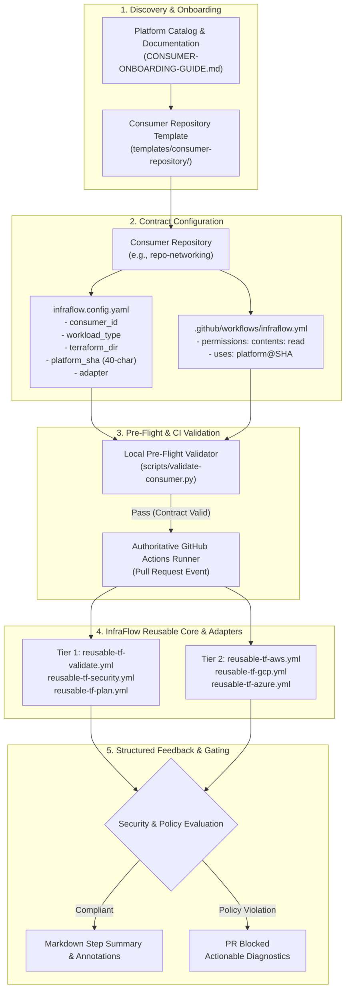

# InfraFlow — Multi-Repository Adoption Architecture (Milestone G08)

> **Program:** InfraFlow Enterprise Terraform Delivery Platform  
> **Milestone:** G08.1 — Multi-Repository Adoption Foundation & Consumer Onboarding Toolkit  
> **Status:** ACTIVE ARCHITECTURE SPECIFICATION  
> **Scope:** Cloud-Free Multi-Tenant Onboarding, Contract Specification, and Governance  
> **Author:** Platform Engineering & DevSecOps Architecture Team  
> **Baseline Release:** v0.5.0 (`2ce0ddd5de01530b6bf7aba749f0081620fb9b27`)

---

## 1. Executive Summary & Problem Statement

### The Problem InfraFlow Solves Across Repositories
Prior to Milestone G08, InfraFlow developed robust Tier 1 provider-neutral validation, DevSecOps security scanning, speculative planning, cryptographic attestation, protected apply simulation, and Tier 2 cloud-free adapters for AWS, GCP, and Azure. These capabilities were verified through an upstream platform repository (`infraflow`) and a single dedicated integration test repository (`infraflow-consumer-test`).

However, scaling InfraFlow across an enterprise fleet of heterogeneous, independently managed repositories presents distinct organizational and technical challenges:
1. **Inconsistent Workflow Invocations**: Independent teams copy and paste GitHub Actions caller workflows, leading to drift, unpinned action references, incorrect permission scoping, and missing security gates.
2. **Configuration Drift**: Different infrastructure teams (Networking, Application, Data) structure Terraform directories and variables inconsistently without a standardized contract.
3. **Governance Fragmentation**: Platform security policies (TFLint rules, Trivy scanners, Conftest/OPA policies) are difficult to distribute and enforce when repositories operate under decentralized administration without GitHub Enterprise organization rulesets.
4. **Unsafe Platform Pinning**: Teams frequently pin mutable tags (`@v0.5.0`, `@main`), exposing production pipelines to upstream breaking changes or supply chain attacks.
5. **Onboarding Friction**: Without self-service templates and automated validation tools, onboarding a new repository requires manual assistance from platform engineers.

### Milestone G08 Objective
Milestone G08 establishes a **reusable, secure, and developer-friendly onboarding foundation** that enables independent repositories to adopt InfraFlow consistently and autonomously. G08.1 delivers:
- An enterprise adoption architecture and governance model.
- A standardized, versioned consumer configuration contract (`infraflow.config.yaml`).
- A self-service repository onboarding template (`templates/consumer-repository/`).
- An automated consumer onboarding validation utility (`scripts/validate-consumer.py`).
- Three representative, isolated reference fixtures representing Networking, Application, and Data infrastructure.
- Zero live cloud credentials and zero infrastructure spending ($0.00).

---

## 2. Adoption Architecture & Lifecycle Model

### The 5 Stages of Consumer Adoption
1. **Discovery**: Development teams discover InfraFlow via central platform documentation, architectural standards, and the repository template.
2. **Template Instantiation**: The team clones or copies `templates/consumer-repository/` into their repository, populating `infraflow.config.yaml` and `.github/workflows/infraflow.yml`.
3. **Pre-Flight Validation**: Developers run `validate-consumer.py` locally to verify that directory paths, commit SHAs, permissions, and settings satisfy platform standards before submitting code.
4. **CI Execution**: On pull request, the consumer's caller workflow calls InfraFlow reusable workflows pinned to an immutable 40-character commit SHA.
5. **Gating & Feedback**: InfraFlow executes static analysis, Trivy scanning, OPA policy evaluation, and speculative planning, returning structured status outputs and PR step summaries.

---

## 3. Reference Consumer Workload Categories

InfraFlow models enterprise adoption using three distinct reference consumer workload categories. These represent realistic workload archetypes for testing and simulation, with **strictly zero cloud spending and zero live infrastructure provisioning**:

| Workload Category | Representative Consumer | Module Structure | Typical Resources Simulated | Key Policy Enforcements |
| :--- | :--- | :--- | :--- | :--- |
| **Consumer A** | **Networking Infrastructure** | Layered VPC, subnets, route tables, security groups | `terraform_data` modeling network topologies, CIDR blocks, gateway routes | CIDR range validation, no `0.0.0.0/0` SSH/RDP ingress, mandatory environment tags |
| **Consumer B** | **Application Infrastructure** | Container services, compute clusters, microservice configs | `terraform_data` modeling app compute, ingress controllers, key vaults | TLS 1.2+ minimum, HTTPS-only endpoints, private network isolation, no plaintext secrets |
| **Consumer C** | **Data Platform Infrastructure** | Storage buckets, lakehouse datasets, analytical schemas | `terraform_data` modeling data lakes, object storage, dataset metadata | Uniform Bucket-Level Access (UBLA), object versioning, customer-managed encryption (CMEK), no public ACLs |

---

## 4. Platform vs Consumer Responsibility Matrix

Clear separation of operational boundaries prevents governance confusion and ensures security invariants are maintained across repositories:

| Responsibility Domain | Platform Team Responsibility | Consumer Team Responsibility | Enforcement Mechanism |
| :--- | :--- | :--- | :--- |
| **Reusable Workflow Logic** | Designs, tests, releases, and maintains `.github/workflows/reusable-tf-*.yml`. | Calls reusable workflows via `workflow_call` without modifying platform logic. | CODEOWNERS, Actionlint, Zizmor |
| **Platform Dependency Pinning** | Publishes semantic release tags and announces immutable commit SHAs. | Pins reusable workflow references to immutable 40-character commit SHAs in caller workflows. | `validate-consumer.py`, Zizmor |
| **Security Quality Gates** | Curates TFLint rules, Trivy vulnerability baselines, and OPA/Conftest policies. | Remediates misconfigurations and policy violations flagged by scanners. | Reusable workflow gates (mandatory, fail-closed) |
| **HCL Source Code** | Provides reference modules (`examples/`) and templates (`templates/`). | Authors, reviews, and maintains repository-specific Terraform configuration. | Consumer pull request reviews |
| **Terraform Testing** | Defines testing standards and executes native tests in CI (`terraform test`). | Authors repository-specific `.tftest.hcl` files for module verification. | `reusable-tf-validate.yml` |
| **CI/CD Permissions** | Enforces least-privilege standards (`contents: read` default). | Configures caller workflow permissions to `contents: read` without write escalation. | `validate-consumer.py`, workflow bash guards |
| **Cloud Credentials & State** | Enforces cloud-free simulation and rejects live auth on PRs (SEC-02). | Supplies module variables without requiring live cloud credentials or tokens. | SEC-02 fail-closed guard |
| **Branch Governance** | Maintains platform rulesets (`main-ruleset.json`) and release tags. | Configures branch protections and review requirements on consumer repositories. | Repository settings / Policy as Code |

---

## 5. Centralized Policy Distribution & Upgrades

### Policy Distribution Without Repository Duplication
A primary goal of G08 is eliminating the copy-pasting of security policies into consumer repositories.
- **Central Storage**: Declarative Rego policies (`policies/common/`, `policies/aws/`, `policies/gcp/`, `policies/azure/`), `.tflint.hcl`, and scanner configurations reside centrally within `infraflow`.
- **Workflow-Embedded Enforcement**: Reusable workflows checkout the central policies at execution time or utilize embedded rules. Consumers do **not** maintain local copies of enterprise security policies.
- **Contract Enforcement**: If a consumer attempts to bypass policies by passing empty policy paths or disabling scanners (`enforce_mandatory_scanners: false`), the workflow guard rejects the execution fail-closed.

### Versioning & Upgrade Strategy
- **Semantic Versioning**: Releases follow SemVer 2.0.0 (`vMAJOR.MINOR.PATCH`).
- **Immutable SHA Recommendation**: While git tags (`@v0.5.0`) provide human-readable milestones, git tags are technically mutable references in git. For strict enterprise immutability and supply-chain hardening, consumers **must pin the full 40-character commit SHA** (`@2ce0ddd5de01530b6bf7aba749f0081620fb9b27`).
- **Deprecation Windows**: Platform features deprecated in minor releases remain supported for at least one subsequent minor version before removal in a major release.
- **Automated Validation**: The `validate-consumer.py` utility verifies whether a consumer repository is using a supported platform SHA and conforms to contract requirements.

---

## 6. External Fleet Adoption & Multi-Cloud Verification (G08.2)

In Milestone G08.2, InfraFlow's multi-repository architecture was verified against three independent, production-grade external consumer repositories on live GitHub Actions runners:

| Consumer Repository | Target Cloud Adapter | Managed Workload | Live PR | GHA CI Run | Result |
| :--- | :--- | :--- | :--- | :--- | :--- |
| [`infraflow-consumer-networking`](https://github.com/TM-threemavithana/infraflow-consumer-networking) | AWS (`reusable-tf-aws.yml`) | VPC, subnets, route tables | [PR #1](https://github.com/TM-threemavithana/infraflow-consumer-networking/pull/1) | [Run 44870873397](https://github.com/TM-threemavithana/infraflow-consumer-networking/actions/runs/44870873397) | **PASS** (19s) |
| [`infraflow-consumer-application`](https://github.com/TM-threemavithana/infraflow-consumer-application) | Azure (`reusable-tf-azure.yml`) | App Service, Key Vault | [PR #1](https://github.com/TM-threemavithana/infraflow-consumer-application/pull/1) | [Run 44870894843](https://github.com/TM-threemavithana/infraflow-consumer-application/actions/runs/44870894843) | **PASS** (26s) |
| [`infraflow-consumer-data-platform`](https://github.com/TM-threemavithana/infraflow-consumer-data-platform) | GCP (`reusable-tf-gcp.yml`) | Lakehouse GCS, BigQuery Dataset | [PR #1](https://github.com/TM-threemavithana/infraflow-consumer-data-platform/pull/1) | [Run 44870921177](https://github.com/TM-threemavithana/infraflow-consumer-data-platform/actions/runs/44870921177) | **PASS** (25s) |

### Key Architectural Validations:
1. **Zero Redundant Policies**: All OPA Rego policies, TFLint configs, and Trivy scans executed directly from the central platform workflows without duplicating files in consumer repositories.
2. **Immutable Contract Enforcement**: All repositories pin `platform_sha: 8fd761bb42165435e1162f37ee39df15d5532b09`. Mutable references (`@main`) fail closed.
3. **Least Privilege Invariant**: All caller workflows enforce `permissions: contents: read` with zero elevated permissions.
4. **Output Contract Parity**: Aggregated all 7 standard outputs (`plan-status`, `<cloud>-auth-status`, `security-status`, `authorization-status`, `has-changes`, `has-destructive-changes`, `total-changes`) consistently across AWS, Azure, and GCP adapters.

---

## 7. Centralized Governance & Consumer Trust Hardening (G08.3)

In Milestone G08.3, InfraFlow advanced beyond optional client-side onboarding checks to establish a mandatory 4-layer defense-in-depth governance model:
1. **Layer A (Local Pre-Flight Validator)**: Hardened `validate-consumer.py` resolving GOV-G08-01 (fail closed on missing `.github/workflows`), GOV-G08-02 (enforce adapter invocation), and GOV-G08-03 (duplicate YAML keys, write permission rejection, `id-token: write` rejection, `pull_request_target` rejection, `secrets: inherit` rejection).
2. **Layer B (Pipeline Governance Gate)**: Central reusable workflow (`reusable-tf-governance.yml`) invoked with `needs: [governance-gate]`. Evaluates normalized metadata against 14 enterprise OPA Rego rules (`policies/governance/consumer_governance.rego`).
3. **Layer C (Server-Side Rulesets)**: GitHub Branch Protection / Rulesets enforcing required status checks (`Evaluate Consumer Governance & Adoption Contracts`), preventing workflow deletion or modification on protected branches.
4. **Layer D (Central Fleet Audit)**: Periodic out-of-band monitoring (`scripts/audit-consumer-fleet.py`) auditing the entire fleet of consumer repositories for contract compliance and active branch ruleset protections.

All three external consumer repositories (`infraflow-consumer-networking`, `infraflow-consumer-application`, `infraflow-consumer-data-platform`) have been updated to pin platform commit `f1ad39fb0f0bdce7c475ed36e717e859b2e9b106` and enforce the central governance gate in live CI pipelines.

