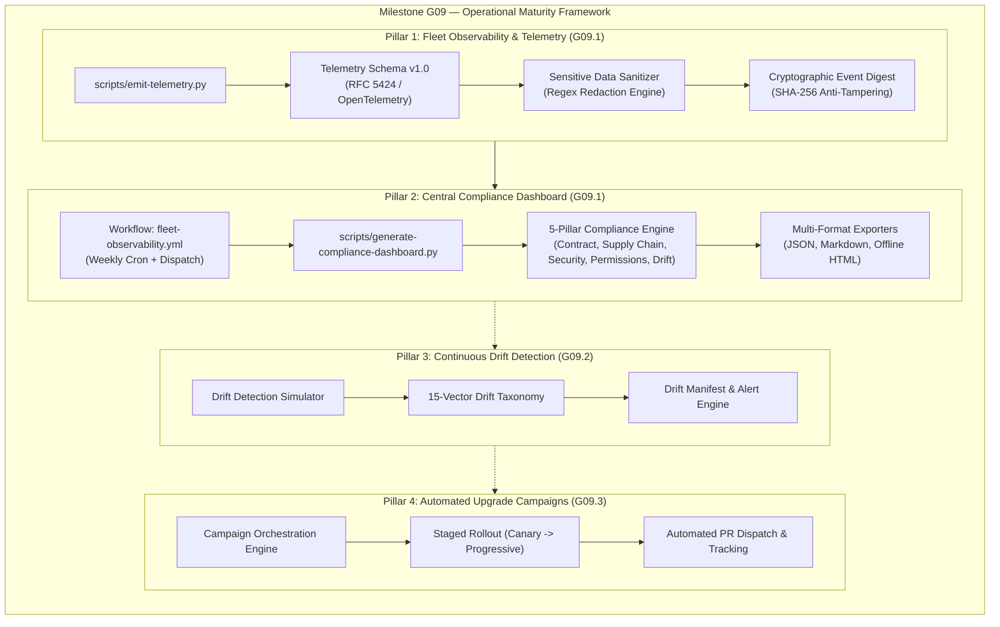

# InfraFlow — Milestone G09: Operational Maturity Architecture

> **Document Version:** 1.0  
> **Status:** Active (Milestone G09.1 Foundation Implemented)  
> **Author:** InfraFlow Platform Architecture Team  
> **Standard:** ISO/IEC 27001:2022, NIST SP 800-218 (SSDF), CIS Software Supply Chain Security v1.0, SLSA Level 3  

---

## 1. Executive Vision & Scope

InfraFlow Milestone **G09: Operational Maturity** transitions InfraFlow from a governed multi-repository infrastructure delivery framework into a continuous, production-ready **Internal Developer Platform (IDP)**.

While Milestone G08 established multi-repository adoption contracts, centralized OPA policy enforcement, and transactional upgrade tooling, Milestone G09 introduces enterprise operational capabilities: continuous fleet observability, standardized telemetry streaming, deterministic compliance posture scoring, continuous drift detection, and automated fleet upgrade campaigns.

### Mandatory Operational Boundaries:
- **Zero Cloud Expenditure ($0.00):** All monitoring, dashboarding, and telemetry collection operates offline or within GitHub Actions free-tier runners without incurring infrastructure spend.
- **Zero Live Cloud Credentials:** No static API keys, AWS secret keys, GCP service account JSONs, or Azure client secrets are required, accepted, or stored.
- **Offline Simulation:** Telemetry and compliance checks evaluate actual Git commits, repository configurations, workflow definitions, and simulated execution metadata.

---

## 2. Four-Pillar Operational Maturity Framework

---

## 3. Pillar 1: Fleet Observability & Telemetry Engine (G09.1)

### 3.1 Telemetry Schema v1.0
InfraFlow defines a standardized JSON telemetry event schema implemented in [`scripts/emit-telemetry.py`](scripts/emit-telemetry.py):

| Schema Field | Type | Description | Invariant / Validation |
| :--- | :--- | :--- | :--- |
| `schema_version` | String | Telemetry specification version | Must be `"1.0"` |
| `event_id` | String | Unique event identifier | Prefix `evt_` followed by 16 hex chars |
| `timestamp` | String | ISO 8601 / RFC 3339 UTC timestamp | `YYYY-MM-DDTHH:MM:SSZ` |
| `event_type` | String | Operational lifecycle event type | Restricted to `VALID_EVENT_TYPES` enum |
| `execution_context` | Object | CI/CD runner and execution environment | `ci_system`, `run_id`, `actor`, `ref` |
| `target` | Object | Target repository and workload identity | `repository`, `consumer_id`, `adapter`, `platform_sha` |
| `metrics` | Object | Quantitative performance and policy metrics | `duration_ms`, `rules_evaluated`, `violations_count` |
| `verdict` | Object | Compliance verdict and diagnostic reasons | `status` (`PASS`, `FAIL`, `WARN`, `SKIP`), `reasons` |
| `integrity` | Object | Cryptographic tampering protection | SHA-256 digest over canonical event payload |

### 3.2 Supported Event Taxonomy
- `governance_gate_evaluated`: Reusable governance workflow execution.
- `security_scan_completed`: Static scanning execution (Trivy, TFLint, Conftest).
- `speculative_plan_completed`: Speculative planning and change classification.
- `contract_verified`: Consumer onboarding contract validation.
- `upgrade_planned`: Fleet upgrade planning and staged candidate evaluation.
- `upgrade_applied`: Atomic upgrade applied to consumer repository.
- `rollback_executed`: Compensating rollback restoring baseline configuration.
- `drift_detected`: Configuration or state discrepancy flagged.
- `fleet_audit_completed`: Out-of-band Layer D fleet audit completion.
- `compliance_evaluated`: Central compliance score computation.

### 3.3 Sensitive Data Scrubbing Engine
To guarantee zero credential leakage into logs, step summaries, or telemetry streams, `scripts/emit-telemetry.py` implements recursive data traversal and regex-based redaction:
- **AWS Credentials:** `AKIA[0-9A-Z]{16}` -> `[REDACTED_AWS_KEY]`, secret key patterns -> `[REDACTED_AWS_SECRET]`
- **GitHub Tokens:** `ghp_[A-Za-z0-9]{36}` -> `[REDACTED_GITHUB_TOKEN]`, `github_pat_[A-Za-z0-9_]{20,}` -> `[REDACTED_GITHUB_PAT]`
- **JSON Web Tokens (JWT):** `eyJ...` -> `[REDACTED_JWT]`
- **Asymmetric Private Keys:** `-----BEGIN ... PRIVATE KEY-----` -> `[REDACTED_PRIVATE_KEY]`
- **Field Name Sensitive Match:** Any dictionary key matching `password`, `secret`, `private_key`, `token`, `auth_key`, or `api_key` is replaced with `[REDACTED_SENSITIVE_FIELD]`.

---

## 4. Pillar 2: Central Fleet Compliance Dashboard (G09.1)

### 4.1 Deterministic 5-Pillar Compliance Scoring Algorithm
Implemented in [`scripts/generate-compliance-dashboard.py`](scripts/generate-compliance-dashboard.py), each registered consumer workload is evaluated across five pillars (maximum 100 points):

$$\text{Compliance Score} = P_1 + P_2 + P_3 + P_4 + P_5$$

1. **Pillar 1: Contract Validity & Schema Conformance (Weight: 20%)**
   - `infraflow.config.yaml` exists on filesystem: **+5 pts**
   - Valid YAML syntax: **+5 pts**
   - Valid schema `version: "1.0"`: **+5 pts**
   - Matching `consumer_id` and defined `team`: **+5 pts**

2. **Pillar 2: Supply Chain Immutability (Weight: 20%)**
   - `platform_sha` in config is an immutable 40-character hexadecimal SHA: **+10 pts**
   - All platform workflows called in `.github/workflows/` pin 40-character SHAs (zero mutable `@main` references): **+10 pts**

3. **Pillar 3: Mandatory DevSecOps Security Controls (Weight: 20%)**
   - `enforce_mandatory_scanners: true` configured: **+10 pts**
   - Reusable governance gate (`reusable-tf-governance.yml`) invoked in caller workflows: **+10 pts**

4. **Pillar 4: Permission Boundary & Least Privilege (Weight: 20%)**
   - Workflows enforce minimal token permissions (zero `write-all`): **+10 pts**
   - Zero `id-token: write` granted in cloud-free mode: **+5 pts**
   - Zero `pull_request_target` escalation triggers: **+5 pts**

5. **Pillar 5: Configuration & Version Drift Integrity (Weight: 20%)**
   - Config `platform_sha` exactly matches workflow caller SHAs: **+10 pts**
   - Config `adapter` matches fleet manifest adapter: **+5 pts**
   - Consumer config SHA matches approved platform deployment target: **+5 pts**
   - *Infrastructure State Drift (G09.2)*: Evaluates per-consumer state drift. Clean state retains full score with explicit evidence. Critical drift (deletions, security downgrades) applies **-10 pts** penalty; High/Medium drift applies **-5 pts** penalty.

### 4.2 Status Classification & Grading Bands
- **`COMPLIANT` (Score $\ge 95.0\%$):** Workload meets all strict governance, security, and supply-chain requirements.
- **`WARNING` ($80.0\% \le \text{Score} < 95.0\%$):** Minor configuration discrepancy detected; operational but requires remediation.
- **`NON_COMPLIANT` ($\text{Score} < 80.0\%$):** Severe violation (mutable reference, missing governance gate, excessive permissions); blocked from deployment.

### 4.3 Multi-Format Reporting
- **JSON Format (`reports/compliance-dashboard.json`):** Full diagnostic payload with timestamps, per-pillar breakdowns, findings, and metadata.
- **Markdown Format (`docs/reports/FLEET-COMPLIANCE-DASHBOARD.md`):** Formatted for GitHub Step Summaries and repository documentation.
- **HTML Format (`reports/compliance-dashboard.html`):** Standalone single-page report with responsive layout, zero external stylesheet or script dependencies, suitable for air-gapped or offline visualization.

---

## 5. Pillar 3: Continuous State & Speculative Drift Detection Simulation (G09.2)

### 5.1 Architecture & Objectives
Milestone G09.2 implements speculative infrastructure drift detection ([`scripts/simulate-drift.py`](../../scripts/simulate-drift.py)) evaluating expected Terraform state ($S_{expected}$) against observed state ($S_{observed}$) across AWS, Azure, and GCP resources with zero cloud spend ($0.00) and zero credentials.

### 5.2 Deterministic 6-Category Drift Taxonomy
1. **`NO_DRIFT`**: Resource is synchronized across both states with identical normalized attributes (Severity: `NONE`).
2. **`ATTRIBUTE_DRIFT`**: Resource exists in both states but attributes differ (Severity: `CRITICAL`, `HIGH`, or `MEDIUM`).
3. **`UNTRACKED_RESOURCE`**: Resource exists only in observed state (shadow IT creation) (Severity: `HIGH`).
4. **`RESOURCE_DELETED`**: Resource exists in expected state but missing from observed state (Severity: `CRITICAL`).
5. **`UNKNOWN_RESOURCE`**: Unsupported provider or malformed resource identifier (Severity: `HIGH`).
6. **`STATE_INCONSISTENCY`**: Type mismatch under identical resource ID, schema violation, or tenant cross-contamination (Severity: `CRITICAL`).

### 5.3 Simulated vs. Live Cloud Drift Detection
- **Simulation Mode**: Evaluates normalized state snapshots locally and in CI/CD pre-merge gates. Safe, deterministic, zero-spend ($0.00), tests severe failure modes (deletions, TLS downgrades, symlinks, secret leaks) without production risk. Strictly read-only with no automatic remediation.
- **Live Cloud Runtime**: Read-only ingestion adapters query cloud APIs via OIDC tokens out-of-band, producing normalized state snapshots that feed directly into the same `simulate-drift.py` engine.

---

## 6. Pillar 4: Automated Upgrade Campaigns & Lifecycle Tracking (G09.3)

### 6.1 Architecture & Objectives
Milestone G09.3 implements the automated fleet upgrade orchestration engine ([`scripts/orchestrate-campaign.py`](../../scripts/orchestrate-campaign.py)), enabling platform engineering teams to orchestrate, track, and rollback multi-tenant infrastructure upgrades across registered consumers in [`config/fleet-manifest.yaml`](../../config/fleet-manifest.yaml).

### 6.2 Staged Rollout Model & Fail-Closed Canary Gate
- **Staged Phasing**: Workloads are partitioned into Canary consumers (`upgrade_role: canary`) and Progressive consumers (`upgrade_role: progressive`).
- **Canary Gate Invariant**: Progressive rollout execution is strictly blocked unless all canary workloads are in the `VERIFIED` state. Any attempt to advance progressive rollout while canary is pending, running, or failed raises `CanaryGateError` (fail-closed).
- **Quality Gates**: Pre-flight checks evaluate contract compatibility, compliance threshold ($\ge 90.0\%$), and zero critical state drift before applying updates.
- **Rollback Assurance**: Automated and emergency rollback operations restore consumers to their registered `rollback_sha` baseline transactionally.
- **Zero-Cost Simulation**: Generates simulated PR metadata, branch references (`infraflow/upgrade-<sha[:7]>`), and markdown review summaries with $0.00 cloud spending and zero live credentials.

---

## 7. Security & Threat Modeling for Operational Maturity

| Threat (STRIDE) | Attack Vector | InfraFlow Mitigation |
| :--- | :--- | :--- |
| **Spoofing** | Cross-tenant state comparison to inspect unauthorized infrastructure | Repository & workspace identity binding enforced; mismatches raise `DriftSecurityError`. |
| **Information Disclosure** | Telemetry logs or drift diffs leaking cloud secrets, PATs, or JWTs | Automatic recursive regex scrubbing in `emit-telemetry.py`, `simulate-drift.py`, and `orchestrate-campaign.py`. |
| **Tampering** | Rogue actor altering telemetry logs, drift reports, or campaign states | Explicit symlink rejection (`os.path.islink`) and deterministic SHA-256 event and campaign digests over canonical payload. |
| **Elevation of Privilege** | Observability, drift, or campaign pipeline attempting unauthorized destructive actions | Zero automatic remediation invariant in drift engine; fail-closed Canary Gate in campaign orchestrator. |
| **Denial of Service** | Corrupted or massive telemetry files crashing parser | Strict schema v1.0 validation and size containment. |
| **Repudiation** | Unverified audit claims without execution evidence | Every event records `event_id`, UTC timestamp, `execution_context` (run ID, actor, commit SHA), and audit trail. |

---

## 8. Implementation Roadmap

- **G09.1 (Completed Foundation):** Fleet Observability Engine, Telemetry Schema v1.0, 5-Pillar Compliance Dashboard Generator, Offline HTML Reporting, Scheduled CI Pipeline.
- **G09.2 (Completed):** Continuous State & Speculative Drift Detection Simulation, Multi-Cloud Normalization, 6-Category Drift Engine, Compliance Dashboard Integration.
- **G09.3 (Completed):** Automated Upgrade Campaigns & Fleet Rollout Tracking, Fail-Closed Canary Gating, Zero-Cost Simulated PR Dispatch, Transactional Rollback.
- **G09.4 (Completed):** Enterprise Governance Automation & Final Operational Maturity Verification (Unified Verifier, Cryptographic Attestations, Complete Documentation & Landing Page Redesign).
