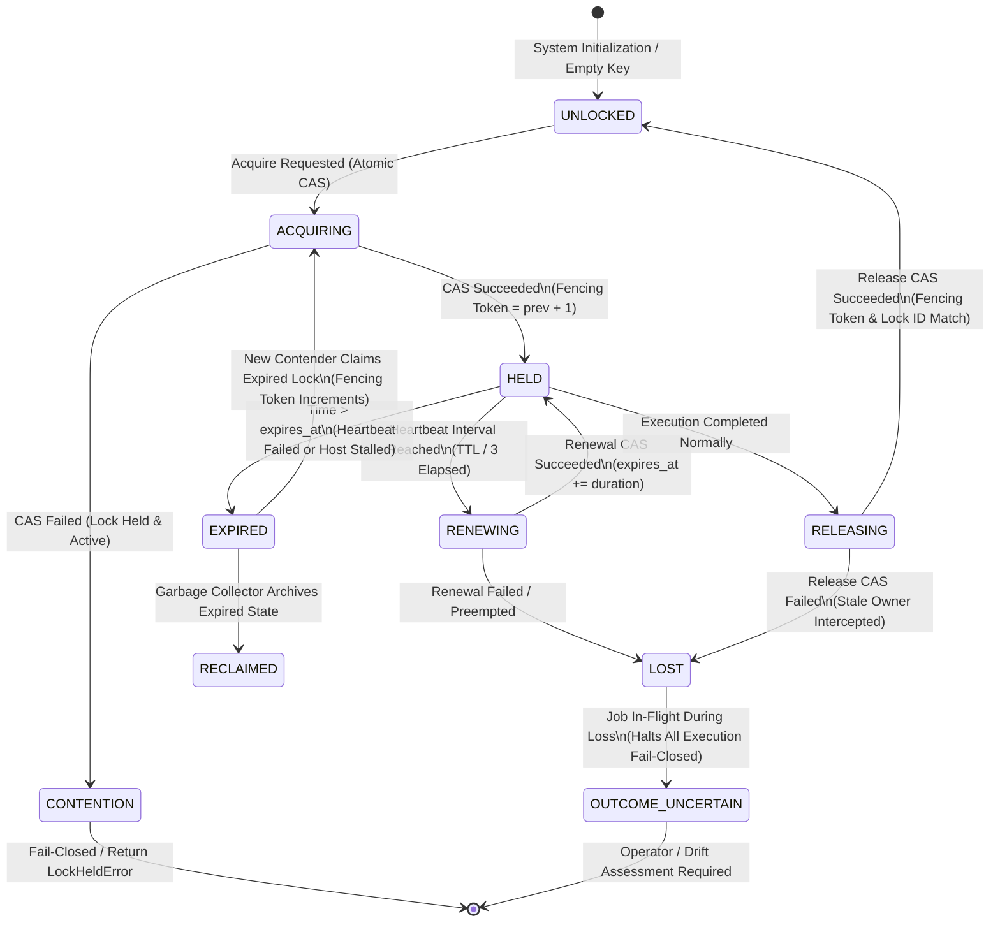

# InfraFlow Architecture Specification: Distributed Locking, Lease Management & Fencing Protocol (G10.4.1)

**Milestone:** G10.4.1 — Distributed Locking Architecture  
**Document Category:** Systems Architecture & Protocol Specification  
**Status:** **APPROVED FOR IMPLEMENTATION**  
**Lead Authors:** Principal Distributed Systems Engineer & Senior Platform Architect  
**Target Release:** v0.8.0-dev  
**Platform Invariant:** **$0.00 Cloud Spend, Zero Live Credentials, Zero Mutating Operations**  

---

## 1. Executive Summary & Problem Formulation

In modern enterprise cloud platform engineering, infrastructure delivery systems must coordinate concurrent execution across multi-tenant, multi-cloud, and multi-repository fleets. While previous InfraFlow milestones established cryptographic plan provenance (G04), multi-cloud workload identity (G05, G07), transactional replay ledgers (G06.2), and semantic destruction defense (G10.3), execution concurrency across independent GitHub-hosted runner virtual machines presents a fundamental distributed systems challenge:

```
[PR #101 Merge (Runner VM A)]  --->  [Attempting Apply on 'consumer-networking' (env: prod)]
                                              ▲
                                              │  RACE CONDITION WINDOW:
                                              │  Both jobs see valid state serial N;
                                              │  Both jobs attempt concurrent apply!
                                              ▼
[Scheduled Drift Job (Runner VM B)] -> [Simulating / Modifying 'consumer-networking' (env: prod)]
```

### 1.1 The Ephemeral Runner Dilemma
In GitHub Actions and cloud-native CI/CD, every workflow run executes on an isolated, ephemeral virtual machine or container. Consequently:
1. **Local Filesystem Confinement:** File locks created via `os.open(..., O_CREAT | O_EXCL)` on Runner VM A are entirely invisible to Runner VM B.
2. **Replay Ledger Ephemerality:** A local SQLite ledger (`plan_executions.db`) initialized on Runner VM A vanishes when VM A is deprovisioned, failing to guard against concurrent runs on VM B.
3. **Plan-to-Apply Concurrency Gaps:** Speculative plans generated during Pull Request review (`reusable-tf-plan.yml`) may take minutes or hours to be approved and merged. If multiple PRs modifying the same environment are merged in rapid succession, out-of-order execution and state serial divergence occur.

### 1.2 Mission of Milestone G10.4.1
Milestone G10.4.1 defines the authoritative, production-grade distributed locking architecture for InfraFlow. It introduces:
- A standardized, decoupled **Lock Manager Interface** supporting pluggable storage backends.
- Monotonically increasing **fencing tokens** to eliminate distributed split-brain hazards caused by GC pauses and network partitions.
- Time-bounded **leases with deterministic expiration and heartbeat renewal**.
- Concrete driver specifications for offline verification (`LocalFSDriver`, `MockDistributedDriver`) and production multi-cloud targets (AWS DynamoDB/S3, Azure Blob Storage, GCP Cloud Storage/Spanner).
- Zero credential exposure and fail-closed security guarantees.

---

## 2. Separation of Concerns: InfraFlow Lock vs. Terraform Native State Lock

A critical architectural tenet of InfraFlow is the strict boundary between **Platform Delivery Orchestration Locking** and **Terraform Native State Storage Locking**:

```
+-------------------------------------------------------------------------------------------------+
|                                InfraFlow Platform Delivery Layer                                |
|                                                                                                 |
|   [reusable-tf-plan.yml]      [reusable-tf-apply.yml]       [infraflow drift / upgrade]        |
|            │                           │                                │                       |
|            ▼                           ▼                                ▼                       |
|   +-----------------------------------------------------------------------------------------+   |
|   |                       InfraFlow Distributed Lock Manager                                |   |
|   |   - Resource Identity Derivation (Tenant/Repo/Env/Workspace)                            |   |
|   |   - Lease Acquisition & Heartbeat Renewal (TTL: 15m)                                    |   |
|   |   - Monotonic Fencing Token Generation (token = prev + 1)                               |   |
|   |   - Cross-Runner Mutual Exclusion & Contention Telemetry                                |   |
|   +-----------------------------------------------------------------------------------------+   |
|                                        │                                                        |
+----------------------------------------┼--------------------------------------------------------+
                                         │ (Only when lock acquired with valid fencing token)
                                         ▼
+-------------------------------------------------------------------------------------------------+
|                                 Terraform Engine Execution Layer                                |
|                                                                                                 |
|   +-----------------------------------------------------------------------------------------+   |
|   |                      Terraform CLI Native Execution (init, plan, apply)                 |   |
|   |   - Evaluates provider graph                                                            |   |
|   |   - Interacts with remote state storage                                                 |   |
|   +-----------------------------------------------------------------------------------------+   |
|                                        │                                                        |
|                                        ▼                                                        |
|   +-----------------------------------------------------------------------------------------+   |
|   |                      Terraform Native Backend State Lock                                |   |
|   |   - S3 Native Conditional Locking (.tflock with If-None-Match: *) / DynamoDB LockID     |   |
|   |   - Azure Blob Storage Lease (x-ms-lease-id)                                            |   |
|   |   - Google Cloud Storage Generation Preconditions (x-goog-if-generation-match)          |   |
|   |   - Scoped strictly to the duration of the single terraform process                     |   |
|   +-----------------------------------------------------------------------------------------+   |
|                                                                                                 |
+-------------------------------------------------------------------------------------------------+
```

### Key Differences & Invariants:
| Dimension | InfraFlow Distributed Lock | Terraform Native State Lock |
|---|---|---|
| **Scope** | Cross-pipeline, cross-job lifecycle (Plan, PR approval, Apply, Drift, Campaigns) | Single CLI command execution (`terraform plan` / `apply`) |
| **Protected Assets** | Entire environment, workload identity, and delivery lifecycle | Raw `terraform.tfstate` binary/JSON blob |
| **Coordination Boundary** | Multi-runner orchestration (e.g. halts apply if drift assessment is active) | Storage blob concurrent mutation prevention |
| **Fencing Protection** | Monotonic fencing token (`uint64`) passed downstream to verify authority | Primitive client UUID / lock ID without monotonic ordering |
| **Replacement Rule** | **NEVER replaces native state locking.** Operates strictly as a pre-flight governance gate. | Continues to execute within Terraform runtime. |

---

## 3. Resource Identity & Lock-Key Derivation

To guarantee unambiguous mutual exclusion across multi-tenant environments, every lockable resource is resolved to a canonical, deterministic lock key.

### 3.1 Resource Identity Tuple
A lockable infrastructure target is defined by the 5-tuple:
$$\text{ResourceTarget} = (\text{tenant\_id}, \text{repository}, \text{environment}, \text{workspace}, \text{component})$$

Where:
- `tenant_id`: Enterprise organization or tenant identifier (e.g., `TM-threemavithana`).
- `repository`: Consumer repository name (e.g., `infraflow-consumer-networking`).
- `environment`: Deployment target environment (e.g., `production`, `staging`, `development`).
- `workspace`: Terraform workspace name (defaults to `default`).
- `component`: Sub-module or directory component within repository (e.g., `vpc`, `database`, `root`).

### 3.2 Canonical Lock Key Derivation
The canonical key string follows a hierarchical, path-safe URI specification:
```text
infraflow/locks/v1/{tenant_id}/{repository}/{environment}/{workspace}/{component}.lock
```

*Example:*
```text
infraflow/locks/v1/TM-threemavithana/infraflow-consumer-networking/production/default/root.lock
```

### 3.3 Cryptographic Resource Fingerprint
To support drivers with partition key length limits (e.g. AWS DynamoDB, HashiCorp Consul), a deterministic SHA-256 digest is derived:
$$\text{ResourceFingerprint} = \text{SHA256}(\text{CanonicalKey})$$

```python
def derive_resource_fingerprint(
    tenant_id: str,
    repository: str,
    environment: str,
    workspace: str = "default",
    component: str = "root"
) -> Tuple[str, str]:
    canonical_key = (
        f"infraflow/locks/v1/{tenant_id.strip()}/{repository.strip()}/"
        f"{environment.strip()}/{workspace.strip()}/{component.strip()}.lock"
    )
    digest = hashlib.sha256(canonical_key.encode("utf-8")).hexdigest()
    return canonical_key, digest
```

---

## 4. Lock Ownership & Metadata Schema (`infraflow-lock-metadata-v1`)

Lock state is maintained as an immutable, cryptographically attested JSON document.

### 4.1 Metadata Schema Definition

```json
{
  "$schema": "https://infraflow.dev/schemas/v1/lock-metadata.json",
  "schema_version": "infraflow-lock-metadata-v1",
  "lock_id": "9b1deb4d-3b7d-4bad-9bdd-2b0d7b3dcb6d",
  "lock_key": "infraflow/locks/v1/TM-threemavithana/infraflow-consumer-networking/production/default/root.lock",
  "resource_fingerprint": "a4f89d3c5e8b6a1d4f7e2c9b0a3d5e8f6b4c1a9d7e5f3b1c8a6d4e2f0b9c7a5e",
  "owner_identity": {
    "runner_id": "runner-vm-us-east-1-042",
    "workflow_name": "reusable-tf-apply.yml",
    "workflow_run_id": "1940827164",
    "workflow_run_attempt": 1,
    "job_id": "apply_production",
    "actor": "release-robot[bot]",
    "commit_sha": "02d755a47aa1ac3abb3b86b33964dd8a64d9482c"
  },
  "fencing_token": 142,
  "purpose": "plan_apply",
  "plan_binding": {
    "plan_id": "plan-20261122-120000-prod",
    "plan_digest_sha256": "e3b0c44298fc1c149afbf4c8996fb92427ae41e4649b934ca495991b7852b855"
  },
  "lease": {
    "duration_seconds": 900,
    "acquired_at": "2026-11-22T12:00:00.000000Z",
    "expires_at": "2026-11-22T12:15:00.000000Z",
    "renewed_at": null,
    "renewal_count": 0,
    "heartbeat_interval_seconds": 300
  },
  "driver_context": {
    "driver_name": "LocalFSDriver",
    "storage_version": "1.0.0",
    "generation_id": "gen-8391204"
  }
}
```

### 4.2 Security Field Invariant: Zero Credential Storage
Lock metadata files are publicly inspectable by diagnostic tooling (`infraflow doctor`, `scripts/audit-consumer-fleet.py`).
- **PROHIBITION:** Lock metadata **MUST NEVER** contain cloud access keys, AWS secrets, Azure client secrets, GitHub PATs, private keys, or plaintext passwords.
- **ENFORCEMENT:** Any driver serializing metadata runs `SecretSanitizer.sanitize_dict(metadata)` prior to write. Detection of credential patterns triggers an immediate fail-closed exception (`UnsafeMetadataException`).

---

## 5. Lock Lifecycle State Machine

The distributed lock lifecycle is strictly modeled as a finite state machine:



### State Definitions & Transition Invariants:
1. **UNLOCKED:** Resource is free. No owner exists. Fencing sequence is preserved in persistence.
2. **ACQUIRING:** Atomic Compare-And-Swap operation in progress.
3. **HELD:** Lock is exclusively owned by `owner_identity`. Heartbeat daemon is active.
4. **RENEWING:** Heartbeat daemon extends lease. Verification guarantees ownership hasn't changed.
5. **EXPIRED:** Lease duration has lapsed without heartbeat. Lock is eligible for acquisition by new contenders.
6. **RELEASING:** Owner requests clean teardown. Verification guarantees `owner_id`, `lock_id`, and `fencing_token` match current record.
7. **LOST:** Owner was preempted, paused, or partitioned. Any subsequent operation by this worker **MUST ABORT IMMEDIATELY**.
8. **OUTCOME_UNCERTAIN:** An un-graceful loss occurred while infrastructure mutations were active. Quarantined until state consistency is verified via drift audit.

---

## 6. Monotonically Increasing Fencing Tokens & Kleppmann Defense

### 6.1 The Distributed Storage Hazard (Kleppmann Anomaly)
A distributed lock that relies purely on client-side leases cannot guarantee mutual exclusion in the presence of asynchronous network delays or process pauses (e.g. stop-the-world garbage collection, thread starvation, hypervisor VM migration):

```
Client 1                     Lock Service                     Storage / Infrastructure
   │                              │                                      │
   ├────── Acquire Lock ─────────►│                                      │
   │◄───── Lock Granted (TTL=15m)─┤                                      │
   │                              │                                      │
   [Process Paused / Stalled]     │                                      │
   [Duration: 16 minutes]         │                                      │
   │                              ├───── Lease Expires ─────►            │
   │                              │                                      │
   │                              │◄──── Acquire Lock ────── Client 2    │
   │                              ├───── Lock Granted ─────► Client 2    │
   │                              │                          │           │
   │                              │                          ├─ Write A ─► [State Serial N+1 Written]
   │                              │                          │           │
   [Process Resumes]              │                          │           │
   ├─ Write B (believes valid) ───┼──────────────────────────┼──────────► [CORRUPTION / OVERWRITE!]
   │                              │                          │           │
```

### 6.2 The InfraFlow Fencing Protocol
To eliminate this hazard without requiring distributed consensus algorithms (like Raft or Paxos) in simple runners, InfraFlow implements **Monotonically Increasing Fencing Tokens**:

1. **Monotonic Counter Generation:**
   - Every lock record contains an integer counter: `fencing_token`.
   - On initial creation: `fencing_token = 1`.
   - On every acquisition or re-acquisition of an expired lease:
     $$\text{fencing\_token}_{\text{new}} = \text{fencing\_token}_{\text{current}} + 1$$
   - The token **NEVER** decreases, resets, or rolls over.

2. **Downstream Verification (Fencing Guard):**
   - Every downstream operational request (e.g., plan reservation in `verify-plan-lifecycle.py`, state serialization, telemetry emission) must include the `fencing_token`.
   - The downstream receiver inspects the token against the highest known token:
     $$\text{if } \text{token}_{\text{presented}} < \text{token}_{\text{highest\_known}} \implies \text{REJECT (STALE\_FENCING\_TOKEN)}$$
   - Client 1's stalled write is rejected because Storage has already processed Client 2's token ($\text{Token } 143 > \text{Token } 142$).

---

## 7. Lock Manager & Abstract Driver Interface (`DistributedLockDriver`)

The locking system is organized into a clean two-tier object-oriented architecture:
1. `LockManager`: High-level workflow orchestration, lease monitoring, context managers, and error handling.
2. `DistributedLockDriver`: Low-level atomic storage interface implemented per backend.

### 7.1 Python Abstract Base Class (`DistributedLockDriver`)

```python
from abc import ABC, abstractmethod
from dataclasses import dataclass
from typing import Any, Dict, Optional, Tuple

@dataclass(frozen=True)
class LockMetadata:
    schema_version: str
    lock_id: str
    lock_key: str
    resource_fingerprint: str
    owner_id: str
    fencing_token: int
    purpose: str
    acquired_at: str
    expires_at: str
    lease_duration_seconds: int
    renewal_count: int
    custom_context: Dict[str, Any]

@dataclass(frozen=True)
class LockResult:
    success: bool
    metadata: Optional[LockMetadata]
    error_code: Optional[str]
    error_message: Optional[str]

class DistributedLockDriver(ABC):
    """
    Abstract interface for atomic distributed lock storage backends.
    All driver implementations must guarantee linearizable, atomic CAS semantics.
    """

    @abstractmethod
    def acquire(
        self,
        key: str,
        owner_id: str,
        ttl_seconds: int,
        purpose: str,
        context: Dict[str, Any],
    ) -> LockResult:
        """
        Atomically attempts to acquire the lock.
        Must succeed if key is free OR if current lease is expired.
        Must increment and persist fencing token.
        Fails if unexpired lock is held by another owner.
        """
        pass

    @abstractmethod
    def renew(
        self,
        key: str,
        lock_id: str,
        owner_id: str,
        fencing_token: int,
        extension_seconds: int,
    ) -> LockResult:
        """
        Atomically extends the lease expiration if and only if:
        key == key AND lock_id == lock_id AND owner_id == owner_id AND fencing_token == fencing_token.
        Fails if lock was lost, expired, or claimed by another owner.
        """
        pass

    @abstractmethod
    def release(
        self,
        key: str,
        lock_id: str,
        owner_id: str,
        fencing_token: int,
    ) -> LockResult:
        """
        Atomically releases the lock if and only if caller matches active ownership.
        Fails if caller is stale or lock was already reclaimed.
        """
        pass

    @abstractmethod
    def inspect(self, key: str) -> Optional[LockMetadata]:
        """
        Inspects the active lock status without modifying state.
        Returns LockMetadata if held/expired, or None if completely uninitialized.
        """
        pass

    @abstractmethod
    def force_break(
        self,
        key: str,
        admin_token: str,
        break_reason: str,
    ) -> LockResult:
        """
        Administrative override. MUST verify signed cryptographic admin token.
        Never permissible automatically.
        """
        pass
```

### 7.2 High-Level `LockManager` Context Manager Protocol
Developers invoke locks in workflows and CLI utilities using a clean, fail-safe context manager:

```python
with lock_manager.acquire_lock(
    target=target_resource,
    ttl_seconds=900,
    purpose="plan_apply"
) as lock:
    # Critical infrastructure section
    # Heartbeat daemon runs automatically in background thread
    execute_terraform_apply(plan_file, fencing_token=lock.fencing_token)
# Lock released automatically on exit; heartbeat thread stopped
```

---

## 8. Reference Drivers: LocalFS and MockDistributed Drivers

To preserve the **$0.00 cloud spending invariant** while enabling deep, adversarial verification, Milestone G10.4 specifies two fully functional offline drivers:

### 8.1 `LocalFSDriver` Specification
Designed for single-runner, local developer workstations, and monolithic CI runners:
- **Storage Strategy:** Uses atomic directory creation (`os.mkdir(lock_dir)`) or atomic file creation with POSIX `O_CREAT | O_EXCL` flags on `lock_dir / "lock.json"`.
- **Atomic Compare-And-Swap:** 
  - Creation: Writing to a temporary file `lock.json.tmp.{uuid}` followed by atomic rename (`os.replace`) ensures readers never observe partial writes.
  - Fencing Token: Maintained in an adjacent monotonic sequence file `resource.sequence` updated via file locks (`fcntl.flock` on Unix / `msvcrt.locking` on Windows).
- **Lease Expiration:** Evaluates `expires_at` timestamp. If expired, acquires an internal master mutex, verifies staleness, increments the sequence, and atomically overwrites `lock.json`.

### 8.2 `MockDistributedDriver` Specification
Designed for multi-threaded, multi-process adversarial test suites (`tests/test_distributed_locking.py`):
- **Simulated Latency:** Configurable network latency simulation (`min_latency_ms`, `max_latency_ms`).
- **Simulated Network Partitions:** Capability to partition specific worker IDs, causing simulated heartbeat timeouts and split-brain contention scenarios.
- **Clock Drift Injection:** Ability to inject artificial clock skew between contenders to prove that the fencing token and driver-side clock boundaries protect state.

---

## 9. Multi-Cloud Production Driver Contracts (AWS, Azure, GCP)

In production multi-tenant environments, InfraFlow delegates distributed locking to cloud data plane services via standardized driver contracts:

### 9.1 AWS Adapter: `DynamoDBLockDriver` & `S3ConditionalLockDriver`

#### Mechanism A: Amazon DynamoDB Conditional Item Writes
- **Partition Key:** `LockKey` (String, e.g. `infraflow/locks/v1/...`).
- **Conditional Expression on Acquire:**
  ```text
  attribute_not_exists(LockKey) OR expires_at < :now
  ```
- **Update Expression on Acquire:**
  ```text
  SET lock_id = :lid, owner_id = :oid, fencing_token = if_not_exists(fencing_token, :zero) + :one, expires_at = :exp
  ```
- **Conditional Expression on Release:**
  ```text
  attribute_exists(LockKey) AND lock_id = :lid AND fencing_token = :token
  ```

#### Mechanism B: Amazon S3 Native Conditional Object Writes (Terraform 1.10+)
- **S3 Object Key:** `s3://<STATE_BUCKET>/locks/<RESOURCE_FINGERPRINT>.lock`
- **Conditional Acquire:** Uses `PutObject` with HTTP header `If-None-Match: *`.
- **Conditional Renewal / Release:** Uses `PutObject` with HTTP header `If-Match: <ETag>`.

### 9.2 Azure Adapter: `AzureBlobLeaseDriver` & `CosmosDBLockDriver`

#### Mechanism A: Azure Blob Storage Native Leases
- **Target Blob:** `https://<ACCOUNT>.blob.core.windows.net/<CONTAINER>/locks/<FINGERPRINT>.json`
- **Acquire:** `Lease Blob` API with `x-ms-lease-action: acquire`, `x-ms-lease-duration: 15-60`.
- **Heartbeat:** `Lease Blob` with `x-ms-lease-action: renew`.
- **Release:** `Lease Blob` with `x-ms-lease-action: release`.
- **Fencing Protection:** Metadata block updated with incremented fencing token prior to lease release.

### 9.3 GCP Adapter: `GCSPreconditionLockDriver` & `SpannerLockDriver`

#### Mechanism A: Google Cloud Storage Object Preconditions
- **Target Object:** `gs://<BUCKET>/locks/<FINGERPRINT>.json`
- **Acquire:** `storage.objects.insert` with query parameter `ifGenerationMatch=0` (guarantees creation only if object does not exist).
- **Renewal / Release:** `storage.objects.patch` with `ifMetagenerationMatch=<metageneration>`.

---

## 10. Concurrency, Reentrancy, Idempotency & Crash Recovery

### 10.1 Non-Reentrancy Invariant
Distributed locks in InfraFlow are **strictly non-reentrant**.
- *Rationale:* In infrastructure pipelines, recursive locking typically masks architectural flaws (e.g. an apply job spawning an inner apply job against the same target), leading to hidden deadlocks.
- *Behavior:* If Owner A requests a lock that Owner A already holds, the manager raises `NonReentrantLockException` unless explicitly requested with `IdempotentReacquisition` parameters.

### 10.2 Crash Recovery & Uncertain Outcome Quarantine
When an execution worker terminates abruptly (SIGKILL, runner preemption, host panic):
1. **Lease Decay:** The background heartbeat stops. After `expires_at` lapses, the lock enters `EXPIRED` status.
2. **Quarantine Check:**
   - If the expired lock has `purpose == "plan_apply"`, the next caller **CANNOT** immediately execute a new apply.
   - The system triggers an automatic pre-flight drift scan (`infraflow drift --enforce-zero-drift`).
   - If state serial or resource drift is observed, the pipeline halts with `STATUS_OUTCOME_UNCERTAIN` and requires human operator verification.

### 10.3 Safe Administrative Unlock Protocol
Automatic force-unlock is strictly prohibited. If a lock is wedged due to an unrecoverable failure:
1. Operator generates an administrative unlock request:
   ```bash
   infraflow unlock --key "infraflow/locks/v1/..." --reason "Operator manual clearance after VM crash"
   ```
2. The command requires presenting an authorized cryptographic signature (`infraflow-admin-unlock-v1`) signed by an authorized platform administrator key.
3. The driver writes an audit event to structured telemetry (`lock_force_unlocked`) documenting the operator identity, key, and rationale.

---

## 11. STRIDE Threat Model & Security Invariants

| STRIDE Category | Threat Scenario | Impact | InfraFlow G10.4 Mitigation |
|---|---|---|---|
| **Spoofing** | Attacker crafts a synthetic request claiming to be `runner-042` to release another job's lock. | Unauthorized lock release; concurrent apply race. | `owner_id` is bound to cryptographic workflow run claims and verified by the lock driver; release requires matching `lock_id` UUID and `fencing_token`. |
| **Tampering** | Rogue actor modifies lock metadata on shared filesystem or storage bucket. | Fencing token regression; corrupted lease timestamps. | Lock metadata includes a SHA-256 integrity signature; driver validates checksum before honoring metadata. |
| **Repudiation** | Operator or pipeline denies breaking an active lock during production deployment. | Lack of accountability for concurrent state corruption. | Administrative force-unlock requires an asymmetric digital signature logged to immutable telemetry. |
| **Information Disclosure** | Pipeline stores database password or access token inside lock metadata `context`. | Credential leakage in diagnostic logs and PR summaries. | `SecretSanitizer` enforces recursive regex scanning on all context payloads; raises fail-closed exception if secrets are found. |
| **Denial of Service** | Malicious or buggy PR acquires a lock with `ttl = 999999` and halts, starving all deploys. | Environment delivery deadlocked indefinitely. | Strict maximum lease TTL enforced by platform (`MAX_LEASE_TTL = 3600s`); requests exceeding limit are rejected fail-closed. |
| **Elevation of Privilege** | Caller passes `force=true` or `--bypass-lock` in workflow dispatch inputs. | Bypasses distributed lock gate, causing uncoordinated changes. | Workflows reject lock-disabling inputs; central governance workflows enforce locking unconditionally. |

---

## 12. Telemetry, Observability & Alerting Contracts

Distributed locking operations emit standardized, RFC 5424 / OpenTelemetry-compatible events to the InfraFlow telemetry engine (`scripts/emit-telemetry.py`):

### 12.1 Lock Telemetry Event Catalog
| Event Name | Severity | Emitted When | Payload Attributes |
|---|---|---|---|
| `lock_acquired` | `INFO` | Lock successfully granted to worker | `lock_key`, `lock_id`, `fencing_token`, `lease_duration`, `owner_id` |
| `lock_renewed` | `INFO` | Lease successfully extended by heartbeat | `lock_key`, `lock_id`, `fencing_token`, `renewal_count`, `new_expires_at` |
| `lock_released` | `INFO` | Lock cleanly surrendered by worker | `lock_key`, `lock_id`, `fencing_token`, `hold_duration_seconds` |
| `lock_contention` | `WARN` | Worker failed to acquire lock due to active owner | `lock_key`, `contender_id`, `active_owner_id`, `time_remaining_seconds` |
| `lock_stale_reclaimed` | `WARN` | Worker claimed lock after lease expiration | `lock_key`, `new_owner_id`, `expired_owner_id`, `stale_duration_seconds` |
| `lock_lost` | `ERROR` | Heartbeat failed or owner preempted during run | `lock_key`, `lock_id`, `owner_id`, `last_successful_heartbeat` |
| `lock_fencing_violation` | `CRITICAL` | Stale worker attempted action with outdated token | `lock_key`, `presented_token`, `current_token`, `rejected_action` |
| `lock_force_unlocked` | `CRITICAL` | Admin broke lock via cryptographic authorization | `lock_key`, `admin_actor`, `reason`, `signature_digest` |

---

## 13. Design Validation & Identified Engineering Risks

### 13.1 Design Validation Checklist
- [x] **Zero Cloud Spend:** Verified purely with offline `LocalFSDriver` and `MockDistributedDriver`.
- [x] **Zero Native Lock Interference:** Operates strictly above Terraform's `.tflock` / backend lock.
- [x] **Monotonic Ordering:** Fencing token increments on every state transition.
- [x] **Crash Resilience:** Time-bounded leases guarantee deadlocks cannot persist past TTL.
- [x] **Zero Secret Leakage:** Enforced by recursive `SecretSanitizer` in metadata writes.

### 13.2 Identified Risks & Mitigations
1. **Clock Skew between Distributed Runners:**
   - *Risk:* If Runner A's clock is 5 minutes behind Runner B, Runner A may consider a lease active while Runner B considers it expired.
   - *Mitigation:* Lease expiration must be calculated against **storage/driver time**, not client runner time. In cloud drivers, server-side timestamps (DynamoDB server time, S3 Last-Modified, GCS Metageneration) are authoritative.
2. **Heartbeat Thread Starvation:**
   - *Risk:* Intense CPU usage during `terraform plan` could starve the Python heartbeat thread, causing accidental lease expiration.
   - *Mitigation:* Heartbeat interval is set to $\frac{1}{3} \times \text{TTL}$ (e.g. 5 minutes on a 15-minute lease), providing two retry windows before expiration. If heartbeat fails twice, the worker initiates graceful abort.

---

## 14. Architecture Document Approval & Sign-Off

**Approved by:** Principal Distributed Systems Engineer & Senior Platform Architect  
**Distribution:** Platform Architecture Registry (`docs/architecture/`)  
**Implementation Milestone:** Milestone G10.4.2 (State Lock Driver Engine & Concurrency Suite)
