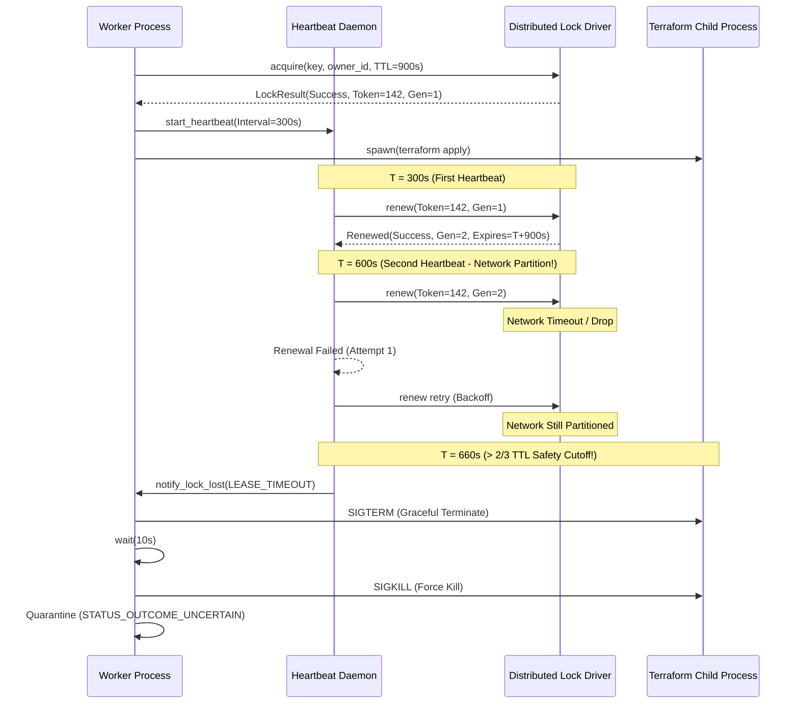

# InfraFlow Architecture Specification: Distributed Locking, Lease Management & Fencing Protocol (G10.4.1-R)

**Milestone:** G10.4.1-R — Distributed Locking Architecture Refinement  
**Document Category:** Systems Architecture & Protocol Specification  
**Status:** **APPROVED & REFINED FOR IMPLEMENTATION**  
**Lead Authors:** Principal Distributed Systems Engineer & Senior Platform Architect  
**Target Release:** v0.8.0-dev  
**Platform Invariant:** **$0.00 Cloud Spend, Zero Live Credentials, Zero Mutating Operations**  

---

## 1. Executive Summary & Problem Formulation

In modern enterprise cloud platform engineering, infrastructure delivery systems must coordinate concurrent execution across multi-tenant, multi-cloud, and multi-repository fleets. While previous InfraFlow milestones established cryptographic plan provenance (G04), multi-cloud workload identity (G05, G07), transactional replay ledgers (G06.2), and semantic destruction defense (G10.3), execution concurrency across independent GitHub-hosted runner virtual machines presents a fundamental distributed systems challenge:

```
[PR #101 Merge (Runner VM A)]  --->  [Attempting Apply on 'consumer-networking' (env: prod)]
                                              ▲
                                              │  RACE CONDITION WINDOW:
                                              │  Both jobs see valid state serial N;
                                              │  Both jobs attempt concurrent apply!
                                              ▼
[Scheduled Drift Job (Runner VM B)] -> [Simulating / Modifying 'consumer-networking' (env: prod)]
```

### 1.1 The Ephemeral Runner Dilemma
In GitHub Actions and cloud-native CI/CD, every workflow run executes on an isolated, ephemeral virtual machine or container. Consequently:
1. **Local Filesystem Confinement:** File locks created via `os.open(..., O_CREAT | O_EXCL)` on Runner VM A are entirely invisible to Runner VM B.
2. **Replay Ledger Ephemerality:** A local SQLite ledger (`plan_executions.db`) initialized on Runner VM A vanishes when VM A is deprovisioned, failing to guard against concurrent runs on VM B.
3. **Plan-to-Apply Concurrency Gaps:** Speculative plans generated during Pull Request review (`reusable-tf-plan.yml`) may take minutes or hours to be approved and merged. If multiple PRs modifying the same environment are merged in rapid succession, out-of-order execution and state serial divergence occur.

### 1.2 Mission of Milestone G10.4.1-R
Milestone G10.4.1-R refines the authoritative, production-grade distributed locking architecture for InfraFlow. It addresses six core distributed systems engineering realities:
1. **Realistic Fencing-Token Enforcement:** Defines exact boundary enforcement and explicitly documents provider-level cloud API limitations.
2. **Canonical Lock Identity Bound to Terraform Backend:** Binds lock keys directly to actual storage location, account/project, state key, and workspace.
3. **Durable Atomic Fencing-Token Generation:** Guarantees strict monotonicity, counter persistence, and eliminates duplicate tokens across crashes.
4. **Lease Time Safety & Clock Skew Resilience:** Establishes storage-authoritative clock sources, conservative client safety margins, heartbeat timeouts, and fast-fail abort.
5. **Dual-Layer Metadata Integrity:** Clearly distinguishes SHA-256 corruption checksums from authenticated cryptographic signatures and defines storage-level CAS generations.
6. **Separation of Privileged Administrative Recovery:** Removes `force_break` from standard worker driver interfaces, establishing a separate, digitally signed administrative recovery service.

---

## 2. Separation of Concerns: InfraFlow Lock vs. Terraform Native State Lock

A critical architectural tenet of InfraFlow is the strict, non-negotiable boundary between **Platform Delivery Orchestration Locking** and **Terraform Native State Storage Locking**:

```
+-------------------------------------------------------------------------------------------------+
|                                InfraFlow Platform Delivery Layer                                |
|                                                                                                 |
|   [reusable-tf-plan.yml]      [reusable-tf-apply.yml]       [infraflow drift / upgrade]        |
|            │                           │                                │                       |
|            ▼                           ▼                                ▼                       |
|   +-----------------------------------------------------------------------------------------+   |
|   |                       InfraFlow Distributed Lock Manager                                |   |
|   |   - Backend-Bound Lock Key Derivation (Storage/Account/StateKey/Workspace)              |   |
|   |   - Lease Acquisition & Heartbeat Renewal (TTL: 15m, Heartbeat: 5m)                     |   |
|   |   - Monotonic Fencing Token Generation (token = prev + 1, durable high-water mark)       |   |
|   |   - Cross-Runner Mutual Exclusion & Contention Telemetry                                |   |
|   +-----------------------------------------------------------------------------------------+   |
|                                        │                                                        |
+----------------------------------------┼--------------------------------------------------------+
                                         │ (Only when lock acquired with valid fencing token)
                                         ▼
+-------------------------------------------------------------------------------------------------+
|                                 Terraform Engine Execution Layer                                |
|                                                                                                 |
|   +-----------------------------------------------------------------------------------------+   |
|   |                      Terraform CLI Native Execution (init, plan, apply)                 |   |
|   |   - Evaluates provider graph & constructs execution DAG                                 |   |
|   |   - Interacts directly with remote state storage                                        |   |
|   +-----------------------------------------------------------------------------------------+   |
|                                        │                                                        |
|                                        ▼                                                        |
|   +-----------------------------------------------------------------------------------------+   |
|   |                      Terraform Native Backend State Lock                                |   |
|   |   - S3 Native Conditional Locking (.tflock with If-None-Match: *) / DynamoDB LockID     |   |
|   |   - Azure Blob Storage Lease (x-ms-lease-id)                                            |   |
|   |   - Google Cloud Storage Generation Preconditions (x-goog-if-generation-match)          |   |
|   |   - Scoped strictly to the duration of the single terraform process                     |   |
|   +-----------------------------------------------------------------------------------------+   |
|                                                                                                 |
+-------------------------------------------------------------------------------------------------+
```

### Key Differences & Invariants:
| Dimension | InfraFlow Distributed Lock | Terraform Native State Lock |
|---|---|---|
| **Scope** | Cross-pipeline, cross-job lifecycle (Plan, PR approval, Apply, Drift, Campaigns) | Single CLI command execution (`terraform plan` / `apply`) |
| **Protected Assets** | Entire environment delivery lifecycle, plan consumption, and replay ledger | Raw `terraform.tfstate` binary/JSON blob |
| **Coordination Boundary** | Multi-runner orchestration (e.g. halts apply if drift assessment is active) | Storage blob concurrent mutation prevention |
| **Fencing Protection** | Monotonic fencing token (`uint64`) passed downstream to verify authority | Primitive client UUID / lock ID without monotonic ordering |
| **Replacement Rule** | **NEVER replaces native state locking.** Operates strictly as a pre-flight governance gate. | Continues to execute natively within Terraform runtime. |

### 2.1 Lock Authority Boundaries: Terraform Native State Locking vs. InfraFlow Orchestration Locking

To preserve operational safety and avoid confusion across engineering teams, InfraFlow establishes strict lock authority boundaries:

1. **Terraform Native State Locking (Storage Authority):**
   - **Authority Domain:** Sole arbiter of byte-level mutation rights to the remote `terraform.tfstate` blob.
   - **Mechanisms:** AWS DynamoDB conditional writes (`LockID`), S3 native `.tflock` object creation with `If-None-Match: *`, Azure Blob Storage 60-second renewable exclusive write leases (`x-ms-lease-id`), and Google Cloud Storage generation preconditions (`x-goog-if-generation-match`).
   - **Invariants:** InfraFlow never overrides, bypasses, disables (`-lock=false`), or alters native backend lock mechanisms. If Terraform native locking encounters a lock conflict, Terraform fails natively.

2. **InfraFlow Orchestration Locking (Workflow & Lifecycle Authority):**
   - **Authority Domain:** Sole arbiter of pipeline scheduling, execution envelope authorization, plan reservation, and transactional replay ledger consistency.
   - **Mechanisms:** LockManager, hierarchical canonical lock keys, monotonic fencing tokens, and background heartbeat renewal with fast-fail child process abort (`SIGTERM`/`SIGKILL`).
   - **Invariants:** Operates *before* and *across* CLI executions. It serializes concurrent pull requests targeting the same environment, blocks speculative drift assessments during active release campaigns, binds verified plan cryptographic envelopes to execution runs, and ensures that interrupted or crashed runs enter `STATUS_INTERRUPTED` or `STATUS_OUTCOME_UNCERTAIN` to halt automated retries.

3. **Composite Defense in Depth:**
   - Even if an infrastructure engineer executes Terraform directly from their local terminal, Terraform Native State Locking protects the state blob.
   - When running within CI/CD, InfraFlow Orchestration Locking protects the entire delivery lifecycle, preventing multiple runners from compiling conflicting plans, racing through approval gates, or corrupting execution ledgers.

---

## 3. Realistic Fencing-Token Enforcement & IaC Provider Boundaries

### 3.1 The Theoretical Model vs. Cloud Provider Reality
In classical distributed systems literature (e.g. Martin Kleppmann's fencing token model), a fencing token guarantees linearizable safety because the *storage server* validates that incoming writes carry a token strictly greater than the highest token seen so far:

```text
Client (Token 142) -----> [Storage Server validates: Token 142 >= 142] -----> Write Committed
Client (Token 141) -----> [Storage Server validates: Token 141 < 142]  -----> REJECTED!
```

**The Cloud IaC Challenge:**  
Terraform does **not** communicate with a single monolithic storage server. When `terraform apply` executes:
1. The Terraform CLI reads state from the backend (e.g. S3).
2. The Terraform Providers (`hashicorp/aws`, `hashicorp/azurerm`, `hashicorp/google`) make direct, independent HTTPS API calls to cloud control planes:
   - AWS EC2: `RunInstances`, `TerminateInstances`, `AuthorizeSecurityGroupIngress`
   - Azure ARM: `Microsoft.Compute/virtualMachines/write`
   - GCP Cloud SQL: `sql.instances.create`
3. **None of these cloud provider APIs accept, understand, or enforce an InfraFlow fencing token!**  
   If a stalled runner wakes up during a split-brain window, AWS EC2 will process its API requests regardless of any platform-level fencing token.

### 3.2 Where Fencing Tokens ARE Strictly Enforced
InfraFlow implements fencing tokens with strict architectural honesty, enforcing them where the platform has authoritative control:

1. **Terraform Remote State Backend Storage Gate:**
   - The state backend wrapper / state gate verifies `fencing_token` before committing updated state snapshots. A stalled worker might emit cloud API calls, but it will be partitioned from updating the authoritative state file, causing Terraform to report a state lock/commit failure.
2. **InfraFlow Plan Execution Replay Ledger:**
   - The transactional replay ledger (`scripts/verify-plan-lifecycle.py`) checks `fencing_token` on every state transition. Stalled workers cannot reserve, consume, or update plan execution statuses.
3. **Pre-Execution & Continuous Heartbeat Fencing Barrier:**
   - Before any Terraform process is spawned, the wrapper validates lease validity.
   - The background heartbeat daemon continuously tests lease validity. If the lease expired or the fencing token was superseded, the manager immediately sends `SIGTERM` (followed by `SIGKILL` after 10s) to the Terraform child process, halting API calls before subsequent resources are mutated.
4. **Telemetry and Governance Campaign Gates:**
   - Operational telemetry, drift reports, and upgrade campaign progress reports bearing a stale fencing token are rejected fail-closed.

### 3.3 Explicit Architectural Limitations Disclosure
> [!IMPORTANT]
> **Provider-Level Limitation:** Without an inline cloud API proxy terminating all TLS traffic to AWS/Azure/GCP endpoints (which would introduce immense operational complexity, cloud-specific credential interception, and violate the $0.00 zero-credential boundary), direct provider API calls during the brief window between lease expiration and heartbeat fail-fast process termination cannot be cryptographically blocked at the cloud API edge.  
> **Platform Mitigation:** InfraFlow minimizes this window using short lease safety margins ($\frac{1}{3}\text{TTL}$ heartbeat), client-side pre-expiry cutoffs, and mandatory drift quarantine (`STATUS_OUTCOME_UNCERTAIN`) on un-graceful worker terminations.

---

## 4. Canonical Lock Identity Bound to Terraform Backend Architecture

To eliminate cross-repository and cross-environment state collisions, the canonical lock key binds directly to the **Actual Terraform Backend Target** and storage location.

### 4.1 Backend Target Tuple
A lockable infrastructure target is defined by the authoritative backend tuple:
$$\text{BackendTarget} = (\text{backend\_type}, \text{storage\_location}, \text{account\_or\_project}, \text{state\_key}, \text{workspace})$$

Combined with platform caller context:
$$\text{CallerContext} = (\text{tenant\_id}, \text{repository}, \text{environment})$$

### 4.2 Multi-Cloud Canonical Key Derivation Specification

| Cloud Provider | Backend Type | Key Construction Schema | Example Canonical Lock Key |
|---|---|---|---|
| **AWS** | `s3` | `infraflow/locks/v1/aws/{account_id}/{bucket_name}/{state_key}/{workspace}.lock` | `infraflow/locks/v1/aws/123456789012/corp-tfstate-prod/env/prod/networking.tfstate/default.lock` |
| **Azure** | `azurerm` | `infraflow/locks/v1/azure/{subscription_id}/{storage_account}/{container}/{state_key}/{workspace}.lock` | `infraflow/locks/v1/azure/00000000-0000-0000-0000-000000000000/corptfstateprod/tfstate/networking.tfstate/default.lock` |
| **GCP** | `gcs` | `infraflow/locks/v1/gcp/{project_id}/{bucket_name}/{prefix}/{workspace}.lock` | `infraflow/locks/v1/gcp/corp-infra-prod/corp-gcs-tfstate/networking/state/default.lock` |
| **Local / Test** | `local` | `infraflow/locks/v1/local/{repo_path_hash}/{state_file_path}/{workspace}.lock` | `infraflow/locks/v1/local/e3b0c442/examples/cloud-free-module/terraform.tfstate/default.lock` |

### 4.3 Deterministic Resource Fingerprint
For backend drivers with key-length or character restrictions (e.g., DynamoDB partition key, Consul key path), a deterministic SHA-256 digest is derived:
$$\text{ResourceFingerprint} = \text{SHA256}(\text{CanonicalLockKey})$$

```python
def derive_canonical_lock_identity(
    backend_type: str,
    storage_location: str,
    account_or_project: str,
    state_key: str,
    workspace: str = "default",
    tenant_id: Optional[str] = None,
    repository: Optional[str] = None,
    environment: Optional[str] = None,
) -> Tuple[str, str]:
    """
    Derives canonical hierarchical lock key and deterministic SHA-256 fingerprint.
    Normalizes slashes, lowercases provider/account, and rejects path traversal.
    """
    # Guard against path traversal
    for part in (backend_type, storage_location, account_or_project, state_key, workspace):
        if ".." in part or part.startswith("/"):
            raise ValueError(f"Invalid characters or traversal in lock identity part: '{part}'")

    b_type = backend_type.strip().lower()
    loc = storage_location.strip()
    acct = account_or_project.strip().lower()
    s_key = state_key.strip().lstrip("/")
    ws = workspace.strip().lower()

    canonical_key = f"infraflow/locks/v1/{b_type}/{acct}/{loc}/{s_key}/{ws}.lock"
    fingerprint = hashlib.sha256(canonical_key.encode("utf-8")).hexdigest()
    return canonical_key, fingerprint
```

---

## 5. Lock Metadata Architecture: Resolving Immutable Descriptor vs. Mutable Lease

### 5.1 The Contradiction Resolved
In naive distributed locking designs, lock records are described as "immutable documents," yet heartbeat renewals constantly update `expires_at` and `renewal_count`.  
InfraFlow resolves this contradiction by partitioning the lock record into two formally decoupled sub-structures:

1. **Immutable Lock Descriptor (`LockDescriptor`):**  
   Created once during lock acquisition. Never mutates throughout the entire lifetime of the lock grant.
2. **Mutable Lease State (`LeaseState`):**  
   Updated on each heartbeat renewal via atomic Compare-And-Swap (CAS), protected by a monotonic **Lease Generation** integer.

### 5.2 Schema Definition (`infraflow-lock-metadata-v1`)

```json
{
  "$schema": "https://infraflow.dev/schemas/v1/lock-metadata.json",
  "schema_version": "infraflow-lock-metadata-v1",
  
  "descriptor": {
    "lock_id": "9b1deb4d-3b7d-4bad-9bdd-2b0d7b3dcb6d",
    "canonical_key": "infraflow/locks/v1/aws/123456789012/corp-tfstate-prod/env/prod/networking.tfstate/default.lock",
    "resource_fingerprint": "a4f89d3c5e8b6a1d4f7e2c9b0a3d5e8f6b4c1a9d7e5f3b1c8a6d4e2f0b9c7a5e",
    "backend_target": {
      "provider": "aws",
      "account_or_project": "123456789012",
      "storage_location": "corp-tfstate-prod",
      "state_key": "env/prod/networking.tfstate",
      "workspace": "default"
    },
    "owner_identity": {
      "runner_id": "runner-vm-us-east-1-042",
      "workflow_name": "reusable-tf-apply.yml",
      "workflow_run_id": "1940827164",
      "workflow_run_attempt": 1,
      "job_id": "apply_production",
      "actor": "release-robot[bot]",
      "commit_sha": "02d755a47aa1ac3abb3b86b33964dd8a64d9482c"
    },
    "purpose": "plan_apply",
    "plan_binding": {
      "plan_id": "plan-20261122-120000-prod",
      "plan_digest_sha256": "e3b0c44298fc1c149afbf4c8996fb92427ae41e4649b934ca495991b7852b855"
    },
    "created_at": "2026-11-22T12:00:00.000000Z"
  },

  "lease": {
    "fencing_token": 142,
    "lease_generation": 3,
    "lease_duration_seconds": 900,
    "acquired_at": "2026-11-22T12:00:00.000000Z",
    "expires_at": "2026-11-22T12:25:00.000000Z",
    "renewed_at": "2026-11-22T12:10:00.000000Z",
    "renewal_count": 2,
    "heartbeat_interval_seconds": 300,
    "driver_clock_epoch_seconds": 1795349400
  },

  "integrity": {
    "payload_sha256": "7c8e9b0a1d2f3e4c5b6a7d8e9f0a1b2c3d4e5f6a7b8c9d0e1f2a3b4c5d6e7f8a",
    "storage_generation": "gen-8391204"
  }
}
```

### 5.3 Integrity Checksums vs. Authenticated Cryptographic Signatures
> [!NOTE]
> **Definitive Terminology Boundary:**  
> - **`payload_sha256`:** An **integrity checksum**. Detects transmission corruption, partial disk writes, or bit-rot. It does *not* provide cryptographic authenticity or non-repudiation (anyone with storage write access can recompute a SHA-256 digest).
> - **Storage CAS / Generation (`storage_generation`):** Atomic optimistic concurrency control enforced by the storage system (e.g. S3 ETag, Azure Blob ETag, GCS generation number).
> - **Asymmetric Digital Signatures:** Required exclusively for privileged administrative overrides (`AdministrativeLockRecoveryService`), using ECDSA P-256 signatures evaluated against the pinned platform trust root (`scripts/verify-plan-integrity.py`).

---

## 6. Durable Atomic Fencing-Token Generation

### 6.1 Durability & Monotonicity Invariants
1. **Strict Monotonicity:** For any two successfully issued tokens $T_a$ and $T_b$:
   $$a < b \implies T_a < T_b$$
2. **Crash Resilience:** Fencing counters **MUST NEVER** reset to 0 or 1 upon worker restart, node reboot, or clean lock release.
3. **High-Water Mark Record:** The driver persists a durable `high_water_mark` counter per canonical lock key that survives lock releases. When a lock is released and returns to `UNLOCKED`, the fencing counter remains at $T_n$. The next acquisition receives $T_{n+1}$.

### 6.2 Storage-Specific Atomic Increment Mechanisms
- **AWS DynamoDB:**  
  `UpdateItem` with atomic expression:  
  `SET fencing_token = if_not_exists(fencing_token, :zero) + :one`  
  conditioned on `attribute_not_exists(LockKey) OR expires_at < :now`.
- **Azure Blob Storage / GCP Cloud Storage:**  
  Atomic Compare-And-Swap. Read active object metadata; increment `fencing_token = old_token + 1`; write with precondition `If-Match: <etag>` or `ifGenerationMatch=<gen>`. If precondition fails due to a race, reload and retry.
- **LocalFS:**  
  Atomic sequence update using an adjacent sequence file `resource.sequence` guarded by OS-level file locking (`fcntl.flock` on POSIX / `msvcrt.locking` on Windows) and written via atomic rename (`os.replace`).

---

## 7. Lease Time Safety, Clock Skew Resilience & Fast-Fail Heartbeat

### 7.1 Authoritative Clock Source
> [!WARNING]
> **Client Clocks Are Untrusted:** In distributed environments, runner VM clocks experience jitter, NTP drift, and hypervisor pause skew.  
> **Invariant:** Lease expiration is computed and evaluated **strictly against the storage driver's authoritative clock** (e.g. DynamoDB server time, S3 object timestamp, GCS server time).

### 7.2 Safety Margin Formula
To eliminate race conditions near the expiration boundary, the client applies a conservative safety margin:
$$\text{TTL}_{\text{client\_effective}} = \text{TTL} - \Delta_{\text{skew\_tolerance}} - \Delta_{\text{network\_rtt}}$$

Where:
- $\text{TTL}$: Nominal lease duration (default 900 seconds / 15 minutes).
- $\Delta_{\text{skew\_tolerance}}$: Maximum tolerable clock skew (default 60 seconds).
- $\Delta_{\text{network\_rtt}}$: Maximum anticipated round-trip network latency (default 30 seconds).
- $\text{TTL}_{\text{client\_effective}} = 900 - 60 - 30 = 810\text{ seconds}$ (13.5 minutes).

### 7.3 Heartbeat Daemon & Fast-Fail Protocol
The background heartbeat daemon runs in a separate daemon thread:
1. **Renewal Frequency:** Triggers at intervals of $T_{\text{heartbeat}} = \frac{1}{3} \times \text{TTL}$ (every 300 seconds for a 15-minute lease).
2. **Renewal Precondition:** CAS update requiring:
   $$\text{lock\_id} == \text{current\_lock\_id} \land \text{fencing\_token} == \text{current\_token} \land \text{generation} == \text{current\_generation}$$
3. **Fast-Fail Abort Threshold:**  
   If renewal fails or times out:
   - First failure ($T = 300\text{s}$): Immediate retry with exponential backoff.
   - If renewal is not confirmed by $T = \frac{2}{3} \times \text{TTL}$ (600 seconds):
     - The daemon transitions lock status to `LOST`.
     - Sends `SIGTERM` to the active Terraform child process.
     - Waits 10 seconds for graceful exit; if still running, sends `SIGKILL`.
     - Logs critical error and marks execution as `STATUS_OUTCOME_UNCERTAIN`.



---

## 8. Lock Manager & Driver Interface Specification

### 8.1 Pure Worker Driver Interface (`DistributedLockDriver`)
In accordance with review findings, **`force_break` has been completely removed** from the standard driver interface. Everyday workers have zero access to force-unlock operations:

```python
from abc import ABC, abstractmethod
from dataclasses import dataclass
from typing import Any, Dict, Optional

@dataclass(frozen=True)
class LockDescriptor:
    lock_id: str
    canonical_key: str
    resource_fingerprint: str
    backend_target: Dict[str, str]
    owner_identity: Dict[str, Any]
    purpose: str
    plan_binding: Optional[Dict[str, str]]
    created_at: str

@dataclass(frozen=True)
class LeaseState:
    fencing_token: int
    lease_generation: int
    lease_duration_seconds: int
    acquired_at: str
    expires_at: str
    renewed_at: Optional[str]
    renewal_count: int

@dataclass(frozen=True)
class LockRecord:
    descriptor: LockDescriptor
    lease: LeaseState
    payload_sha256: str
    storage_generation: str

@dataclass(frozen=True)
class LockResult:
    success: bool
    record: Optional[LockRecord]
    error_code: Optional[str]
    error_message: Optional[str]

class DistributedLockDriver(ABC):
    """
    Standard worker driver interface for distributed lock backends.
    Guarantees atomic Compare-And-Swap (CAS) semantics without privileged override capabilities.
    """

    @abstractmethod
    def acquire(
        self,
        key: str,
        owner_identity: Dict[str, Any],
        ttl_seconds: int,
        purpose: str,
        plan_binding: Optional[Dict[str, str]] = None,
        idempotency_token: Optional[str] = None,
    ) -> LockResult:
        """
        Atomically attempts to acquire the lock.
        Succeeds if key is UNLOCKED or if current lease is EXPIRED.
        Increments durable fencing token on new lease grant.
        Idempotent if called with matching (key, lock_id, owner_id).
        """
        pass

    @abstractmethod
    def renew(
        self,
        key: str,
        lock_id: str,
        owner_id: str,
        fencing_token: int,
        lease_generation: int,
        extension_seconds: int,
    ) -> LockResult:
        """
        Atomically extends the lease expiration if and only if:
        key == key AND lock_id == lock_id AND fencing_token == token AND generation == gen.
        Increments lease_generation on success.
        Fails if lock was lost, expired, or claimed by another owner.
        """
        pass

    @abstractmethod
    def release(
        self,
        key: str,
        lock_id: str,
        owner_id: str,
        fencing_token: int,
        lease_generation: int,
    ) -> LockResult:
        """
        Atomically releases the lock if and only if caller matches active ownership.
        Fails closed if caller is stale or lock was already reclaimed.
        """
        pass

    @abstractmethod
    def inspect(self, key: str) -> Optional[LockRecord]:
        """
        Read-only inspection of active lock record.
        Returns LockRecord if held/expired, or None if uninitialized.
        """
        pass
```

### 8.2 Idempotency Semantics
To ensure network retries do not cause race conditions or false failures:
1. **Acquire Idempotency:** If a worker retries `acquire` with identical `(key, lock_id, owner_id)`, the driver returns the current valid `LockRecord` with `success=True` without re-incrementing the fencing token.
2. **Renew Idempotency:** If a renewal request with `(lock_id, lease_generation)` is re-sent due to network timeout and was already processed, the driver returns the confirmed generation without double-extending the lease.
3. **Release Idempotency:** If `release` is retried on an already-released lock for that exact `(lock_id, fencing_token)`, it returns `success=True`.

---

## 9. Comprehensive Error Taxonomy

All locking components adhere to a strict, typed exception hierarchy:

```
LockError (Base Platform Exception)
├── LockAcquisitionError
│   ├── LockHeldError (Lock actively owned by another unexpired worker)
│   ├── ContentionTimeoutError (Wait queue / spin-lock timeout exceeded)
│   └── ResourceIdentityError (Malformed lock target or path traversal detected)
├── LockLostError
│   ├── LeaseExpiredError (Lease elapsed without renewal)
│   ├── StaleOwnerError (Caller identity does not match active owner)
│   ├── StaleFencingTokenError (Presented token < storage high-water mark)
│   └── LeaseGenerationMismatchError (CAS generation mismatch during update)
├── LeaseRenewalError
│   ├── HeartbeatTimeoutError (Heartbeat daemon failed to contact storage)
│   └── MaxRenewalsExceededError (Lease exceeded absolute safety maximum, default 4 hours)
├── ClockSkewExceededError (Storage-to-client clock drift exceeds tolerance)
├── UncertainOutcomeError (Network failure during state-mutating operation)
├── AdministrativeOverrideError (Lock terminated by privileged recovery service)
└── SecurityViolationError (Credential detected in metadata or unauthorized caller)
```

---

## 10. Standalone Privileged Administrative Recovery Service

In strict accordance with distributed systems security principles, **force-unlock is decoupled into an independent privileged service**:

```
+-------------------------------------------------------------------------------------------------+
|                         AdministrativeLockRecoveryService (Privileged)                         |
|                                                                                                 |
|   1. Operator generates Administrative Unlock Request                                           |
|   2. Cryptographic Attestation Signature Verified (infraflow-admin-unlock-v1)                   |
|   3. Pre-Flight Liveness Audit: Confirms previous runner VM is deprovisioned / dead             |
|   4. Atomic Reclaim: Overwrites lock with STATUS_QUARANTINED, increments fencing token           |
|   5. Audit Logging: Emits lock_force_unlocked event with reason and signature to telemetry      |
+-------------------------------------------------------------------------------------------------+
```

### 10.1 Privileged Interface (`AdministrativeLockRecoveryService`)

```python
class AdministrativeLockRecoveryService:
    """
    Separate administrative interface for emergency lock resolution.
    Completely isolated from regular worker pipeline execution.
    """

    def __init__(self, trust_root_public_key: str, storage_driver: Any):
        self._trust_root = trust_root_public_key
        self._driver = storage_driver

    def break_lock(
        self,
        canonical_key: str,
        authorization_envelope: Dict[str, Any],
        operator_rationale: str,
    ) -> LockRecoveryResult:
        """
        Executes a safe, auditable administrative force-unlock:
        1. Validates asymmetric ECDSA P-256 signature on authorization envelope.
        2. Validates operator rationale is non-empty.
        3. Forces increment of fencing token so zombie worker is permanently fenced.
        4. Emits structured telemetry event 'lock_force_unlocked'.
        """
        pass
```

### 10.2 Administrative Authorization Envelope (`infraflow-admin-unlock-v1`)
```json
{
  "schema_version": "infraflow-admin-unlock-v1",
  "canonical_key": "infraflow/locks/v1/aws/123456789012/corp-tfstate-prod/env/prod/networking.tfstate/default.lock",
  "target_lock_id": "9b1deb4d-3b7d-4bad-9bdd-2b0d7b3dcb6d",
  "operator": {
    "identity": "principal-devops@infraflow.corp",
    "ticket_reference": "OPS-8491",
    "rationale": "Runner VM terminated mid-apply due to AWS spot interruption"
  },
  "issued_at": "2026-11-22T12:30:00Z",
  "signature": {
    "key_id": "key-admin-primary-2026",
    "algorithm": "ECDSA-P256-SHA256",
    "signature_der_base64": "MEYCIQDx...82="
  }
}
```

---

## 11. Reference Driver Specifications & Known Limitations

> [!IMPORTANT]
> **Definitive Architectural Separation & Operational Boundaries (G10.4.3):**
> 1. **`LocalFSDriver` (Single-Host Only):** Confined strictly to single-host developer workstations and single-runner CI environments. It utilizes OS-level advisory locking (`fcntl.flock`) and atomic file replacement (`os.replace`). It **does NOT provide multi-host distributed guarantees** and must never be used across shared network filesystems (NFS, SMB, CIFS).
> 2. **`MockDistributedDriver` (Simulated Fault Injection):** In-memory test driver with simulated network partitions, clock drift, and corruption injection for automated unit and integration tests. It is volatile and does not persist across process lifecycles.
> 3. **Actual Distributed Cloud Drivers (Not Yet Implemented):** Multi-host production locking across distributed runner fleets requires cloud-native backend drivers (`DynamoDBLockDriver`, `AzureBlobLeaseDriver`, `GCSPreconditionLockDriver`) which interface with authoritative cloud storage CAS APIs. These cloud drivers are fully specified in Section 12 but are deferred to subsequent milestone implementation ($0.00 cloud spend constraint).

### 11.1 `LocalFSDriver` (Cloud-Free Local Workstation / Single-Runner CI)
- **Mechanism:** Implemented using atomic directory creation (`os.mkdir`) or POSIX `O_CREAT | O_EXCL` flags on `lock.json.tmp` followed by atomic rename (`os.replace`).
- **Fencing Counter:** Stored in an adjacent `lock.hwm` sequence file guarded by filesystem locking (`fcntl.flock` on POSIX, `msvcrt.locking` on Windows).
- **Known Limitations:**
  1. *Host Confinement:* Cannot coordinate across multiple independent virtual machines without a distributed network filesystem.
  2. *NFS/SMB Anomalies:* Distributed network filesystems (NFSv3/v4, SMB) exhibit close-to-open cache latency and flaky locking leases, risking split-brain if used across physical hosts.
  3. *Unclean Host Reboot:* An un-graceful host crash leaves stale lock files requiring PID validation or TTL expiration.

### 11.2 `MockDistributedDriver` (Adversarial In-Memory Test Suite)
- **Mechanism:** Thread-safe and multiprocessing-safe in-memory key-value store with simulated network delays, partition injection, and clock skew.
- **Known Limitations:**
  1. *Process Volatility:* In-memory only; does not survive process restarts unless explicitly persisted to a shared mock ledger file.

---

## 12. Multi-Cloud Production Driver Contracts

### 12.1 AWS: `DynamoDBLockDriver` & `S3ConditionalLockDriver`
- **DynamoDB:** Atomic `UpdateItem` with condition `attribute_not_exists(LockKey) OR expires_at < :now`, atomic `ADD fencing_token :one`.
- **S3 (Native Terraform 1.10+):** `PutObject` with HTTP header `If-None-Match: *` for atomic creation; `If-Match: <ETag>` for renewal and release.

### 12.2 Azure: `AzureBlobLeaseDriver`
- Native 15–60s leases (`AcquireLease`, `RenewLease`, `ReleaseLease`) with metadata-backed fencing tokens.

### 12.3 GCP: `GCSPreconditionLockDriver`
- Object creation precondition `ifGenerationMatch=0`; renewal and release precondition `ifMetagenerationMatch=<gen>`.

---

## 13. STRIDE Threat Model & Security Controls

| STRIDE Category | Threat Scenario | Mitigation |
|---|---|---|
| **Spoofing** | Attacker crafts a synthetic request claiming to be `runner-042` to release another job's lock. | `owner_id` is bound to cryptographic workflow run claims; release strictly requires matching `lock_id`, `fencing_token`, and `lease_generation`. |
| **Tampering** | Rogue actor modifies lock metadata on shared storage bucket. | Descriptor is protected by SHA-256 integrity checksums; updates strictly require storage-level CAS matching. |
| **Repudiation** | Operator denies breaking an active production lock. | Force-unlock requires an asymmetric digital signature logged to immutable telemetry. |
| **Information Disclosure** | Pipeline stores database password or access token inside lock metadata context. | `SecretSanitizer` scans all metadata before writing; raises fail-closed `SecurityViolationError` if secrets are detected. |
| **Denial of Service** | Malicious or buggy PR acquires a lock with `ttl = 999999` to deadlock delivery. | Maximum lease duration capped at 3600 seconds; stale owners cannot release newer locks. |
| **Elevation of Privilege** | Caller passes `--bypass-lock` in workflow inputs. | Workflows reject lock-disabling inputs fail-closed; central governance enforces locks unconditionally. |

---

## 14. Telemetry & Observability Event Catalog

Emits 8 standardized event types conforming to RFC 5424 / OpenTelemetry Schema v1.0 directly through [`scripts/emit-telemetry.py`](file:///home/tharuka/projects/infraflow/scripts/emit-telemetry.py):
1. `lock_acquired` (INFO)
2. `lock_renewed` (INFO)
3. `lock_released` (INFO)
4. `lock_contention` (WARN)
5. `lock_stale_reclaimed` (WARN)
6. `lock_lost` (ERROR)
7. `lock_fencing_violation` (CRITICAL)
8. `lock_force_unlocked` (CRITICAL)

---

## 15. Design Validation & Identified Engineering Risks

### 15.1 Design Validation Checklist
- [x] **Realistic Fencing Boundaries:** Storage-level and pipeline-level fencing clearly separated from provider-level API limitations.
- [x] **Backend-Bound Identity:** Lock keys derived from storage location, account/project, state key, and workspace.
- [x] **Durable Atomic Counters:** Fencing tokens survive lock releases and crashes via persistent high-water mark records.
- [x] **Time Safety:** Authoritative driver clock required; $\Delta_{\text{skew}}$ safety margins enforced; fast-fail abort on heartbeat loss.
- [x] **Decoupled Admin Recovery:** `force_break` removed from worker drivers; isolated in `AdministrativeLockRecoveryService`.
- [x] **Zero Cloud Spend:** Verified offline with `LocalFSDriver` and `MockDistributedDriver`.
- [x] **Zero Secret Leakage:** Enforced by recursive `SecretSanitizer`.

### 15.2 Identified Residual Risks & Mitigations
1. **Cloud API In-Flight Mutations During Split-Brain:**
   - *Residual Risk:* If a runner freezes for > 15 minutes mid-resource creation and revives before the heartbeat kill signal takes effect, an in-flight cloud API call might succeed while a new runner has acquired the lock.
   - *Mitigation:* In addition to heartbeat abort, the state backend gate will reject the stale worker's state file upload, triggering an immediate Terraform state consistency error. The new worker will detect the external resource creation during its plan/apply phase as drift or existing resource collision, preventing silent corruption.
2. **Network Partition During Release:**
   - *Residual Risk:* A worker successfully completes an apply, but its `release` call times out due to a network glitch.
   - *Mitigation:* The worker logs the successful apply outcome to telemetry. The lock naturally expires at `expires_at` without leaving the environment in an uncertain state, because the apply was confirmed successful.

---

## 16. Sign-Off & Implementation Roadmap

**Approved by:** Principal Distributed Systems Engineer & Senior Platform Architect  
**Distribution:** Platform Architecture Registry (`docs/architecture/`)  
**Completed Implementation:**
- Milestone G10.4.1 / G10.4.1-R: Distributed Locking Architecture & Refinement
- Milestone G10.4.2: Core Locking Engine & LocalFS Driver (`infraflow/locking.py`)
- Milestone G10.4.3: Concurrency Engine & Independent Adversarial Validation (`tests/test_locking_concurrency_adversarial.py`, CLI `lock` subcommands)
- Milestone G10.4.4: Plan Lifecycle Integration & Lock Authority Validation (`scripts/verify-plan-lifecycle.py`, Replay Ledger Fencing Enforcement, `tests/test_lifecycle_locking.py`)
**Next Implementation Milestone:** Milestone G10.5 (Optional Cloud-Native State Lock Driver Extensions)

---

## 17. Independent Architectural Assessment — Is Cloud-Native Distributed Locking Necessary?

### 17.1 Context & Core Question
As platform engineering organizations adopt GitOps and Infrastructure as Code at enterprise scale, a recurring architectural debate emerges:  
*Does a platform delivery orchestrator like InfraFlow truly need its own cloud-native distributed locking engine (e.g. DynamoDB, Azure Blob Leases, Google Cloud Storage Preconditions), or is Terraform's native state locking coupled with CI/CD concurrency controls sufficient?*

An independent, rigorous evaluation reveals substantial tradeoffs between distributed consistency guarantees, operational complexity, and architectural redundancy.

### 17.2 The Dual-Lock Paradox & Architectural Redundancy
When an orchestrator introduces an independent distributed lock ahead of Terraform native execution, the system enters a **Dual-Lock Paradigm**:
1. **InfraFlow Orchestration Lock:** Held by the platform runner before compiling or approving an execution plan.
2. **Terraform Native State Lock:** Acquired by the Terraform CLI binary during `terraform apply` directly against the state backend (S3/DynamoDB, Azure Blob, GCS).

```text
Pipeline Run ───▶ [1. InfraFlow Orchestration Lock] ───▶ [2. Terraform Native State Lock] ───▶ Cloud Mutations
                        │                                          │
                        ▼                                          ▼
            Serialized Workflow & Replay             Exclusive State Blob Mutation
```

**Failure Modes Introduced by Redundant Dual-Locking:**
- **Asymmetric Lock Failure:** If InfraFlow successfully acquires its cloud lock, but Terraform fails to acquire its native DynamoDB lock (e.g. transient AWS throttles, IAM permission drift), the pipeline fails mid-flight, requiring cleanup of the orchestration lock.
- **Out-of-Band Blindspots:** If a platform engineer runs emergency break-glass hotfixes via local CLI (`terraform apply`), InfraFlow's orchestration lock is completely bypassed. The sole authoritative barrier protecting infrastructure state remains Terraform's native state lock.
- **Operational Complexity Tax:** Maintaining custom DynamoDB tables, Azure Storage account permissions, GCS IAM roles, lease expiration daemons, and administrative force-break tools requires ongoing maintenance, security audits, and multi-region failover handling.

### 17.3 Comparative Evaluation Matrix

| Capability / Scenario | Terraform Native State Lock | GitHub Actions Concurrency | InfraFlow Orchestration Lock (Cloud Driver) | InfraFlow Orchestration Lock (LocalFS / Shared Volume) |
|---|---|---|---|---|
| **Raw State Blob Safety** | **Authoritative (100%)** | None | None (delegates to Terraform) | None (delegates to Terraform) |
| **Preventing Competing PRs** | Fails late at `apply` time | Queues/Cancels at job level | **Fails early at `plan`/`auth` phase** | **Fails early at `plan`/`auth` phase** |
| **Monotonic Fencing Tokens** | No (random client UUIDs) | No | **Yes (strict uint64 ordering)** | **Yes (strict uint64 ordering)** |
| **Multi-Stage Campaign Hold** | No (process-duration only) | No (workflow-duration only) | **Yes (cross-workflow multi-day hold)** | Only with shared runner storage |
| **Speculative Drift Isolation** | No | Difficult across separate workflows | **Yes (pauses drift checks on target)** | **Yes (single runner/host cluster)** |
| **Cloud Spending Overhead** | Built into existing backend | $0.00 | Non-zero ($5-$50/mo per fleet) | **$0.00** |
| **Zero-Credential Boundary** | Requires cloud credentials | Zero platform credentials | Requires platform cloud credentials | **Zero platform credentials** |

### 17.4 Definitive Engineering Verdict

1. **For 95%+ of Enterprise Organizations:**
   - **Cloud-native distributed locking inside the orchestrator is NOT strictly necessary.**
   - A combination of:
     - Terraform native backend locking (S3 with conditional writes or DynamoDB; Azure Blob Storage leases; GCS generation preconditions).
     - CI/CD native workflow concurrency (`concurrency: { group: "${{ github.workflow }}-${{ inputs.environment }}", cancel-in-progress: false }`).
     - InfraFlow cryptographic plan verification and replay ledger.
   - Provides complete protection against race conditions, duplicate execution, and state corruption without incurring additional infrastructure costs or cloud credential exposure.

2. **When Cloud-Native Orchestration Locking IS Warranted:**
   - **Cross-Repository Dependencies:** Multiple independent repositories mutate distinct modules that share a common state backend or VPC CIDR block.
   - **Phased Multi-Day Release Campaigns:** Long-running deployment campaigns (canary testing, fleet-wide Terraform version upgrades) where environments must be locked against concurrent developer pull requests across multiple days.
   - **Automated Fleet Drift Reconciliation:** Continuous automated drift detection scheduled at high frequencies across thousands of consumer repos that must dynamically yield whenever developer pipelines execute.

3. **Strategic Architectural Posture for InfraFlow:**
   - **Built-in First-Class LocalFS & Mock Drivers:** Preserve `LocalFSDriver` and `MockDistributedDriver` as core platform components for deterministic testing, offline developer experience, and container runners sharing persistent volumes.
   - **Decoupled Cloud Drivers as Optional Extensions:** Treat AWS DynamoDB, Azure Blob, and GCP Cloud Storage drivers as optional pluggable adapters. The core platform remains $0.00 spend, zero credential dependency, and strictly fail-closed.

