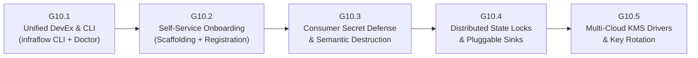

# InfraFlow G10 Readiness Assessment & Architecture Evolution Roadmap

**Document Reference:** `docs/architecture/G10-READINESS-ASSESSMENT.md`  
**Current Release Baseline:** `v0.7.0` (Commit [`759667d6617853fea314abff40ad6962fb9080f5`](https://github.com/TM-threemavithana/infraflow/commit/759667d6617853fea314abff40ad6962fb9080f5))  
**Auditor Roles:** Principal Platform Engineer, Staff DevSecOps Architect, SRE Lead  
**Evaluation Date:** 2026-11-21  
**Status:** PROPOSED & READY FOR ARCHITECTURE REVIEW  
**Cost & Safety Invariants:** Strictly **$0.00 cloud spending**, zero live credentials, read-only discovery, simulation-first verification.

---

## 1. Executive Summary

With the successful publication of **InfraFlow v0.7.0**, the platform has fulfilled the core milestones of its foundational roadmap:
- **G01–G03:** Provider-neutral CI/CD core, DevSecOps scanning layers (TFLint, Trivy, Conftest), and initial security gates.
- **G04–G06:** Cryptographic plan provenance (ECDSA P-256 in-toto DSSE attestations), destruction blast radius circuit-breakers, and plan envelope encryption (`kms-envelope.py`).
- **G07:** Multi-cloud adapter architecture supporting AWS, Azure, and GCP Workload Identity Federation (WIF) and backend isolation.
- **G08:** Multi-repository adoption framework, consumer onboarding contract (`infraflow.config.yaml`), and out-of-band fleet auditing (`audit-consumer-fleet.py`).
- **G09:** Enterprise operational maturity, Schema v1.0 telemetry streaming (`emit-telemetry.py`), 5-pillar compliance dashboard (`generate-compliance-dashboard.py`), continuous state drift simulation (`simulate-drift.py`), automated upgrade campaigns with Canary Gates (`orchestrate-campaign.py`), and unified operational verifier (`verify-operational-maturity.py`).

InfraFlow now operates as a robust, supply-chain hardened, multi-cloud infrastructure delivery framework tested across three external consumer repositories (`infraflow-consumer-networking`, `infraflow-consumer-application`, `infraflow-consumer-data-platform`).

However, as the platform transitions from an architectural proof-of-concept into enterprise adoption, critical architectural boundaries and developer friction points emerge. This readiness assessment conducts an exhaustive, evidence-based architectural audit across eight core platform dimensions to determine the highest-value engineering investments for **Phase G10**.

---

## 2. Current Platform Baseline & Architectural Invariants

### 2.1 Verified Capabilities (v0.7.0)
1. **Unified Reusable Core:** Reusable GitHub Actions workflows (`reusable-tf-validate.yml`, `reusable-tf-security.yml`, `reusable-tf-plan.yml`, `reusable-tf-apply.yml`, `reusable-tf-governance.yml`, `fleet-observability.yml`).
2. **Cloud-Free Local Harness:** 407/407 automated validation checks passing in `scripts/validate-local.sh` across 25 quality sections at $0.00 cloud expenditure.
3. **Comprehensive Test Coverage:** 535 Python unit and adversarial tests (`tests/`) and 194 OPA/Rego enterprise security policy assertions (`policies/`).
4. **Supply Chain Hardening:** 100% of external actions and platform workflow references pinned to immutable 40-character commit SHAs; zero medium/high Zizmor findings; clean Gitleaks scans across full history.
5. **External Fleet Integration:** 3 independent consumer repositories operating with 100.0% fleet compliance scores on `main` branches.

### 2.2 Preserved Safety & Scope Invariants
- **Zero Cloud Expenditure ($0.00):** No billable cloud resources are provisioned or modified during development or CI validation.
- **Zero Live Credentials:** Long-lived access keys and cloud credentials remain strictly forbidden; authentication is verified offline via policy-as-code and mock provider contracts.
- **Read-Only Simulation Scope:** Speculative drift detection and staged upgrade campaigns operate in simulation mode without destructive automated remediation.
- **Cryptographic Clarity:** Asymmetric digital signatures (ECDSA P-256 with in-toto DSSE envelopes) are specifically reserved for plan provenance attestations; canonical SHA-256 hashing is used for state integrity digests.

---

## 3. Comprehensive Evaluation Across 8 Platform Dimensions

### Dimension 1: Developer Self-Service and Platform Onboarding

#### What Already Exists
- Static consumer template repository in `templates/consumer-repository/` containing caller workflows, `infraflow.config.yaml`, and baseline HCL modules.
- Pre-merge contract validation utility in `scripts/validate-consumer.py` verifying YAML syntax, directory containment, and immutable SHA references.
- Mandatory upstream governance gate in `.github/workflows/reusable-tf-governance.yml` evaluating consumer compliance before adapter execution.
- Central fleet manifest in `config/fleet-manifest.yaml` registering consumer repositories and rollout roles.

#### The Actual Architectural Gap
- **Manual Fleet Registration Bottleneck:** To register a new consumer, a platform engineer must manually edit `config/fleet-manifest.yaml`, commit to a platform branch, pass local tests, open a PR, and merge. There is no automated registration API or self-service pull request validation for onboarding consumers.
- **Lack of Interactive Scaffolding:** Consuming developers must manually clone or copy the template repository, manually edit YAML files, and manually substitute platform commit SHAs. No interactive or headless generator (e.g. `infraflow init` / `scaffold-consumer.py`) exists to generate valid configurations for specific cloud archetypes.
- **Contract Schema Version Deprecation:** The contract parser assumes Schema v1.0. There is no migration path, deprecation warning system, or compatibility matrix when upgrading contract schemas to v1.1+.

#### Why It Matters
In an enterprise with dozens of application teams, manual manifest editing creates a central platform engineering bottleneck. Developers experience high onboarding friction, leading to configuration copy-paste errors and inconsistent directory layouts.

#### Dependencies
- `config/fleet-manifest.yaml` (Schema v1.0).
- `scripts/validate-consumer.py`.

#### Measurable Acceptance Criteria
1. `scripts/scaffold-consumer.py` generates 100% compliant consumer starter repositories for AWS, Azure, and GCP archetypes via headless flags and interactive prompts.
2. `scripts/register-consumer.py` programmatically parses a consumer repository URL, validates its contract offline, and injects a sanitized, formatted entry into `fleet-manifest.yaml` with schema validation.
3. Schema version negotiation: The validator cleanly accepts Schema v1.0 and v1.1, providing structured deprecation warnings for outdated configurations.

#### Implementation Complexity & Zero-Cost Testing
- **Complexity:** Medium (2–3 engineer days).
- **Zero-Cost Testing:** Offline unit tests creating temporary directory trees, asserting YAML output schemas, and executing mock scaffolding workflows.
- **Live Cloud Boundary:** Actual GitHub Enterprise repository provisioning, GitHub Team access grants, and organization webhook creation require live GitHub permissions.

---

### Dimension 2: Production Integration Readiness

#### What Already Exists
- Multi-cloud adapter workflows (`reusable-tf-aws.yml`, `reusable-tf-azure.yml`, `reusable-tf-gcp.yml`) declaring OIDC authentication parameters and backend configuration blocks.
- SEC-02 rule: Fail-closed abort if live cloud authentication is requested in untrusted pull requests.
- Offline provider mocking in `examples/cloud-free-module/` with native `.tftest.hcl` assertions.

#### The Actual Architectural Gap
- **Missing Cloud Infrastructure Bootstrap Modules:** InfraFlow assumes state backends (S3+DynamoDB, Azure Storage, GCS) and OIDC Identity Providers exist in target clouds, but provides zero platform-standard Terraform modules to provision them.
- **Lack of Multi-Environment Promotion Scaffolding:** Workflows do not declare structured environment promotion gates (e.g., `dev` -> `staging` -> `prod` with GitHub Actions Environment approvals, required reviewers, and deployment branch protections).
- **Absence of Rich Pull Request Feedback:** Plan results and compliance scores are published exclusively to GitHub Actions Step Summaries. There is no automated, sticky pull request comment engine providing collapsible plan diffs, cost estimates, and security ratings directly in the PR review thread.

#### Why It Matters
Prospective adopters cannot easily deploy InfraFlow into real AWS, Azure, or GCP accounts without standard bootstrap modules. Furthermore, forcing developers to leave their PR conversation to inspect Actions run step summaries degrades code review velocity.

#### Dependencies
- Reusable cloud adapter workflows.
- GitHub REST API / `gh` CLI.

#### Measurable Acceptance Criteria
1. Standardized bootstrap Terraform modules authored in `bootstrap/aws`, `bootstrap/azure`, `bootstrap/gcp` establishing least-privilege OIDC trust roles and encrypted state backends (tested via mock provider).
2. Sticky PR Commenter (`scripts/post-plan-comment.py`) generating formatted, collapsible Markdown comments with plan change tallies, security statuses, and drift warnings, updating existing comments on commit push.
3. Environment promotion matrix documented and enforced via workflow input parameters.

#### Implementation Complexity & Zero-Cost Testing
- **Complexity:** High (3–4 engineer days).
- **Zero-Cost Testing:** Mock provider unit tests for bootstrap modules; unit tests validating comment Markdown formatting and GitHub API payload generation via mock HTTP fixtures.
- **Live Cloud Boundary:** Real AWS IAM OIDC Thumbprint exchanges, Azure Service Principal consent, and GCP Workload Identity Pool creation require live cloud credentials.

---

### Dimension 3: Distributed State and Replay Protection

#### What Already Exists
- Plan envelope encryption with AES-256-GCM via `scripts/kms-envelope.py`.
- Atomic plan reservation, expiration TTL validation, lineage/serial consistency, and consumption gating in `scripts/verify-plan-lifecycle.py`.
- Local software-backed atomic file locking (`.plan.lock`).

#### The Actual Architectural Gap
- **Single-Host Local Filesystem Lock Confinement:** `verify-plan-lifecycle.py` relies on `os.open(..., O_CREAT | O_EXCL)` on a local filesystem directory. On distributed, ephemeral GitHub-hosted runners, each workflow job runs on an isolated virtual machine! A local filesystem lock on Runner VM 1 provides zero mutual exclusion against a concurrent job on Runner VM 2.
- **Ephemeral Reservation State Transfer:** When Plan executes in a PR and Apply executes upon merge, the reservation ledger (`reserved_plans.json`) is not persisted in a shared distributed state store.
- **Lack of Pluggable Lock Driver Interface:** The lifecycle verifier does not have an abstraction layer to delegate atomic leases to cloud state locks (e.g., DynamoDB lock items, Azure Blob leases, GCS object holds, or GitHub Actions Environment concurrency).

#### Why It Matters
In enterprise environments with concurrent pull request merges, independent ephemeral runners could attempt concurrent applies, causing race conditions, state corruption, or out-of-order infrastructure modifications.

#### Dependencies
- `scripts/verify-plan-lifecycle.py`.
- `scripts/kms-envelope.py`.

#### Measurable Acceptance Criteria
1. Abstract Lock Driver Interface (`scripts/state_locks/`) implemented with `LocalFSDriver`, `MockDistributedDriver`, and production driver interfaces (`DynamoDBLockDriver`, `BlobLeaseDriver`, `GCSHoldDriver`).
2. Distributed plan lease protocol enforcing atomic reservation tokens and heartbeat renewal with deterministic lease expiration.
3. Cryptographic Lease Token Binding: Apply workflows require presenting an encrypted, one-time lease token generated during the Plan phase.

#### Implementation Complexity & Zero-Cost Testing
- **Complexity:** High (4 engineer days).
- **Zero-Cost Testing:** High-concurrency multithreaded/multiprocess adversarial test suites simulating distributed race conditions and lease expiration.
- **Live Cloud Boundary:** Network partition tolerance under live DynamoDB conditional writes and Azure Blob lease acquisition timeouts.

---

### Dimension 4: Multi-Cloud Workload Identity and KMS Integration

#### What Already Exists
- Asymmetric ECDSA P-256 in-toto DSSE plan attestation generator and verifier in `scripts/verify-plan-integrity.py`.
- Software-backed KMS envelope encryption utility in `scripts/kms-envelope.py`.
- Centralized OIDC subject validation policies in Rego (`policies/aws/iam_oidc.rego`, `policies/azure/entra_oidc.rego`, `policies/gcp/wif_oidc.rego`).

#### The Actual Architectural Gap
- **Hardcoded Software Mock KMS:** `kms-envelope.py` implements only `--key-provider mock-kms`. It lacks a pluggable provider interface capable of invoking cloud KMS APIs (AWS KMS `GenerateDataKey`, Azure Key Vault `wrapKey`, GCP Cloud KMS `encrypt`).
- **Static Key Management & Absence of Rotation Architecture:** Cryptographic signing keys and KEKs are static files. There is no automated key versioning or graceful dual-key rotation window allowing in-flight plans signed by key $N-1$ to be verified while new plans use key $N$.
- **Absence of Ephemeral OIDC Keyless Attestation:** Signing relies on static private keys rather than ephemeral, keyless Sigstore/Cosign signing tied directly to the GitHub Actions OIDC identity token.

#### Why It Matters
Static private keys stored in CI environments represent a critical secret leakage vector. Enterprise compliance frameworks (NIST SP 800-57, CIS) mandate regular key rotation and hardware-backed KMS storage.

#### Dependencies
- `scripts/kms-envelope.py`, `scripts/verify-plan-integrity.py`.
- Python `cryptography` library.

#### Measurable Acceptance Criteria
1. Pluggable KMS Provider Interface (`scripts/kms_providers/`) supporting Mock KMS, AWS KMS, Azure Key Vault, and GCP Cloud KMS interfaces.
2. Dual-Key Rotation Protocol: Verifier accepts plans signed with active key version $N$ or retired key version $N-1$ within a configurable grace window.
3. Keyless OIDC Attestation Interface: Plan signer supports packaging ephemeral GitHub OIDC tokens into in-toto provenance bundles.

#### Implementation Complexity & Zero-Cost Testing
- **Complexity:** High (3–4 engineer days).
- **Zero-Cost Testing:** Software emulation of cloud KMS HTTP API endpoints; adversarial rotation test vectors asserting rejection of revoked key versions.
- **Live Cloud Boundary:** Real AWS KMS HSM key protection validation and Azure Key Vault managed identity token acquisition.

---

### Dimension 5: Platform Observability and Reliability

#### What Already Exists
- Structured JSON-Lines telemetry engine in `scripts/emit-telemetry.py` supporting 10 event types, regex secret scrubbing, and canonical SHA-256 digests.
- 5-pillar central compliance scoring engine in `scripts/generate-compliance-dashboard.py` exporting JSON, Markdown, and offline HTML reports.
- Scheduled fleet observability workflow in `.github/workflows/fleet-observability.yml`.

#### The Actual Architectural Gap
- **Isolated Runner-Local File Sinks:** Emitted telemetry events and compliance reports are written to local disk and stored as zip artifacts in GitHub Actions. They are not transmitted to centralized monitoring sinks.
- **No Real-Time Alert Dispatching:** When compliance scores breach thresholds or critical drift is identified, the workflow fails, but cannot dispatch notifications to operational channels (Slack, MS Teams, PagerDuty, or automated GitHub Issue creation).
- **Absence of Historical Trend Analytics:** The dashboard calculates a point-in-time snapshot. It cannot track compliance drift over time (e.g. tracking Mean Time to Remediate Drift across weeks).
- **No Metrics Exporter:** No standardized OpenTelemetry / Prometheus metric export endpoint (e.g., `infraflow_compliance_score{consumer="..."}`).

#### Why It Matters
A compliance dashboard buried inside a downloadable zip artifact does not enable rapid incident response. SRE and Platform teams require proactive alerts and long-term trend visibility across 100+ repositories.

#### Dependencies
- `scripts/emit-telemetry.py`.
- `scripts/generate-compliance-dashboard.py`.

#### Measurable Acceptance Criteria
1. Pluggable Telemetry Exporter Interface (`scripts/telemetry_sinks/`) supporting Local File, OpenTelemetry HTTP/JSON, and Mock Sink.
2. Alert Dispatcher CLI (`scripts/dispatch-alerts.py`) formatting webhook payloads for Slack/Teams and generating structured GitHub Issues upon critical drift.
3. Historical Trend Analyzer (`scripts/aggregate-trends.py`) aggregating time-series telemetry events to compute compliance trajectories and MTTR metrics.

#### Implementation Complexity & Zero-Cost Testing
- **Complexity:** Medium (2–3 engineer days).
- **Zero-Cost Testing:** Local mock HTTP server verifying webhook payload formatting; synthetic multi-week telemetry event fixtures validating trend calculations.
- **Live Cloud Boundary:** Live delivery across corporate Slack workspaces, PagerDuty incident routing, and Datadog API ingestion.

---

### Dimension 6: Failure Recovery and Operational Resilience

#### What Already Exists
- 7-stage upgrade campaign engine with `--rollback` and fail-closed Canary Gates in `scripts/orchestrate-campaign.py`.
- Atomic filesystem replacement with rollback backups in `scripts/plan-fleet-upgrade.py`.
- Coarse destruction blast-radius check (max 25 deletions) in `scripts/assess-destruction.py`.

#### The Actual Architectural Gap
- **Coarse Blast Radius Checks:** `assess-destruction.py` checks only the raw number of deletions. It lacks semantic resource awareness (e.g. banning deletion of production databases, VPCs, or KMS keys regardless of total count).
- **Lack of Automated Drift Remediation Proposals:** `simulate-drift.py` detects drift and circuit-breaks, but cannot generate non-destructive remediation proposals (e.g., generating Git patch diffs to bring Terraform code into alignment with observed state).
- **Manual Rollback Branching:** When a campaign rollbacks, local state updates, but the engine does not automatically create remote Git rollback branches or open emergency rollback Pull Requests in consumer repositories.

#### Why It Matters
Catastrophic outages occur when non-production changes accidentally destroy critical stateful resources. Semantic destruction guardrails provide defense against accidental resource destruction, and automated rollback PRs reduce operational MTTR.

#### Dependencies
- `scripts/assess-destruction.py`, `scripts/simulate-drift.py`, `scripts/orchestrate-campaign.py`.

#### Measurable Acceptance Criteria
1. Semantic Destruction Guardrails in Rego (`policies/destruction/critical_resources.rego`) blocking destruction of stateful resources (RDS, DynamoDB, Storage Accounts, KMS Keys) regardless of deletion thresholds.
2. Drift Remediation Proposal Generator (`scripts/plan-drift-remediation.py`) outputting synthetic HCL attribute patches to reconcile configuration drift without live API calls.
3. Automated Rollback PR Dispatcher generating deterministic rollback branches and Markdown review summaries upon canary failure.

#### Implementation Complexity & Zero-Cost Testing
- **Complexity:** Medium-High (3 engineer days).
- **Zero-Cost Testing:** Synthetic Terraform plan JSON files containing destructive changes; adversarial unit tests verifying critical resource blockages.
- **Live Cloud Boundary:** Live cloud point-in-time snapshot recovery and multi-region failover.

---

### Dimension 7: Consumer Developer Experience (DevEx)

#### What Already Exists
- Standardized caller workflow (`infraflow-ci.yml`) consuming upstream platform workflows.
- Rich Markdown step summaries in GitHub Actions.
- Reference module examples (`examples/cloud-free-module/`).

#### The Actual Architectural Gap
- **Fragmented Local CLI Tooling:** To run pre-commit validations locally, developers must remember multiple script paths (`scripts/validate-consumer.py`, `scripts/simulate-drift.py`, `validate-local.sh`). There is no unified developer CLI (e.g., `infraflow <subcommand>`).
- **Absence of "InfraFlow Doctor" Environment Diagnostics:** When a developer's local run fails, they have no diagnostic utility to verify local toolchain versions (Terraform >=1.6.0, Python >=3.10, Conftest, Actionlint) or inspect local directory paths.
- **Cryptic Rego Policy Errors:** Policy denials in Conftest output raw rule names. Developers are not provided with line-number targeted explanations or exact syntax corrections for their `infraflow.config.yaml` or `.tf` files.

#### Why It Matters
Developers who encounter cryptic errors in CI experience frustration and slowed delivery cycles. A unified local CLI with actionable diagnostic guidance dramatically accelerates developer onboarding and platform adoption.

#### Dependencies
- Python CLI infrastructure (`argparse`).
- Existing validation scripts.

#### Measurable Acceptance Criteria
1. Unified Platform CLI (`scripts/infraflow-cli.py` / entrypoint `infraflow`) with subcommands: `validate`, `doctor`, `drift`, `upgrade`, `scaffold`.
2. Diagnostic Command (`infraflow doctor`) checking installed toolchains (Terraform, TFLint, Trivy, Conftest, Actionlint), python dependencies, and git configuration with colorized pass/fail and actionable fix commands.
3. Contextual Policy Error Formatter translating raw Rego deny strings into line-number targeted fix instructions.

#### Implementation Complexity & Zero-Cost Testing
- **Complexity:** Medium (2–3 engineer days).
- **Zero-Cost Testing:** Mock stdin/stdout CLI tests; synthetic malformed environment fixtures verifying `doctor` exit codes and output formatting.
- **Live Cloud Boundary:** Integration with interactive browser authentication or SSO login tools.

---

### Dimension 8: Platform Security and Governance

#### What Already Exists
- 4-layer governance model (Pre-commit, Reusable gate, Branch protection, Fleet audit).
- 194 OPA/Rego enterprise policies with 100% test pass rate.
- Immutable 40-character SHA pinning across workflows.
- Clean Zizmor, Trivy, ShellCheck, and Gitleaks security audits.

#### The Actual Architectural Gap
- **Absence of Consumer-Side Secret Scanning in Governance Gate:** While Gitleaks runs on the upstream platform repository, the reusable governance gate (`reusable-tf-governance.yml`) does not scan consumer commit diffs for secrets before running Terraform plan or apply stages! A consumer can accidentally commit API keys in `.tf` files.
- **No Automated Workflow Action Deprecation Auditing:** Platform workflows pin external actions to commit SHAs, but have no automated scanner to detect when an action becomes deprecated, vulnerable, or revoked (e.g., runner Node.js runtime transitions).
- **No Policy-as-Code Resource Sizing / Cost Guardrails:** Policies enforce tagging and encryption, but lack guardrails preventing provisioning of excessively large or unapproved cloud instance sizes (e.g., `m5.24xlarge` or multi-node clusters).

#### Why It Matters
Secret leakage in Terraform code is a top enterprise attack vector. Catching secrets at the consumer governance gate before plan generation prevents credential leakage into build logs and plan files.

#### Dependencies
- `.github/workflows/reusable-tf-governance.yml`.
- Gitleaks CLI / Conftest OPA policies.

#### Measurable Acceptance Criteria
1. Reusable Governance Secret Scanner integrated into `reusable-tf-governance.yml` executing offline Gitleaks across consumer git commit diffs.
2. Action Deprecation Auditor (`scripts/audit-workflow-actions.py`) parsing pinned action SHAs, checking runner Node.js runtime targets, and asserting zero deprecated actions.
3. Resource Sizing Guardrails in Rego (`policies/governance/resource_sizing.rego`) blocking unapproved compute instance tiers and storage allocations.

#### Implementation Complexity & Zero-Cost Testing
- **Complexity:** Medium (2–3 engineer days).
- **Zero-Cost Testing:** Synthetic HCL fixtures containing test secret patterns and oversized instance types; adversarial unit tests verifying fail-closed gate halts.
- **Live Cloud Boundary:** Real-time synchronization with GitHub Advanced Security secret push protection and cloud pricing APIs.

---

## 4. Comparative Assessment & Trade-Off Matrix

| Evaluation Dimension | Strategic Value | Engineering Complexity | Enterprise Urgency | Cloud-Free Testability | Feasibility in G10 | Priority Rank |
|---|:---:|:---:|:---:|:---:|:---:|:---:|
| **Dim 1: Developer Self-Service & Onboarding** | **VERY HIGH** | Medium (2–3d) | High | 100% ($0.00) | Immediate | **#1** |
| **Dim 7: Consumer Developer Experience (CLI & Doctor)** | **VERY HIGH** | Medium (2–3d) | High | 100% ($0.00) | Immediate | **#2** |
| **Dim 8: Security & Consumer Secret Scanning Gate** | **HIGH** | Medium (2d) | High | 100% ($0.00) | Immediate | **#3** |
| **Dim 6: Semantic Destruction Guardrails & Blast Radius** | **HIGH** | Medium (3d) | Medium | 100% ($0.00) | Immediate | **#4** |
| **Dim 5: Pluggable Telemetry Sinks & Alert Dispatch** | **MEDIUM** | Medium (3d) | Medium | 100% ($0.00) | Subsequent | **#5** |
| **Dim 3: Distributed State & Lease Lock Protocol** | **VERY HIGH** | High (4d) | Medium | 100% ($0.00) | Subsequent | **#6** |
| **Dim 4: Cloud KMS Driver Abstraction & Key Rotation** | **HIGH** | High (4d) | Low | 90% ($0.00) | Subsequent | **#7** |
| **Dim 2: Production Bootstrap & PR Plan Visualizer** | **MEDIUM** | High (4d) | Low | 80% ($0.00) | Future Horizon | **#8** |

### Trade-Off Analysis
1. **Developer Experience vs. Backend Concurrency:**
   - Distributed state locking (Dimension 3) is a vital enterprise capability, but currently all CI and PR workflows execute in controlled, sequential environments. Building distributed lease managers before streamlining developer onboarding solves an architectural edge case while ignoring the primary bottleneck facing human engineers adopting the platform.
2. **Self-Service & DevEx Synergy:**
   - Dimension 1 (Self-Service Onboarding) and Dimension 7 (Developer Experience) share underlying CLI infrastructure. Combining them into a unified developer toolchain yields the single greatest return on platform engineering effort.
3. **Consumer Secret Defense:**
   - Adding secret scanning to `reusable-tf-governance.yml` (Dimension 8) protects against the most immediate risk of expanding into real consumer repositories—accidental credential check-in.

---

## 5. Ordered Implementation Roadmap for Phase G10

To ensure modular, testable, cloud-free progress, Phase G10 is structured into four sequential milestones:

### Milestone G10.1: Unified Platform Developer Experience, CLI & Diagnostics
- **Scope:** Author unified `scripts/infraflow-cli.py` entrypoint. Implement `infraflow doctor` diagnostic suite inspecting Terraform, Python, TFLint, Trivy, Conftest, and Git configuration. Implement friendly, line-number-targeted Rego policy error formatters.
- **Quality Gates:** 100% unit test coverage; Section 26 added to `scripts/validate-local.sh`.
- **Target Deliverable:** Interactive developer CLI utility operating with $0.00 cloud spending.

### Milestone G10.2: Self-Service Consumer Scaffolding & Registration Automation
- **Scope:** Implement `scripts/scaffold-consumer.py` generating cloud-specific starter repositories (AWS, Azure, GCP). Implement `scripts/register-consumer.py` verifying external repositories and automating manifest entries in `config/fleet-manifest.yaml`.
- **Quality Gates:** Automated end-to-end scaffolding and registration test matrix.

### Milestone G10.3: Consumer Secret Defense & Semantic Destruction Guardrails
- **Scope:** Embed offline Gitleaks secret scanning directly into `.github/workflows/reusable-tf-governance.yml` to block consumer secret commits at the door. Implement `policies/destruction/critical_resources.rego` to block deletion of stateful cloud resources regardless of deletion count.
- **Quality Gates:** Adversarial secret injection fixtures and destructive plan rejection assertions.

### Milestone G10.4: Distributed Plan State Lease Locking & Alert Dispatching
- **Scope:** Implement abstract state lock driver interface (`LocalFS`, `MockDistributed`, cloud interfaces). Implement `scripts/dispatch-alerts.py` supporting Slack/Teams webhooks and automated GitHub issue generation on critical drift.
- **Quality Gates:** High-concurrency multithreaded test suite and mock webhook receiver assertions.

### Milestone G10.5: Multi-Cloud KMS Driver Abstraction & Key Versioning
- **Scope:** Refactor `kms-envelope.py` to support pluggable KMS drivers (`MockKMS`, `AWSKMS`, `AzureKeyVault`, `GCPCloudKMS`). Implement dual-key rotation windows and key versioning in `verify-plan-integrity.py`.
- **Quality Gates:** Software-emulated cloud KMS API test suite; adversarial key rotation test vectors.

---

## 6. Definitive Recommendation: Next Implementation Milestone

### Recommended Milestone: **G10.1 — Unified Platform Developer Experience, CLI & Diagnostic Engine**

### Architectural Rationale
1. **Addresses the Primary Platform Bottleneck:**
   InfraFlow v0.7.0 has achieved enterprise-grade backend maturity (attestation, encryption, drift simulation, campaign orchestration). However, its frontend developer interface remains fragmented into multiple disparate Python scripts. Consuming engineers must memorize arcane paths (`scripts/validate-consumer.py`, `scripts/simulate-drift.py`, etc.). Providing a single, cohesive CLI (`infraflow <command>`) immediately unifies the platform experience.
2. **Immediate Developer Feedback via `doctor` Diagnostics:**
   When developers encounter setup failures (wrong Terraform version, missing Conftest, malformed config), diagnosing the failure currently requires deep platform knowledge. The `infraflow doctor` command immediately pinpoints missing prerequisites with actionable remediation commands, eliminating support overhead for platform maintainers.
3. **Zero Risk, 100% Cloud-Free Verifiability:**
   G10.1 introduces zero live cloud dependencies, modifies zero production workflows, incurs strictly $0.00 in cloud expenditure, and establishes the foundational CLI architecture upon which self-service scaffolding (G10.2) and subsequent milestones will be built.
4. **Adheres to Architecture Decision Principles:**
   Following the principle of *"Delay decisions until you must make them"* and *"Resist premature optimization,"* building distributed state lock managers (G10.4) or cloud KMS drivers (G10.5) before establishing a unified developer CLI would optimize backend mechanics while leaving the developer adoption pathway rough and unpaved.

---

## 7. Next Steps & Sign-Off Gate

> [!IMPORTANT]
> **READ-ONLY DISCOVERY COMPLETE — AWAITING OPERATOR APPROVAL**:
> In accordance with strict instructions, no source code, workflows, branches, commits, or release tags have been modified or created.
> 
> Review the assessment and roadmap above. Upon review and approval of **Milestone G10.1**, implementation may proceed.
