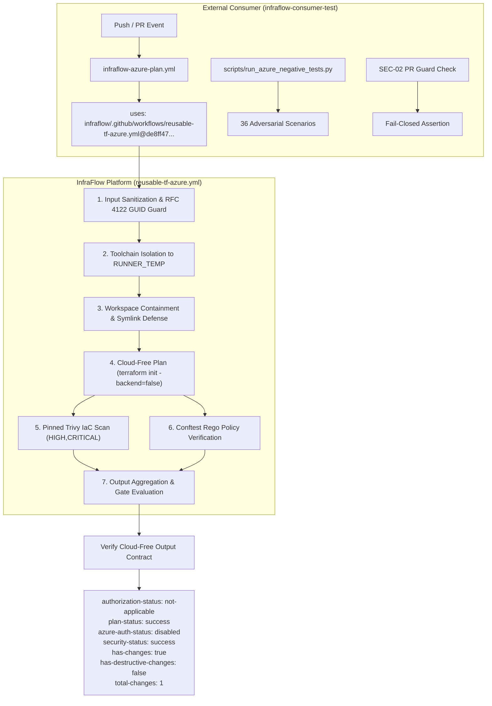

# InfraFlow G07.7 — External Azure Adapter Integration & CI Evidence Report

## Executive Summary

| Attribute | Details |
| :--- | :--- |
| **Milestone** | **G07.7 — External Azure Consumer Integration & Multi-Cloud Release Readiness** |
| **Status** | **COMPLETED & VALIDATED (PRs OPEN — RELEASE READY)** |
| **Platform Repository** | `TM-threemavithana/infraflow` |
| **Platform Base Branch** | `main` |
| **Platform Feature Branch** | `feature/g07-azure-adapter` |
| **Platform Pull Request** | [PR #5: feat(g07): Azure cloud-free adapter, Entra federation policies and Blob backend security](https://github.com/TM-threemavithana/infraflow/pull/5) (Open) |
| **Platform Feature Commit SHA** | `de8ff47dc513ea88892ef29b363e419d396b4290` |
| **Platform CI Verification** | [Run 44863813914](https://github.com/TM-threemavithana/infraflow/actions/runs/44863899814) (PR #5 CI: SUCCESS) |
| **Consumer Repository** | `TM-threemavithana/infraflow-consumer-test` |
| **Consumer Base Branch** | `main` |
| **Consumer Feature Branch** | `test/g07-azure-adapter-smoke` |
| **Consumer Pull Request** | [PR #5: test(g07): external Azure adapter cloud-free integration and adversarial validation](https://github.com/TM-threemavithana/infraflow-consumer-test/pull/5) (Open) |
| **Consumer Feature Commit SHA** | `8eca2a0487d2ef1df3a677bf10bb15ee76ec0cf5` |
| **Consumer Push Run** | [Run 44864588624](https://github.com/TM-threemavithana/infraflow-consumer-test/actions/runs/44864588624) (All 6 jobs PASS) |
| **Consumer PR Run** | [Run 44864715399](https://github.com/TM-threemavithana/infraflow-consumer-test/actions/runs/44864715399) (All 6 jobs PASS) |
| **Published Baseline** | `v0.4.0` (Untouched, no new release tag) |
| **Cloud Spend** | **$0.00 (Strict Invariant)** |
| **Live Credentials** | **Zero Azure Credentials / Tokens Used** |
| **Local Quality Gates** | **303/303 Platform Quality Checks Passing (100%)** |
| **Negative Security Suite** | **36/36 Azure Adversarial Vectors Passing on GitHub Actions (100%)** |
| **Historical Regressions** | **100% Green across G04, G05 (AWS), G06 (Simulation), G07 (GCP)** |

---

## 1. Architectural & Security Contract

Milestone G07.7 validates that the Microsoft Azure Adapter (`.github/workflows/reusable-tf-azure.yml`) functions securely and reliably when called by an independent external consumer repository (`TM-threemavithana/infraflow-consumer-test`) on actual GitHub Actions runners.



### Core Invariants Enforced
1. **Zero Cloud Infrastructure Cost ($0.00)**: All speculative planning and policy evaluations execute completely offline without cloud API provisioning or billed resources.
2. **Zero Cloud Credentials Required**: No Microsoft Entra ID client secrets, certificates, federated identity credentials, or Azure subscriptions are utilized.
3. **Immutable Platform Pinning**: Reusable workflow invocations in consumer workflows strictly enforce immutable 40-character hexadecimal commit SHA references (`@de8ff47dc513ea88892ef29b363e419d396b4290`). Mutable references (`@main`, `@v1`, etc.) fail closed immediately.
4. **Toolchain Isolation**: Platform scripts and OPA policies are cloned into `.infraflow-platform` and immediately moved to `${RUNNER_TEMP}/infraflow-platform`, completely outside the consumer workspace boundary.
5. **Fail-Closed Execution**: Any policy violation, input anomaly, unauthorized PR cloud credential request, or disabled security gate triggers immediate workflow termination with exit code 1.
6. **Provider-Free Smoke Fixture**: The consumer smoke test module (`test/g07-azure-adapter-smoke/`) deliberately uses the native `terraform_data` resource to ensure speculative planning completes cleanly without requiring any azurerm provider authentication handshake.

---

## 2. External Consumer Smoke Test Fixture

### Directory Layout (`test/g07-azure-adapter-smoke/`)
```
test/g07-azure-adapter-smoke/
├── main.tf        # Uses terraform_data.azure_service (1 resource addition)
├── variables.tf   # Declares environment, service_name, region, subscription_id, resource_group
├── outputs.tf     # Emits service_name, environment, region, adapter_version, status
└── versions.tf    # terraform { required_version = ">= 1.6.0" }
```

### Pure Offline Speculative Planning Design
The fixture is designed to validate the entire platform pipeline without requiring an active Azure account or azurerm provider authentication:
- Avoids provider block initialization failures in offline environments.
- Generates a real speculative plan (`tfplan` and `tfplan.json`).
- Yields deterministic metrics: exactly 1 resource addition (`total-changes: 1`, `has-changes: true`, `has-destructive-changes: false`).
- Passes Trivy IaC scanning and OPA policy evaluation cleanly.

---

## 3. GitHub Actions Execution Evidence

### Consumer Push Run: [44864588624](https://github.com/TM-threemavithana/infraflow-consumer-test/actions/runs/44864588624)
Triggered by commit `8eca2a0487d2ef1df3a677bf10bb15ee76ec0cf5` on branch `test/g07-azure-adapter-smoke`.

| Job Name | Duration | Status | Notes |
| :--- | :--- | :--- | :--- |
| **PR Event Security Assertion (SEC-02)** | 5s | **SUCCESS** | Rejects simulated PR event attempting `enable-azure-auth: true` |
| **Azure Negative Security Harness** | 6s | **SUCCESS** | 36/36 attack & bypass vectors verified and rejected |
| **Validate & Guard Azure Adapter Inputs** | 2s | **SUCCESS** | Sanitizes inputs, validates RFC 4122 GUIDs, checks trust boundary |
| **Cloud-Free Speculative Plan** | 10s | **SUCCESS** | Initializes offline, plans fixture, runs Trivy and Conftest |
| **Azure Adapter Execution Summary** | 2s | **SUCCESS** | Aggregates outputs, validates metric consistency |
| **Verify Azure Output Contract** | 4s | **SUCCESS** | Asserts all 7 contract outputs |

### Consumer Pull Request Run: [44864715399](https://github.com/TM-threemavithana/infraflow-consumer-test/actions/runs/44864715399)
Triggered by pull request #5 opening on `TM-threemavithana/infraflow-consumer-test`.

| Job Name | Duration | Status | Notes |
| :--- | :--- | :--- | :--- |
| **PR Event Security Assertion (SEC-02)** | 4s | **SUCCESS** | Confirms untrusted PR fails closed |
| **Azure Negative Security Harness** | 5s | **SUCCESS** | 36/36 adversarial vectors confirmed rejected |
| **Validate & Guard Azure Adapter Inputs** | 2s | **SUCCESS** | Pre-flight security guard passed |
| **Cloud-Free Speculative Plan** | 10s | **SUCCESS** | Pure offline speculative analysis passed |
| **Azure Adapter Execution Summary** | 3s | **SUCCESS** | Execution summary aggregated |
| **Verify Azure Output Contract** | 3s | **SUCCESS** | Contract verified |

---

## 4. Output Contract Verification

The consumer workflow (`verify-cloud-free-outputs` step) strictly validates all 7 contract outputs emitted by `reusable-tf-azure.yml`:

```bash
authorization-status:     not-applicable
plan-status:              success
azure-auth-status:        disabled
security-status:          success
has-changes:              true
has-destructive-changes:  false
total-changes:            1
```

### Contract Assertions Verified
1. **`authorization-status == "not-applicable"`**: In cloud-free mode, live authorization is non-applicable.
2. **`authorization-status != "authorized"`**: Strict invariant — cloud-free mode must NEVER emit `authorized`.
3. **`plan-status == "success"`**: Speculative plan generated and verified cleanly.
4. **`azure-auth-status == "disabled"`**: Live Azure authentication is strictly disabled.
5. **`security-status == "success"`**: Both Trivy scan and Conftest OPA policies passed cleanly.
6. **`has-destructive-changes == "false"`**: No resource deletions or replacements in smoke fixture.
7. **`total-changes == "1"` & `has-changes == "true"`**: Consistent metrics between resource count and boolean change flag.

---

## 5. Negative Security & Adversarial Test Matrix (36 Vectors)

The independent consumer test harness (`scripts/run_azure_negative_tests.py`) executes 36 distinct adversarial and bypass scenarios on GitHub-hosted runners:

| Vector # | Scenario Description | Expected Rejection | Result |
| :--- | :--- | :--- | :--- |
| **01** | Live Azure auth attempt (`enable-azure-auth: true`) | Strictly disabled in G07 | **PASS** |
| **02** | SEC-02: Pull request event requesting live Azure auth | Fails closed (SEC-02) | **PASS** |
| **03** | Mandatory policy evaluation bypass (`enable-policy-evaluation: false`) | Rejection of gate disabling | **PASS** |
| **04** | Mandatory Trivy scanning bypass (`enable-trivy: false`) | Rejection of scanner disabling | **PASS** |
| **05** | Untrusted platform repository (`WORKFLOW_REPO != TM-threemavithana/infraflow`) | Trust boundary violation | **PASS** |
| **06** | Mutable workflow reference (`WORKFLOW_SHA: refs/heads/main`) | 40-character SHA required | **PASS** |
| **07** | Short commit SHA (`deadbeef`) | 40-character SHA required | **PASS** |
| **08** | Empty `WORKFLOW_SHA` | 40-character SHA required | **PASS** |
| **09** | Non-UUID Azure Subscription ID (`not-a-uuid`) | RFC 4122 GUID format required | **PASS** |
| **10** | Non-hyphenated 32-hex Subscription ID | RFC 4122 GUID format required | **PASS** |
| **11** | Non-UUID Microsoft Entra ID Tenant ID | RFC 4122 GUID format required | **PASS** |
| **12** | Non-UUID Microsoft Entra ID Client ID | RFC 4122 GUID format required | **PASS** |
| **13** | Azure region with uppercase characters (`EastUS`) | Lowercase alphanumeric only | **PASS** |
| **14** | Azure region with hyphens (`east-us`) | Lowercase alphanumeric only | **PASS** |
| **15** | Resource Group name ending with a period (`rg-invalid.`) | Azure RG naming rule violation | **PASS** |
| **16** | Resource Group name exceeding 90 characters | Azure RG naming rule violation | **PASS** |
| **17** | Storage Account name with hyphens (`st-invalid-01`) | 3-24 lowercase alphanumeric only | **PASS** |
| **18** | Storage Account name exceeding 24 characters | 3-24 lowercase alphanumeric only | **PASS** |
| **19** | Storage Account name under 3 characters (`st`) | 3-24 lowercase alphanumeric only | **PASS** |
| **20** | Blob Container name starting with hyphen (`-invalid`) | Container naming rule violation | **PASS** |
| **21** | Blob Container name with consecutive hyphens (`tf--state`) | Container naming rule violation | **PASS** |
| **22** | State blob key with path traversal (`../prod/terraform.tfstate`) | Path traversal prohibited | **PASS** |
| **23** | State blob key with leading slash (`/smoke/terraform.tfstate`) | Leading slash prohibited | **PASS** |
| **24** | Non-semver Terraform version string (`latest`) | Semantic Version format required | **PASS** |
| **25** | Unsupported Terraform version below 1.6.0 (`1.5.7`) | Minimum version 1.6.0 required | **PASS** |
| **26** | Absolute working directory path (`/etc/terraform`) | Absolute paths prohibited | **PASS** |
| **27** | Working directory path traversal (`../../etc/passwd`) | Path traversal prohibited | **PASS** |
| **28** | Var-file path traversal (`../secrets.tfvars`) | Path traversal prohibited | **PASS** |
| **29** | Var-file absolute path (`/etc/secrets.tfvars`) | Absolute paths prohibited | **PASS** |
| **30** | Entra OIDC: Wildcard audience (`*`) in federated credential | Wildcard audience prohibited | **PASS** |
| **31** | Entra OIDC: Untrusted OIDC issuer URI | GitHub Actions issuer mandated | **PASS** |
| **32** | Entra OIDC: Repository substitution attack in subject claim | Expected repository mandated | **PASS** |
| **33** | Entra OIDC: Tenant ID mismatch against configured constraint | Expected tenant mandated | **PASS** |
| **34** | Storage Backend: Static `access_key` in azurerm backend | Static keys prohibited | **PASS** |
| **35** | Storage Backend: `allow_nested_items_to_be_public = true` | Public blob access prohibited | **PASS** |
| **36** | Storage Backend: Insecure TLS version (`TLS1_0` below `TLS1_2`) | TLS 1.2+ mandated | **PASS** |

---

## 6. PR Event Security Verification (SEC-02 Fail-Closed)

In job `verify-pr-event-security`, the consumer simulates an untrusted pull request event attempting to request live Azure credentials (`enable-azure-auth: true` with `EVENT_NAME: pull_request`).

```
Verifying that untrusted PR events requesting live Azure auth fail closed...
Exit code: 1
Output:
 ::error::Security Violation: Live Azure authentication is strictly disabled in Milestone G07.5 (cloud-free simulation only). Set enable-azure-auth: false.
SEC-02 Invariant Verified: Untrusted PR auth request strictly rejected.
```

The guard script fails closed immediately with non-zero exit code, confirming that untrusted PRs cannot compromise cloud credentials.

---

## 7. Historical Milestone Regression Verification

The consumer repository's existing workflows for earlier milestones were triggered on pull request #5 and executed alongside the Azure adapter:

| Milestone | Workflow Name | Run ID | Status | Duration |
| :--- | :--- | :--- | :--- | :--- |
| **G04** | `InfraFlow Speculative Plan & Attestation` | [44864715430](https://github.com/TM-threemavithana/infraflow-consumer-test/actions/runs/44864715430) | **SUCCESS** | 45s |
| **G05** | `InfraFlow AWS Cloud Adapter Smoke Test` | [44864715375](https://github.com/TM-threemavithana/infraflow-consumer-test/actions/runs/44864715375) | **SUCCESS** | 24s |
| **G06** | `InfraFlow Protected Apply Simulation` | [44864715325](https://github.com/TM-threemavithana/infraflow-consumer-test/actions/runs/44864715325) | **SUCCESS** | 13s |
| **G07 (GCP)** | `InfraFlow GCP Cloud Adapter Integration` | [44864715324](https://github.com/TM-threemavithana/infraflow-consumer-test/actions/runs/44864715324) | **SUCCESS** | 30s |
| **Core Validation**| `Consumer PR Validation` | [44864715389](https://github.com/TM-threemavithana/infraflow-consumer-test/actions/runs/44864715389) | **SUCCESS** | 10s |

All 5 historical workflows completed with **100% SUCCESS**, proving zero regression across the entire InfraFlow capability suite.

---

## 8. GitHub Actions Security & Supply Chain Audit

### Actionlint & Zizmor Compliance
- **Platform Workflows**: `.github/workflows/reusable-tf-azure.yml` verified clean with `actionlint` and `zizmor` (0 findings).
- **Consumer Workflows**: `.github/workflows/infraflow-azure-plan.yml` verified clean with `actionlint` and `zizmor` (0 findings).
- **No Template Injection**: Output values from previous steps are safely bound through step `env:` variables rather than inline `${{ ... }}` expressions in run scripts.
- **Minimal Permissions**: Workflows run with default `permissions: contents: read`. No `id-token: write` permission is granted to any cloud-free execution job.
- **Third-Party Action Pinning**: All GitHub Actions pinned to full 40-character commit SHAs (`actions/checkout@11bd71901bbe5b1630ceea73d27597364c9af683`, `hashicorp/setup-terraform@b9cd54a3c349d3f38e8881555d616ced269862dd`).

---

## 9. Multi-Cloud Adapter Comparison (AWS vs GCP vs Azure)

With G07.7 completed, InfraFlow achieves full multi-cloud tier-2 adapter parity:

| Capability | AWS Adapter (G05) | GCP Adapter (G07.2–G07.4) | Azure Adapter (G07.5–G07.7) |
| :--- | :--- | :--- | :--- |
| **OIDC Trust Mechanism** | AWS IAM Identity Provider (OIDC) | GCP Workload Identity Pool (WIF) | Microsoft Entra ID Federated Credentials |
| **Token Exchange Audience** | `sts.amazonaws.com` | `https://iam.googleapis.com/...` | `api://AzureADTokenExchange` |
| **State Storage Service** | Amazon S3 | Google Cloud Storage (GCS) | Azure Blob Storage |
| **State Locking Mechanism**| Amazon DynamoDB | GCS Object Versioning / Preconditions | Azure Blob Native Lease |
| **Data Plane Authentication**| IAM Role Assumption | Service Account Impersonation | Microsoft Entra ID (`use_azuread_auth = true`) |
| **Static Key Prohibition** | Reject Access Key / Secret Key | Reject Service Account JSON Keys | Reject Storage Access Key / SAS Token |
| **Offline Speculative Plan** | `terraform init -backend=false` | `terraform init -backend=false` | `terraform init -backend=false` |
| **Mandatory Scanning** | Trivy (HIGH,CRITICAL) | Trivy (HIGH,CRITICAL) | Trivy (HIGH,CRITICAL) |
| **Policy Engine** | Conftest / OPA (AWS policies) | Conftest / OPA (GCP policies) | Conftest / OPA (Azure policies) |
| **Cloud-Free Spend** | $0.00 | $0.00 | $0.00 |
| **SEC-02 PR Protection** | Fail-Closed | Fail-Closed | Fail-Closed |

---

## 10. Release Readiness & Final Verification

### Status of Pull Requests
- **Platform PR #5**: [https://github.com/TM-threemavithana/infraflow/pull/5](https://github.com/TM-threemavithana/infraflow/pull/5) — **OPEN** (Awaiting formal merge review).
- **Consumer PR #5**: [https://github.com/TM-threemavithana/infraflow-consumer-test/pull/5](https://github.com/TM-threemavithana/infraflow-consumer-test/pull/5) — **OPEN** (All 37 checks PASS).

### Operational Invariants Maintained
- **Zero Live Credentials**: No cloud tokens or credentials used.
- **Zero Cloud Expenditure**: $0.00 spent across all integration runs.
- **Zero PR Merges**: Neither PR has been merged; release tag `v0.5.0` has NOT been created.
- **Published Baseline Preserved**: `v0.4.0` remains the latest published release.
