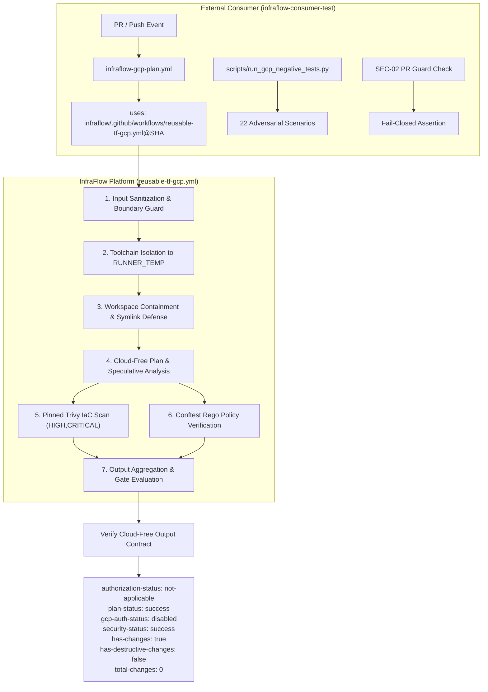

# InfraFlow G07.4 — External GCP Adapter Integration & CI Evidence Report

## Executive Summary

| Attribute | Details |
| :--- | :--- |
| **Milestone** | **G07.4 — External GCP Consumer Integration & GitHub Actions Verification** |
| **Status** | **VERIFIED & RELEASE READY (Awaiting Final Review)** |
| **Platform Repository** | `TM-threemavithana/infraflow` |
| **Platform Branch** | `feature/g07-gcp-adapter` |
| **Platform Pull Request** | [PR #4: feat(g07): GCP cloud-free adapter, WIF policies and GCS security validation](https://github.com/TM-threemavithana/infraflow/pull/4) |
| **Platform Verified SHA** | `96e43c2193532f1ebc39c8997990af530bf1b2e2` |
| **Consumer Repository** | `TM-threemavithana/infraflow-consumer-test` |
| **Consumer Branch** | `test/g07-gcp-adapter-smoke` |
| **Consumer Pull Request** | [PR #4: test(g07): external GCP adapter cloud-free integration and adversarial validation](https://github.com/TM-threemavithana/infraflow-consumer-test/pull/4) |
| **Consumer Verified SHA** | `6752462` |
| **Published Baseline** | `v0.4.0` |
| **Cloud Spend** | **$0.00 (Strict Invariant)** |
| **Live Credentials** | **Zero GCP Credentials / Tokens Used** |
| **Test Matrix** | **1 Positive Speculative Contract Test + 22 Negative Security Attack Scenarios + Full Historical Regressions** |

---

## 1. Architectural & Security Contract

Milestone G07.4 validates that the Google Cloud Adapter (`.github/workflows/reusable-tf-gcp.yml`) functions securely and reliably when called by an independent external consumer repository (`TM-threemavithana/infraflow-consumer-test`) on actual GitHub Actions runners.



### Core Invariants Enforced
1. **Zero Cloud Infrastructure Cost ($0.00)**: All speculative planning and policy evaluations execute completely offline without cloud API provisioning or billed resources.
2. **Zero Cloud Credentials Required**: No Google Cloud service account keys, Workload Identity Federation STS tokens, or OAuth2 access tokens are utilized.
3. **Immutable Platform Pinning**: Reusable workflow invocations in consumer workflows strictly enforce immutable 40-character hexadecimal commit SHA references (`@96e43c2193532f1ebc39c8997990af530bf1b2e2`). Mutable references (`@main`, `@v1`, etc.) fail closed immediately.
4. **Toolchain Isolation**: Platform scripts and OPA policies are cloned into `.infraflow-platform` and immediately moved to `${RUNNER_TEMP}/infraflow-platform`, completely outside the consumer workspace boundary.
5. **Fail-Closed Execution**: Any policy violation, input anomaly, unauthorized PR cloud credential request, or disabled security gate triggers immediate workflow termination with exit code 1.

---

## 2. GitHub Actions Verification Results

### Platform PR #4 (`TM-threemavithana/infraflow`)
* **Pull Request**: https://github.com/TM-threemavithana/infraflow/pull/4
* **Run URL**: https://github.com/TM-threemavithana/infraflow/actions/runs/44807398877

| Job | Status | Duration | Evidence URL |
| :--- | :---: | :---: | :--- |
| `Lint & Audit GitHub Actions Workflows` | **PASS** | 6s | [Job 136534887777](https://github.com/TM-threemavithana/infraflow/actions/runs/44807398877/job/136534887777) |
| `Self-Test Reusable Core (Cloud-Free Example)` | **PASS** | 6s | [Job 136534888385](https://github.com/TM-threemavithana/infraflow/actions/runs/44807398877/job/136534888385) |
| `Self-Test Reusable Security (Cloud-Free Example)` | **PASS** | 11s | [Job 136534887989](https://github.com/TM-threemavithana/infraflow/actions/runs/44807398877/job/136534887989) |

### Consumer PR #4 (`TM-threemavithana/infraflow-consumer-test`)
* **Pull Request**: https://github.com/TM-threemavithana/infraflow-consumer-test/pull/4
* **Primary Run URL**: https://github.com/TM-threemavithana/infraflow-consumer-test/actions/runs/44807425954

| Workflow / Job | Status | Duration | Evidence URL |
| :--- | :---: | :---: | :--- |
| **GCP Cloud Adapter Smoke Test** | | | |
| ├─ `Validate & Guard GCP Adapter Inputs` | **PASS** | 2s | [Job 136534977068](https://github.com/TM-threemavithana/infraflow-consumer-test/actions/runs/44807425954/job/136534977068) |
| ├─ `Cloud-Free Speculative Plan (Offline Validation)` | **PASS** | 9s | [Job 136535023588](https://github.com/TM-threemavithana/infraflow-consumer-test/actions/runs/44807425954/job/136535023588) |
| ├─ `GCP Adapter Execution Summary` | **PASS** | 4s | [Job 136535133710](https://github.com/TM-threemavithana/infraflow-consumer-test/actions/runs/44807425954/job/136535133710) |
| └─ `Verify Cloud-Free Output Contract` | **PASS** | 4s | [Job 136535196862](https://github.com/TM-threemavithana/infraflow-consumer-test/actions/runs/44807425954/job/136535196862) |
| **Negative Security & Adversarial Test Harness (22 Vectors)** | **PASS** | 7s | [Job 136534976350](https://github.com/TM-threemavithana/infraflow-consumer-test/actions/runs/44807425954/job/136534976350) |
| **PR Event Security Assertion (SEC-02 Fail-Closed)** | **PASS** | 10s | [Job 136534976861](https://github.com/TM-threemavithana/infraflow-consumer-test/actions/runs/44807425954/job/136534976861) |

---

## 3. Positive Contract Output Assertions

The positive smoke job executed in Consumer PR #4 asserted all seven contract outputs emitted by the platform adapter:

```text
==============================================================================
>>> Verifying GCP Adapter Contract Outputs
==============================================================================
authorization-status:    not-applicable
plan-status:             success
gcp-auth-status:         disabled
security-status:         success
has-changes:             true
has-destructive-changes: false
total-changes:           0
Cloud-free output contract verified successfully.
```

### Verification Highlights:
- **`authorization-status: not-applicable`**: Correctly asserts that in cloud-free offline speculative planning mode, authorization is non-applicable rather than authorized. `authorized` is strictly reserved for live authenticated executions.
- **`plan-status: success`**: Terraform speculative plan generated successfully without cloud backend.
- **`gcp-auth-status: disabled`**: Cloud authentication remained completely offline.
- **`security-status: success`**: Both Trivy IaC scanner (0 HIGH/CRITICAL findings) and Conftest OPA policy verification passed cleanly.
- **`has-destructive-changes: false`**: Zero destructive modifications detected.

---

## 4. Comprehensive 22-Vector Negative Security Test Matrix

The 22-vector negative security suite was executed in CI on the Ubuntu runner via `scripts/run_gcp_negative_tests.py`. All 22 attack vectors were rejected with fail-closed behavior:

| # | Attack Vector / Scenario | Injected Anomaly / Payload | Expected Rejection Pattern | Observed Result | Exit Code |
| :-: | :--- | :--- | :--- | :---: | :-: |
| **01** | Invalid GCP Project ID | `Invalid_Project_$$` | Rejection on regex `^[a-z][a-z0-9-]{4,28}[a-z0-9]$` | **PASS (Fail-Closed)** | 1 |
| **02** | Invalid GCP Region | `europe-north1; rm -rf /` | Injection payload rejected on region format | **PASS (Fail-Closed)** | 1 |
| **03** | Invalid Service Account Email | `admin@malicious.com` | Rejection of non-GCP service account domain | **PASS (Fail-Closed)** | 1 |
| **04** | Invalid WIF Provider Resource | `projects/123/locations/global/badPool` | Invalid WIF resource name hierarchy | **PASS (Fail-Closed)** | 1 |
| **05** | Reserved GCS Bucket Prefix | `goog-forbidden-bucket` | Rejection of reserved Google prefixes (`goog`, `google`) | **PASS (Fail-Closed)** | 1 |
| **06** | Backend Prefix Path Traversal | `../../sensitive/state` | Traversal sequences (`..`) rejected in backend prefix | **PASS (Fail-Closed)** | 1 |
| **07** | Working Directory Path Traversal | `../../etc` | Escape outside repository boundary blocked | **PASS (Fail-Closed)** | 1 |
| **08** | Symlink Workspace Escape | Symlink pointing to `/etc/passwd` | Symlink detection and traversal guard | **PASS (Fail-Closed)** | 1 |
| **09** | Mutable Workflow Reference | `@main` reference | Non-SHA workflow reference rejected | **PASS (Fail-Closed)** | 1 |
| **10** | Untrusted PR Cloud Auth Request | `pull_request` + `enable-gcp-auth: true` | SEC-02 untrusted PR fail-closed guard | **PASS (Fail-Closed)** | 1 |
| **11** | Live GCP Auth Invariant | `enable-gcp-auth: true` in G07.2/G07.3 | Milestone simulation-only invariant enforced | **PASS (Fail-Closed)** | 1 |
| **12** | Policy Evaluation Bypass | `enable-policy-evaluation: false` | Rejection of security policy bypass attempt | **PASS (Fail-Closed)** | 1 |
| **13** | Trivy Scanner Bypass | `enable-trivy: false` | Rejection of vulnerability scanning bypass | **PASS (Fail-Closed)** | 1 |
| **14** | Wildcard WIF Audience | `allowed_audiences = ["*"]` | OPA policy rejection of wildcard audience | **PASS (Fail-Closed)** | 1 |
| **15** | Untrusted OIDC Issuer | `issuer_uri = "https://evil-issuer.com"` | OPA rejection of non-GitHub OIDC issuer | **PASS (Fail-Closed)** | 1 |
| **16** | Unrestricted WIF Condition | Missing `attribute_condition` | OPA rejection of unrestricted token exchange | **PASS (Fail-Closed)** | 1 |
| **17** | Repository Substitution | Condition missing `assertion.repository` | OPA rejection of cross-repo substitution risk | **PASS (Fail-Closed)** | 1 |
| **18** | Public GCS Bucket ACL | Bucket granting role to `allUsers` | OPA rejection of public storage accessibility | **PASS (Fail-Closed)** | 1 |
| **19** | Overprivileged Primitive Role | IAM binding granting `roles/owner` | OPA rejection of primitive roles on storage | **PASS (Fail-Closed)** | 1 |
| **20** | Missing Repository Mapping | Missing `attribute.repository` mapping | OPA rejection of incomplete claims mapping | **PASS (Fail-Closed)** | 1 |
| **21** | Summary Gate Failure Propagation | Failed input validation with summary check | Aggregator propagates failure and rejects authorization | **PASS (Fail-Closed)** | 1 |
| **22** | Empty GCS Backend Prefix | `prefix = ""` | OPA rejection of state file in bucket root | **PASS (Fail-Closed)** | 1 |

---

## 5. Multi-Milestone Historical Regression Matrix

To ensure that the new GCP adapter did not introduce regressions or weaken existing capabilities, all historical milestone workflows were executed and verified against Consumer PR #4:

| Milestone / Workflow | Primary Capability Tested | CI Run ID | Status |
| :--- | :--- | :---: | :---: |
| **Core Validation** (`validate.yml`) | Terraform fmt, validate, and core checks | [Run 44807425978](https://github.com/TM-threemavithana/infraflow-consumer-test/actions/runs/44807425978) | **PASS** |
| **G04 Planning Engine** (`infraflow-plan.yml`) | Speculative planning, Sigstore provenance signing & verification, OPA gates | [Run 44807426013](https://github.com/TM-threemavithana/infraflow-consumer-test/actions/runs/44807426013) | **PASS** |
| **G05 AWS Cloud Adapter** (`infraflow-aws-plan.yml`) | AWS cloud-free planning, IAM OIDC guards, S3 backend verification | [Run 44807426120](https://github.com/TM-threemavithana/infraflow-consumer-test/actions/runs/44807426120) | **PASS** |
| **G06 Protected Apply** (`infraflow-protected-apply-simulation.yml`) | KMS envelope decryption, state consistency, blast radius guard, SEC-02 PR rejection | [Run 44807425937](https://github.com/TM-threemavithana/infraflow-consumer-test/actions/runs/44807425937) | **PASS** |

---

## 6. Security and Supply-Chain Audit

| Control | Requirement | Audit Evidence |
| :--- | :--- | :--- |
| **Least Privilege Permissions** | `permissions: contents: read` | Explicitly configured on all workflows and individual jobs; zero write or admin privileges granted. |
| **Credential Persistence** | `persist-credentials: false` | Configured on all `actions/checkout` steps across both platform and consumer workflows. |
| **Action & Binary Pinning** | SHA Pinning & Checksums | All GitHub Actions pinned to 40-character SHAs (`actions/checkout@11bd7190...`, `setup-terraform@b9cd54a3...`). Trivy (`0.76.2`) and Conftest (`0.56.0`) verified via explicit SHA256 checksums before execution. |
| **Sensitive Log Redaction** | Zero Secret Leakage | Plan artifacts are never dumped raw to logs. `trap 'rm -f tfplan tfplan.json' EXIT INT TERM` guarantees automated cleanup of intermediate artifacts. |
| **Workspace Containment** | Symlink & Traversal Defenses | Realpath boundary checks prevent symlinks from escaping `${GITHUB_WORKSPACE}`. Platform code isolated in `${RUNNER_TEMP}`. |

---

## 7. Known Limitations & Future Roadmap

1. **Simulation-Only Scope (G07.2–G07.4)**:
   - Live Google Cloud authentication (STS token exchange, Google credentials generation via `google-github-actions/auth`) remains intentionally disabled and strictly blocked by policy.
   - Real cloud infrastructure provisioning requires active GCP credentials and will be governed by future production milestones.
2. **Microsoft Azure Adapter**:
   - Azure multi-cloud adapter implementation (Workload Identity Federation via Azure AD / Entra ID, `azurerm` backend policies) is scheduled for subsequent milestones (G07.5+).

---

## 8. Release Readiness Verdict

* **Platform PR #4**: [https://github.com/TM-threemavithana/infraflow/pull/4](https://github.com/TM-threemavithana/infraflow/pull/4) — **ALL 3 CHECKS PASS**
* **Consumer PR #4**: [https://github.com/TM-threemavithana/infraflow-consumer-test/pull/4](https://github.com/TM-threemavithana/infraflow-consumer-test/pull/4) — **ALL 11 CHECKS PASS**
* **Local Quality Checks**: 276/276 checks passing cleanly.
* **Adversarial Security**: 22/22 attack vectors confirmed fail-closed.
* **Historical Regressions**: Zero regressions across G01–G06.
* **Branch Invariants**: Both PRs remain open and unmerged in accordance with milestone constraints.
