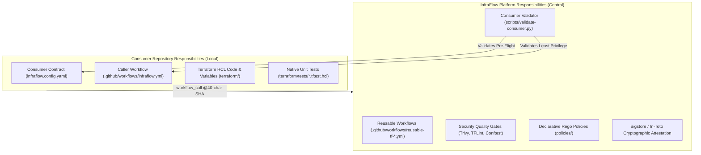

# InfraFlow G08.1 — Consumer Onboarding Toolkit & Adoption Foundation Report

> **Standard:** ISO/IEC 27001:2022, NIST SP 800-218 (SSDF), CIS Software Supply Chain Security v1.0  
> **Milestone:** **G08.1 — Multi-Repository Adoption Foundation & Consumer Onboarding Toolkit**  
> **Evaluation Date:** 2026-11-21  
> **Status:** **COMPLETED & VALIDATED (LOCAL FEATURE BRANCH)**  
> **Target Release:** v0.6.0 (Future) | **Current Baseline:** v0.5.0 (`2ce0ddd5de01530b6bf7aba749f0081620fb9b27`)  
> **Cloud Spend:** **$0.00 (Strict Invariant)** | **Live Credentials:** **Zero**

---

## 1. Executive Summary

Milestone **G08.1: Multi-Repository Adoption Foundation & Consumer Onboarding Toolkit** establishes the architectural, operational, and tooling foundation for fleet-wide adoption of InfraFlow across independent repositories.

Rather than authoring additional cloud adapters, G08.1 addresses developer experience, governance scaling, and onboarding friction by providing a standardized contract, automated pre-flight validation tooling, an instantiation template, and three representative reference consumer fixtures.

### Key Deliverables Completed:
1. **Multi-Repository Adoption Architecture** ([`docs/architecture/G08-MULTI-REPOSITORY-ADOPTION.md`](file:///home/tharuka/projects/infraflow/docs/architecture/G08-MULTI-REPOSITORY-ADOPTION.md)): Formulates the 5-stage adoption lifecycle, consumer archetype definitions, platform-versus-consumer responsibility boundaries, and centralized policy distribution without local rule duplication.
2. **Developer Onboarding & Upgrades Documentation**:
   - [`docs/adoption/CONSUMER-ONBOARDING-GUIDE.md`](file:///home/tharuka/projects/infraflow/docs/adoption/CONSUMER-ONBOARDING-GUIDE.md): 15-minute quick-start guide covering workflow selection, pre-flight checks, and permission invariants.
   - [`docs/adoption/PLATFORM-VERSIONING-AND-UPGRADES.md`](file:///home/tharuka/projects/infraflow/docs/adoption/PLATFORM-VERSIONING-AND-UPGRADES.md): Guidance on SemVer 2.0.0, immutable 40-character commit SHA pinning, upgrade procedures, and deprecation policies.
3. **Self-Service Consumer Repository Template** ([`templates/consumer-repository/`](file:///home/tharuka/projects/infraflow/templates/consumer-repository/)): Production-ready scaffold containing `infraflow.config.yaml`, `.github/workflows/infraflow.yml`, cloud-free `terraform_data` reference module, and native unit tests.
4. **Standardized Versioned Configuration Contract**: Defined strict schema (`version: "1.0"`) with zero tolerance for unknown keys, mutable platform tags (`@main`), path traversals (`..`), scanner bypasses, or live cloud auth requests.
5. **Automated Consumer Onboarding Validator** ([`scripts/validate-consumer.py`](file:///home/tharuka/projects/infraflow/scripts/validate-consumer.py)): High-performance Python utility verifying schema compliance, workspace containment, symlink security, and workflow permission least privilege.
6. **Multi-Consumer Reference Fixtures**: Three isolated fixtures representing Networking ([`fixtures/consumers/networking/`](file:///home/tharuka/projects/infraflow/fixtures/consumers/networking/)), Application ([`fixtures/consumers/application/`](file:///home/tharuka/projects/infraflow/fixtures/consumers/application/)), and Data Platform ([`fixtures/consumers/data-platform/`](file:///home/tharuka/projects/infraflow/fixtures/consumers/data-platform/)) with distinct configurations and passing unit tests.
7. **Comprehensive Test Suite** ([`tests/test_consumer_onboarding.py`](file:///home/tharuka/projects/infraflow/tests/test_consumer_onboarding.py)): 31 unit, security, and CLI integration tests validating all contract rules.
8. **Harness Expansion**: Expanded `scripts/validate-local.sh` with Section 19 (18 new checks), elevating platform quality gates from 303 to **321 passing checks** (100% pass rate).

---

## 2. Adoption Architecture & Responsibility Separation

---

## 3. Configuration Contract Specification (`infraflow.config.yaml`)

| Field | Type | Required | Constraints / Validation |
| :--- | :--- | :---: | :--- |
| `version` | `string` | **Yes** | Must be `"1.0"`. Unsupported versions rejected. |
| `consumer_id` | `string` | **Yes** | Must match `^[a-z0-9][a-z0-9-]{1,62}[a-z0-9]$`. |
| `team` | `string` | **Yes** | 2 to 64 character team identifier. |
| `workload_type` | `string` | **Yes** | Must be one of: `networking`, `application`, `data-platform`, `general`. |
| `terraform_dir` | `string` | **Yes** | Relative path. Absolute (`/`), tildes (`~`), and traversal (`..`) rejected. Must exist and not be a symlink. |
| `environment` | `string` | **Yes** | Must be one of: `dev`, `staging`, `prod`. |
| `adapter` | `string` | **Yes** | Must be one of: `provider-neutral`, `aws`, `gcp`, `azure`, `apply-simulation`. |
| `platform_ref` | `string` | **Yes** | Must match canonical `TM-threemavithana/infraflow`. |
| `platform_sha` | `string` | **Yes** | Strict 40-character lowercase hex commit SHA (`^[0-9a-f]{40}$`). Mutable refs (`main`, `latest`, `v0.5.0`) rejected. |
| `terraform_version` | `string` | **Yes** | SemVer format. Enforced `>= 1.6.0`. |
| `security_controls` | `dict` | **Yes** | Mandatory block defining scanning enforcement. |
| ↳ `enforce_mandatory_scanners` | `boolean` | **Yes** | Strictly `true`. Bypasses fail closed. |
| ↳ `fail_on_destructive` | `boolean` | No | Defaults to `false`. |
| ↳ `max_allowed_deletions` | `integer` | No | Integer between 0 and 25 (platform hard ceiling). |

---

## 4. Multi-Consumer Reference Fixtures

Each fixture models a distinct enterprise infrastructure domain using `terraform_data` for 100% cloud-free, zero-spend execution:

| Fixture Name | Location | Workload Domain | Simulated Architecture | Native Tests |
| :--- | :--- | :--- | :--- | :---: |
| **Networking** | `fixtures/consumers/networking/` | Network Infrastructure | Layered VPC, public/private subnets, route tables | 2/2 Passed |
| **Application** | `fixtures/consumers/application/` | App & Shared Services | Microservice compute, HTTPS ingress, Key Vault | 2/2 Passed |
| **Data Platform** | `fixtures/consumers/data-platform/` | Big Data & Analytics | Lakehouse storage bucket (UBLA), analytical dataset | 2/2 Passed |
| **Template Module**| `templates/consumer-repository/` | General Workload | Standard service resource with lifecycle safeguards | 2/2 Passed |

> [!NOTE]
> These reference fixtures provide deterministic, offline testing of consumer contracts and modules. In accordance with program restrictions, they do not yet represent independent remote GitHub repositories; multi-repository remote deployment testing is designated for Milestone G08.2.

---

## 5. Automated Quality & Security Verification

### Comprehensive Test Metrics

| Test Suite / Tool | Test Target | Pass Count | Fail Count | Status |
| :--- | :--- | :---: | :---: | :---: |
| **Local Automated Quality Harness** | `scripts/validate-local.sh` (Sections 1–19) | **321** | 0 | **100% PASS** |
| ↳ *Section 19 (G08.1)* | Onboarding tooling, template, fixtures, security guards | 18 | 0 | 100% PASS |
| **Python Test Suites** | `tests/` (12 test modules) | **330** | 0 | **100% PASS** |
| ↳ *Consumer Onboarding Suite* | `tests/test_consumer_onboarding.py` | 31 | 0 | 100% PASS |
| **OPA / Conftest Policy Tests** | `policies/` (Rego verification) | **171** | 0 | **100% PASS** |
| **CI/CD Supply Chain Audit** | `zizmor` across workflows | Clean | 0 | **100% PASS** |
| **Workflow Syntax & Schema** | `actionlint` across workflows | Clean | 0 | **100% PASS** |
| **IaC Misconfiguration Scan** | `trivy config` across template & fixtures | Clean | 0 | **100% PASS** |
| **Shell Script Linting** | `shellcheck scripts/*.sh` | Clean | 0 | **100% PASS** |

---

## 6. Security Analysis & Threat Controls

1. **Anti-Tampering & Supply Chain Defense**:
   - Reusable workflows and consumer configurations strictly require immutable 40-character commit SHAs. Mutable tags (`@v0.5.0`, `@main`) are rejected by `validate-consumer.py`.
2. **Permission Boundary Confinement**:
   - Caller workflows must enforce `permissions: contents: read`. Attempts to grant `write-all` or `id-token: write` on pull requests are flagged and rejected.
   - Rejection of `pull_request_target` triggers prevents untrusted fork privilege escalation.
3. **Workspace Escape & Path Traversal Prevention**:
   - Defensive path validation rejects directory traversal (`..`), tildes (`~`), absolute paths (`/`), and symlinks.
   - Canonical directory containment is enforced via `os.path.realpath`.
4. **Mandatory Security Gate Invariant**:
   - The contract rejects any setting attempting to disable scanners (`enforce_mandatory_scanners: false`).
   - Platform hard ceilings (maximum 25 deletions) prevent unauthorized mass resource destruction.
5. **Zero Cloud Credential Invariant**:
   - Settings requesting live cloud auth (`enable-*-auth: true`) fail closed immediately.

---

## 7. Known Limitations & Readiness for G08.2

### Current Scope & Limitations:
- **Local Fixture Scope**: The reference fixtures currently exist within the platform repository for offline testing and contract validation.
- **Organization Ruleset Availability**: Centralized organization-level rulesets require GitHub Enterprise. For free and team GitHub tiers, repository-level rulesets and reusable workflow validation gates serve as the enforcement mechanism.
- **Offline Simulation**: All Terraform resources use `terraform_data` with zero live cloud infrastructure or credential dependencies ($0.00 spend).

### Readiness Criteria for G08.2 (External Fleet Rollout):
- [x] Standardized consumer configuration contract defined and verified.
- [x] Self-service template repository structure validated.
- [x] Automated pre-flight validation tooling (`validate-consumer.py`) operational.
- [x] Multi-workload reference fixtures tested cleanly.
- [x] 100% backward-compatibility with G01–G07 verified across 321 quality checks.
- [ ] G08.2 Objective: Roll out onboarding toolkit to multiple independent external GitHub consumer repositories.
