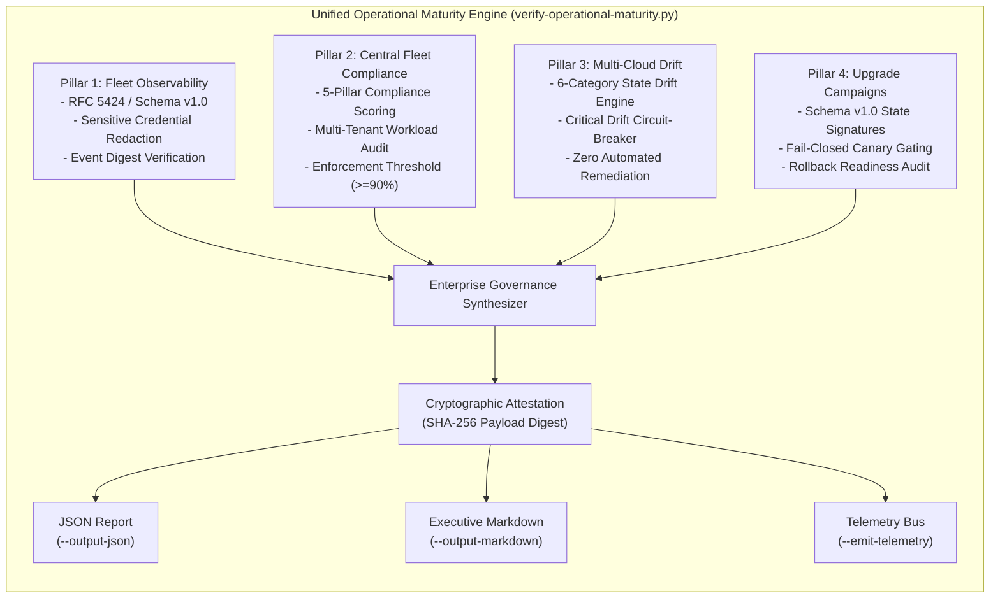

# InfraFlow — Unified Operational Maturity Verification & Governance Engine (Milestone G09.4)

## 1. Executive Vision & Scope

As an Internal Developer Platform (IDP), **InfraFlow** governs multi-cloud infrastructure delivery across independent consumer repositories with zero cloud spending ($0.00) and zero credentials. While milestones G09.1, G09.2, and G09.3 delivered specialized subsystems for observability, continuous drift detection, and upgrade campaigns, Milestone **G09.4** establishes the **Unified Operational Maturity Verification Engine** ([`scripts/verify-operational-maturity.py`](../../scripts/verify-operational-maturity.py)).

The Operational Maturity Verification Engine serves as the platform's overarching, fail-closed governance auditor. It consolidates all four foundational operational maturity pillars into a single deterministic evaluation run, producing cryptographically signed attestations, executive summaries, and machine-readable evidence:



---

## 2. Four Operational Maturity Pillars

### Pillar 1: Fleet Observability & Structured Telemetry
- **Standard**: RFC 5424 / OpenTelemetry-compatible Event Schema v1.0.
- **Engine**: [`scripts/emit-telemetry.py`](../../scripts/emit-telemetry.py).
- **Invariants**:
  - Zero sensitive data or credential leakage: automatic multi-pattern regex scrubbing (`[REDACTED_AWS_KEY]`, `[REDACTED_GITHUB_TOKEN]`, `[REDACTED_JWT]`, `[REDACTED_PRIVATE_KEY]`).
  - Deterministic SHA-256 event digest (`event_digest`) validation: any payload tampering causes immediate rejection.
  - Fail-closed schema validation on every event.

### Pillar 2: Central Fleet Compliance & Multi-Tenant Scoring
- **Standard**: 5-Pillar Multi-Tenant Governance Scoring Framework.
- **Engine**: [`scripts/generate-compliance-dashboard.py`](../../scripts/generate-compliance-dashboard.py).
- **Weightings**:
  1. Contract Validity & Schema Conformance (20%)
  2. Supply Chain Immutability (40-char SHA Pinning) (20%)
  3. Mandatory DevSecOps Security Controls (20%)
  4. Permission Boundary & Least Privilege (20%)
  5. Configuration & Version Drift Integrity (20%)
- **Invariants**:
  - Overall fleet compliance must meet or exceed the configurable enforcement threshold (`--enforce-threshold`, default 90.0%).
  - Individual workload regressions trigger governance alerts and non-compliant status.

### Pillar 3: Multi-Cloud State & Speculative Drift Detection
- **Standard**: 6-Category Multi-Cloud State Drift Normalization Engine.
- **Engine**: [`scripts/simulate-drift.py`](../../scripts/simulate-drift.py).
- **Categories**:
  - `NO_DRIFT`: Attributes match expected configuration.
  - `ATTRIBUTE_DRIFT`: Known resource attributes have drifted.
  - `UNTRACKED_RESOURCE`: Out-of-band creation / Shadow IT.
  - `RESOURCE_DELETED`: Managed resource deleted remotely.
  - `UNKNOWN_RESOURCE`: Malformed ID or unsupported provider.
  - `STATE_INCONSISTENCY`: Schema corruption or snapshot tampering.
- **Invariants**:
  - CRITICAL severity drift (e.g. unencrypted S3 bucket, public storage) acts as a strict governance circuit-breaker, halting verification.
  - Zero automated cloud remediation: all drift detection is strictly read-only and simulation-based ($0.00 cloud spend).

### Pillar 4: Automated Upgrade Campaigns & Lifecycle Tracking
- **Standard**: Cryptographically Signed Campaign Schema v1.0.
- **Engine**: [`scripts/orchestrate-campaign.py`](../../scripts/orchestrate-campaign.py).
- **Lifecycle States**: `PLANNED` -> `CANARY_IN_PROGRESS` -> `CANARY_VERIFIED` -> `PROGRESSIVE_IN_PROGRESS` -> `COMPLETED` / `ROLLED_BACK`.
- **Invariants**:
  - Fail-closed Canary Gate: progressive rollout is strictly blocked if designated canary workloads are `PENDING`, `RUNNING`, or `FAILED`.
  - Cryptographic state signature: any out-of-band edit to campaign state files invalidates the SHA-256 signature and triggers rejection.
  - Rollback preparedness: all participating workloads must declare immutable `rollback_sha` references.

---

## 3. CLI Reference & Verification Workflow

### Command Syntax

```bash
python3 scripts/verify-operational-maturity.py \
  --manifest config/fleet-manifest.yaml \
  --fleet-root fixtures/consumers \
  [--telemetry-file PATH] \
  [--drift-dir PATH] \
  [--campaign-file PATH] \
  [--enforce-threshold FLOAT] \
  [--fail-on-drift] \
  [--output-json PATH] \
  [--output-markdown PATH] \
  [--emit-telemetry] \
  [--quiet]
```

### Options Description

| Flag | Type | Default | Description |
|---|---|---|---|
| `--manifest` | Path | `config/fleet-manifest.yaml` | Path to fleet manifest YAML. |
| `--fleet-root` | Path | `fixtures/consumers` | Directory containing consumer workload clones or test fixtures. |
| `--telemetry-file` | Path | `None` | Path to telemetry events file (JSON or JSONL) to audit. |
| `--drift-dir` | Path | `None` | Directory containing per-workload drift report JSON files. |
| `--campaign-file` | Path | `None` | Path to active upgrade campaign JSON state file. |
| `--enforce-threshold` | Float | `90.0` | Minimum fleet compliance score percentage required to pass. |
| `--fail-on-drift` | Flag | `False` | Reject non-critical drift as failure (default: warn on non-critical, fail on critical). |
| `--output-json` | Path | `None` | Destination path for consolidated JSON report. |
| `--output-markdown` | Path | `None` | Destination path for GitHub Step Summary Markdown report. |
| `--emit-telemetry` | Flag | `False` | Emits `governance_gate_evaluated` event to telemetry bus. |
| `--quiet` | Flag | `False` | Suppresses progress logging in terminal output. |

### Exit Codes

| Code | Status | Meaning |
|---|---|---|
| `0` | `COMPLIANT_AND_VERIFIED` | All 4 pillars passed; compliance score $\ge$ threshold; zero critical drift. |
| `1` | `NON_COMPLIANT` | One or more pillars failed; score below threshold; or critical drift detected. |
| `2` | `ARGUMENT_ERROR` | Malformed CLI arguments, missing required files, or path traversal detected. |

---

## 4. Security & Safety Invariants

1. **Zero Cloud Spending ($0.00)**: All checks are executed locally using offline state snapshots, static analyzers, and mock fixtures. Zero live cloud API calls are made.
2. **Zero Automated Destructive Remediation**: Drift detection and compliance reporting are strictly read-only. The platform never attempts destructive out-of-band updates.
3. **Fail-Closed Path Traversal Protection**: All file paths are validated against path traversal (`..`) and symbolic link attacks (`os.path.islink`).
4. **Deterministic Attestation Signature**: The operational report includes a SHA-256 signature computed over the canonical JSON representation of all findings, ensuring tamper-evident governance evidence.
5. **Credential Sanitization**: The verifier scans its own emitted reports and telemetry to guarantee zero credentials (AWS, Azure, GCP, GitHub PATs, JWTs) are leaked into build logs or artifacts.
