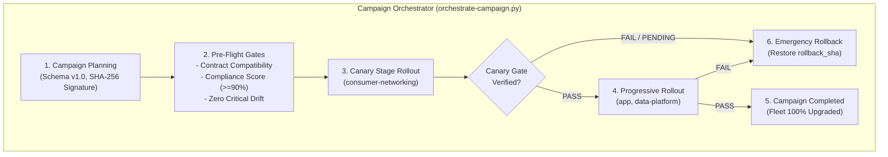
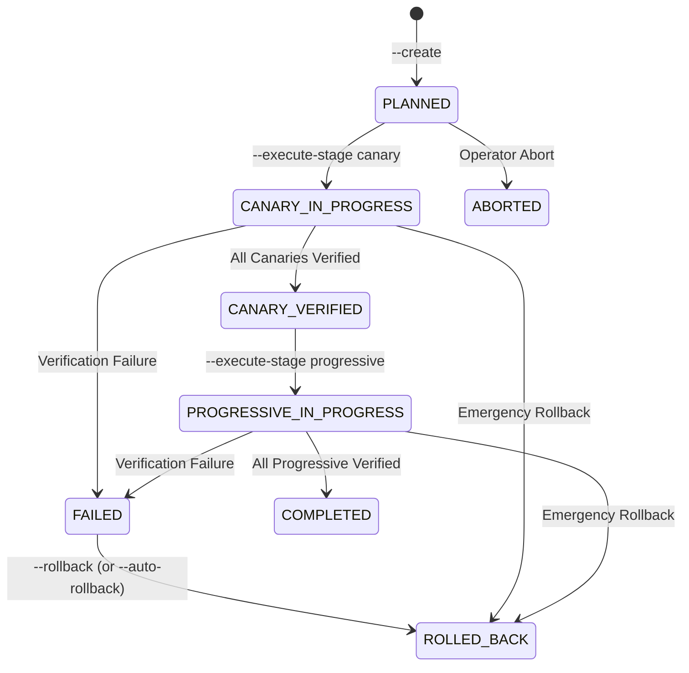

# InfraFlow — Automated Upgrade Campaigns & Lifecycle Tracking Architecture (Milestone G09.3)

## 1. Executive Vision & Scope

As an Internal Developer Platform (IDP), **InfraFlow** governs infrastructure delivery across an ecosystem of independent consumer repositories. While Milestone G08 established transactional file upgrade utilities (`plan-fleet-upgrade.py`), Milestone **G09.3** elevates fleet upgrades into a continuous, policy-governed **Campaign Orchestration Engine** ([`scripts/orchestrate-campaign.py`](../../scripts/orchestrate-campaign.py)).

An **Upgrade Campaign** is a cryptographically signed, multi-stage rollout process that transitions consumer repositories from their current pinned platform commit SHAs to an approved target platform release commit SHA with zero cloud spending ($0.00) and zero credentials.



---

## 2. Core Architecture Principles

1. **Staged Canary Isolation**:
   - Progressive rollout is strictly gated behind successful canary verification.
   - The platform strictly rejects attempts to advance to general rollout while canary workloads remain in `PENDING`, `RUNNING`, or `FAILED` states.
2. **Deterministic Cryptographic State Signatures**:
   - Every campaign state file (`campaigns/camp-<id>.json`) is signed with a deterministic SHA-256 digest computed over its canonical JSON structure.
   - Any out-of-band state modification triggers immediate signature verification failure (`CampaignIntegrityError`).
3. **Fail-Closed Quality Gates**:
   - Pre-flight compatibility: Workload contracts must align with the target platform workflow outputs.
   - Pre-flight compliance: Consumer compliance score must meet or exceed the mandatory threshold (default: $\ge 90.0\%$).
   - Pre-flight state drift: Workloads exhibiting unacknowledged `CRITICAL` state drift are halted before file modification.
4. **Transactional Rollback Assurance**:
   - Every registered consumer specifies a tested, known-good `rollback_sha` in [`config/fleet-manifest.yaml`](../../config/fleet-manifest.yaml).
   - In case of pipeline regression or operator cancellation, the orchestrator transactionally restores configurations and caller workflows to the baseline SHA.
5. **Zero-Cost Simulation & Pull Request Generation**:
   - In offline CI and developer validation, the engine generates deterministic simulated Git pull requests (`infraflow/upgrade-<sha[:7]>`), branch references, and formatted Markdown review summaries without requiring external GitHub API tokens or cloud infrastructure.

---

## 3. Campaign Lifecycle State Machine

A campaign transitions through seven discrete, deterministic states:



| Lifecycle State | Description | Gate Invariant |
| :--- | :--- | :--- |
| **`PLANNED`** | Campaign initialized from manifest. Workloads enrolled in stages. | Initial state; no repository modifications executed. |
| **`CANARY_IN_PROGRESS`** | Canary workload verification and simulated PR dispatch active. | Only workloads with `upgrade_role: canary` are touched. |
| **`CANARY_VERIFIED`** | Canary workloads successfully upgraded and passed post-flight compliance. | **Prerequisite for Progressive Rollout**. |
| **`PROGRESSIVE_IN_PROGRESS`**| General fleet rollout active across non-canary workloads. | Blocked fail-closed if Canary is not `CANARY_VERIFIED`. |
| **`COMPLETED`** | 100% of enrolled fleet workloads upgraded and verified. | Terminal success state. |
| **`ROLLED_BACK`** | Modified workloads reverted to `rollback_sha`. | Restores original platform contracts and workflows. |
| **`FAILED`** | Quality gate failure encountered during execution. | Rollback required to reconcile fleet. |
| **`ABORTED`** | Campaign cancelled prior to stage execution. | Terminal cancelled state. |

---

## 4. Quality & Governance Gates

### 4.1 Canary Gate
The **Canary Gate** enforces isolation between early adopters and broad enterprise consumers:
$$\text{Canary Gate Verdict} = \begin{cases} \text{PASS}, & \text{if } \forall c \in \text{Canary Consumers}: \text{status}(c) = \text{VERIFIED} \\ \text{FAIL}, & \text{otherwise} \end{cases}$$
If an operator attempts `--execute-stage progressive` while `Canary Gate` is `FAIL` or `PENDING`, the orchestrator raises `CanaryGateError` and exits with non-zero exit code (fail-closed).

### 4.2 Compliance Threshold Gate
Every consumer must achieve a score $S \ge S_{threshold}$ (default: $90.0\%$) evaluated by [`scripts/generate-compliance-dashboard.py`](../../scripts/generate-compliance-dashboard.py) across the five governance pillars (Contract Validity, Supply Chain Immutability, Mandatory Scanners, Permission Boundaries, Drift Integrity).

### 4.3 State Drift Gate
If `--enforce-zero-drift` is enabled (default), the orchestrator inspects per-consumer state drift assessments generated by [`scripts/simulate-drift.py`](../../scripts/simulate-drift.py). Any workload exhibiting `CRITICAL` drift (remote deletions, unauthorized security downgrades) is immediately halted.

---

## 5. Security Architecture & Threat Mitigations (STRIDE)

| Threat Vector | STRIDE Category | Mitigation in Campaign Orchestrator |
| :--- | :--- | :--- |
| **Campaign State Tampering** | Tampering | Deterministic SHA-256 signature calculated over canonicalized state JSON. Any payload alteration causes `CampaignIntegrityError`. |
| **Mutable Ref Poisoning** | Spoofing / Tampering | Strict regex enforcement (`^[0-9a-fA-F]{40}$`) rejecting branch names (`main`), tags (`v0.6.0`), or command injection characters. |
| **Canary Bypass Attack** | Elevation of Privilege | Hard gate in code checking `canary_stage["status"] == "VERIFIED"` prior to executing progressive consumers. |
| **Symlink Path Traversal** | Elevation of Privilege | Strict `os.path.islink()` validation rejecting symbolic links for manifest, campaign files, and consumer repos. |
| **Secret Leakage in PRs** | Information Disclosure | Multi-tier regex sanitization automatically scrubbing AWS keys, GitHub PATs, JWTs, and passwords from PR bodies and diffs. |
| **Supply Chain Degradation** | Tampering | Pre-flight compatibility checks ensuring target platform workflows maintain pinned 40-character commit SHAs. |

---

## 6. CLI Usage Guide

```bash
# 1. Initialize a new upgrade campaign
python3 scripts/orchestrate-campaign.py \
    --create \
    --target-sha be51718f06a2662099500a710e93e6e8201b4f1c \
    --title "InfraFlow v0.6.1 Fleet Campaign" \
    --campaign-file campaigns/camp-v061.json

# 2. Execute Canary Stage (Dry-Run Simulation)
python3 scripts/orchestrate-campaign.py \
    --execute-stage canary \
    --campaign-file campaigns/camp-v061.json \
    --fleet-root fixtures/consumers \
    --dry-run

# 3. Execute Progressive Stage (After Canary Verified)
python3 scripts/orchestrate-campaign.py \
    --execute-stage progressive \
    --campaign-file campaigns/camp-v061.json \
    --fleet-root fixtures/consumers \
    --dry-run

# 4. Emergency Campaign Rollback
python3 scripts/orchestrate-campaign.py \
    --rollback \
    --rollback-reason "Upstream contract degradation" \
    --campaign-file campaigns/camp-v061.json \
    --fleet-root fixtures/consumers \
    --dry-run

# 5. Inspect Status & Export Markdown Summary
python3 scripts/orchestrate-campaign.py \
    --status \
    --campaign-file campaigns/camp-v061.json \
    --output-markdown docs/evidence/G09/campaign-status.md
```
