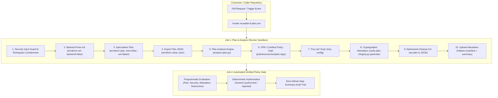

# InfraFlow Planning Architecture

## Overview

The **InfraFlow Secure Planning & Approval Engine** (Milestone G04) provides automated, speculative Terraform plan generation, structural change classification, policy evaluation, and cryptographic integrity gating for multi-cloud infrastructure delivery.

The engine enforces a strict zero-cloud-access, zero-apply guarantee: plans are computed purely as speculative execution models without cloud provider mutations, and execution is gated behind both automated cryptographic attestations and GitHub protected environment approvals.

---

## Architectural Principles

1. **Speculative Execution Only**
   All planning operations run with `-input=false` and `-lock=false` against local module definitions or state snapshots. At no point does the planning engine execute `terraform apply` or `terraform destroy`.

2. **Zero Cloud Access Requirement**
   Core testing and module verification utilize cloud-free primitives (`terraform_data`, local modules, mock providers) ensuring zero AWS, Azure, or GCP credential dependencies ($0 operating budget).

3. **Privacy by Design & Secret Protection**
   Raw binary plan files (`tfplan`) and raw execution plan JSON (`tfplan.json`) may contain unencrypted passwords, API tokens, and internal subnet configurations. InfraFlow treats raw plan files as ephemeral secrets: they reside strictly in POSIX-restricted temporary storage (`chmod 700`) during analysis and are purged before the job completes. Only sanitized Markdown summaries and cryptographic attestation manifests are published as artifacts.

4. **Cryptographic Plan Attestation**
   Plans are cryptographically bound to their execution context:
   - Source repository (`$GITHUB_REPOSITORY`)
   - Source commit SHA (`$GITHUB_SHA`)
   - Workflow run ID (`$GITHUB_RUN_ID`)
   - Triggering actor (`$GITHUB_ACTOR`)
   - Terraform toolchain version
   - SHA-256 digest of the execution plan JSON and binary plan

5. **Dual-Gated Approval Model**
   Advancing from plan to downstream delivery requires passing two orthogonal gates:
   - **Automated Gate**: Cryptographic validation that the candidate plan matches the signed commit and has not been tampered with or regenerated.
   - **Human Gate**: GitHub Protected Environment review by authorized human engineers.

---

## Reusable Workflow Contract (`reusable-tf-plan.yml`)

### Inputs

| Input | Type | Default | Description |
|---|---|---|---|
| `terraform-version` | `string` | `"1.10.4"` | SemVer Terraform version (>= 1.6.0 enforced) |
| `working-directory` | `string` | `"."` | Safe relative module directory |
| `var-file` | `string` | `""` | Optional relative path to `.tfvars` file |
| `environment` | `string` | `"production"` | Target deployment environment context for policy evaluation |
| `enable-policy-evaluation` | `boolean` | `true` | Evaluate OPA / Conftest policies against plan JSON |
| `policy-directory` | `string` | `"policies"` | Relative path to enterprise Rego policy root |
| `enable-trivy` | `boolean` | `true` | Execute Trivy IaC static scan |
| `severity-threshold` | `string` | `"HIGH,CRITICAL"` | Severity levels triggering hard failure |
| `fail-on-destructive` | `boolean` | `false` | Fail plan generation if deletions or replacements occur |
| `upload-plan-attestation` | `boolean` | `true` | Upload sanitized summary and attestation manifest |

### Outputs

| Output | Description |
|---|---|
| `plan-status` | Speculative plan generation outcome (`success`, `failure`, `skipped`) |
| `analysis-status` | Change classification outcome (`success`, `failure`, `skipped`) |
| `security-status` | Aggregated security scan outcome (`success`, `failure`, `skipped`) |
| `authorization-status` | Automated verified policy gate status (`authorized`, `rejected`) |
| `approval-status` | Deprecated alias for `authorization-status` |
| `has-changes` | Boolean flag indicating whether modifying changes are planned |
| `has-destructive-changes` | Boolean flag indicating whether deletions or replacements are planned |
| `total-changes` | Integer count of total modifying changes |
