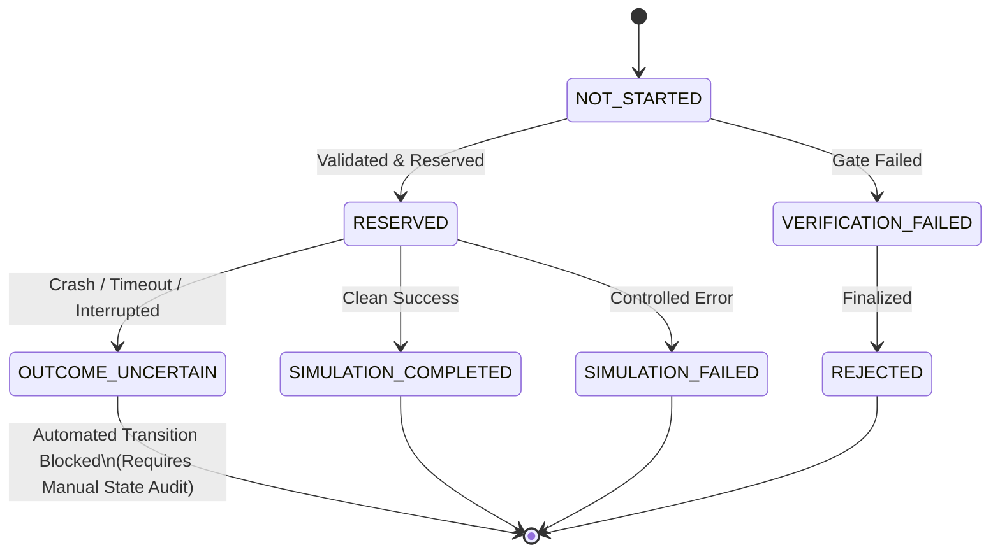

# InfraFlow Controlled Destruction, Blast-Radius Protection & Failure Recovery

**Document ID:** `INFRAFLOW-SEC-G06-003`  
**Milestone:** G06.4 — Controlled Destruction, Blast-Radius Protection & Failure Recovery  
**Classification:** Security Architecture & Authorization Specification  
**Author:** Senior DevSecOps Engineer, Terraform Security Architect & Site Reliability Engineer  
**Status:** IMPLEMENTED (Offline Baseline)  
**Budget Consumed:** $0.00 (Strict Zero-Cloud-Cost Invariant Preserved)

---

## 1. Executive Summary

Milestone **G06.1** established client-side **AES-256-GCM envelope encryption** to ensure plan confidentiality, **G06.2** enforced **plan lifecycle and replay protection**, and **G06.3** established the **reusable protected apply workflow contract**. However, in production infrastructure environments, the greatest existential threat to service availability and data durability is **accidental, unconstrained, or adversarial resource destruction**.

A Terraform plan that deletes infrastructure can cause catastrophic outages or permanent data loss if:
1. **The blast radius is unbounded**: A single typo or refactoring defect deletes dozens of database instances, storage buckets, or network gateways.
2. **Security perimeters are destroyed**: IAM roles, KMS encryption keys, or S3 public access blocks are deleted, opening vulnerabilities or rendering encrypted data unrecoverable.
3. **State-wide destruction occurs**: An entire workspace or environment is destroyed due to a misconfigured module reference or `-destroy` flag.
4. **Approval is ambiguous or transferable**: Approvals rely on generic confirmation tokens (`yes`, `true`, `destroy`) that can be copy-pasted or forged across different plans, repositories, or environments.
5. **Execution failure leaves the system in an ambiguous state**: A network partition or job timeout interrupts plan application, leading to blind retries or reckless automated rollbacks that corrupt infrastructure state.

Milestone **G06.4** implements **Controlled Destruction, Blast-Radius Protection, and Safe Failure Recovery** via `scripts/assess-destruction.py` and the updated `.github/workflows/reusable-tf-apply.yml`. This system enforces pre-execution blast-radius ceilings, requires cryptographically bound confirmation contracts for destructive changes, and guarantees fail-closed crash containment without automated rollbacks or lock tampering.

```mermaid
flowchart TD
    subgraph PlanAnalysis["1. Destructive Change Classification (assess-destruction.py)"]
        PlanJSON["Terraform Plan JSON\n(resource_changes)"]
        Classify["Action Classifier\n- Pure Deletions\n- Replacements (CBD / DBC)\n- State-Wide Destroy Detection\n- Security-Critical Detection"]
    end

    subgraph BlastRadiusGate["2. Blast-Radius Policy Evaluation"]
        PolicyFile["Destruction Policy\n(max_deletions, max_replacements)"]
        ThresholdCheck["Threshold & Perimeter Evaluation\n- Max deletions exceeded?\n- Max replacements exceeded?\n- Security-critical deletion blocked?"]
    end

    subgraph ConfirmationGate["3. Plan-Specific Confirmation Contract"]
        TokenInput["Confirmation Contract JSON\n(infraflow-destruction-confirmation-v1)"]
        ContractCheck["Contract Verification\n- Plan ID exact match?\n- SHA-256 digest exact match?\n- Repo & Env match?\n- Summary (del/rep) exact match?\n- Generic strings strictly blocked?\n- Timestamp unexpired?"]
    end

    subgraph StateMachine["4. Execution State Machine & Recovery"]
        Ledger["SQLite Recovery Ledger"]
        States["States:\n- NOT_STARTED\n- RESERVED\n- SIMULATION_COMPLETED\n- SIMULATION_FAILED\n- OUTCOME_UNCERTAIN (Locked)"]
    end

    subgraph Decision["5. Final Assessment Outcome"]
        AuthSim["AUTHORIZED_FOR_SIMULATION\n(Within limits + Valid confirmation)"]
        Reject["REJECTED (Fail-Closed)\n(Policy violation, missing/invalid token)"]
    end

    PlanJSON --> Classify
    Classify --> PolicyFile
    PolicyFile --> ThresholdCheck
    ThresholdCheck -->|Exceeded / Prohibited| Reject
    ThresholdCheck -->|Within Limits & Destructive| TokenInput
    TokenInput --> ContractCheck
    ContractCheck -->|Invalid / Expired / Mismatch| Reject
    ContractCheck -->|Valid Token| StateMachine
    ThresholdCheck -->|Non-Destructive (0 del, 0 rep)| StateMachine
    StateMachine --> AuthSim
    StateMachine -.->|Crash / Timeout| States
```

---

## 2. Destructive Change Classification

The `DestructivePlanClassifier` inspects the normalized Terraform plan JSON (`resource_changes` array) and classifies actions according to strict canonical rules:

### 2.1 Action Categories
* **Pure Deletion (`category: delete`)**:
  - Actions list: `["delete"]`.
  - The resource is permanently removed from infrastructure and state.
* **Replacement (`category: replace`)**:
  - Two distinct directions are recognized:
    1. **Create-Before-Destroy**: Actions list: `["create", "delete"]`. A replacement instance is created before the old instance is destroyed.
    2. **Destroy-Before-Create**: Actions list: `["delete", "create"]`. The old instance is destroyed before the replacement instance is provisioned (higher risk).
* **Non-Destructive Operations**:
  - `["no-op"]`: Resource is unchanged.
  - `["read"]`: Data source read.
  - `["create"]`: New resource provisioned.
  - `["update"]`: In-place resource attribute mutation without recreation.

### 2.2 Fail-Closed Action Token Enforcement
Any action sequence not explicitly recognized in the canonical set (e.g., `["destroy"]`, `["corrupt"]`, or unknown action combinations) immediately raises `UnknownActionError` and terminates the assessment with a fail-closed rejection.

### 2.3 State-Wide Destroy Detection
A plan is flagged as `is_state_wide_destroy: true` if:
$$\text{total\_active\_resources} > 0 \land \text{pure\_deletions} = \text{total\_active\_resources} \land \text{creates} = 0 \land \text{updates} = 0 \land \text{replacements} = 0$$
State-wide destructions are prohibited by default across all environments and require explicit, separate policy authorization (`allow_state_wide_destroy: true`).

---

## 3. Blast-Radius Protection & Policy Model

Blast-radius protection sets firm upper bounds on the volume and nature of changes that any single plan may execute.

### 3.1 Policy Schema (`infraflow-destruction-policy-v1`)
A destruction policy defines environment-specific blast-radius ceilings:
```json
{
  "schema_version": "infraflow-destruction-policy-v1",
  "environment": "production",
  "max_deletions": 0,
  "max_replacements": 2,
  "allow_security_critical_destruction": false,
  "allow_state_wide_destroy": false,
  "require_confirmation": true
}
```

### 3.2 Environment Defaults
* **Production (`prod`, `production`)**:
  - `max_deletions`: **0** (Zero deletions permitted without explicit trusted policy).
  - `max_replacements`: **2**.
  - `allow_security_critical_destruction`: **false**.
  - `require_confirmation`: **true**.
* **Non-Production (`staging`, `dev`, etc.)**:
  - `max_deletions`: **5**.
  - `max_replacements`: **10**.
  - `require_confirmation`: **true**.

### 3.3 Protection of Security-Critical Controls and Assets
Destruction of perimeter access controls, cryptographic keys, and logging infrastructure poses existential risks. The engine enforces strict deletion bans on resources matching `SECURITY_CRITICAL_RESOURCE_TYPES`, including:
* **AWS**: `aws_iam_role`, `aws_iam_policy`, `aws_kms_key`, `aws_s3_bucket_public_access_block`, `aws_security_group`, `aws_vpc`, `aws_route_table`.
* **Azure**: `azurerm_key_vault`, `azurerm_key_vault_key`, `azurerm_storage_account_network_rules`, `azurerm_role_assignment`.
* **GCP**: `google_kms_crypto_key`, `google_kms_key_ring`, `google_storage_bucket_iam_binding`, `google_project_iam_binding`.

Any deletion or replacement of these resources without `allow_security_critical_destruction: true` is rejected with `SECURITY_CRITICAL_DESTRUCTION_BLOCKED`.

### 3.4 Strict Prevention of Caller Privilege Elevation
Callers may specify CLI bounds (`--max-deletions`, `--max-replacements`), but the effective limit is strictly computed as:
$$\text{effective\_limit} = \min(\text{policy\_limit}, \text{caller\_limit})$$
An untrusted caller or workflow input can **tighten** a threshold, but cannot elevate privileges above the trusted repository policy.

---

## 4. Plan-Specific Destruction Confirmation Contract

Generic, untargeted approvals (such as passing `-auto-approve`, or typing `yes`/`true`/`destroy`) provide zero assurance of human intent or blast-radius comprehension.

InfraFlow mandates a structured, plan-specific **Destruction Confirmation Contract**:

### 4.1 Confirmation Contract Schema (`infraflow-destruction-confirmation-v1`)
```json
{
  "schema_version": "infraflow-destruction-confirmation-v1",
  "plan_id": "plan-20261120-prod-app-042",
  "plan_digest_sha256": "e3b0c44298fc1c149afbf4c8996fb92427ae41e4649b934ca495991b7852b855",
  "source_repository": "TM-threemavithana/infraflow",
  "target_environment": "production",
  "change_summary": {
    "pure_deletions": 1,
    "replacements": 0
  },
  "authorized_by": "security-lead@infraflow.local",
  "created_at": "2026-11-20T12:00:00Z",
  "expires_at": "2026-11-20T13:00:00Z"
}
```

### 4.2 Security Invariants of Confirmation
1. **Exact Plan Digest Binding**: The token contains the exact SHA-256 digest of the unencrypted plan binary. If a new plan is generated, the confirmation is instantly invalid.
2. **Context Binding**: The token explicitly binds `plan_id`, `source_repository`, and `target_environment`. Tokens cannot be transferred across environments (e.g. staging to production) or across repositories.
3. **Change Summary Verification**: The token declares exact deletion and replacement counts. If the plan alters more resources than confirmed, it fails closed (`CONFIRMATION_SUMMARY_MISMATCH`).
4. **Short Time-to-Live (TTL)**: Confirmations expire automatically (default 1 hour, maximum 12 hours). Expired tokens are rejected (`CONFIRMATION_EXPIRED`).
5. **Generic String Blocklist**: Passing bare tokens (`yes`, `y`, `true`, `1`, `destroy`, `apply`, `approved`, `proceed`, `force`, `override`) is intercepted and rejected with `INVALID_CONFIRMATION_TOKEN`.

---

## 5. Execution State Machine & Safe Failure Recovery

### 5.1 Plan Execution State Machine
Every plan transitions through formal lifecycle states managed in an offline SQLite recovery ledger:

| State | Description | Retryable? | Next Valid States |
| :--- | :--- | :---: | :--- |
| `NOT_STARTED` | Initial plan record created. | Yes | `RESERVED`, `VERIFICATION_FAILED` |
| `VERIFICATION_FAILED` | Plan failed cryptographic, policy, or confirmation checks. | Terminal | `REJECTED` |
| `RESERVED` | Plan successfully reserved by simulation worker; lock acquired. | No | `SIMULATION_COMPLETED`, `SIMULATION_FAILED`, `OUTCOME_UNCERTAIN` |
| `SIMULATION_COMPLETED` | Execution simulation completed cleanly without errors. | Terminal | None |
| `SIMULATION_FAILED` | Simulation failed prior to execution simulation step. | Terminal | `REJECTED` |
| `OUTCOME_UNCERTAIN` | Simulation or execution process crashed, timed out, or interrupted. | **STRICTLY LOCKED** | Requires manual administrative audit |
| `REJECTED` | Pre-execution verification rejected plan. | Terminal | None |

### 5.2 The Non-Retryable Uncertainty Lock
If an execution worker crashes, experiences a network timeout, receives `SIGTERM`, or aborts mid-flight, the plan is marked as `OUTCOME_UNCERTAIN`.



> [!CAUTION]
> **Strict Uncertainty Lock Invariant**: Plans in `OUTCOME_UNCERTAIN` cannot transition back to `RESERVED` or `NOT_STARTED`. Automated retries are permanently blocked to prevent double-execution against unknown infrastructure states.

### 5.3 Prohibition of Automatic Rollbacks
InfraFlow explicitly prohibits automated rollback mechanisms (such as automatically running a reverse plan or destroying created resources upon error).
* **Rationale**: Terraform state updates are non-atomic. A failed apply may leave partial resources provisioned or state locks held. Automatically executing a blind reverse operation risks destroying dependencies, cascading failures, or corrupting state metadata.
* **Standard Operating Procedure**: All partial execution failures require human operator triage and state inspection.

---

## 6. Safe Lock Handling & Temporary Filesystem Cleanup

### 6.1 Temporary File Permissions & POSIX Cleanup Traps
* **File Permissions**: All intermediate plan extractions, decrypted envelopes, and confirmation tokens are created with strict octal mode `0600` (read/write by owner only; group/other forbidden). Intermediate directories use mode `0700`.
* **POSIX Traps**: Workflow scripts and CLI utilities install cleanup traps (`trap 'rm -f ...' EXIT INT TERM`) ensuring temporary files are unlinked even in the event of process interruption or unhandled exceptions.

### 6.2 Remote Lock Isolation Invariant
* **Zero Manipulation of Remote Locks**: The engine does not inspect, modify, or delete remote state backend locks (e.g. AWS DynamoDB lock records, Azure blob leases, or S3 `.tflock` objects).
* **Prohibition of `force-unlock`**: Under no circumstances does the platform workflow or any automated script execute `terraform force-unlock`. Unlocking state must remain an explicit, out-of-band human administrative action.

---

## 7. Operational Runbook & Incident Response

### 7.1 Authorizing Destructive Plans in CI/CD
When a plan includes deletions or replacements:
1. Review the generated planning summary and change metrics.
2. Ensure destructive changes are strictly intended and within blast-radius limits.
3. Generate a plan-specific confirmation token using the CLI:
   ```bash
   python3 scripts/assess-destruction.py create-confirmation \
     --plan-id "plan-20261120-prod-app-042" \
     --plan-digest "<exact-plan-sha256>" \
     --repo "TM-threemavithana/infraflow-consumer-test" \
     --environment "production" \
     --pure-deletions 1 \
     --replacements 0 \
     --authorized-by "ops-lead@company.com" \
     --ttl-seconds 1800 \
     --output-file confirmation.json
   ```
4. Commit or pass `confirmation.json` (or pass `--destruction-confirmation-token`) to the protected apply workflow.

### 7.2 Recovering from an `OUTCOME_UNCERTAIN` Incident
If a workflow terminates unexpectedly:
1. **Do not retry the workflow**: The replay ledger will reject any attempt to re-reserve or re-execute the plan ID.
2. **Inspect Remote State**: Using an authorized, out-of-band administrative terminal, inspect the current remote state (`terraform state list` or backend console).
3. **Verify Physical Infrastructure**: Check the cloud provider console or API to confirm which resources were actually provisioned, updated, or deleted.
4. **Synchronize State**: Refresh state metadata if necessary (`terraform refresh`).
5. **Generate a Fresh Plan**: Initiate a completely new planning cycle with a new `plan_id` and new plan digest.

---

## 8. Simulation Invariants & Offline Verification

All components implemented in Milestone G06.4 operate under strict verification constraints:
* **$0.00 Cloud Spend**: Zero real cloud API calls; zero AWS/Azure/GCP billing.
* **Zero Cloud Credentials**: Executes entirely offline using mock cryptographic fixtures and synthetic states.
* **Simulation-Only Execution**: The reusable apply workflow (`reusable-tf-apply.yml`) validates contracts and outputs `simulation-status: simulated-only`. No real `terraform apply` or `terraform destroy` commands exist in platform workflows.
