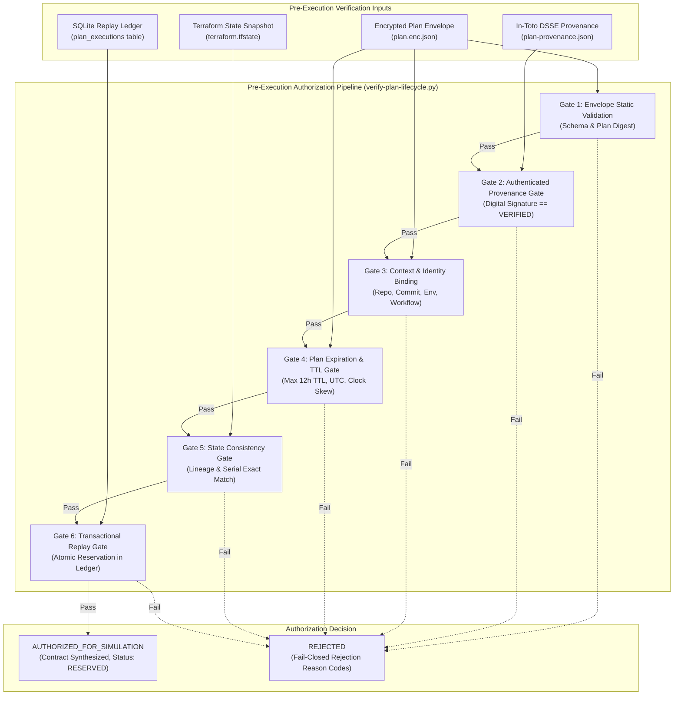
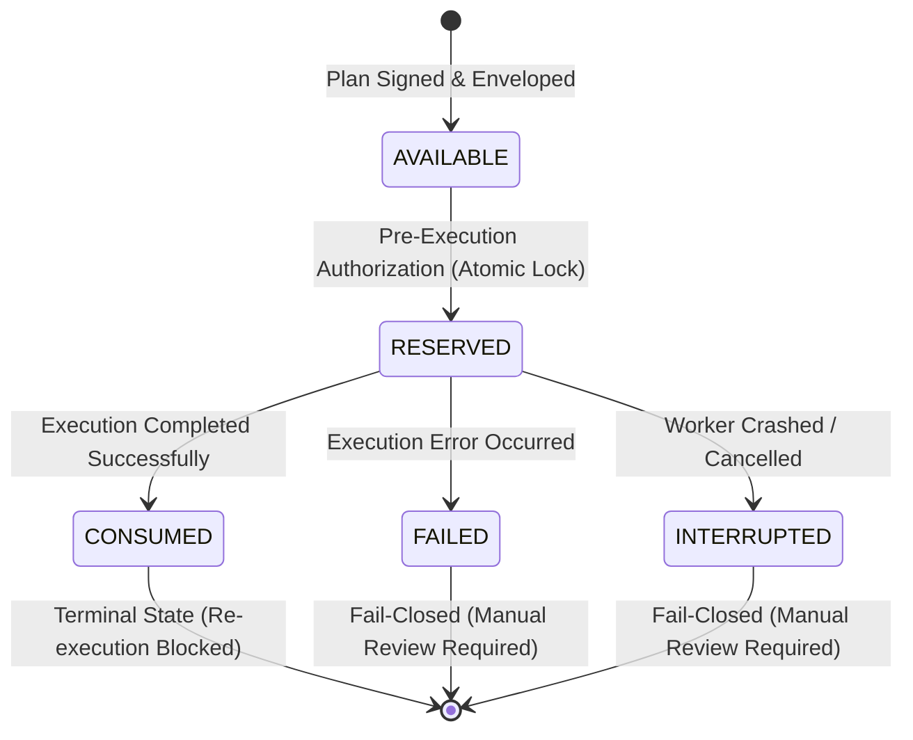

# InfraFlow Plan Lifecycle, State Consistency & Replay Protection

**Document ID:** `INFRAFLOW-SEC-G06-002`  
**Milestone:** G06.2 — Protected Apply & Destroy (Verification Foundation)  
**Classification:** Security Architecture & Authorization Specification  
**Author:** Senior DevSecOps Engineer, Terraform Security Architect & Python Security Engineer  
**Status:** IMPLEMENTED (Offline Baseline)  
**Budget Consumed:** $0.00 (Zero Cloud Spending Invariant Strictly Preserved)

---

## 1. Executive Summary

Milestone **G06.1** established client-side **AES-256-GCM envelope encryption** to prevent raw `.tfplan` file disclosure (`SEC-07`). However, cryptographic confidentiality and integrity alone do **not** constitute authorization for infrastructure application. 

A mathematically authentic, properly encrypted plan may still be dangerously invalid if:
1. **The plan has expired**: Infrastructure has drifted since the plan was created, making execution unpredictable or destructive.
2. **The state has mutated**: Another workflow or engineer executed an intermediate state change (stale state serial or divergent lineage).
3. **The plan is replayed**: An adversary or duplicated CI trigger attempts to re-execute a plan that was already applied or canceled.
4. **The execution context is substituted**: A plan generated for staging is presented for production execution.

Milestone **G06.2** introduces the **Plan Lifecycle, State Consistency & Replay Protection Engine** (`scripts/verify-plan-lifecycle.py`). This engine acts as the authoritative pre-execution authorization gate, strictly verifying plan TTLs, state serial and lineage invariants, transactional replay prevention, and context bindings prior to any potential application workflow.



---

## 2. Plan Authorization Contract (`infraflow-plan-authorization-v1`)

The engine enforces a strictly versioned verification contract distinguishing **authenticated claims** (derived from signed digital signatures, authenticated GCM AAD, and authoritative runner contexts) from **untrusted caller-supplied inputs**.

### 2.1 Authenticated Claims vs. Untrusted Caller Inputs

| Parameter | Trust Classification | Authoritative Source of Truth |
| :--- | :--- | :--- |
| `plan_digest_sha256` | **Authenticated Claim** | Computed directly from decrypted payload; matched to signed in-toto statement and canonical envelope AAD. |
| `source_repository` | **Authenticated Claim** | GCM AAD verified parameter; matched to trusted runner context `${{ github.repository }}`. |
| `source_commit_sha` | **Authenticated Claim** | GCM AAD verified parameter; matched to trusted runner context `${{ github.sha }}`. |
| `target_environment` | **Authenticated Claim** | GCM AAD verified parameter; matched to protected workflow environment `${{ inputs.environment }}`. |
| `created_at` | **Authenticated Claim** | Authenticated provenance predicate timestamp and signed envelope creation timestamp. |
| `provenance_status` | **Authenticated Claim** | Result of ECDSA P-256 signature verification against pinned platform trust roots. |
| `state_lineage` | **Verified Snapshot** | Validated against current state snapshot metadata in the remote backend. |
| `state_serial` | **Verified Snapshot** | Validated against current state serial in the remote backend. |
| `--expected-repo` | *Untrusted Caller Input* | Parameter supplied to verifier CLI; must match authenticated claim or fails closed. |
| `--expected-commit` | *Untrusted Caller Input* | Parameter supplied to verifier CLI; must match authenticated claim or fails closed. |
| `--expected-environment`| *Untrusted Caller Input* | Parameter supplied to verifier CLI; must match authenticated claim or fails closed. |

> [!CAUTION]
> **Decryption is NOT Authorization**: The ability to unwrap a DEK and decrypt an envelope merely proves possession of key access; it conveys **zero authority** to modify cloud infrastructure. Only a plan that satisfies all six pre-execution gates receives `AUTHORIZED_FOR_SIMULATION`.

---

## 3. Plan Expiration & TTL Policy

Terraform plans represent a point-in-time calculation of resource deltas. Executing stale plans against drifted infrastructure leads to state corruption, unintended resource replacement, or operational downtime.

### 3.1 Timing Invariants
1. **ISO 8601 UTC Standardization**:
   - Timestamps must be strict, timezone-aware UTC strings (e.g., `2026-11-20T12:00:00Z` or `2026-11-20T12:00:00+00:00`).
   - Naive (timezone-unaware) timestamps are strictly rejected (`MALFORMED_TIMESTAMP`).
2. **Maximum Plan TTL (12 Hours)**:
   - Plans have an enforced maximum lifespan of **12 hours** (43,200 seconds):
     $$\text{duration} = \text{expires\_at} - \text{created\_at} \le 43,200\text{s}$$
   - Any envelope specifying a duration greater than 12 hours is rejected (`TTL_EXCEEDED`).
3. **Future Creation Guard**:
   - If `created_at > (now + clock_skew)`, the plan is rejected (`FUTURE_CREATED_PLAN`).
4. **Expiration Enforcement**:
   - If `now > (expires_at + clock_skew)`, the plan is rejected (`PLAN_EXPIRED`).
5. **Clock-Skew Tolerance**:
   - A configurable allowance of $\pm 60\text{s}$ accommodates minor non-adversarial NTP drift across runner nodes.
6. **Injectable Clock Interface**:
   - All validation methods accept an optional `current_time` parameter for 100% deterministic testing without sleep or monkeypatching.

---

## 4. State Consistency & Lineage Validation

Terraform state files track real-world infrastructure bindings. State metadata provides vital concurrency and consistency controls:

```json
{
  "version": 4,
  "terraform_version": "1.10.4",
  "serial": 42,
  "lineage": "3f2e1d0c-4b5a-6789-0123-abcdef456789",
  "outputs": {},
  "resources": []
}
```

### 4.1 State Invariants
- **Lineage Invariant**:
  - `lineage` is a unique UUID assigned upon state inception. If the actual state lineage does not match the plan's expected lineage, the state has been recreated, forked, or substituted (`STATE_LINEAGE_MISMATCH`).
- **Serial Invariant**:
  - `serial` is a monotonic counter incremented by Terraform on every state write.
  - If `actual_serial > expected_serial`: The state has progressed since the plan was created; applying this plan would overwrite newer state changes (`STALE_STATE_SERIAL`).
  - If `actual_serial < expected_serial`: Current state serial has regressed; indicates state rollback or snapshot corruption (`STATE_SERIAL_REGRESSION`).
- **Workspace Invariant**:
  - The plan must be applied in the exact Terraform workspace (`default`, `staging`, `production`) in which it was calculated (`WORKSPACE_MISMATCH`).
- **Backend Identity Invariant**:
  - The plan must target the exact storage backend (`s3://...`, `local://...`) recorded during planning (`BACKEND_MISMATCH`).
- **Initial Bootstrap Handling**:
  - New environments have no prior state (empty state or serial 0). This state is only accepted when an explicit `--initial-state` flag is asserted. Unflagged missing state is rejected (`MISSING_STATE_METADATA`).

> [!NOTE]
> **Pre-Execution vs. Runtime Locking**: The pre-execution state comparison verifies state snapshot consistency before requesting elevated apply permissions. However, it does **not** eliminate race conditions between verification and apply execution. Terraform's native remote backend locks (e.g., DynamoDB lock table or S3 conditional write) and saved-plan stale checks remain strictly necessary during live execution.

---

## 5. Transactional Replay Prevention Ledger

InfraFlow prevents replay attacks, duplicate execution of approved plans, and race conditions via an offline transactional SQLite ledger.

### 5.1 Ledger Lifecycle State Machine



### 5.2 State Definitions

1. `AVAILABLE`: Plan exists and has never been reserved or applied.
2. `RESERVED`: Plan has been claimed by an authorized execution worker. A reservation timestamp and execution context are recorded. Duplicate reservation requests fail closed (`DUPLICATE_RESERVATION`).
3. `CONSUMED`: Plan was successfully applied. Any future attempt to reserve or apply this plan is blocked (`ALREADY_CONSUMED`).
4. `FAILED`: Plan application failed.
5. `INTERRUPTED`: Worker process was terminated or crashed during execution.

### 5.3 Crash Recovery & Fail-Closed Boundaries
- **No Automatic Re-Try on Uncertainty**: If a worker crashes or is cancelled while a plan is in `RESERVED` status, the plan is marked `INTERRUPTED`.
- The ledger **strictly refuses** to re-reserve an `INTERRUPTED` or `FAILED` plan (`UNCERTAIN_EXECUTION_STATE`). Because Terraform may have partially applied resources before the crash, automatic re-execution could cause resource duplication. A human operator or reconciliation workflow must investigate before manually clearing the ledger.

### 5.4 Concurrency & Isolation
- The ledger uses SQLite with **Write-Ahead Logging (WAL)** and `BEGIN IMMEDIATE` transactions.
- Thread safety is enforced via `threading.Lock()` and connection locking.
- Concurrent workers attempting to reserve the same plan simultaneously result in exactly one successful reservation; all competing requests are rejected.

---

## 6. Pre-Execution Verifier Decision Matrix

The unified verifier (`PlanLifecycleVerifier.verify_authorization`) returns a structured `AuthorizationDecision`:

```json
{
  "decision": "AUTHORIZED_FOR_SIMULATION",
  "decision_code": "AUTH_SUCCESS",
  "reasons": [],
  "contract": {
    "schema_version": "infraflow-plan-authorization-v1",
    "plan_id": "plan-e3b0c44298fc1c14",
    "plan_digest_sha256": "e3b0c44298fc1c149afbf4c8996fb92427ae41e4649b934ca495991b7852b855",
    "source_repository": "TM-threemavithana/infraflow-consumer-test",
    "source_commit_sha": "d0660de837ca07d5bdd56f04b0e50691ce98bd28",
    "target_environment": "production",
    "workflow_identity": "reusable-tf-plan.yml",
    "workflow_sha": "484b067aa500d5523d1bccc06ce111cfe736a8af",
    "terraform_version": "1.10.4",
    "backend_identity": "s3://infraflow-tfstate-bucket/env/production/tf.state",
    "workspace": "default",
    "state_lineage": "3f2e1d0c-4b5a-6789-0123-abcdef456789",
    "state_serial": 42,
    "created_at": "2026-11-20T11:00:00+00:00",
    "expires_at": "2026-11-20T17:00:00+00:00",
    "provenance_status": "VERIFIED",
    "replay_status": "RESERVED"
  },
  "evaluated_at": "2026-11-20T12:00:00+00:00"
}
```

### 6.1 Rejection Reason Codes

| Decision Code | Triggering Condition |
| :--- | :--- |
| `UNSUPPORTED_SCHEMA_VERSION` | Envelope schema does not match `"infraflow-plan-envelope-v1"`. |
| `MALFORMED_ENVELOPE` | Envelope JSON is corrupted or missing required context dictionary. |
| `INVALID_PLAN_DIGEST` | Plan digest is missing or not a valid 64-character SHA-256 hex string. |
| `UNVERIFIED_PROVENANCE` | Digital signature attestation status is `"UNVERIFIED"` or `"REJECTED"`. |
| `REPO_MISMATCH` | Envelope repository does not match runner execution context. |
| `COMMIT_MISMATCH` | Envelope commit SHA does not match target commit. |
| `ENVIRONMENT_MISMATCH` | Envelope environment does not match requested deployment tier. |
| `WORKFLOW_SHA_MISMATCH` | Workflow commit SHA does not match immutable platform release SHA. |
| `MISSING_TIMESTAMP` | `created_at` or `expires_at` is empty or missing. |
| `MALFORMED_TIMESTAMP` | Timestamp is not valid ISO 8601 or missing explicit UTC timezone. |
| `INVALID_EXPIRATION_ORDER` | `expires_at` is earlier than or equal to `created_at`. |
| `TTL_EXCEEDED` | Validity window exceeds maximum 12 hours (43,200 seconds). |
| `FUTURE_CREATED_PLAN` | Plan was created in the future relative to current evaluation time. |
| `PLAN_EXPIRED` | Current evaluation time is past `expires_at` (plus clock skew). |
| `MISSING_STATE_METADATA` | State file is empty or missing without initial-state declaration. |
| `MALFORMED_STATE_METADATA` | State JSON lacks `version`, `serial`, or `lineage`. |
| `WORKSPACE_MISMATCH` | Actual Terraform workspace differs from expected workspace. |
| `BACKEND_MISMATCH` | Actual state backend differs from planning backend. |
| `STATE_LINEAGE_MISMATCH` | State lineage has changed (state recreation/forking detected). |
| `STALE_STATE_SERIAL` | Current state serial is higher than plan serial (drift detected). |
| `STATE_SERIAL_REGRESSION` | Current state serial is lower than plan serial (rollback detected). |
| `DUPLICATE_RESERVATION` | Plan is currently reserved by another worker in the ledger. |
| `ALREADY_CONSUMED` | Plan has already been consumed and applied. |
| `UNCERTAIN_EXECUTION_STATE` | Plan previously ended in `FAILED` or `INTERRUPTED` state. |

---

## 7. Operational Limitations & Future Integration

1. **Simulation Status Invariant**:
   - In Milestone G06.2, successful verification emits **`AUTHORIZED_FOR_SIMULATION`**. It strictly does **not** grant live production deployment authorization.
2. **Local SQLite Ledger Scope**:
   - The SQLite replay ledger is an offline simulation. In future cloud execution (Milestone G06.3+), replay prevention will integrate with a centralized, distributed locking mechanism (such as AWS DynamoDB transactional conditional writes or GitHub Deployment API concurrency controls).
3. **No Direct Terraform Apply/Destroy**:
   - G06.2 builds the authorization and verification engine. Actual execution of `terraform apply` or `terraform destroy` is deferred to subsequent milestone phases (G06.3+).
4. **Time Source Trust Reality**:
   - Local runner system time is an offline simulation. In enterprise production, timestamps will be bound to RFC 3161 Time-Stamp Protocol (TSP) tokens or Sigstore Cosign timestamp authorities embedded within the in-toto DSSE envelope.
