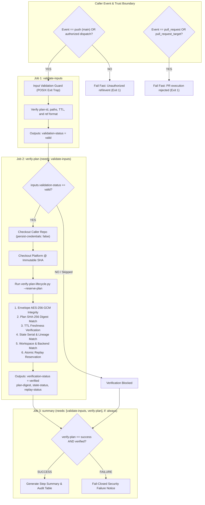

# InfraFlow G06.3 — Protected Apply Workflow Contract Specification

## 1. Architectural Overview & Threat Model

InfraFlow Milestone **G06.3** establishes the secure reusable workflow contract for protected Terraform plan execution:
`.github/workflows/reusable-tf-apply.yml`.

In standard CI/CD pipelines, `terraform apply` is a high-risk operational boundary. Insecure implementations suffer from critical vulnerabilities:
1. **Plan Tampering**: Replacing or modifying the plan binary after security approvals were granted.
2. **State Drift & Race Conditions**: Applying a stale plan against a state file whose serial or lineage advanced after planning.
3. **Replay Attacks**: Re-executing an already applied plan, potentially reverting intentional subsequent state modifications.
4. **Untrusted Trigger Elevation**: Running state-modifying workflows from pull request contexts or arbitrary untrusted branches.
5. **Toolchain Substitution**: Modifying verification scripts between planning and execution.

G06.3 enforces a **strict, fail-closed pre-execution authorization contract** in a **zero-cloud-cost ($0.00), simulation-only** mode. No cloud credentials, no AWS STS API calls, and no live `terraform apply` or `terraform destroy` commands are executed during this milestone.

---

## 2. Workflow Dependency Graph & Job Architecture



### Job Descriptions & Responsibilities

| Job ID | Responsibilities | Permissions | Dependencies |
|---|---|---|---|
| `validate-inputs` | Validates caller parameters, rejects untrusted event contexts (`pull_request`, `pull_request_target`), ensures non-empty identifiers, checks positive numeric bounds, and validates that the platform workflow ref is pinned to an immutable SHA-1 hash. | `contents: read` | None (Entry Point) |
| `verify-plan` | Performs pre-execution cryptographic integrity verification, envelope validation, plan freshness checks (TTL), remote state consistency checking (serial & lineage), workspace containment, and atomic plan reservation in the replay prevention ledger. | `contents: read` | `validate-inputs` (`if: needs.validate-inputs.outputs.validation-status == 'valid'`) |
| `summary` | Generates GitHub Actions step summary markdown and audit logs. Operates with `if: always()` to ensure fail-closed audit trail visibility even upon upstream abortion or failure. | `contents: read` | `[validate-inputs, verify-plan]` |

---

## 3. Pre-Execution Verification Invariants

The `verify-plan` job invokes `scripts/verify-plan-lifecycle.py` with the `--reserve-plan` flag. The following six invariants must hold simultaneously:

1. **Envelope Authenticity**:
   - The encrypted plan file must match the canonical schema defined in `scripts/kms-envelope.py`.
   - The wrapped DEK, initialization vector (IV), authentication tag, and ciphertext must decrypt successfully using the designated Key Encryption Key (KEK) simulator.
   - The Additional Authenticated Data (AAD) must bind the exact execution context:
     `{"environment": "...", "plan_id": "...", "repository": "...", "workflow": "..."}`.
2. **Digest Integrity**:
   - The SHA-256 digest of the decrypted plan payload must match the `plan_digest` recorded inside the authenticated envelope.
   - The digest must match the DSSE in-toto attested subject in `plan-provenance.json` (when production provenance is required).
3. **Plan Freshness (TTL)**:
   - The plan's embedded RFC 3339 creation timestamp is evaluated against current wall-clock time.
   - Maximum allowable age defaults to 12 hours (`43,200` seconds), configurable down to 60 seconds.
   - Clock skew tolerance is strictly limited to 60 seconds.
4. **State Consistency (Anti-Drift)**:
   - The current remote state file's `serial` must match `expected_serial` (drift prevention).
   - The `lineage` UUID must match `expected_lineage` (state file replacement prevention).
   - The backend storage URL (`expected_backend`) and workspace name (`expected_workspace`) must match planning declarations.
5. **Replay Prevention & Plan Reservation**:
   - The unique `plan-id` is queried against `.infraflow/ledger.json`.
   - If the plan is already recorded as `EXECUTED` or `RESERVED`, execution is immediately halted with a security violation.
   - Upon successful verification, the plan ID is atomically marked as `RESERVED` with execution timestamp, commit SHA, and runner metadata.
6. **Simulation Safety Guarantee**:
   - In G06.3, the workflow halts after plan verification and replay reservation.
   - Zero state changes occur: no `terraform apply`, `terraform destroy`, or `force-unlock` commands exist in the workflow.

---

## 4. GitHub Actions Permission Architecture

InfraFlow adheres to least-privilege permission isolation:

- **Top-Level Workflow Permissions**:
  ```yaml
  permissions:
    contents: read
  ```
  Neither `id-token: write` nor `pull-requests: write` is granted in G06.3.
- **Token Scope**:
  `actions/checkout` explicitly configures `persist-credentials: false` across all jobs to prevent token leakage to runner filesystems or untrusted dependencies.
- **Workflow Isolation**:
  The platform toolchain is cloned into an isolated `.infraflow-platform` directory pinned to `${{ job.workflow_repository }}` and `${{ job.workflow_sha }}`.

---

## 5. Reusable Workflow Interface Contract

### Workflow Inputs

| Input Name | Type | Required | Default | Security Purpose |
|---|---|---|---|---|
| `plan-id` | `string` | **Yes** | — | Unique identifier for plan tracking and replay ledger reservation. |
| `plan-envelope-file` | `string` | **Yes** | — | Path to AES-256-GCM encrypted plan envelope JSON. |
| `state-file` | `string` | **Yes** | — | Path to current Terraform state file for serial/lineage verification. |
| `environment` | `string` | No | `"production"` | Target deployment environment bound to AAD. |
| `expected-lineage` | `string` | **Yes** | — | Expected state lineage UUID to detect state destruction/recreation. |
| `expected-serial` | `number` | **Yes** | — | Expected state serial to detect concurrent state modifications. |
| `expected-backend` | `string` | No | `""` | Expected backend storage location (e.g. S3 URL). |
| `expected-workspace` | `string` | No | `"default"` | Expected Terraform workspace name. |
| `provenance-file` | `string` | No | `""` | Path to DSSE in-toto signed plan provenance file. |
| `require-production-provenance` | `boolean` | No | `true` | Enforces production tier provenance key verification. |
| `allow-initial-state` | `boolean` | No | `false` | Permits serial=0 lineage="" only during greenfield bootstrapping. |
| `max-ttl-seconds` | `number` | No | `43200` | Maximum allowable plan age in seconds (12 hours). |
| `clock-skew-seconds` | `number` | No | `60` | Allowable clock skew buffer in seconds. |
| `mock-kms` | `boolean` | No | `true` | Offline simulation mode flag. Must remain `true` for G06.3. |

### Workflow Outputs

| Output Name | Source Job | Description |
|---|---|---|
| `verification-status` | `verify-plan` | Status of pre-apply verification: `verified` or `failed`. |
| `state-consistency-status` | `verify-plan` | Status of state serial/lineage evaluation: `consistent` or `drifted`. |
| `replay-status` | `verify-plan` | Status of replay ledger check: `reserved` or `replayed`. |
| `authorization-status` | `verify-plan` | Overall pre-execution authorization status: `authorized` or `unauthorized`. |
| `plan-digest` | `verify-plan` | Cryptographically recomputed SHA-256 digest of decrypted plan binary. |

---

## 6. Consumer Workflow Integration Example

An external consumer repository invokes the protected apply simulation via an immutable commit SHA:

```yaml
name: "Protected Apply Simulation"

on:
  push:
    branches: [main]
  workflow_dispatch:
    inputs:
      plan-id:
        description: "Plan identifier"
        required: true
        type: string

permissions:
  contents: read

jobs:
  simulate:
    name: "Simulate Protected Apply"
    uses: TM-threemavithana/infraflow/.github/workflows/reusable-tf-apply.yml@484b067aa500d5523d1bccc06ce111cfe736a8af
    permissions:
      contents: read
    with:
      plan-id: ${{ inputs.plan-id || 'plan-demo-01' }}
      plan-envelope-file: "artifacts/plan.enc.json"
      state-file: "artifacts/terraform.tfstate"
      environment: "production"
      expected-lineage: "3f2e1d0c-4b5a-6789-0123-abcdef456789"
      expected-serial: 42
      require-production-provenance: true
```

---

## 7. Future Production Evolution (G06.4+)

When transitioning from simulation mode to live execution in G06.4:
1. **GitHub Environment Approval Protection**:
   - The apply execution job will be bound to `environment: production`, requiring authorized human approval.
2. **IAM Role Separation**:
   - The workflow will separate read-only planning roles (`arn:aws:iam::...:role/infraflow-plan-role`) from state-modifying apply roles (`arn:aws:iam::...:role/infraflow-apply-role`).
   - The apply role will only be assumable from protected branches (`refs/heads/main`).
3. **Exclusive State Locking & Trap Handler**:
   - Lock acquisition via S3 native locking (`use_lockfile = true`) with a robust POSIX EXIT/INT/TERM trap to ensure lock release under all exit paths.
