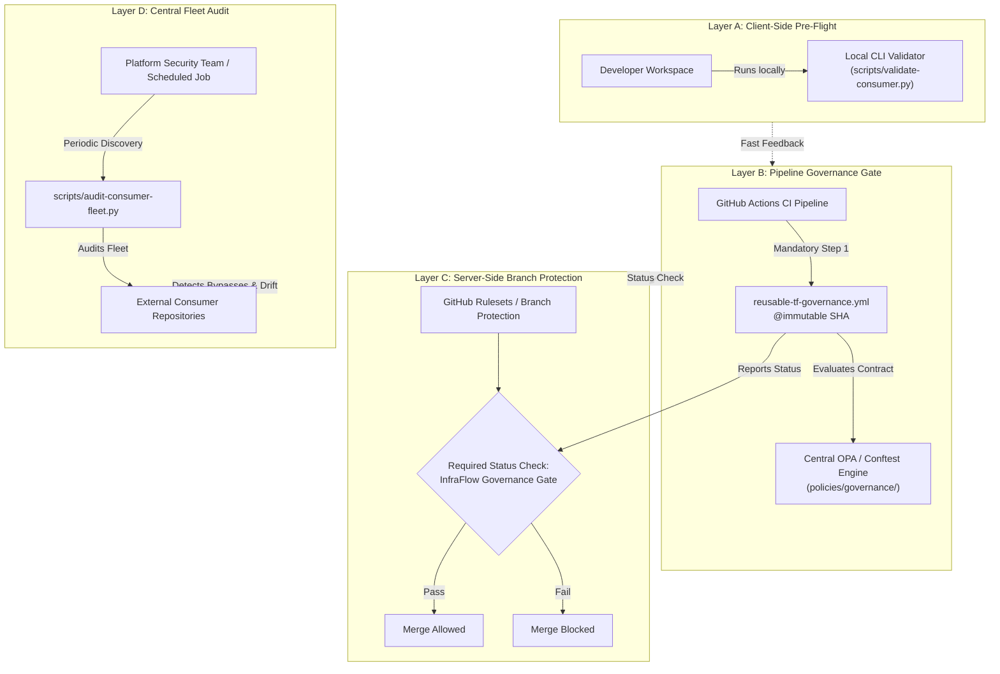

# InfraFlow — Consumer Governance & Trust Hardening Model (Milestone G08.3)

> **Document ID:** DOC-SEC-G08-GOV-01  
> **Milestone:** G08.3 — Centralized Governance, Policy Enforcement & Consumer Trust Hardening  
> **Classification:** Enterprise Security Architecture Specification  
> **Status:** APPROVED & ENFORCED  
> **Author:** Senior Platform Security Architect & DevSecOps Engineering Lead  
> **Platform Version:** v0.5.0 (`f1ad39fb0f0bdce7c475ed36e717e859b2e9b106`)  
> **Scope:** Multi-Repository Governance, Policy Enforcement, Supply Chain Hardening & Fleet Audit  

---

## 1. Executive Summary & Problem Context

In decentralized internal developer platforms, self-service onboarding alone introduces critical governance risks. When independent repositories adopt shared platform workflows:
1. **Adoption Bypass Risk**: A consumer repository may define `infraflow.config.yaml` to claim platform compliance, while failing to invoke platform workflows in `.github/workflows/`, bypassing all security scanning.
2. **Workflow Tampering Risk**: Consumers can configure excessive workflow permissions (`id-token: write`, `write-all`), pass unauthorized live cloud authentication flags, or request dangerous secret inheritance (`secrets: inherit`).
3. **Trigger Escalation Risk**: Consumers may configure `pull_request_target` triggers, exposing trusted platform secrets and runner contexts to malicious pull requests from forks.
4. **Adapter Inconsistency Risk**: A consumer configured for AWS infrastructure may invoke a GCP adapter, or skip cloud-specific adapter validation entirely.
5. **Version Drift & Supply Chain Vulnerability**: Referencing mutable tags (e.g. `@main`, `@v0.5.0`) exposes production environments to unreviewed upstream changes and breaking modifications.

Milestone G08.3 establishes an authoritative, defense-in-depth governance model that moves beyond voluntary pre-flight checks to implement verifiable, fail-closed governance enforcement across independent consumer repositories.

---

## 2. The Four-Layer Defense-in-Depth Architecture

InfraFlow separates governance controls into four distinct, complementary operational layers:

### Detailed Layer Specification

| Layer | Component | Execution Context | Enforcement Level | Architectural Boundary & Guarantees |
|---|---|---|---|---|
| **Layer A** | `validate-consumer.py` | Developer workstation / pre-commit hook | Voluntary Advisory | **Client-side only**: Fast developer feedback. Cannot prevent a developer from pushing non-compliant code to GitHub. |
| **Layer B** | `reusable-tf-governance.yml` | GitHub Actions runner on PR / push | Pipeline Fail-Closed | **Workflow execution level**: Checks out authoritative platform toolchain at immutable SHA. Evaluates schema, containment, AST permissions, and OPA policies. Blocks dependent pipeline jobs (`needs: [governance-gate]`). |
| **Layer C** | GitHub Branch Rulesets | GitHub API / Organization repository settings | Server-Side Cryptographic Gate | **Server-side repository boundary**: The **only** mechanism that prevents merging when workflows are deleted, modified, or failing. Enforces required status checks (`Evaluate Consumer Governance & Adoption Contracts`). |
| **Layer D** | `audit-consumer-fleet.py` | Platform administration / scheduled audit cron | Out-of-Band Fleet Governance | **Fleet monitoring level**: Discovers all onboarded repositories, audits configuration, verifies workflow presence and active Layer C branch protection, alerting on unmonitored drift. |

---

## 3. Critical Threat Matrix & Countermeasures

| Threat ID | Threat Vector | Description | Attack Mechanism | Countermeasure & Enforcement Mechanism |
|---|---|---|---|---|
| **T-GOV-01** | **Workflow Removal Bypass** | Rogue or compromised developer deletes `.github/workflows/infraflow-ci.yml` to merge insecure infrastructure. | `git rm .github/workflows/*.yml` | **Layer C (Branch Rulesets)**: GitHub blocks pull request merge because required status check was not reported. **Layer D**: Fleet audit flags repository as non-compliant. |
| **T-GOV-02** | **OIDC Credential Exfiltration** | Consumer requests `id-token: write` permission to mint cloud tokens in an untrusted context. | Adds `permissions: id-token: write` to workflow | **Layer B (Validator & Rego Rule 7)**: AST inspection strictly rejects `id-token: write`. Governance gate fails closed. |
| **T-GOV-03** | **Trigger Privilege Escalation** | Consumer uses `pull_request_target` to execute untrusted fork code with repository secrets. | Adds `on: pull_request_target` to workflow | **Layer B (Validator & Rego Rule 8)**: Workflow trigger inspection rejects `pull_request_target`. |
| **T-GOV-04** | **Secret Inheritance Escalation** | Consumer attempts to leak upstream credentials via workflow secret inheritance. | Adds `secrets: inherit` to reusable workflow call | **Layer B (Validator & Rego Rule 15)**: Workflow AST inspection forbids `secrets: inherit`. |
| **T-GOV-05** | **Cloud Authentication Abuse** | Consumer enables live cloud authentication in cloud-free simulation environments. | Passes `enable-aws-auth: true` in `with:` block | **Layer B (Validator & Rego Rule 9)**: Inspects caller workflow inputs and rejects live auth enablement. |
| **T-GOV-06** | **Security Scanner Disabling** | Consumer disables mandatory security scans to pass CI with non-compliant infrastructure. | Sets `enforce_mandatory_scanners: false` in config | **Layer B (Rego Rule 6)**: OPA policy strictly requires `enforce_mandatory_scanners == true`. |
| **T-GOV-07** | **Filesystem & Symlink Escape** | Consumer attempts directory traversal or symlink escape outside repository workspace. | Sets `terraform_dir: "../../etc"` or creates symlink | **Layer B (Filesystem Validator & Rego Rule 11)**: Traversal patterns (`..`), absolute paths, and symlink targets outside workspace fail closed. |
| **T-GOV-08** | **Mutable Version Tampering** | Consumer references mutable Git ref (`@main`, `@v0.5.0`), exposing CI to upstream supply chain attacks. | Sets `platform_sha: "main"` | **Layer B (Rego Rule 5)**: Requires exact 40-character hexadecimal SHA. Rejects mutable tags and branch names. |

---

## 4. Centralized Governance Policy Specification (`governance.consumer`)

All consumer metadata exported by the authoritative platform validator is evaluated by Open Policy Agent (OPA) via Conftest against package `governance.consumer`:

1. **Rule 1 (Consumer Identity)**: Requires `consumer_id` matching `^[a-z0-9][a-z0-9-]{1,62}[a-z0-9]$`.
2. **Rule 2 (Team & Workload)**: Requires valid `team` name (2–64 chars) and approved `workload_type`.
3. **Rule 3 (Adapter Selection)**: Adapter must be one of `aws`, `azure`, `gcp`, `provider-neutral`, `generic`, `apply-simulation`.
4. **Rule 4 (Required Adapter Invocation)**: At least one caller workflow must invoke the reusable workflow corresponding to the configured adapter.
5. **Rule 5 (Immutable Platform Pinning)**: `platform_sha` must be an exact 40-character hexadecimal commit hash. Mutable refs (`main`, `master`, `latest`, `v0.5.0`, `HEAD`) are strictly denied.
6. **Rule 6 (Mandatory Scanners)**: `security_controls.enforce_mandatory_scanners` must be strictly `true`.
7. **Rule 7 (Least-Privilege Permissions)**: Workflow and job-level permissions must be read-only (`contents: read`). Rejects `write-all`, `contents: write`, and `id-token: write`.
8. **Rule 8 (Trigger Safety)**: Strictly denies `pull_request_target` triggers.
9. **Rule 9 (Cloud Auth Restriction)**: Reusable workflow calls must not pass `enable-aws-auth: true`, `enable-azure-auth: true`, or `enable-gcp-auth: true`.
10. **Rule 10 (Environment Separation)**: Environment must match approved classification (`dev`, `staging`, `prod`, `sand`, `test`).
11. **Rule 11 (Workspace Containment)**: `terraform_dir` must be a relative path free of traversals (`..`), absolute roots (`/`), or home aliases (`~`).
12. **Rule 12 (Contract Compatibility)**: Contract `version` must be strictly `"1.0"`.
13. **Rule 13 (Platform Boundary)**: `platform_ref` must match canonical repository `TM-threemavithana/infraflow`.
14. **Rule 14 (Deletion Ceiling)**: `max_allowed_deletions` must be between `0` and `25`.
15. **Rule 15 (Secret Safety)**: Reusable workflow calls must not specify `secrets: inherit`.

---

## 5. Server-Side Enforcement Reality & Governance Boundaries

> [!IMPORTANT]
> **Server-Side Enforcement Clarification**:
> Reusable workflows and local validators cannot enforce themselves if a repository administrator removes them. In GitHub Actions, true server-side immutability requires **GitHub Organization Rulesets** or **Branch Protection Rules** configured with required status checks:
> - Required check name: `InfraFlow Governance Gate / Evaluate Consumer Governance & Adoption Contracts`
> - Block force pushes to `main`
> - Require pull request reviews before merging
> - Require branches to be up to date before merging
>
> In the absence of GitHub Enterprise organization-level ruleset enforcement, Layer D (`audit-consumer-fleet.py`) serves as the active detective control to identify rogue repositories across the enterprise fleet.
