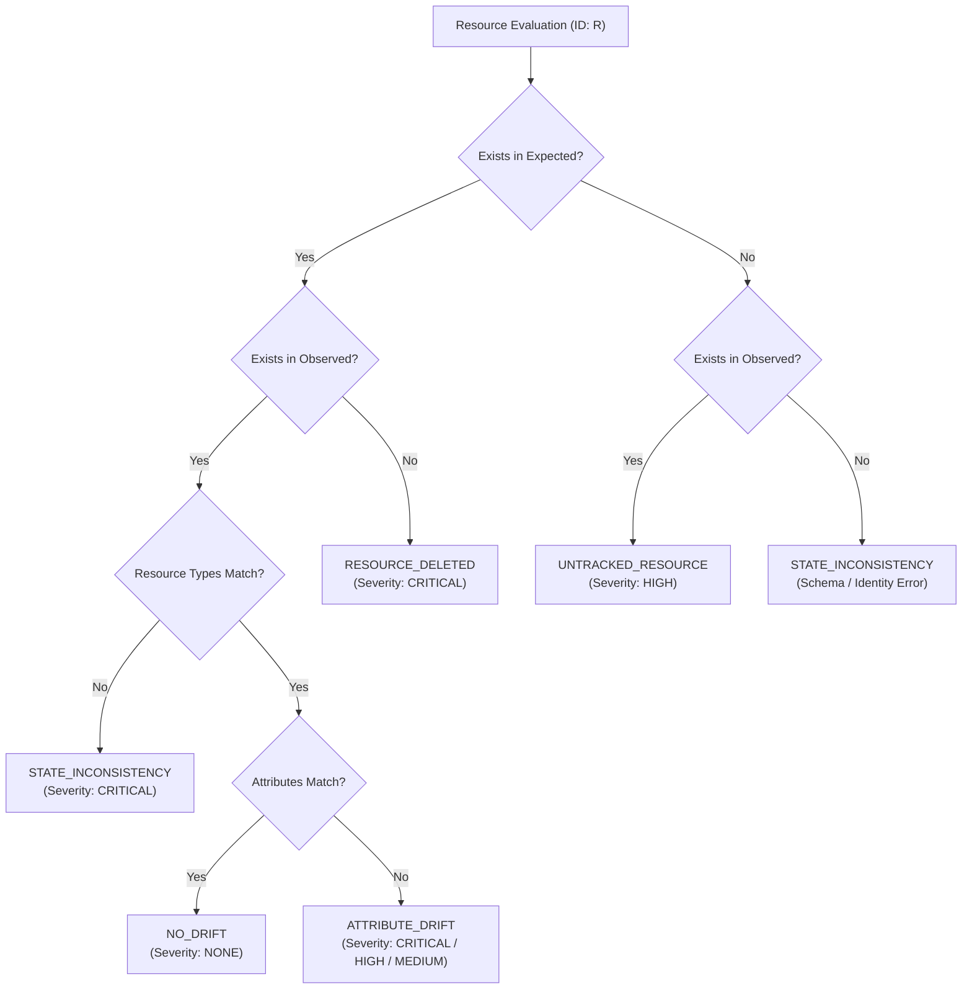

# InfraFlow G09.2 — Infrastructure Drift Detection & State Reconciliation Architecture
## Speculative Drift Simulation, Multi-Cloud State Normalization & Security Controls

**Platform Repository:** `TM-threemavithana/infraflow`  
**Milestone:** G09.2 — Continuous State & Speculative Drift Detection Simulation  
**Status:** IMPLEMENTED  
**Cost & Credential Boundary:** Strictly **$0.00 cloud spend**, **zero live credentials**, simulation & static analysis only.

---

## 1. Executive Summary

Infrastructure drift occurs when the actual runtime configuration of cloud resources deviates from the authoritative state recorded in version-controlled Terraform code and state files. Drift commonly arises from out-of-band manual console edits, emergency hotfixes, rogue scripts, out-of-band resource creation (shadow IT), or uncoordinated resource deletions.

In **Milestone G09.2**, InfraFlow introduces a provider-neutral, multi-cloud **Continuous State & Speculative Drift Detection Engine** implemented in [`scripts/simulate-drift.py`](../../scripts/simulate-drift.py). The engine compares expected infrastructure state ($S_{expected}$) against observed infrastructure state ($S_{observed}$) across AWS, Azure, and GCP resources, classifying deviations with mathematical determinism and feeding findings into the centralized compliance engine and telemetry bus.

---

## 2. Simulated Drift Detection vs. Live Cloud Drift Detection

A core architectural principle of InfraFlow is the separation of **Drift Detection Logic & Analysis** from **Live Cloud Credential Exchange**:

| Architectural Dimension | Simulated Drift Detection (G09.2) | Live Cloud Drift Detection (Production Runtime) |
| :--- | :--- | :--- |
| **Cloud Expenditure** | **$0.00** (Strictly zero cloud cost) | Subject to cloud provider API query costs |
| **Credential Requirement** | **Zero credentials** (No IAM, Entra ID, or WIF keys) | Requires authenticated OIDC read-only roles |
| **Execution Environment** | Offline local validation harness, pre-merge CI, PR checks | Scheduled out-of-band cron jobs on isolated production runners |
| **Determinism & Speed** | 100% deterministic, millisecond execution, zero network flakiness | Dependent on cloud API rate limits, network latency, and eventual consistency |
| **State Comparison Engine** | Normalized schema v1.0 comparison (`simulate-drift.py`) | Same normalized schema v1.0 comparison (`simulate-drift.py`) |
| **Adversarial Safety** | Safely tests malicious inputs (symlinks, secret leakage, corrupted schemas) | High risk if untrusted inputs are processed against live cloud APIs |
| **Safety Invariant** | **Zero modification**: Strictly read-only, no automated remediation | Strictly read-only; alerts human operators or queues speculative PRs |

### Why Simulation is Essential for Enterprise Platforms
1. **Pre-Merge PR Quality Gates**: CI/CD pipelines can evaluate how consumer repositories handle simulated state drift without requiring live cloud environments or exposing production credentials to pull request workflows.
2. **Adversarial Testability**: Security engineers can simulate severe scenarios—such as unauthorized public bucket ACLs, TLS downgrades, or remote database deletions—and verify that the platform alerts and scores appropriately, without risking production outages.
3. **Decoupled Architecture**: In live production, an ingestion adapter fetches live state via read-only cloud APIs and outputs a normalized JSON state snapshot. That snapshot is then analyzed by `simulate-drift.py` using the exact same logic verified in simulation.

---

## 3. Normalized Multi-Cloud State Representation

To eliminate cloud-specific state discrepancies, InfraFlow normalizes infrastructure resources across AWS, Azure, and GCP into a standardized Schema v1.0 structure:

```json
{
  "schema_version": "1.0",
  "state_source": "expected",
  "provider": "aws",
  "repository": "TM-threemavithana/infraflow-consumer-networking",
  "workspace": "prod",
  "timestamp": "2026-11-21T08:00:00Z",
  "resources": [
    {
      "resource_id": "aws_s3_bucket.state_bucket",
      "provider": "aws",
      "resource_type": "aws_s3_bucket",
      "attributes": {
        "bucket": "infraflow-networking-tfstate",
        "acl": "private",
        "versioning_enabled": true,
        "sse_algorithm": "aws:kms",
        "kms_master_key_id": "arn:aws:kms:us-east-1:123456789012:key/mock-state-key",
        "tags": {
          "Environment": "prod",
          "ManagedBy": "infraflow"
        }
      }
    }
  ]
}
```

### Supported Providers & Normalization Aliases
- **AWS (`aws`)**: Amazon Web Services resources (e.g., `aws_s3_bucket`, `aws_dynamodb_table`, `aws_security_group`, `aws_kms_key`).
- **Azure (`azure`, alias `azurerm`)**: Microsoft Azure resources (e.g., `azurerm_storage_account`, `azurerm_storage_container`, `azurerm_network_security_group`).
- **GCP (`gcp`, alias `google`)**: Google Cloud Platform resources (e.g., `google_storage_bucket`, `google_compute_disk`, `google_service_account`).

---

## 4. Drift Classification & Severity Taxonomy

InfraFlow evaluates every resource against six mutually exclusive, deterministic classifications:



### 4.1 Detailed Drift Classifications

| Classification | Definition | Example Scenario | Default Severity |
| :--- | :--- | :--- | :---: |
| **`NO_DRIFT`** | Resource exists in both states with byte-identical normalized attributes. | Terraform state matches live infrastructure perfectly. | `NONE` |
| **`ATTRIBUTE_DRIFT`** | Resource exists in both states, but one or more configuration attributes differ. | S3 bucket encryption modified from KMS to AES256, or TLS version downgraded. | `CRITICAL`, `HIGH`, or `MEDIUM` |
| **`UNTRACKED_RESOURCE`** | Resource exists in observed state but is completely absent from expected Terraform state. | Shadow IT: Engineer manually created a security group or VM outside Terraform. | `HIGH` |
| **`RESOURCE_DELETED`** | Resource exists in expected Terraform state, but does not exist in observed infrastructure. | Out-of-band deletion: Someone deleted an S3 bucket or DynamoDB lock table via console. | `CRITICAL` |
| **`UNKNOWN_RESOURCE`** | Resource contains an unsupported provider, malformed identifier, or invalid schema. | Unrecognized cloud provider or corrupted state syntax. | `HIGH` |
| **`STATE_INCONSISTENCY`** | Resource type mismatch under the same ID, cross-repository mismatch, or schema violation. | Expected resource is an S3 bucket, observed is an SQS queue under the same ID. | `CRITICAL` |

### 4.2 Attribute Drift Severity Engine
When `ATTRIBUTE_DRIFT` is identified, the severity is determined by analyzing the affected attribute paths:
- **`CRITICAL`**: Security-critical attributes compromised:
  - `sse_algorithm`, `kms_master_key_id`, `encryption`: Encryption disabled or downgraded.
  - `min_tls_version`: TLS downgraded (e.g., from `TLS1_2` to `TLS1_0`).
  - `allow_nested_items_to_be_public`, `acl`: Public accessibility enabled on storage.
  - `uniform_bucket_level_access`: Cloud storage IAM boundary removed.
  - `point_in_time_recovery`, `versioning_enabled`: Disaster recovery controls disabled.
- **`HIGH`**: Network and IAM boundary modifications:
  - `ingress`, `egress`, `cidr_blocks`, `security_group_rules`: Firewall rule expansions.
  - `role`, `members`, `ip_configuration`: Permissions and routing alterations.
- **`MEDIUM`**: Standard functional or configuration modifications:
  - Attribute changes to timeouts, performance tiers, descriptions, non-security toggles.
- **`LOW` / `INFORMATIONAL`**: Non-functional metadata modifications:
  - Non-security tags or labels updated.

---

## 5. Security Controls & STRIDE Threat Modeling

`scripts/simulate-drift.py` enforces rigorous security boundaries:

```
+-------------------------------------------------------------------------------+
|                       SECURITY DEFENSE-IN-DEPTH MODEL                         |
+-------------------------------------------------------------------------------+
| 1. Strict Schema Validation (v1.0 JSON schema, mandatory keys, valid ISO 8601)|
| 2. Explicit Symlink Prohibition (os.path.islink & is_symlink rejection)       |
| 3. Repository & Workspace Identity Binding (fail-closed on cross-tenant diffs)|
| 4. Automatic Sensitive Data Scrubbing (AWS keys, GitHub tokens, JWTs, passes) |
| 5. Zero Automatic Remediation Invariant (strictly read-only simulation)       |
+-------------------------------------------------------------------------------+
```

### 5.1 STRIDE Threat Assessment

| Threat Category | Threat Vector | InfraFlow Mitigation |
| :--- | :--- | :--- |
| **Spoofing** | Attacker compares production state against another tenant's state to infer configuration. | **Repository & Workspace Identity Binding**: `simulate-drift.py` strictly verifies that `expected["repository"] == observed["repository"]` and `expected["workspace"] == observed["workspace"]`. Mismatches raise `DriftSecurityError` (exit code 2). |
| **Tampering** | Rogue actor alters state files or symlinks sensitive host files (`/etc/passwd`). | **Explicit Symlink Check**: `os.path.islink()` rejects symlinks fail-closed before any read. Schema validation rejects malformed structures. |
| **Repudiation** | Lack of auditability regarding when drift was detected. | **Deterministic RFC 5424 Telemetry**: Generates canonical SHA-256 integrity digests for all `drift_detected` and `drift_assessment_completed` events. |
| **Information Disclosure** | Cloud credentials (AWS access keys, PATs, database passwords) leaked in diff reports. | **Multi-Tier Sensitive Secret Scrubbing**: All attribute diffs, values, and keys pass through regex sanitization, replacing secrets with `[REDACTED_AWS_KEY]`, `[REDACTED_GITHUB_TOKEN]`, or `[REDACTED_SECRET]`. |
| **Denial of Service** | Malformed JSON, massive recursion, or corrupted snapshot hangs analysis. | **Strict Schema Validation & Depth Limiting**: Schema version enforced to `"1.0"`, duplicate resource IDs rejected, timestamps validated. |
| **Elevation of Privilege** | Drift tool attempts to automatically execute `terraform apply` or delete resources. | **Zero Automatic Modification Invariant**: `simulate-drift.py` is strictly read-only; it emits reports and telemetry, never invoking Terraform apply or destroy. |

---

## 6. Integration with Platform Ecosystem

### 6.1 Telemetry Bus Integration (`scripts/emit-telemetry.py`)
`simulate-drift.py` integrates seamlessly with `emit-telemetry.py` to publish three standardized event types:
1. `drift_detected`: Emitted for each individual drifted resource with severity, affected attributes, and consumer context.
2. `drift_assessment_completed`: Emitted at the completion of an assessment, summarizing total resources evaluated, clean count, drifted count, and overall verdict.
3. `drift_assessment_failed`: Emitted fail-closed if security errors or validation violations occur.

### 6.2 Central Compliance Dashboard Integration (`scripts/generate-compliance-dashboard.py`)
Drift findings directly inform **Pillar 5 (Configuration & Drift Integrity, Max 20 pts)** in the Central Compliance Dashboard:
- **Clean State (NO_DRIFT)**: Consumer retains full Pillar 5 points with explicit recorded evidence: `"Infrastructure state: CLEAN (zero drift detected)"`.
- **Critical Drift (RESOURCE_DELETED, Security ATTRIBUTE_DRIFT)**: Applies a **10-point deduction** (floor at 0) with recorded evidence: `"Penalty: -10 pts for CRITICAL infrastructure drift"`.
- **High/Medium Drift (UNTRACKED_RESOURCE, Standard ATTRIBUTE_DRIFT)**: Applies a **5-point deduction** (floor at 0) with recorded evidence: `"Penalty: -5 pts for HIGH infrastructure drift"`.
- **Fleet Summary**: Central reports aggregate fleet drift metrics (`total_assessed`, `clean_consumers`, `drifted_consumers`, `fleet_drift_verdict`).
- **Backward Compatibility**: If no drift report directory is provided, Pillar 5 evaluates configuration/version drift as in G09.1, ensuring 100% backward compatibility for all existing tests.

---

## 7. Verification & Quality Invariants

- **Adversarial Test Suite (`tests/test_drift_detection.py`)**: 34 dedicated unit and adversarial test scenarios passing with 100% success.
- **Local Quality Validation Harness (`scripts/validate-local.sh`)**: Section 23 ("Continuous State & Speculative Drift Detection Simulation") incorporates 15 automated validation gates.
- **Safety Invariants Maintained**: Exactly **$0.00 cloud spending**, **zero live credentials**, **zero live API calls**, **no automatic remediation**, and **fail-closed security**.
