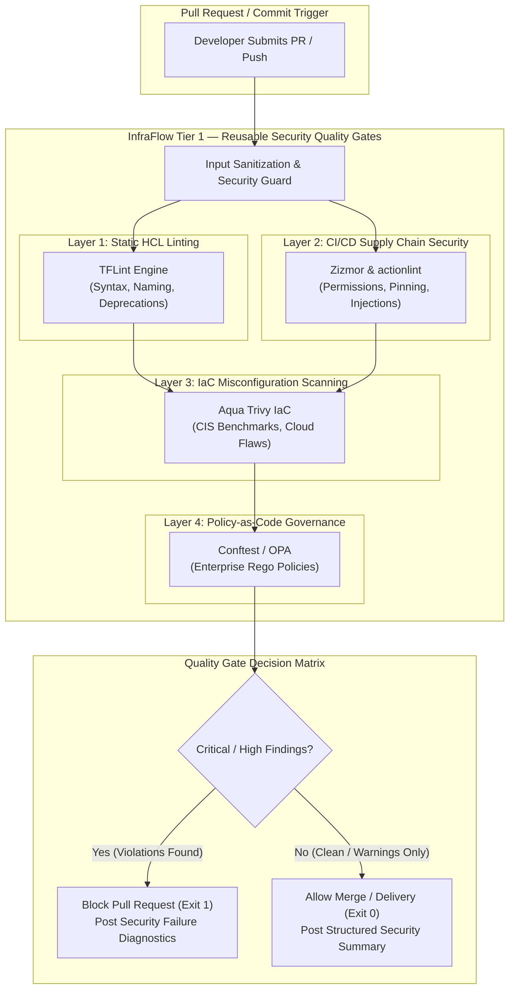

# InfraFlow — DevSecOps Security Architecture & Quality Gates

## 1. Executive Summary & Vision

**InfraFlow Milestone G03** establishes the automated **DevSecOps Quality Gate Architecture** across all Terraform delivery workflows. Modern cloud infrastructure delivery faces security risks spanning code defects, vulnerable third-party dependencies, insecure workflow orchestration, and enterprise compliance deviations.

To counter these risks without compromising deployment agility or imposing cloud credential exposure on pull requests, InfraFlow implements a **Defense-in-Depth DevSecOps Pipeline** consisting of four specialized, decoupled security layers:

1. **Static Analysis & Code Linting (`TFLint`)**: Validates Terraform syntax standards, naming conventions, deprecated constructs, and module best practices before runtime.
2. **Workflow & Supply Chain Security (`Zizmor` & `actionlint`)**: Analyzes GitHub Actions workflow configurations, detecting excessive token permissions, unpinned action dependencies, and expression injection vectors.
3. **Infrastructure-as-Code Misconfiguration Scanning (`Trivy`)**: Scans Terraform code against CIS benchmarks and cloud security best practices (e.g., exposed storage, unencrypted volumes, overly permissive firewall rules).
4. **Policy-as-Code Governance (`Conftest` / `OPA`)**: Enforces organization-specific architectural rules and regulatory standards across multi-cloud environments using declarative Rego policies.

---

## 2. DevSecOps Quality Gate Topology



---

## 3. Security Severity Levels & Failure Criteria

InfraFlow defines a strict, non-negotiable severity taxonomy aligned with CVSS v3 and cloud security frameworks. Every scanner in the platform must normalize findings to this taxonomy:

| Severity Level | Definition | CI/CD Quality Gate Action | Remediation SLA |
|---|---|---|---|
| **CRITICAL** | Direct exploitable vulnerability, credential exposure, or publicly exposed high-risk asset (e.g. S3 bucket public, unrestricted 0.0.0.0/0 SSH, unpinned action with write-all token). | **HARD BLOCK (Exit 1)**. Pull request blocked immediately. | 24 Hours |
| **HIGH** | Significant misconfiguration, lack of encryption at rest, insecure TLS configuration, or missing mandatory organizational security controls. | **HARD BLOCK (Exit 1)**. Pull request blocked immediately. | 7 Days |
| **MEDIUM** | Architectural deviation, missing non-critical tags, minor CIS benchmark deviation, or standard deprecation warnings. | **Advisory Warning**. Recorded in `$GITHUB_STEP_SUMMARY`. Can be configured to block in production pipelines. | 30 Days |
| **LOW / INFO** | Code style, variable naming convention notices, formatting nitpicks, or informational notices. | **Informational Only**. Logged in job telemetry without blocking. | Backlog / Opportunistic |

---

## 4. Provider-Extensible Policy Architecture

Policy-as-Code in InfraFlow is architected for zero vendor lock-in and modular multi-cloud scaling. Policies are stored in a dedicated root directory (`policies/`), completely separated from application and infrastructure modules.

### 4.1 Policy Package Hierarchy

```
policies/
├── common/             # Cloud-agnostic enterprise baseline
│   ├── tags.rego       # Mandatory tagging schema (Environment, Project, ManagedBy)
│   ├── tags_test.rego  # Unit test suite for common tag validation
│   ├── naming.rego     # Resource naming conventions
│   ├── naming_test.rego
│   ├── plan.rego       # Terraform plan JSON security checks
│   └── plan_test.rego  # Unit tests for plan lifecycle and unknown handling
├── aws/                # AWS Provider Adapters
│   ├── s3.rego         # Encryption at rest, block public access enforcement
│   ├── s3_test.rego    # Unit test suite for AWS S3 policies
│   ├── network.rego    # Security group unrestricted ingress restrictions (22, 3389)
│   └── network_test.rego
├── azure/              # Azure Provider Adapters
│   ├── storage.rego    # Storage accounts: TLS 1.2+, public blob access disabled
│   └── storage_test.rego
└── gcp/                # Google Cloud Provider Adapters
    ├── storage.rego    # GCS uniform bucket-level access enforcement
    └── storage_test.rego
```

### 4.2 Policy Evaluation Modes & Defensive Construction (G03.2 Hardened)
1. **Static HCL Evaluation (Pre-Plan / Fast Feedback)**:
   - Scans `.tf` configuration files directly using Conftest's HCL2 parser.
   - Evaluates resource definitions, blocks, and arguments before running `terraform init` or generating a plan.
   - Operates with zero cloud credentials and $0 runtime cost.
   - **Explicit Cloud Allowlists**: Enforces metadata tags exclusively on validated cloud resource types (`aws_taggable_resources`, `azure_taggable_resources`, `gcp_labelable_resources`).
   - **Zero False-Positive Invariant**: Resources that legitimately do NOT support metadata tags (such as `aws_route_table_association`, `aws_s3_bucket_public_access_block`, `azurerm_subnet_network_security_group_association`, `google_compute_network`, `terraform_data`) are excluded from allowlists and produce zero false positives when defined without tags.
   - **Defensive Attribute Access**: Uses `object.get(res, key, default)` and helper lookups to guarantee omitted attributes fail closed rather than evaluating to Rego `undefined`.
2. **Terraform Plan JSON Evaluation (Post-Plan / Deep Context)**:
   - Evaluates speculative execution plans (`terraform show -json <plan-file>`).
   - **Security Control Deletion Protection**: Standalone security controls (`aws_s3_bucket_public_access_block`, `aws_s3_bucket_server_side_encryption_configuration`, `azurerm_storage_account_network_rules`, `aws_s3_bucket_policy`) are strictly blocked from deletion while their protected parent asset remains active. Deletion is permitted ONLY when the target parent resource is also being decommissioned in the exact same plan.
   - **Safe Deletion Allowance**: Deletion of ordinary non-security infrastructure (`aws_instance`, `terraform_data`, `aws_ebs_volume`) is permitted without blocking.
   - **Replacement Actions**: Replacements (`["delete", "create"]` or `["create", "delete"]`) are evaluated against the proposed `after` configuration. Any replacement that strips security protections is blocked.
   - **Fail-Closed Unknown Attributes**: Speculative unknown values (`after_unknown`) on security-critical attributes (`acl`, `block_public_acls`, `min_tls_version`, `uniform_bucket_level_access`) are blocked, requiring explicit static declarations in source HCL.
   - **Malformed & Incomplete Plan Handling**: Rejects plans marked with `errored: true`, missing `resource_changes`, null `change` blocks, or missing `change.actions`.
   - Recursively evaluates module-contained resources (`module.*`).

> [!IMPORTANT]
> **Synthetic Plan Boundary**: Evaluating synthetic or offline Terraform plan JSON validates policy logic against planned state changes; it does not replace runtime cloud provider IAM boundaries or cloud control plane authorization.

---

## 5. False Positive Management & Non-Suppression Policy

Silent suppression of security alerts (e.g., blanket comments `#trivy:ignore:*` or unmonitored `--skip-check` flags) compromises supply chain integrity. InfraFlow enforces a **Strict Non-Suppression Policy**:

1. **No Blanket Ignores**: Global suppression flags or whole-file ignores are prohibited in reusable workflows and security configurations.
2. **Narrow Rule-Scoped Exceptions with Audit Trails**:
   Where a genuine architectural limitation or tool incompatibility arises (e.g. Zizmor flagging `uses: ./.github/workflows/...` under `self-repository` while `actionlint` strictly rejects the suggested `$/...` format), blanket suppression of the workflow is forbidden. Any permitted exception in `.zizmor.yml` must:
   - Suppress ONLY the specific rule ID (`rules.self-repository.ignore: ["ci.yml"]`).
   - Leave 100% of critical supply chain checks active (`unpinned-uses`, `artipacked`, `template-injection`, etc.).
   - Include documented rationale, compensating controls, and re-review triggers.
3. **Granular Inline Annotations with Audit Trails**:
   Where a genuine architectural exception or false positive is identified in code, it must be documented at the specific resource block with four mandatory fields:
   - `id`: Exact vulnerability / rule ID (e.g., `AVD-AWS-0089`)
   - `reason`: Technical rationale why the risk is mitigated or accepted
   - `approved_by`: Identity of the security engineer approving the exception
   - `expires`: ISO 8601 expiration date after which the exception fails CI
4. **Central Policy Exceptions**:
   Policy-as-code exceptions are managed through version-controlled data files in `policies/exceptions/`, enabling security teams to review, audit, and revoke temporary bypasses via standard pull request workflows.

---

## 6. Reusable Security Workflow Integration Model

To preserve backward compatibility with the G02 validation core (`reusable-tf-validate.yml`) while enabling independent security auditing, InfraFlow introduces **Tier 1 DevSecOps Reusable Workflows**:

- **`.github/workflows/reusable-tf-validate.yml`**: Continues to provide fast formatting check, backend-free initialization, static validation, and native testing.
- **`.github/workflows/reusable-tf-security.yml`**: Reusable security workflow encapsulating TFLint, Trivy, Conftest, and Zizmor. Can be run in parallel with validate or sequentially as a gating pre-condition.

Both workflows share identical input sanitization guards, 40-character commit SHA action pinning, and minimal token privileges (`contents: read`).
