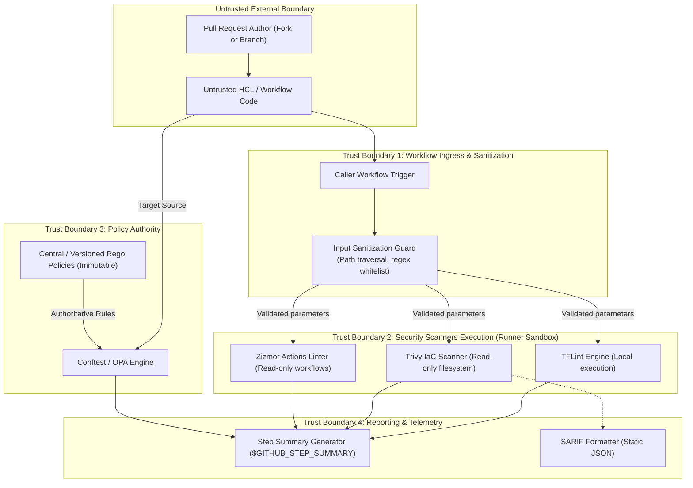

# InfraFlow — DevSecOps Threat Model & Supply Chain Security

## 1. Scope & Objective

This threat model extends the foundational STRIDE analysis established in G01 (`docs/architecture/THREAT_MODEL.md`) to encompass the **DevSecOps Security Scanning and Policy-as-Code subsystem** introduced in Milestone G03.

As CI/CD platforms integrate automated static analysis, vulnerability scanners, and policy engines, the security tooling itself becomes an attractive target for attackers seeking to bypass compliance gates, poison supply chains, or tamper with deployment artifacts.

---

## 2. DevSecOps Trust Boundaries & Data Flow

---

## 3. STRIDE Threat Analysis: Security Tooling & Supply Chain

| Threat ID | STRIDE Category | Threat Description | Attack Vector | InfraFlow Mitigation | Residual Risk |
|---|---|---|---|---|---|
| **T-SEC-01** | **Tampering** | Scanner Configuration Overwrite | PR author commits a local `.tflint.hcl` or `trivy.yaml` that disables critical rules or sets `--exit-code 0`. | Reusable security workflow enforces command-line severity gates (`--severity HIGH,CRITICAL --exit-code 1`) and overrides permissive local configurations. | **Low** (Hardcoded workflow CLI flags take precedence). |
| **T-SEC-02** | **Tampering** | Policy Definition Bypass | Attacker modifies Rego policy files in the caller repository to delete mandatory rules. | Policies are maintained in dedicated directories; in cross-repo setups, the reusable workflow pulls authoritative policies from the pinned InfraFlow release. | **Low** (Policy source decoupled from caller module). |
| **T-SEC-03** | **Elevation of Privilege** | GitHub Actions Expression Injection | Malicious repository branch names, commit messages, or scanner outputs interpolated into bash scripts (`${{ github.event... }}`). | Strict variable segregation: All dynamic outputs and scanner results are passed via environment variables, never inline script interpolation. Shell scripts execute with `set -euo pipefail`. | **Negligible**. |
| **T-SEC-04** | **Tampering / Supply Chain** | Compromised Scanner Action or Binary | Upstream action tag hijacked or release binary replaced with trojaned executable. | 1. All third-party GitHub Actions pinned to 40-character commit SHAs. 2. Tool binaries (TFLint, Trivy, Conftest, Zizmor) pinned to verified versions with cryptographic integrity verification where applicable. | **Low** (Full commit SHA verification required). |
| **T-SEC-05** | **Information Disclosure** | Token & Credential Leaking in Diagnostics | Scanners dump environment variables or runner memory into public build logs or SARIF reports. | Workflows operate under least-privilege tokens (`permissions: contents: read`). No cloud credentials or secrets exist in the job environment. Zero secret exposure. | **Zero** (No credentials present). |
| **T-SEC-06** | **Denial of Service** | Resource Exhaustion via Malformed HCL | Attacker submits deeply nested or recursive Terraform configurations causing parser hangs or runner OOM. | Strict workflow timeouts (`timeout-minutes: 15`), container memory caps, and fail-fast step ordering. | **Low**. |
| **T-SEC-07** | **Elevation of Privilege** | Policy Attribute Omission Bypass | In Rego, accessing undefined attributes yields `undefined`, so omitting `tags` or security flags (`block_public_acls`) can silently bypass naive `!= true` rules. | 1. Mandatory `taggable_resource` rule denies cloud resources omitting `tags` blocks. 2. Defensive attribute extraction via `object.get(res, key, default)` defaults omitted attributes to insecure states. 3. Native unit tests assert failure on omitted attributes. | **Negligible** (Attribute omissions guaranteed to fail). |
| **T-SEC-08** | **Tampering / Repudiation** | Parser Conflicts & Blanket Suppressions | Differing linter conventions (e.g. Zizmor suggesting `$/...` repo-relative workflow calls while Actionlint rejects `$/...`) lead engineers to blanket-ignore workflows (`ignore: ["ci.yml"]`), masking real security flaws. | 1. Zero tolerance for blanket file-level ignore rules in `.zizmor.yml`. 2. Narrowest possible rule-specific suppressions (`rules.<rule-id>.ignore: ["file"]`) with mandatory inline architecture justification, compensating controls, and re-review triggers. 3. Dual-linter verification in platform CI. | **Low** (All supply chain rules remain active). |
| **T-SEC-09** | **Elevation of Privilege** | Security Control Deletion & Perimeter Stripping | PR author submits a change deleting standalone security controls (`aws_s3_bucket_public_access_block`, `azurerm_storage_account_network_rules`, etc.). Because deleted resources have `after: null`, naive policies that ignore deletions permit stripping the security perimeter from active resources. | 1. `policies/common/plan.rego` tracks standalone security controls. 2. Pure delete actions (`actions == ["delete"]`) are blocked unless the protected parent resource is also being decommissioned in the exact same plan. 3. Regression fixtures verify enforcement. | **Negligible** (Orphan deletion blocked). |
| **T-SEC-10** | **Tampering / Elevation of Privilege** | Speculative Plan Attribute Evasion (`after_unknown`) | PR author delegates security attributes (e.g. `block_public_acls`, `min_tls_version`) to computed/dynamic outputs, resulting in `after_unknown` during speculative plan evaluation. Naive policies checking only `after` allow unverified plans to pass CI. | 1. Fail-closed policy evaluation: Any computed/unknown value on security-critical attributes is rejected. 2. Requires explicit static declarations in source HCL. 3. Regression fixtures assert rejection of unknown security attributes. | **Negligible** (Computed security flags fail closed). |

---

## 4. Policy-as-Code Trust Invariant

> [!CAUTION]
> **Separation of Policy Authority and Infrastructure Code**:
> The infrastructure code under review must NEVER dictate the rules by which it is evaluated. In production deployments:
> 1. Policy definitions are owned and approved exclusively by Platform/Security teams.
> 2. PR authors in consuming repositories cannot modify the authoritative Rego rulesets without dedicated security team approval.
> 3. Conftest runs in immutable evaluation mode where unauthorized policy overrides cause instant failure.
